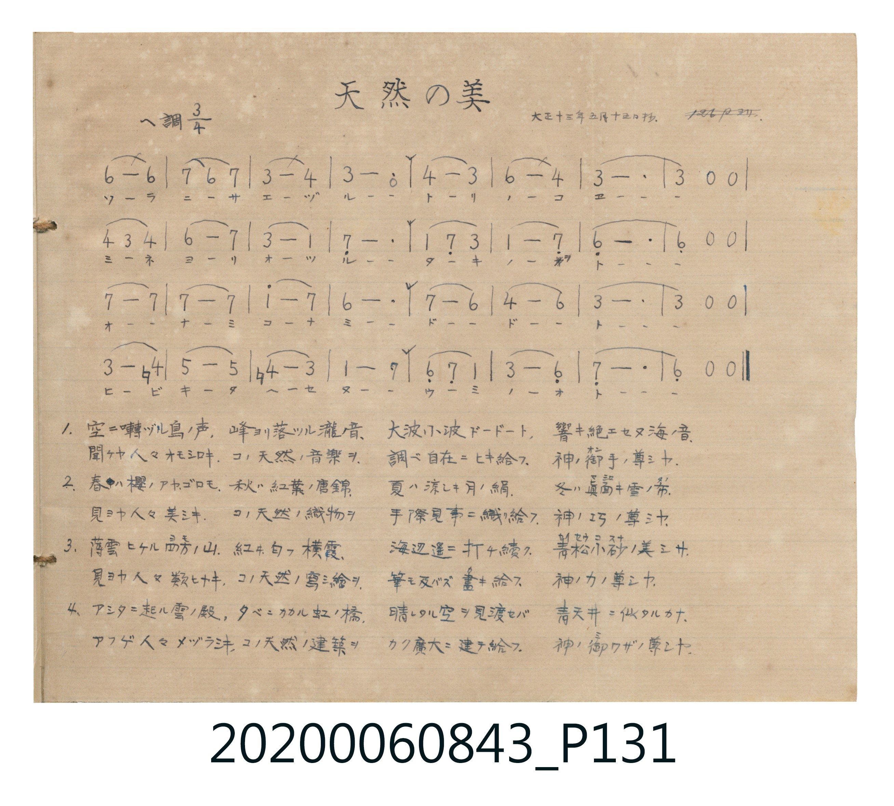

# 天然の美

> Re:Shoka 使用 AI 協助辨識與重建樂譜，可能會有錯誤。歡迎回報。

<audio controls src="tennen_no_bi.mp3"></audio>

- 詞：武島羽衣
- 曲：田中穗積
- 唱歌帳（2020.006.0843）P131.jpg（大正十三年五月十五日抄）

## 說明

原書資訊與歌詞全文（對應 P131.jpg，手抄簡譜單頁）：
調性與拍號：ヘ調四分之三拍子（關係小調 D 小調 3/4 拍）
抄寫註記：「大正十三年五月十五日抄.」

## 跨冊／重複收錄參照

> 同曲（武島羽衣作詞、田中穗積作曲〈美しき天然／天然の美〉；《唱歌帖》P104 與 P131）

- **[同曲]** 楊金土手抄《唱歌帖》第 2 冊・II（2020.006.0843）：[**〈美しき天然〉**](../../vol_02/p104_utsukushiki_tennen/index.md)（`F` / `3/4` — [原始 TMD](../../vol_02/p104_utsukushiki_tennen/utsukushiki_tennen.tmd)）
- 總表：[跨冊重複與同名歌曲總索引](../../../duplicate_songs.md)

## 歌詞

```text
1. 空ニ囀ヅル鳥ノ声、峰ヨリ落ツル瀧ノ音、
大波小波ドードート、響キ絶エセヌ海ノ音、
聞ケヤ人々オモシロキ、コノ天然ノ音樂ヲ、
調ベ自在ニヒキ給フ、神ノ御手ノ尊シヤ。

2. 春ハ櫻ノアヤゴロモ、秋ハ紅葉ノ唐錦、
夏ハ涼シキ月ノ絹、冬ハ眞白キ雪ノ布、
見ヨヤ人々美シキ、コノ天然ノ織物ヲ、
手際見事ニ織リ給フ、神ノ巧ノ尊シヤ。

3. 薄雲ヒケル四方ノ山、紅ヰ匂フ横霞、
海辺遙ニ打チ續ク、青松白砂ノ美シサ、
見ヨヤ人々類ヒナキ、コノ天然ノ寫シ繪ヲ、
筆モ及バズ畫キ給フ、神ノ力ノ尊シヤ。

4. アシタニ起ル雲ノ殿、夕ベニカカル虹ノ橋、
晴レタル空ヲ見渡セバ、青天井ニ似タルカナ、
アフゲ人々メヅラシキ、コノ天然ノ建築ヲ、
カク廣大ニ建テ給フ、神ノ御ワザノ尊シヤ。
```

## ABC

```abc
X:1
T:天然の美
C:曲：田中穗積
M:3/4
L:1/16
Q:1/4=96
K:Dm
V:V1 name="Vocal" snm="Voc"
[V:V1]
D8 D4 | E4 D4 E4 | A8 B4 | A12 |
B8 A4 | d8 B4 | A12 | A4 z4 z4 |
B4 A4 B4 | d8 e4 | A8 F4 | E12 |
F4 E4 A4 | F8 ^E4 | D12 | D4 z4 z4 |
e8 e4 | e8 e4 | f8 e4 | d12 |
e8 d4 | B8 d4 | A12 | A4 z4 z4 |
A8 =B4 | c8 c4 | =B8 A4 | F8 E4 |
D4 E4 F4 | A8 D4 | E12 | D4 z4 z4 |
D8 D4 | E4 D4 E4 | A8 B4 | A12 |
B8 A4 | d8 B4 | A12 | A4 z4 z4 |
B4 A4 B4 | d8 e4 | A8 F4 | E12 |
F4 E4 A4 | F8 ^E4 | D12 | D4 z4 z4 |
e8 e4 | e8 e4 | f8 e4 | d12 |
e8 d4 | B8 d4 | A12 | A4 z4 z4 |
A8 =B4 | c8 c4 | =B8 A4 | F8 E4 |
D4 E4 F4 | A8 D4 | E12 | D4 z4 z4 |
D8 D4 | E4 D4 E4 | A8 B4 | A12 |
B8 A4 | d8 B4 | A12 | A4 z4 z4 |
B4 A4 B4 | d8 e4 | A8 F4 | E12 |
F4 E4 A4 | F8 ^E4 | D12 | D4 z4 z4 |
e8 e4 | e8 e4 | f8 e4 | d12 |
e8 d4 | B8 d4 | A12 | A4 z4 z4 |
A8 =B4 | c8 c4 | =B8 A4 | F8 E4 |
D4 E4 F4 | A8 D4 | E12 | D4 z4 z4 |
D8 D4 | E4 D4 E4 | A8 B4 | A12 |
B8 A4 | d8 B4 | A12 | A4 z4 z4 |
B4 A4 B4 | d8 e4 | A8 F4 | E12 |
F4 E4 A4 | F8 ^E4 | D12 | D4 z4 z4 |
e8 e4 | e8 e4 | f8 e4 | d12 |
e8 d4 | B8 d4 | A12 | A4 z4 z4 |
A8 =B4 | c8 c4 | =B8 A4 | F8 E4 |
D4 E4 F4 | A8 D4 | E12 | D4 z4 z4 |
```

## TMD 檔案連結

- [主旋律 TMD 檔案](tennen_no_bi.tmd) [[在 TMD Studio 編輯](https://tmdlang.github.io/Tmd-TS/#tmd=s7IKdvYPcrWy4qpTUCpJTLdSSM7PyUlNLsnMz7MqzsjPTkzOyFeCS5bl55TmploBqXgDQ4RwcX5pUXJqfEFieqpVgKExhgzcpPi8_JLUpPz8bISKgqL8stS8xDygqtzEvNLi5KLMgpL45PyCSoSa1LLMlFSQitSUzJL8oszEHCQnpRYVgx0LcUNJUWIexAygIEJVSUYq0N15iSWlRalKXFpaCk-XrHzesu1x47rn-_oUtLS4FG0VLM247G0V3LiyUyttFVxyuWyM9U3sQCa8WDnv_Z5Zz9Yue7p52_N9e18sXAw2-NnsTUDh51M2PNmx9vnK6c9X9oKFn07Z-Gxtz9Mdm9_v6TAyMDLQMzAw0zOwMDF-v6cTFDh6WQXpQKmnS5Y_W7v4aW_jkx2dT3duebJryrM5HSAukDF96bOuFqByJS4ufS0FW2oBLgUFhad985_N3vFic_uLFV0vOtqBLgX67mnrimfT2kGO2tD7rL1TAeHMnmed3UC3PN-w8MXaOU-nrXu5oBHoLqC3QWa9WLX_WcNykCndvS9mzgeKPm6eARR8Onv20462Jzu7gV4DSj1dOwFo9Mvpc57sb3q6oR-oQMFFAcoABrECUAnQTJCBQJuerl_9YsXuFytmgExr6CEYSnqPG3q5QHoN9RSer9z1uLn76eyGx82tj5tXv9y89HFz39PFGx43ND7dvOFx84rHzateTNj7uLkFKPu8YTlQ9uX8zUBZkH5Q2AAt27wI6DIg-bi583HzHhjZAVT0cv7-x01rn2_d9rhpxeOm3Y-be55t3Y5uxIvGeY-bNj5uXvJk167HDa2Pm1Y9bl70uAmobi1QM1Dd46bNIEdBUh9Y87MVTY-bNyEZsWr_4-aZL9pXPZ0DdHD34-ZJYGuXPW6eClT0fOk8kP59C4ERA2Js6AKbvuRxQxM4GIz0FJ7NAPq7_9lqoBP7HjcBfbLkcdMWkAOALgEasByor__5ltYXE4F-63s6ZcLLnmXIYdAP0rxtD8jYprXA0AYqer51JygM29aAdM6Z93zmXqDUy9lAv_U93dGM5PRlQLOBjob6Hpi1IKZg-vv5zinPO1ei-BvooZezZgONeLILaEo3UAUwutD9vR0UaRieNtZTeDGt5eXsTeDAAgb_amASfDZtJ0jtxo0g3VuACWLD0x5gSE99tmLVyznzkOzduv3Fvl0vG2cCLX3WOflxc-PzXT2Pm9aDonzupGdz9wG9-3wBUGcfzD9bcfr45UKgKyc9bga6D4ungWkbqP_5TmC4Ifn7-do2YMw87e963DzhcdOu51OBijDiu2s2Nn-b6CmAIhjkJmCa6X4BSo-rwcHQ92zdflCULZkKTEugVNQENHU1UPbFTFCoPFvZjRQAM4GpYw3YiNXgLLQJ6KtnOxaCE_kESDAA_fBkF9Cs7id7gCkDpBJsXBfCFHBKm_q4aRM05TcvBOfClbhSwNPdu56vB6ZApJAAO3L9092LgRkRlJF3A93ShpnyHzevf9wENgI5PID6KS8hoUBBS5-LKyQ1Ly81zy_fKdMqLD85McehxqBGoRrsVBsTLTswA1vprPB8zZonOxpeLOxR0LAAlXPP1zfowItUTSwagLaBDKtRMItX0AURNQrm8SAaSNYoGAPFTKC0LpA2AZLGIMVo4sYKBkBYA04YuB22q4cch5kATQfZBbLTHGqnIcSZEMsNQUyQqwxBKtRB7gZ7BiQHZBDjsh2d5LjMHOoiGG0YB2WAnAqyHSRhBg02EE1ScAGLEXIcBY4ydSDDFMgwBVmuDo00cPBAQwdIg8IQpBgW52gBVsvFpWungEiICiTxlLkA)]
- [鋼琴伴奏 TMD 檔案](tennen_no_bi_piano.tmd) [[在 TMD Studio 編輯](https://tmdlang.github.io/Tmd-TS/#tmd=s7IKdvYPcrWy4tLSUni6ZOXzlm2PG9c939f3fk_Hy-49zydsebJny9Ol_c87O97v6VTQ0uJStFWwNOOyt1Vw48pOrbRVcMnlsjHWN7HjqlNQerFy3vs9s56tXfZ087bn-_a-WLhYCST8bPYmoPDzKRue7Fj7fOX05yt7wcJPp2x8trbn6Y7NQLuMDIwM9AwMzPQMLEyMgTYFGBob6mUVpAOlni5Z_mzt4qe9jU92dD7dueXJrinP5nSAuEDG9KXPulqAypW4uEJS8_JS8_zynTKtwvKTE3McagxqFKq5FIDAxkTLDsyoUTCLV9AFETUK5vEgGkjWKBgDxUygtC6QNgGSxiDFaOLGCgZAWAM1ygTIB8mCVJlDVRlCDIYoNwQxQeYYglSog2wCWw-SAzKQzTKHmgGjDeOgDJDhIPUgCTOo00A0dieBPaIOZJgCGaYg5epQr4CdAHUBkAa5E6QYFhJojqpFCc6AzMS8_CAPEgLUUBtkuJE2KHggbJDxID4wiIB8oMO0QT5DVwFiYQtiiGpwwIDVkhvMpuraoIAEU-g8M21woEN5xmAbQUZAVYEEYF4AOQefs-HRYKwNiggQSWRUmKrHa8M9ZhyvjS9GfHDGCNDQeG1jGAkyKB5mMpTCpgpTxChewQTsBgiJRQC7KchhQY4ZxLmXeF-hxA0WXeSGDzZ9RHoP2UmYKgyBCTpe2xRGAtMFUIl5fLw20HQoRVR8gWwCKtMGmgelcHsWns507RQQSU2BJJ4yFwA)]

## 分析

```text
================================================================================
📊 TMD Song Profile: [ 天然の美 ]
================================================================================
⏱  Duration:       4:00 (240.0s), 128 measures total
🎼 Key & Tempo:    首調基準 F, != 96.0 BPM, <3/4>
   - 分析範圍：      由實際發聲的音符與和弦推測調性；播放脈絡另行呈現
🎤 人聲音域:    D4 (MIDI 62) – F5 (MIDI 77) [跨度: 15 個半音 / 1.2 個八度, 難度: moderate]
   - 最低音:  D4 in [TennenNoBi #1 @ m.1, 0:00]
   - 最高音: F5 in [TennenNoBi #1 @ m.19, 0:33]
   - 適合: soprano, mezzo-soprano, contralto, tenor, baritone, bass
🏛  結構:      TennenNoBi (60.0s) -> TennenNoBi (60.0s) -> TennenNoBi (60.0s) -> TennenNoBi (60.0s)
⚡ 編曲密度:        Peak 1 軌道同時演奏
🗝  調性診斷：       D 小調（純淨自然小調，未偵測到可信轉調）
   - 風格氣質:    純淨自然小調（陰鬱抒情、旋律集中，無明顯調外色彩）
   - 轉調歷程:    全曲維持單一推測調性（未偵測到可信轉調）
   - 核心骨幹音:  A, E, D, F, A#
   - 調性數值:    D 小調 [相關度: 0.72, 穩定度: Moderate, 自然音純度: 96.6%]
   - 候選調性 (K-S): D 小調 (0.72), A 大調 (0.68), A 小調 (0.64)
   - 五度圈歷程:   +2 -> +2 -> +2 -> +2
   - 各段落調性細節:
     • [TennenNoBi #1]: D 小調 (r: 0.72, 自然音純度: 96.6%, 調外音: B)
     • [TennenNoBi #2]: D 小調 (r: 0.72, 自然音純度: 96.6%, 調外音: B)
     • [TennenNoBi #3]: D 小調 (r: 0.72, 自然音純度: 96.6%, 調外音: B)
     • [TennenNoBi #4]: D 小調 (r: 0.72, 自然音純度: 96.6%, 調外音: B)

  [ 五度圈游移軌跡 ]
               C  
         F            G  
      Bb              [D ]*
      Eb               A  
         Ab           E  
            Db       B  
               F# 
     (* = active key center)

  [ 十二半音累積音高分佈 ]
     C  : ███                        3.4%
     C# :                            0.0%
     D  : █████████████████████     22.7%
     D# :                            0.0%
     E  : ██████████████████████    23.9%
     F  : ██████████                11.4%
     F# :                            0.0%
     G  :                            0.0%
     G# :                            0.0%
     A  : ████████████████████████  26.1%
     A# : ████████                   9.1%
     B  : ███                        3.4%
--------------------------------------------------------------------------------
Assignment 軌道音域：
  - Vocal         : D4 – F5 (15 個半音 / 1.2 個八度, 228 個音符)
================================================================================
```


## 原書掃描頁




