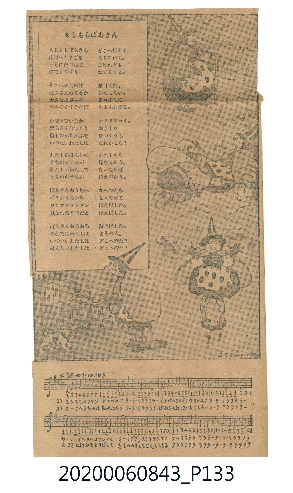

# もしもしばあさん

<audio controls src="moshimoshi_baasan.mp3"></audio>

- 日治時期公學校《唱歌帳》（典藏號 2020.006.0843・P133）
- 國立臺灣歷史博物館典藏

## 說明

【曲目說明】
・出處：《唱歌帳》（國立臺灣歷史博物館典藏號 2020.006.0843）第 P133.jpg 頁。
・調性與拍號：ト長調（G 大調，原頁文字誤記「ニ調四分ノ四拍子」，五線譜調號為 1♯ 且首音 G4 標為 1），4/4 拍。
・背景與曲風：頁面愛惜地剪貼了附有 B.C. Burnside 插畫之報紙童謠〈もしもしばあさん〉（喂喂老婆婆），
下方手抄五線譜與數字簡譜。歌詞以孩童與九十九歲老婆婆的幽默對話，祝賀百歲長壽。
・版本說明：本檔案為原頁手抄單聲部旋律之忠實數位化版本。

・編曲說明（鋼琴伴奏版）：
1. 前奏 (Intro, 4 小節)：引用結尾樂句「あかちゃんになったら おっぱいあげましょ」，營造輕快俏皮的童謠氣氛。
2. 主歌伴奏 (Song, 16 小節)：右手演奏童謠主旋律，左手以輕快的低音與和弦分解伴奏。

## 歌詞

```text
【原頁歌詞全文與中文語譯】（對應 P133.jpg）

もしもしばあさん　うめぼしばあさん
あなたのおとしは　いくつです
わたしはことしで　九十九になるよ
それならばあさん　おめでたい
ことしで九十九なら　百まで一ツ
らいねんうまれりゃ　あかちゃんだ
あかちゃんになったら　おっぱいあげましょ
那樣的話老婆婆真是恭喜呀！今年九十九歲的話，離一百歲只差一歲；
明年重新投胎出生的話就是小寶寶了，變成小寶寶的話就餵您喝奶奶吧！）
```

## ABC

```abc
X:1
T:もしもしばあさん
M:4/4
L:1/16
Q:1/4=108
K:G
V:V1 name="Piano" snm="Pia"
[V:V1]
G2 A2 B2 c2 d2 d2 d2 d2 | g2 g2 g2 g2 e4 z4 | d8 B8 | A2 G2 A2 B2 G4 z4 |
G2 A2 B2 c2 d2 d2 d2 d2 | g2 g2 g2 g2 e4 z4 | d8 B8 | A2 G2 A2 B2 G4 z4 |
g2 g2 g3 g g2 g2 g3 g | g2 g2 g3 g g4 z4 | g2 g2 g2 g2 f2 f2 f2 f2 | e2 d2 e2 f2 d4 z4 |
G2 A2 B2 c2 d4 d4 | g4 g4 e4 z4 | d8 B8 | A2 G2 A2 B2 G4 z4 |
```

## TMD 檔案連結

- [主旋律 TMD 檔案](moshimoshi_baasan.tmd) [[在 TMD Studio 編輯](https://tmdlang.github.io/Tmd-TS/#tmd=s7IKdvYPcrWy4tLSUnjc1PS4cTqUbNzwuBHImPq4abKClhaXoq2CoYEFl72tgjuXjYm-iR1XnYLSs-lLn23a_Wxm07M585-2rnm6dsezBQsfN3Q9nbLx2dqepzs2P27ofr-n42nrjhfT-1_MnK9gZGBkoGdgYKZnYGFi_Lh5d4ChsfH7PZ1KIMOezul-vrr7Rfuu542Ln63d_rR_09PeWc87V75csgJigBIXl76Wgi21AJeCgsLjhgnPZm96Pnvdi1Wrns3oe9wwESzavPtp-64XM6e-3zMLi28IuRPDo0AfPl-zRgHkWb2sgnSFlwsaHzc0QW16sWr_s4blLzran3X3AnWCrGzueDl1O1AcaJm7wtMly8HMnqd984Ean01rf7p2-otVS16smPG4oedxczdQ9uns2U872h439wEZQGOerp3wuKEXqOXJrinPt896sXYOUA3Q7OdNuxQMH81cr_Bkx5SXy6a9nL9Zwd1E4dmKmWAJoCuBWoBRqwA0Asl9zT3PZq4HuW_2ppeLVgDdB3TFy7mLnrXMftY85-mcDU87V73YtOfJrraXM1uezelUcNJz1lNwKi3KK85MSVV41j_p-dTVT3Z2P12w8fmWmc9XL32xZsHjhg5cae1xA9AVHU-nNQHRi4bGpyvbgAjiNJCDFIBu7342beezzu5nXS0I_wGdN3UHMGCeb1gI5AJdD4yxFyvnPdm99OnalSBLO9qf7Jz7tLcRSD5buwlu8vNZLU937n25e8bTDb0vVm4E2vJ86dwXmxuez9wHVAaMhqeL9yLC4nlnx7M5ayBpBRgQQPazVVOeLewAhh80dsDOejpt3YvGTS-bVzyb3v10XzfI8_sXPF2_DOjEJ3t7n_ZMg5gDMheaCKG6wW5-2roCGMkgB-9YC2Ksmvdi7XpgygQFy4beZ-2d8IQEDBaIATjDsuFxY9vjpsbHjXvQpMDaQJxVjxvnP25c97ix63HjCrAioF1AbS2PG_sfNy553Lj8ceNMiCVAPlApWEXjZJjq5UDV8JB93LgaZGJT9-OmDogNcx839YCFOjEc1gV2GNB4oKEtENUIU5GMBGtuAMXI40YgWv5kR8PjZogGkKlAh64FGQn0KFAaaFsT0OBmsA1A27ofNy4EcUEKFsA9jSwKdnHjYpAzwPaAQwLI3Qg2Gqh4EthaYPC2g_QDYwESI8D4R0uljxsaX7bueLao9cnOfUhJt-fF6u6nU_ufNa14srvr6c4tT3eCktbTiYve75n_rGMiVHDDxhfLGp_t3o-cSp_OBjoInPYUFF42LX62YjEwuQJTKSL1zpn_bMb6Z41rn06b83Riw_s9jRDTkA2BaAE64-XsRcCggyTsp_2rnm5fB-QC2e_3zIZYAUzUQL0v23ufTdvwrGvqC2BxAizkpsyHmAB0IdCupxv6n67fBkTA_A7y2rquZx0T4IJwlS-XbAX69-m0uU-XbgOhCcuBbgMlV6A1lJfcUKCgpc_FFZyfl24VkJmYl-9QY1CjUA32io2hmZYdmAWsMID5Ahjr0xF04wZQKgDiqUCxyQo1QFYbkNUIpPfAVIAUGIClgIqagcIwDNSAzAepABm1CojnA_E6IO4C6gQ6DWR9jYKhgq6CERAbA7EJEJuiYaCKOCCFRpgBMQgaQOkasFpkCDIPGdaAbUG2DcRGMQNcVoBDpHEF1J_rgbgFiPuBeAkQLwfimSBPNYFEQB6CqZoMDQ6gTuTgAMmjBAcw0SkA0x6YBmYucNAM-uAAxik8SJajeWEVODg6FYAZB8gDYaCKHQ2Q4ACKQwJwLSRlgBISSE1TDxCDyiF4AukGYlCZA1W3ACVQUH0LprCJ4VGJGjrYwtAcDdeAQxUUjiAaJAILU2whhMULwLgFpwBQ6QnPC8AkA84lwHABS4LKUmjK2YiWcoDBhiUjTYIGMqi8BYcngcQDgjAa6nFouEAYtEk6tVxcunYKoLJHAUgrcwEA)]
- [鋼琴伴奏 TMD 檔案](moshimoshi_baasan_piano.tmd) [[在 TMD Studio 編輯](https://tmdlang.github.io/Tmd-TS/#tmd=s7IKdvYPcrWy4tLSUnjc1PS4cTqUbNzwuBHImPq4afL7PR0vu_c8n7DlyZ4tT5f2P-_seL-nU0FLi0vRVsHQwILL3lbBncvGRN_EjqtOQenZ9KXPNu1-NrPp2Zz5T1vXPF2749mChY8bup5O2fhsbc_THZsfN3QDTXzauuPF9P4XM-crGBkYGegZGJjpGViYGD9u3h1gaGwMtEAJZNjTOd3PV3e_aN_1vHHxs7Xbn_Zveto763nnypdLVkAMUOLi0tdSsKUW4FJQUHjcMOHZ7E3PZ697sWrVsxl9jxsmgkWbdz9t3_Vi5tT3e2Zh8Q0hd2J4FOjD52vWKIA8q5dVkK7wckHj44YmqE0vVu1_1rD8RUf7s-5eoE6Qlc0dL6duB4oDLXNXeLpkOZjZ-X5PDzDcFYDKgKyXDfOf7lqmAIkVhGHPt68A-gfiGaxRCTQepFRBwVBP4WlnL1BcQcMzr6QoX0fBROHphv7n6xs0gWqe7pn6fMqK51snPN2w79mKpqf9Sx839IATSffjxoWPm5qBSeVx4-rHjaseNy5-3Dj_cVOnwuPGLjBn4-PGFrDSSY8b94ETWfvjBpCbn7fPf9mw4MWeqU_3r36yv__5rHXPZ7U8X730xZoFzzYsfrZhNtQfCgpGegpPduwGBjrE6Qoawfl56ToKhmbITuzf_Kyz-9meKSC_gQ0BaZne_XQfMJJ6nm5fBpR9snspxDqgRU_29r2cvxkYzk8n9Tzds-xpR9uL5Ysh5kPtpTxJQYGClj4XFzhUrQIyE_PygzwcagxqFKrBnrMxNNOyA7NqFAwVdBWMgNgYiE2A2BSIQRBGA1XEQZlwhhmUNoCrgamGQZBpyLAGbAeyXSA2ihlctSgO9kFxsAnCvfEK0YaxCqYQqkbBBMgwiQVRBghZKAV0F5BhCuYDZUE2gGIRb4gAszcooxg-apgMS42gsMQdWMgYGlhoBG2CC9m1pkDXWgwZ11oCXWtohOlcVHeAKWxieFSiuhub78zRcA3YvyAfgmiQCMy32N1uaAxyPKwQwB_WIDgg2QiRyGmRi2hlAkIPkglQjUCPAxlGYD513AAMJl07BXCBowBkgIIMRCtzAQA)]

## 分析

```text
================================================================================
📊 TMD Song Profile: [ もしもしばあさん ]
================================================================================
⏱  Duration:       0:35 (35.6s), 16 measures total
🎼 Key & Tempo:    首調基準 G, != 108.0 BPM, <4/4>
   - 分析範圍：      由實際發聲的音符與和弦推測調性；播放脈絡另行呈現
🎤 人聲音域:    G4 (MIDI 67) – G5 (MIDI 79) [跨度: 12 個半音 / 1.0 個八度, 難度: easy]
   - 最低音:  G4 in [Song #1 @ m.1, 0:00]
   - 最高音: G5 in [Song #1 @ m.2, 0:02]
   - 適合: soprano, mezzo-soprano, tenor, baritone
🏛  結構:      Song (35.6s)
⚡ 編曲密度:        Peak 1 軌道同時演奏
🗝  調性診斷：       G 大調（純淨自然大調，未偵測到可信轉調）
   - 風格氣質:    純淨自然大調（陽光明朗、易唱易記，無明顯調外色彩）
   - 轉調歷程:    全曲維持單一推測調性（未偵測到可信轉調）
   - 核心骨幹音:  G, D, B, A, E
   - 調性數值:    G 大調 [相關度: 0.95, 穩定度: High, 自然音純度: 100.0%]
   - 候選調性 (K-S): G 大調 (0.95), D 大調 (0.63), G 小調 (0.59)
   - 五度圈歷程:   +1
   - 各段落調性細節:
     • [Song #1]: G 大調 (r: 0.95, 自然音純度: 100.0%)

  [ 五度圈游移軌跡 ]
               C  
         F           [G ]*
      Bb               D  
      Eb               A  
         Ab           E  
            Db       B  
               F# 
     (* = active key center)

  [ 十二半音累積音高分佈 ]
     C  : ██                         2.7%
     C# :                            0.0%
     D  : ███████████████           24.1%
     D# :                            0.0%
     E  : █████                      7.1%
     F  :                            0.0%
     F# : ███                        4.5%
     G  : ████████████████████████  37.5%
     G# :                            0.0%
     A  : █████                      8.0%
     A# :                            0.0%
     B  : ██████████                16.1%
--------------------------------------------------------------------------------
Assignment 軌道音域：
  - Piano         : G4 – G5 (12 個半音 / 1.0 個八度, 82 個音符)
================================================================================
```


## 原書掃描頁




