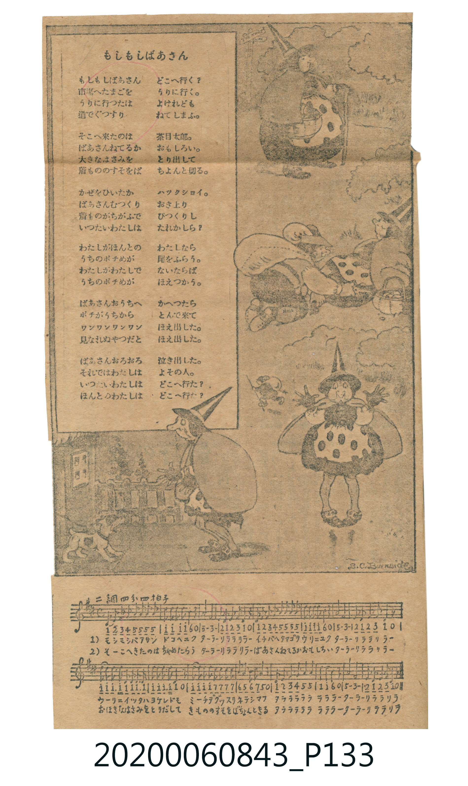

# もしもしばあさん

> Re:Shōka 使用 AI 協助辨識與重建樂譜，可能會有錯誤。歡迎回報。

- **鋼琴伴奏版**：<br><audio controls src="moshimoshi_baasan.mp3"></audio>
- **NEUTRINO 歌聲合成版**：<br><audio controls src="moshimoshi_baasan_neutrino.mp3"></audio>

- 日治時期公學校《唱歌帳》（典藏號 2020.006.0843・P133）
- 國立臺灣歷史博物館典藏

## 說明


- 出處：《唱歌帳》（國立臺灣歷史博物館典藏號 2020.006.0843）第 P133.jpg 頁。
- 調性與拍號：ト長調（G 大調，原手記題「二調四分ノ四拍子」，五線譜調號 1♯、主音 G4 標 1），4/4 拍。
- 背景與曲風：頁面剪貼了 B.C. Burnside 插畫之報刊童謠〈もしもしばあさん〉，取材自著名鵝媽媽童謠（Mother Goose）
"There was an old woman, as I've heard tell, she went to market her eggs for to sell..." 之日語譯詩。
下方由楊金土手抄五線譜、工整數字簡譜及兩段手抄歌詞與合唱伴唱副歌「タラララララ…」。
- 版本說明：本檔案為原頁手抄雙段歌詞與旋律之忠實數位化版本。
【原頁手抄歌詞全文】（對應 P133.jpg 下方五線譜手抄文字）


## 歌詞

```text
（一）
もしもしばあさん　どこへ行く？　ターラーリララリラー
市場へたまごを　うりに行く　ターラーリララリラー
うりに行つたはよけれども　道でぐつすりねてしまふ
タラララララ　ラララーターラーリララリラ

（二）
そこへ來たのは　茶目太郎　ターラーリララリラー
ばあさんねてるか　おもしろい　ターラーリララリラー
大きなはさみを　とり出して　着もののすそをばちよんと切る
タラララララ　ラララーターラーリララリラ

【剪貼報紙刊載原作後續詩節】（P133.jpg 上半部剪報印刷文）
（三）
かぜをひいたか　ハックショイ。
ばあさんむつくり　おき上り
着ものがちがふで　びっくりし
いつたいわたしは　たれかしら？

（四）
わたしがほんとの　わたしなら
うちのポチめが　尾をふらう。
わたしがわたしで　ないならば
うちのポチめが　ほえつかう。

（五）
ばあさんおうちへ　かへつたら
ポチがうちから　とんで來て
ワンワンワンワン　ほえ出した。
見なれぬやつだと　ほえ出した。

（六）
ばあさんおろおろ　泣き出した。
それではわたしは　よその人。
いつたいわたしは　どこへ行った？
ほんとのわたしは　どこへ行った？
```

## ABC

<div class="abc-score" data-abc-src="moshimoshi_baasan.abc" aria-label="五線譜載入中"></div>

[下載 ABC 原始檔](moshimoshi_baasan.abc)

## TMD 檔案連結

- [主旋律 TMD 檔案](moshimoshi_baasan.tmd) [[在 TMD Studio 編輯](https://tmdlang.github.io/Tmd-TS/#tmd=s7IKdvYPcrWy4qpTUCpJTLdSSM7PyUlNLsnMz7MqzsjPTkzOyFeCS5bl55TmploBqXgDQ4RwcX5pUXJqfEFieqpVgKGxMboM3KT4vPyS1KT8_GyEioKi_LLUvMQ8oKrcxLzS4uSizIKS-OT8gkqEmtSyzJRUkIrUlMyS_KLMxBwkJ6UWFYMdC3FDSVFiHsQMoCBCVUlGKtDdGaW5-UXogmn5Odk5-UWpCHGgDemZeVYliZlAd8en5FcihUB-UUlGfnpRYkFGpVVGZjHINcmJOfHZiXmJSlxaWgqPm5oeN06Hko0bHjcCGVMfN01W0NLiUrRVMDSw4LK3VXDnsjHRN7EDmfps-tJnm3Y_m9n0bM78p61rnq7d8WzBwscNXU-nbHy2tufpjs2PG7rf7-l42rrjxfT-FzPnKxgZGBnoGRiY6RlYmBg_bt4NCvD3ezrBTnw6p_v56u4X7bueNy5-tnb70_5NT3tnPe9c-XLJCogBSlxc-loKttQCXAoKCo8bJjybven57HUvVq16NqPvccNEsGjz7qftu17MnPp-zywsviHkTgyPAn34fM0aBZBn9bIK0hVeLmh83NAEtenFqv3PGpa_6Gh_1t0L1Amysrnj5dTtQHGgZe4KT5csBzN7nvbNf9bZ_WLFjJcLex439DzZ1QMUfzp79tOOtsfNfUAG0ICnayc8bugFKn6ya8rz7bNerJ0DVANyj-GjmesfNzQ-2bH75fzNCu4mCs9WzFQwBDoMqBYYmwpAvUhOau55NnM9yEmzN71ctALoJKCLX85d9LRz1YtNe57salNw0nPWU3AqLcorBiZuhWf9k55PXf1kZ_fTBRufdnQ9X730xZoFjxs6cKWnxw0ga5_2T3s2d8KL9lUvJk5_OqH35da5T1ftBSKIdqDfffOBibxIwT0_vzgV6FKQ4xQUlEKAYqkK5YnFCol5Cvk5KQrl-cC8p6MAFPBUL0tVyEhNLEpRKEnNydFRKM4AqkzNK1EoyVfITSzKTi0BShcppKanFyuk5ReBhIuBCvX09JQUgM4HJucXq-a9WLv-xcqV0NBQUHiyo_vZtJ3PgWlgadfL9olP54Bi4VlXCzyEgcH6dPvSZ1O3PJu64-na6c83LAQKPu3vetq68tm6rRDFwPTzYuU8YIg-ndABTE5P9mwBkk871wPFgVH5uGn_4-aVyOhRwzJgPCJi5Hlnx7M5ayCJFBgdQPazVVOeLex43rQLmCyAsQOx5uXsmSArYZY9m979dF83KF72L3i6fhnQfU_29j7tmQYxDWQ6NA8gmwHR_bR1xbNp7cD8AErwG3qftXciki8kROD-h2qb1g70PCiaQGYCdT3Z0QCNNNzJoOFx48rHjZMfN-54AUzTjf3v98wHCYKCYw84IIDkKligQBh7QCY-3dH0dMEWoLbHjfMfN-573DjlcdMksHFtj5u6HjeuhhhHlFmoepaATVz_uKnjcePEx01AkZUghzc0vAQ5c_njxglgNTPBWtY-blwG9hPQBVshPkWPSJATENw9eJwDD7ddPbBwa5wLCZwn-9rAzloHcllDw4uebcAS6-mSVS-bgSUWUV5ECnSIq5u6Hzd2g0OsCxY9vY8bW4gL_SXAcACqXgVyDtDQxv2w0F8BDBZgyQkOE2ACbng-F2gc0HSgw4FoJshDQJUg1ywEhTDINSuedrQDXUOV0AOlZHARBSyHnm-ZCSyKXuzpBKbtJ3vnPN3X8xxYYK5c-Xx9AyRVIyXnrqe9XS-bVwD1ggqw3g1PO7YDkzM0FsBJGVheQaMEGG5zwJ7YBAouUKyAg7G5_3Fz8-MmYMLZ_rh5-eOmJbC8ixz0TcAgAiaeflDigQR9Yy_QdiAXpBQpsIDJbiGY3ApKcyClmx83LobqbJwOMRhoOyS1tjxu6gczgKEOSh8gNijlAp0KjFag0-fD0hawkoDnSbgWoMrdkKgA2Q1KAHCpVUDtsDwCctG6x81zHzc3Pm5qBGlraHi6YR84LLYC1YHUQP2MbDaCDfEIMNEAHQ4yGBg0-MwGuaoRmAuBfgR6BGw2PIdMgUcHcsIGBg3EqB1g7UBdwPIBHERQX0AsAHkYoq4b5ApougXlbnA-WwZRuv5x82YsJMxdsFQOLK_Afn6xDGgd0FdAs9c8boJEzQKQwVg1wKKjdS0Oj4AyI5hsaHi2GRjxvej2gbMS0DJgTgSmOdToB5VdwJJj3ZNdu-Cq8SQW5BIYaBWwBTIfogcpVRCph_JGGRQoaOlzcQXn56VbBWQm5uU71BjUVIOrYxtDMy07MAtbU1AB2MwC1jtAZylomCg83dAPzO068IpLE4sGoD0gw2oUDBV0FYyA2BiITYDYFA0DVcQBKTTCDIhB0ABK14DVIkOQeciwBmwLsm0gNooZYBf5GNYAU-EiIB9YpIBIFPYEMBsishUsshls9uPmTrAYiPe4eQaYvQJMroeaHg93B7A0RXMbsBzFcC2weIXLwEiECIqJEHcbAfU0zoWZ2DgZ4ZLGXjA5H0yuA5MgV4HUA6uDZrAzGxFKmsBeaWyjg8PxJyhgvTFcElTTEnAIgEMZkoigiQQUoo-b54HZW8DsTZBQbFqGFHLdYBIsQucEtQGkorEJTE4F2w9OWI1rwSTERWDXNYJIkI4usBhEx3QwG5L8WujgbgIFVCdZ6Qk1oYApbGJ4VKIkCqzJzxwN14ATJCgJgmiQCCw5YktcoGiABB8oYCAJBpbkINkbEtDA1hI4QEElE5jftBEqvgZagqFFUDOoQICoACVdEN0O1AVOFFCTd8LtBakHR3UzqOiAlZjgpN0MSjq4khg4wTTuBpMg_SB6FbSMgia6Rqj7myaBkxikZIXoWwDVMR2aHNF8ACn7oMkRUvZByJlgElRegkwFsUG-AvmhEdiQBDsaUph3gJWA03vzagxv4E1xwGYftUowEITR0CQETWEQBq3LL0g5hZwHESQkYcBYoCDEFMWSW2lZbg0R99ZycenaKYDaW9E-hrEKcLYRmK3MBQA)]
- [鋼琴伴奏 TMD 檔案](moshimoshi_baasan_piano.tmd) [[在 TMD Studio 編輯](https://tmdlang.github.io/Tmd-TS/#tmd=s7IKdvYPcrWy4qpTUCpJTLdSyC8qychPL0osyKi0ysgsLskvykxOzInPTsxLVIIrKs4vLUpOjS9ITE-1CjA0NkbIlGSk5qZaZZTm5hehC6bl52Tn5BelIsSBZqdn5lmVJGYWZ-THp-RX5iPkUssyU1LzklOtUlMyQY5IzEHIlaUWFWfm51kVZCbm5ccnFhUl5qUDbcgrUeLS0lJ43NT0uHE6lGzc8LgRyJj6uGny-z0dL7v3PJ-w5cmeLU-X9j_v7Hi_p1NBS4tL0VbB0MCCy95WwZ3LxkTfxA5k0bPpS59t2v1sZtOzOfOftq55unbHswULHzd0PZ2y8dnanqc7Nj9u6Aaa-LR1x4vp_S9mzlcwMjAy0DMwMNMzsDAxfty8GxQuQAvArn46p_v56u4X7bueNy5-tnb70_5NT3tnPe9c-XLJCogBSlxcnnklRflWASAvBXk41BjUVHMpAIGNhZYdmFGjYKhgpGCsYKJgqqALxkCROCAFJsyA2AAsBpIBQWMoXQPUBdFpCFPDVYtinQ-ydSYI6-IVog1jFUwhVI2CCZBhEguiDBCyUApoLZBhCuYDZUEWBOfnpWPxjqEZ1AJ9LQVbdKDwfM2aJzsaXizsUdAwUXi6of_5-gYdBVBI6mUVpGti0aClDw8cXaAnId42gQYQMkYOLNRgA0FQsEACCxZ8MAgLRhgEBSdQM5JtIDaKGWAX-RjWKDxuXgTkP27aDiJR2BPAbIjIVrDIZrDZj5s7wWIg3uPmGWD2CjC5Hmp6PNwdj5v2o7ntcfNKDNc-bl4Fl4GRCBEUEyHuNgKZvBdmIopL1oJJkK2Pm_vAZD_UjsbHzYvBAguRlIAta1pGB4fjT1C7eoZNgmpaAg6BRjAJTkTQqIGE-DwwewuYvQkSiuDwh4VcN5gEi9A3QeFI8I-be8FkG5hcDZYFkSC3QMxEzjSQ5AcKgYFNTzs6yUpPqAkFTGETw6MSJVFgTX7maLgGnCBBSRBEg0RgyRFb4oJlVUjAQBIMLMk1g0hoQIPyPShAQSUTmN-0ESq-BlqCoUVQ83y4yaCkC6Lbgbo2IJm8E24vSD1SsoBGPjhpN09FNxupzIJE5mywHlBSAfG6oGUULNFB3AHKHCBbOuB2Pm5ugPpkO9Re9CQGTnyQ5Agt-8AkxN3g8hKS5SBJHVomLgcLQFI62DKoMaA0TkKKezp7NrVKMBCE0dAkBE1hEAatyy-kmgGDhEQNjAUKQkxRLLmVphXh0HAvSnOLBs05WpmA0INkAlQjMF0BGUZgPnXcAAwlXTsFcMNXAcgAhVi0D1AdnA20DMhW5gIA)]

## 分析

```text
================================================================================
📊 TMD Song Profile: [ もしもしばあさん ]
================================================================================
⏱  Duration:       1:11 (71.1s), 32 measures total
🎼 Key & Tempo:    首調基準 G, != 108.0 BPM, <4/4>
   - 分析範圍：      由實際發聲的音符與和弦推測調性；播放脈絡另行呈現
🎤 人聲音域:    G4 (MIDI 67) – G5 (MIDI 79) [跨度: 12 個半音 / 1.0 個八度, 難度: easy]
   - 最低音:  G4 in [Song[L1] #1 @ m.1, 0:00]
   - 最高音: G5 in [Song[L1] #1 @ m.2, 0:02]
   - 適合: soprano, mezzo-soprano, tenor, baritone
🏛  結構:      Song[L1] (35.6s) -> Song[L2] (35.6s)
⚡ 編曲密度:        Peak 1 軌道同時演奏
🗝  調性診斷：       G 大調（純淨自然大調，未偵測到可信轉調）
   - 風格氣質:    純淨自然大調（陽光明朗、易唱易記，無明顯調外色彩）
   - 轉調歷程:    全曲維持單一推測調性（未偵測到可信轉調）
   - 核心骨幹音:  G, D, B, A, E
   - 調性數值:    G 大調 [相關度: 0.95, 穩定度: High, 自然音純度: 100.0%]
   - 候選調性 (K-S): G 大調 (0.95), D 大調 (0.63), G 小調 (0.59)
   - 五度圈歷程:   +1 -> +1
   - 各段落調性細節:
     • [Song[L1] #1]: G 大調 (r: 0.95, 自然音純度: 100.0%)
     • [Song[L2] #1]: G 大調 (r: 0.95, 自然音純度: 100.0%)

  [ 五度圈游移軌跡 ]
               C  
         F           [G ]*
      Bb               D  
      Eb               A  
         Ab           E  
            Db       B  
               F# 
     (* = active key center)

  [ 十二半音累積音高分佈 ]
     C  : ██                         2.7%
     C# :                            0.0%
     D  : ███████████████           24.1%
     D# :                            0.0%
     E  : █████                      7.1%
     F  :                            0.0%
     F# : ███                        4.5%
     G  : ████████████████████████  37.5%
     G# :                            0.0%
     A  : █████                      8.0%
     A# :                            0.0%
     B  : ██████████                16.1%
--------------------------------------------------------------------------------
Assignment 軌道音域：
  - Piano         : G4 – G5 (12 個半音 / 1.0 個八度, 164 個音符)
================================================================================
```


## 原書掃描頁




