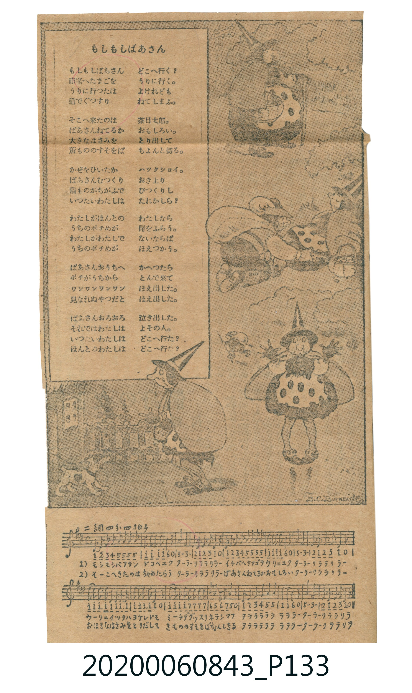

# もしもしばあさん

> Re:Shōka 使用 AI 協助辨識與重建樂譜，可能會有錯誤。歡迎回報。

- **鋼琴伴奏版**：<br><audio controls src="moshimoshi_baasan.mp3"></audio>

- 日治時期公學校《唱歌帳》（典藏號 2020.006.0843・P133）
- 國立臺灣歷史博物館典藏

## 說明


- 出處：《唱歌帳》（國立臺灣歷史博物館典藏號 2020.006.0843）第 P133.jpg 頁。
- 調性與拍號：ト長調（G 大調，原頁文字誤記「ニ調四分ノ四拍子」，五線譜調號為 1♯ 且首音 G4 標為 1），4/4 拍。
- 背景與曲風：頁面愛惜地剪貼了附有 B.C. Burnside 插畫之報紙童謠〈もしもしばあさん〉（喂喂老婆婆），
下方手抄五線譜與數字簡譜。歌詞以孩童與九十九歲老婆婆的幽默對話，祝賀百歲長壽。
- 版本說明：本檔案為原頁手抄單聲部旋律之忠實數位化版本。

### 編曲說明（鋼琴伴奏版）：

1. 前奏 (Intro, 4 小節)：引用結尾樂句「あかちゃんになったら おっぱいあげましょ」，營造輕快俏皮的童謠氣氛。
2. 主歌伴奏 (Song, 16 小節)：右手演奏童謠主旋律，左手以輕快的低音與和弦分解伴奏。


## 歌詞

```text
【原頁歌詞全文與中文語譯】（對應 P133.jpg）

もしもしばあさん　うめぼしばあさん
あなたのおとしは　いくつです
わたしはことしで　九十九になるよ
それならばあさん　おめでたい
ことしで九十九なら　百まで一ツ
らいねんうまれりゃ　あかちゃんだ
あかちゃんになったら　おっぱいあげましょ
那樣的話老婆婆真是恭喜呀！今年九十九歲的話，離一百歲只差一歲；
明年重新投胎出生的話就是小寶寶了，變成小寶寶的話就餵您喝奶奶吧！）
```

## ABC

<div class="abc-score" data-abc-src="moshimoshi_baasan.abc" aria-label="五線譜載入中"></div>

[下載 ABC 原始檔](moshimoshi_baasan.abc)

## TMD 檔案連結

- [主旋律 TMD 檔案](moshimoshi_baasan.tmd) [[在 TMD Studio 編輯](https://tmdlang.github.io/Tmd-TS/#tmd=s7IKdvYPcrWy4qpTUCpJTLdSSM7PyUlNLsnMz7MqzsjPTkzOyFeCS5bl55TmploBqXgDQ4RwcX5pUXJqfEFieqpVgKGxMboM3KT4vPyS1KT8_GyEioKi_LLUvMQ8oKrcxLzS4uSizIKS-OT8gkqEmtSyzJRUkIrUlMyS_KLMxBwkJ6UWFYMdC3FDSVFiHsQMoCBCVUlGKtDdaYm5mTlI5gKNSs_MsyrNAxlfkpmWmZqixKWlpfC4qelx43Qo2bjhcSOQMfVx02QFLS0uRVsFQwMLLntbBXcuGxN9EzuQac-mL322afezmU3P5sx_2rrm6dodzxYsfNzQ9XTKxmdre57u2Py4ofv9no6nrTteTO9_MXO-gpGBkYGegYGZnoGFifHj5t2gUHu_pxPstKdzup-v7n7Rvut54-Jna7c_7d_0tHfW886VL5esgBigxMWlr6VgSy3ApaCg8LhhwrPZm57PXvdi1apnM_oeN0wEizbvftq-68XMqe_3zMLiG0LuxPAo0IfP16xRAHlWL6sgXeHlgsbHDU1Qm16s2v-sYfmLjvZn3b1AnSArmzteTt0OFAda5q7wdMlyMLPnad98oMZn09qfrp3-YtWSFytmPG7oedzcDZR9Onv20462x819QAbQmKdrJzxu6AVqebJryvPts16snQNUAzT7edMuBcNHM9crPNkx5eWyaS_nb1ZwN1F4tmImWALoSqAWYNQqAI1Acl9zz7OZ60Hum73p5aIVQPcBXfFy7qJnLbOfNc95OmfD085VLzbtebKr7eXMlmdzOhWc9Jz1FJxKi_KKgclL4Vn_pOdTVz_Z2f10wcbnW2Y-X730xZoFjxs6cKW1xw1AV3Q8ndYERC8aGp-ubAMiiNNADlIAur372bSdzzq7n3W1IPwHdN7UHcCAeb5hIZALdD0wxl6snPdk99Kna1eCLO1of7Jz7tPeRiD5bO0muMnPZ7U83bn35e4ZTzf0vli5EWjL86VzX2xueD5zH1AZMBqeLt6LCIvnnR3P5qyBpBVgQADZz1ZNebawAxh-0NgBO-vptHUvGje9bF7xbHr3033dIM_vX_B0_TKgE5_s7X3aMw1iDshcaCKE6ga7-WnrCmAkgxy8Yy2IsWrei7XrgSkTFCwbep-1d8ITEjBYIAbgDMuGx41tj5saHzfuQZMCawNxVj1unP-4cd3jxq7HjSvAioB2AbW1PG7sf9y45HHj8seNMyGWAPlApWAVjZNhqpcDVcND9nHjapCJTd2PmzogNsx93NQDFurEcFgX2GFA44GGtkBUI0xFMhKsuQEUI48bgWj5kx0Nj5shGkCmAh26FmQk0KNAaaBtTUCDm8E2AG3rfty4EMQFKVgA9zSyKNjFjYtBzgDbAw4JIHcj2Gig4klga4HB2w7SD4wFSIwA4x8tlT5uaHzZuuPZotYnO_chJd2eF6u7n07tf9a04snurqc7tzzdCUpaTycuer9n_rOOiVDBDRtfLGt8tns_cip9OhvoIHDaU1B42bT42YrFwOQKTKWI1Dtn_rMZ6581rn06bc7TiQ3v9zRCTEM2BKIF6IyXsxcBgw6SsJ_2r3q6fR2QC2S_3zMbYgUwUQP1vmzvfTZtw7OuqS-AxQmwkJsyH2IC0IVAu55u6H-6fhsQAfM7yGvrup51TIALwlW-XLIV6N-n0-Y-XboNhCYsB7oNlFyB1lBeckOBgpY-F1dwfl66VUBmYl6-Q41BjUI12Cs2hmZadmAWsMIA5gtgrE9H0I0bQKkAiKcCxSYr1ABZbUBWI5DeA1MBUmAAlgIqagYKwzBQAzIfpAJk1Cogng_E64C4C6gT6DSQ9TUKhgq6CkZAbAzEJkBsioaBKuKAFBphBsQgaACla8BqkSHIPGRYA7YF2TYQG8UMcFkBDpHGFVB_rgfiFiDuB-IlQLwciGeCPNUEEgF5CKZqMjQ4gDqRgwMkjxIcwESnAEx7YBqYucBBM-iDAxin8CBZjuaFVeDg6FQAZhwgD4SBKnY0QIIDKA4JwLWQlAFKSCA1TT1ADCqH4AmkG4hBZQ5U3QKUQEH1LZjCJoZHJWroYAtDczRcAw5VUDiCaJAILEyxhRAWLwDjFpwCQKUnPC8Akww4lwDDBSwJKkuhKWcjWsoBBhuWjDQJGsig8hYcngQSDwjCaKjHoeECYdAm6dRycenaKYDKHgUgrcwFAA)]
- [鋼琴伴奏 TMD 檔案](moshimoshi_baasan_piano.tmd) [[在 TMD Studio 編輯](https://tmdlang.github.io/Tmd-TS/#tmd=s7IKdvYPcrWy4tLSUnjc1PS4cTqUbNzwuBHImPq4afL7PR0vu_c8n7DlyZ4tT5f2P-_seL-nU0FLi0vRVsHQwILL3lbBncvGRN_EjqtOQenZ9KXPNu1-NrPp2Zz5T1vXPF2749mChY8bup5O2fhsbc_THZsfN3QDTXzauuPF9P4XM-crGBkYGegZGJjpGViYGD9u3h1gaGwMtEAJZNjTOd3PV3e_aN_1vHHxs7Xbn_Zveto763nnypdLVkAMUOLi0tdSsKUW4FJQUHjcMOHZ7E3PZ697sWrVsxl9jxsmgkWbdz9t3_Vi5tT3e2Zh8Q0hd2J4FOjD52vWKIA8q5dVkK7wckHj44YmqE0vVu1_1rD8RUf7s-5eoE6Qlc0dL6duB4oDLXNXeLpkOZjZ-X5PDzDcFYDKgKyXDfOf7lqmAIkVhGHPt68A-gfiGaxRCTQepFRBwVBP4WlnL1BcQcMzr6QoX0fBROHphv7n6xs0gWqe7pn6fMqK51snPN2w79mKpqf9Sx839IATSffjxoWPm5qBSeVx4-rHjaseNy5-3Dj_cVOnwuPGLjBn4-PGFrDSSY8b94ETWfvjBpCbn7fPf9mw4MWeqU_3r36yv__5rHXPZ7U8X730xZoFzzYsfrZhNtQfCgpGegpPduwGBjrE6Qoawfl56ToKhmbITuzf_Kyz-9meKSC_gQ0BaZne_XQfMJJ6nm5fBpR9snspxDqgRU_29r2cvxkYzk8n9Tzds-xpR9uL5Ysh5kPtpTxJQYGClj4XFzhUrQIyE_PygzwcagxqFKrBnrMxNNOyA7NqFAwVdBWMgNgYiE2A2BSIQRBGA1XEQZlwhhmUNoCrgamGQZBpyLAGbAeyXSA2ihlctSgO9kFxsAnCvfEK0YaxCqYQqkbBBMgwiQVRBghZKAV0F5BhCuYDZUE2gGIRb4gAszcooxg-apgMS42gsMQdWMgYGlhoBG2CC9m1pkDXWgwZ11oCXWtohOlcVHeAKWxieFSiuhub78zRcA3YvyAfgmiQCMy32N1uaAxyPKwQwB_WIDgg2QiRyGmRi2hlAkIPkglQjUCPAxlGYD513AAMJl07BXCBowBkgIIMRCtzAQA)]

## 分析

```text
================================================================================
📊 TMD Song Profile: [ もしもしばあさん ]
================================================================================
⏱  Duration:       0:35 (35.6s), 16 measures total
🎼 Key & Tempo:    首調基準 G, != 108.0 BPM, <4/4>
   - 分析範圍：      由實際發聲的音符與和弦推測調性；播放脈絡另行呈現
🎤 人聲音域:    G4 (MIDI 67) – G5 (MIDI 79) [跨度: 12 個半音 / 1.0 個八度, 難度: easy]
   - 最低音:  G4 in [Song #1 @ m.1, 0:00]
   - 最高音: G5 in [Song #1 @ m.2, 0:02]
   - 適合: soprano, mezzo-soprano, tenor, baritone
🏛  結構:      Song (35.6s)
⚡ 編曲密度:        Peak 1 軌道同時演奏
🗝  調性診斷：       G 大調（純淨自然大調，未偵測到可信轉調）
   - 風格氣質:    純淨自然大調（陽光明朗、易唱易記，無明顯調外色彩）
   - 轉調歷程:    全曲維持單一推測調性（未偵測到可信轉調）
   - 核心骨幹音:  G, D, B, A, E
   - 調性數值:    G 大調 [相關度: 0.95, 穩定度: High, 自然音純度: 100.0%]
   - 候選調性 (K-S): G 大調 (0.95), D 大調 (0.63), G 小調 (0.59)
   - 五度圈歷程:   +1
   - 各段落調性細節:
     • [Song #1]: G 大調 (r: 0.95, 自然音純度: 100.0%)

  [ 五度圈游移軌跡 ]
               C  
         F           [G ]*
      Bb               D  
      Eb               A  
         Ab           E  
            Db       B  
               F# 
     (* = active key center)

  [ 十二半音累積音高分佈 ]
     C  : ██                         2.7%
     C# :                            0.0%
     D  : ███████████████           24.1%
     D# :                            0.0%
     E  : █████                      7.1%
     F  :                            0.0%
     F# : ███                        4.5%
     G  : ████████████████████████  37.5%
     G# :                            0.0%
     A  : █████                      8.0%
     A# :                            0.0%
     B  : ██████████                16.1%
--------------------------------------------------------------------------------
Assignment 軌道音域：
  - Piano         : G4 – G5 (12 個半音 / 1.0 個八度, 82 個音符)
================================================================================
```


## 原書掃描頁




