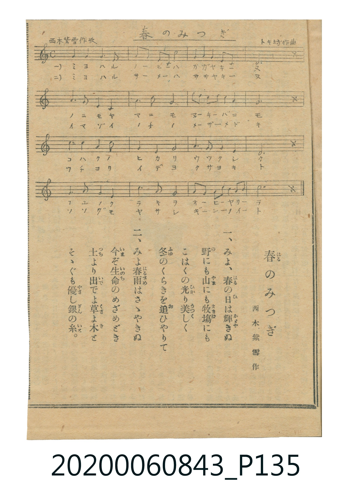

# 春のみつぎ

> Re:Shoka 使用 AI 協助辨識與重建樂譜，可能會有錯誤。歡迎回報。

<audio controls src="haru_no_mitsugi.mp3"></audio>

- 詞：西木紫雪
- 曲：トキ坊
- 日治時期公學校《唱歌帳》（典藏號 2020.006.0843・P135）

## 說明

【曲目說明】
・出處：《唱歌帳》（國立臺灣歷史博物館典藏號 2020.006.0843）第 P135.jpg 頁剪貼雜誌樂譜。
・作詞／作曲：西木紫雪 作歌、トキ坊 作曲。
・調性與拍號：ハ長調（C 大調），4/4 拍（C），速度 != 104。
・背景與曲風：描寫春天來臨時，黃鶯、蝴蝶與孩童各自獻上歌聲、舞蹈與唱歌作為「春之貢禮」（春のみつぎ）。
原印刷五線譜上方留有舊藏者以鉛筆標註之簡譜數字。
・版本說明：本檔案為原頁單聲部旋律之忠實數位化版本。
【原頁歌詞全文與中文語譯】（對應 P135.jpg）

・編曲說明（鋼琴伴奏版）：
1. 前奏 (Intro, 4 小節)：取全曲末樂句「春のおみつぎ あげました」，展現春日明朗氣息。
2. 主歌伴奏 (Song, 16 小節 × 3 段)：右手演奏主旋律，左手配以溫暖的三和弦伴奏。

## 歌詞

```text
一、春が來たので　うぐひすは
白い梅の實　たべながら
ホーホケキョーと　お歌ひで
春のおみつぎ　あげました

二、春が來たので　蝶々は
黄ろい菜の蜜　すひながら
ヒラヒラヒラと　おどりして
春のおみつぎ　あげました

三、春が來たので　わたくしは
紅いおリボン　かけながら
うれしい唱歌　うたひして
春のおみつぎ　あげました
```

## ABC

```abc
X:1
T:春のみつぎ
C:曲：トキ坊
M:4/4
L:1/16
Q:1/4=104
K:C
V:V1 name="Piano" snm="Pia"
[V:V1]
G6 G2 E4 C4 | A6 A2 G4 c4 | A4 G4 A4 E4 | G12 z4 |
G6 G2 E4 C4 | D6 D2 E4 G4 | A4 A4 G4 E4 | D12 z4 |
c6 c2 G4 E4 | A4 G4 E4 C4 | G6 G2 E4 C4 | D12 z4 |
E6 E2 G4 E4 | A6 A2 G4 E4 | D4 E4 G2 G2 E2 D2 | C12 z4 |
G6 G2 E4 C4 | A6 A2 G4 c4 | A4 G4 A4 E4 | G12 z4 |
G6 G2 E4 C4 | D6 D2 E4 G4 | A4 A4 G4 E4 | D12 z4 |
c6 c2 G4 E4 | A4 G4 E4 C4 | G6 G2 E4 C4 | D12 z4 |
E6 E2 G4 E4 | A6 A2 G4 E4 | D4 E4 G2 G2 E2 D2 | C12 z4 |
G6 G2 E4 C4 | A6 A2 G4 c4 | A4 G4 A4 E4 | G12 z4 |
G6 G2 E4 C4 | D6 D2 E4 G4 | A4 A4 G4 E4 | D12 z4 |
c6 c2 G4 E4 | A4 G4 E4 C4 | G6 G2 E4 C4 | D12 z4 |
E6 E2 G4 E4 | A6 A2 G4 E4 | D4 E4 G2 G2 E2 D2 | C12 z4 |
```

## TMD 檔案連結

- [主旋律 TMD 檔案](haru_no_mitsugi.tmd) [[在 TMD Studio 編輯](https://tmdlang.github.io/Tmd-TS/#tmd=s7IKdvYPcrWy4qpTUCpJTLdSSM7PyUlNLsnMz7MqzsjPTkzOyFeCS5bl55TmploBqXgDQ4RwcX5pUXJqfEFieqpVgKGxKboM3KT4vPyS1KT8_GyEioKi_LLUvMQ8oKrcxLzS4uSizIKS-OT8gkqEmtSyzJRUkIrUlMyS_KLMxBwkJ6UWFYMdC3FDSVFiHsQMoCBCVUlGKtDd5amJQEYRunBxamJxfl6xEpeWlsKzGUsfN6573Lj_ceOSx419ClpaXIq2CoYGJlz2tgrOXDYm-iZ2IO0vVs57v2fWi6X7n81Z8XzL6pezV4FNfTZ7E1D4cXPH46a1T-d2QcSmL322afezmU3P5sx_2rrm6dodzxYsfNzQ9XTKxmdre57u2Py4ofv9no6nrTteTO9_MXO-gpGBkYGegYGZnoGFifHj5t2gIH2_p1OJi0tfS8GWWoBLQUHhccMEoIufz173YtWqZzP6HjdMBIs2737avuvFzKkgr2C6c07389XdL9p3PW9c_Gzt9qf9m572znreufLlkhU4vAB0-_M1axRA3tDLKkhXeLmg8Wnnqheb9rycPefFqp5nK5perJ3zuKEJaveTvXPAodsPZEDCEzmYFUCia3seNzTCQxksNHsTwoQXq_Y_a1j-oqP9WXcv0DXgGOl_OXU7UBzoAWeFp0uWg5md7_f0ACNUAagMJA4ReNkw_-muZQqQWEcys7nn2cz1IDNnb3q5aAXQzGf9_U_XrwYmmKdLVj7Z1_aifQUwjkEG7G5-uW090IEv5m55MXcbUMvTtSufr176dELLi_ZVz3t3P9nRBfTBi0agixtfdMx7sbMDpAYcykCfPG_a9bihB2jsk53dLzYter5s3eMGkPPQUibQsVDHKSg87Zv_tHfD047tT3ZNeb59FjA0QVZM2_l86sxnczpfdHSBYqWh9cnupS87Zz9f2_ZsxcwXK3YDzX--YSFQ8bOpO56unY7w6vPOjmdz1kCSBMifc9Y8WzXl2cIOoMuANoFib9o6oOtfNq94Nr376b5uoEFP9y94un4Z0KAne3uf9kyDmAAyEZrKIPpAvl4572nrimfT2oFefrJjLYixat6LtcDgmghKWxt6n7V3wlMK0I9gA57saAAGFTgAeoAh_bhxPjgklj9uaHjcCOROeAwMy8aZjxvXQ6wDqm54PnPv48aWZ4tagUqBTgMrBWrb-bhxFdCUx02dCKWPm2c_bt4DIps2AlPU4-blIG7jCrAeUFSBjV-O0ACLii54bICVNj1unPS4cd_jxulAq0CqgT6C-A4Yik9nLwCGHzy1PNnVBk8qQO-9bOp6OqH5xcTpQGcD3fxs3hygm4EKoFJTNgKlgKkCu0tByaMHkq6AxkKseD6rBZhygNkSGAnwYNwFyjZYgxGYTh83AIMKKQBf7m553NQLDMMX_XOA6l7MAWZRoCeBoQwMDCxhOOlx80oUEhaAjxtXPm4CksBQWUaDMITkMlgY7gAGFDBUX3RuerZpJ9DlL7o2Al0OD8nn-1cC0Yut24H5jshA2wHMZzjSXlM_mAskga5FTntbgEHZAvJb86rHzXMeNwOLTqDfuh83TsQWdMAk3ARMY0AzWiClACxdA80GhjWNwu1Zx0RomOxcDQwEoJufb930dMc2tFT3dP9qYAENDBmI0wgHGtBuyisnKFDQ0ufiCs7PS7cKyEzMy3eoMahRqAaXeTYWWnZgBrBKBDrXSgEYAcCya4_C46ZuILsHiHsVaoDkfIho4zogXg7EbWDRCUC8CYhngvXVKBiAbAIZV6NgqqALhKYKxkDSEIhrFMzAImZgGcM4uBCIC6JBCmHaINAAJAJOPUjOmw51Xi-Q3QJzSFMjkvP2g50Lct5OIF4F8UZTJyHnGYFFjMAiIFmI62AuhLgOoga368DlCsQpzbOBlm4EYmjxAnbQCiDuAjsa5kRg6IEdvhxoHooDwSEEDiiE9ciOgTgalzfwBCBy_IKCqwvsDmCggd2xBIj7gLgJLDoJiPdBAh3sXiT3gWwEuQTVdbD4RQQXJDhBLjQC-QrDdbVcXLp2CqDEqYCFVuYCAA)]
- [鋼琴伴奏 TMD 檔案](haru_no_mitsugi_piano.tmd) [[在 TMD Studio 編輯](https://tmdlang.github.io/Tmd-TS/#tmd=s7IKdvYPcrWy4tLSUng2Y-njxnWPG_c_blzyuLHv_Z6Ol917nk_Y8mTPlqdL-593drzf06mgpcWlaKtgaGDCZW-r4MxlY6JvYsdVp6D0YuW893tmvVi6_9mcFc-3rH45e5USSPjZ7E1A4cfNHY-b1j6d2wURm7702abdz2Y2PZsz_2nrmqdrdzxbsPBxQ9fTKRufre15umPz44ZuoOVPW3e8mN7_YuZ8BSMDIwM9AwMzPQMLE-PHzbsDDI1NgW5R4uLS11KwpRbgUlBQeNwwAeji57PXvVi16tmMvscNE8Gizbuftu96MXMqyCuY7pzT_Xx194v2Xc8bFz9bu_1p_6anvbOed658uWQFDi8A3f58zRoFkDf0sgrSFV4uaHzc0AS16cneOeCw7AcyIKGHHKgKING1PY8bGuFhChaavQlhwotV-581LH_R0f6suxdoNzj8-19O3Q4UBzrXWeHpkuVgZuf7PT3A6FMAKgOyXjbMf7prmQIkchGGPd--Amg4JDiwpgig8SClCgqGegpPO3uB4goannklRfk6CiYKTzf0P1_foAlU87R_2tNWkFHP5qx-tqLpaf_Sxw09sBTXBU90Co8bmx43TnrcuO9x4_THjfMfN4Dc9nTj1Of9-4CqQUlnRt-zOdOfbVj8rHE91JkKCkZ6Ck927AYGDMRlChrB-XnpOgqGZlAXKByermCs8GzdVohTNj_r7H62ZwpQJUjX9O6n-4AR2fN0-zKg-MvW3ie7lz7btfrZrGnPZ7U82dH5dFLP0z3LICZDbaQ8tUGBgpY-Fxc4uKwCMhPz8oM8HGoMahSqwd6ysdCyAzNqgI7XBUJjBVMwqQsUMQOLmCGJGEFZpkBoDOTVKBiC1UCgAUgNVy2KbT4otpnAbTOMV4g2jFUwhVA1CiZAhkksTLgGLGEKkQdScPVAygBiByj48XkImG9BOcDwUcNkWCIBhQTEdpCPQL4A-QXkA1S_GsbBhUBcEA3xPkQbsmeRrTIFWmVBhFWgQNQFkpCAhNkEsw0R0LhtsgTaZGiEYRXY3WDno8YhjAexHpeDcFlmaAyyDZ7M4bZRMb0g4pLc5II7-YCSC3YzoGooMgNdDw47SDKDYNLXtVMA5zAFIAMUdNhoZS4A)]

## 分析

```text
================================================================================
📊 TMD Song Profile: [ 春のみつぎ ]
================================================================================
⏱  Duration:       1:50 (110.8s), 48 measures total
🎼 Key & Tempo:    首調基準 C, != 104.0 BPM, <4/4>
   - 分析範圍：      由實際發聲的音符與和弦推測調性；播放脈絡另行呈現
🎤 人聲音域:    C4 (MIDI 60) – C5 (MIDI 72) [跨度: 12 個半音 / 1.0 個八度, 難度: easy]
   - 最低音:  C4 in [Song #1 @ m.1, 0:01]
   - 最高音: C5 in [Song #1 @ m.2, 0:04]
   - 適合: soprano, mezzo-soprano, contralto, tenor, baritone, bass
🏛  結構:      Song (36.9s) -> Song (36.9s) -> Song (36.9s)
⚡ 編曲密度:        Peak 1 軌道同時演奏
🗝  調性診斷：       G 大調（純淨自然大調，未偵測到可信轉調）
   - 風格氣質:    純淨自然大調（陽光明朗、易唱易記，無明顯調外色彩）
   - 轉調歷程:    全曲維持單一推測調性（未偵測到可信轉調）
   - 核心骨幹音:  G, E, C, D, A
   - 調性數值:    G 大調 [相關度: 0.80, 穩定度: Moderate, 自然音純度: 100.0%]
   - 候選調性 (K-S): G 大調 (0.80), C 大調 (0.76), E 小調 (0.72)
   - 五度圈歷程:   +1 -> +1 -> +1
   - 各段落調性細節:
     • [Song #1]: G 大調 (r: 0.80, 自然音純度: 100.0%)
     • [Song #2]: G 大調 (r: 0.80, 自然音純度: 100.0%)
     • [Song #3]: G 大調 (r: 0.80, 自然音純度: 100.0%)

  [ 五度圈游移軌跡 ]
               C  
         F           [G ]*
      Bb               D  
      Eb               A  
         Ab           E  
            Db       B  
               F# 
     (* = active key center)

  [ 十二半音累積音高分佈 ]
     C  : █████████████             16.7%
     C# :                            0.0%
     D  : █████████████             15.8%
     D# :                            0.0%
     E  : ██████████████████        22.5%
     F  :                            0.0%
     F# :                            0.0%
     G  : ████████████████████████  30.0%
     G# :                            0.0%
     A  : ████████████              15.0%
     A# :                            0.0%
     B  :                            0.0%
--------------------------------------------------------------------------------
Assignment 軌道音域：
  - Piano         : C4 – C5 (12 個半音 / 1.0 個八度, 162 個音符)
================================================================================
```


## 原書掃描頁




