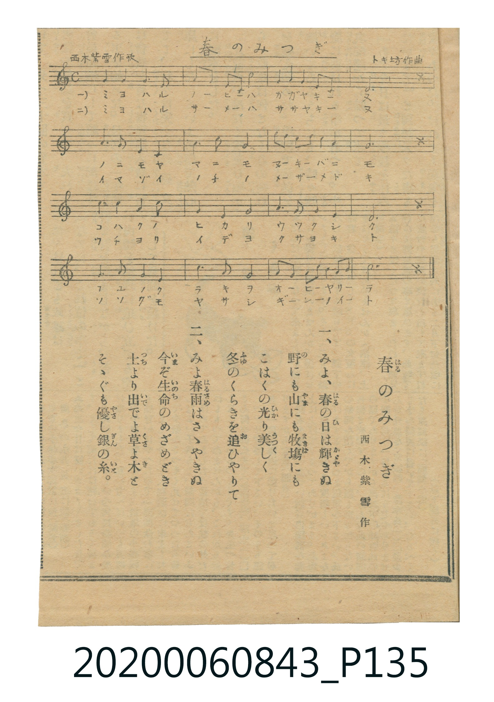

# 春のみつぎ

> Re:Shōka 使用 AI 協助辨識與重建樂譜，可能會有錯誤。歡迎回報。

- **鋼琴伴奏版**：<br><audio controls src="haru_no_mitsugi.mp3"></audio>

- 詞：西木紫雪
- 曲：トキ坊
- 日治時期公學校《唱歌帳》（典藏號 2020.006.0843・P135）

## 說明


- 出處：《唱歌帳》（國立臺灣歷史博物館典藏號 2020.006.0843）第 P135.jpg 頁剪貼雜誌樂譜。
- 作詞／作曲：西木紫雪 作歌、トキ坊 作曲。
- 調性與拍號：ハ長調（C 大調），4/4 拍（C），速度 != 104。
- 背景與曲風：描寫春天來臨時，黃鶯、蝴蝶與孩童各自獻上歌聲、舞蹈與唱歌作為「春之貢禮」（春のみつぎ）。
原印刷五線譜上方留有舊藏者以鉛筆標註之簡譜數字。
- 版本說明：本檔案為原頁單聲部旋律之忠實數位化版本。
【原頁歌詞全文與中文語譯】（對應 P135.jpg）

### 編曲說明（鋼琴伴奏版）：

1. 前奏 (Intro, 4 小節)：取全曲末樂句「春のおみつぎ あげました」，展現春日明朗氣息。
2. 主歌伴奏 (Song, 16 小節 × 3 段)：右手演奏主旋律，左手配以溫暖的三和弦伴奏。


## 歌詞

```text
一、春が來たので　うぐひすは
白い梅の實　たべながら
ホーホケキョーと　お歌ひで
春のおみつぎ　あげました

二、春が來たので　蝶々は
黄ろい菜の蜜　すひながら
ヒラヒラヒラと　おどりして
春のおみつぎ　あげました

三、春が來たので　わたくしは
紅いおリボン　かけながら
うれしい唱歌　うたひして
春のおみつぎ　あげました
```

## ABC

<div class="abc-score" data-abc-src="haru_no_mitsugi.abc" aria-label="五線譜載入中"></div>

[下載 ABC 原始檔](haru_no_mitsugi.abc)

## TMD 檔案連結

- [主旋律 TMD 檔案](haru_no_mitsugi.tmd) [[在 TMD Studio 編輯](https://tmdlang.github.io/Tmd-TS/#tmd=s7IKdvYPcrWy4qpTUCpJTLdSSM7PyUlNLsnMz7MqzsjPTkzOyFeCS5bl55TmploBqXgDQ4RwcX5pUXJqfEFieqpVgKGxKboM3KT4vPyS1KT8_GyEioKi_LLUvMQ8oKrcxLzS4uSizIKS-OT8gkqEmtSyzJRUkIrUlMyS_KLMxBwkJ6UWFYMdC3FDSVFiHsQMoCBCVUlGKtDd5amJQEYRunBxamJxfl4xQhhoRXpmnlVJYibQ4fFAXJ4Yn5uYmZeTmJeCrKokIz-9KLEgo9IqI7MY5LDkxJz47MS8RCUuLS2FZzOWPm5c97hx_-PGJY8b-xS0tLgUbRUMDUy47G0VnLlsTPRN7ECGvVg57_2eWS-W7n82Z8XzLatfzl4FtuPZ7E1A4cfNHY-b1j6d2wURm7702abdz2Y2PZsz_2nrmqdrdzxbsPBxQ9fTKRufre15umPz44bu93s6nrbueDG9_8XM-QpGBkYGegYGZnoGFibGj5t3g2Ln_Z5OJS4ufS0FW2oBLgUFhccNE4Aufj573YtVq57N6HvcMBEs2rz7afuuFzOngryC6c453c9Xd79o3_W8cfGztduf9m962jvreefKl0tW4PAC0O3P16xRAHlDL6sgXeHlgsannatebNrzcvacF6t6nq1oerF2zuOGJqjdT_bOAYduP5ABCU_kYFYAia7tedzQCA9lsNDsTQgTXqza_6xh-YuO9mfdvUDXgGOk_-XU7UBxoAecFZ4uWQ5mdr7f0wOMUAWgMpA4ROBlw_ynu5YpQGIdyczmnmcz14PMnL3p5aIVQDOf9fc_Xb8amGCeLln5ZF_bi_YVwDgGGbC7-eW29UAHvpi75cXcbUAtT9eufL566dMJLS_aVz3v3f1kRxfQBy8agS5ufNEx78XODpAacCgDffK8adfjhh6gsU92dr_YtOj5snWPG0DOQ0uZQMdCHaeg8LRv_tPeDU87tj_ZNeX59lnA0ARZMW3n86kzn83pfNHRBYqVhtYnu5e-7Jz9fG3bsxUzX6zYDTT_-YaFQMXPpu54unY6wqvPOzuezVkDSRIgf85Z82zVlGcLO4AuA9oEir1p64Cuf9m84tn07qf7uoEGPd2_4On6ZUCDnuztfdozDWICyERoKoPoA_l65bynrSueTWsHevnJjrUgxqp5L9YCg2siKG1t6H3W3glPKUA_gg14sqMBGFTgAOgBhvTjxvngkFj-uKHhcSOQO-ExMCwbZz5uXA9S_Xzm3seNLc8WtQIVAR0FVgTUsPNx4yqg_sdNnRBvzn7cvAdENm0EpqLHzctB3MYVYNWg6AEbuRykFBbwXfCwBytqetw46XHjvseN04HGg9QB3Q_xCzDMns5eAAwteNp4sqsNnjCAnnnZ1PV0QvOLidOBTgW689m8OUB3AhVApaZsBEoB0wB2N4ISQw8kFQGNhVjxfFYLMJ0AMyEwyOGBtguUSbAGGjBVPm4ABg84uF7ubnnc1AsMsRf9c4AqXswBZkWg94ChCQwAlBCb9Lh5JQoJC67HjSsfNwFJYEgso2qIQXIQLMR2AIMFGIYvOjc927QT6NoXXRuBroWH2_P9K4HoxdbtwDxFZBDtAOYhHOmqqR_MBZJA10LS1RZgkLWAfNW86nHznMfNwAIR6Kvux40TUQMKmCSbgOkHqK8Fkqth6RRoHjBMqR5KzzomQkNg52qgl4HufL5109Md29BS1NP9q4FFLTAcII4iHERAuymvZqBAQUufiys4Py_dKiAzMS_focagphpceNlYaNmBGcC6DehaK2DwrQemtT0Kj5u6geweIO5VqAGS8yGijeuAeDkokMGiE4B4ExDPBOurUTAAWQQyrkbBVEEXCE0VjIGkIRDXKJiBRczAMoZxcCEQF0SDFMK0QaABSAScVJCcNx3qvF4guwXmkKZGJOftBzsX5LydQLwK4o2mTkLOMwKLGIFFQLIQ18FcCHEdRA1u14GLDIhTmmcDLd0IxNCSA-ygFUDcBXY0zInA0AM7fDnQPBQHgkMIHFAI65EdA3E0Lm_gCUDk-AUFVxfYHcBAA7tjCRD3AXETWHQSEO-DBDrYvUjuA9kIcgmq62DxiwguSHCCXGgE8hWG62q5uHTtFEBpUwFIK3MBAA)]
- [鋼琴伴奏 TMD 檔案](haru_no_mitsugi_piano.tmd) [[在 TMD Studio 編輯](https://tmdlang.github.io/Tmd-TS/#tmd=s7IKdvYPcrWy4qpTUCpJTLdSyC8qychPL0osyKi0ysgsLskvykxOzInPTsxLVIIrKs4vLUpOjS9ITE-1CjA0NkXIlGSk5qZaFacmFufnFStxaWkpPJux9HHjuseN-x83Lnnc2Pd-T8fL7j3PJ2x5smfL06X9zzs73u_pVNDS4lK0VTA0MOGyt1Vw5rIx0TexA5n5YuW893tmvVi6_9mcFc-3rH45exXYqmezNwGFHzd3PG5a-3RuF0Rs-tJnm3Y_m9n0bM78p61rnq7d8WzBwscNXU-nbHy2tufpjs2PG7qBlj9t3fFiev-LmfMVjAyMDPQMDMz0DCxMjB837wZ5BOgWJS4ufS0FW2oBLgUFhccNE4Aufj573YtVq57N6HvcMBEs2rz7afuuFzOngryC6c453c9Xd79o3_W8cfGztduf9m962jvreefKl0tW4PAC0O3P16xRAHlDL6sgXeHlgsbHDU1Qm57snQMOy34gAxJ6yIGqABJd2_O4oREepmCh2ZsQJrxYtf9Zw_IXHe3PunuBdoPDv__l1O1AcaBznRWeLlkOZna-39MDjD4FoDIg62XD_Ke7lilAIhdh2PPtK4CGQ4IDa4oAGg9SqqBgqKfwtLMXKK6g4ZlXUpSvo2Ci8HRD__P1DZpANU_7pz1tBRn1bM7qZyuanvYvfdzQA0txXfBEp_C4selx46THjfseN05_3Dj_cQPIbU83Tn3evw-oGpR0ZvQ9mzP92YbFzxrXQ52poGCkp_Bkx25gwEBcpqARnJ-XrqNgaAZ1gcLh6QrGCs_WbYU4ZfOzzu5ne6YAVYJ0Te9-ug8YkT1Pty8Dir9s7X2ye-mzXaufzZr2fFbLkx2dTyf1PN2zDGIy1EbKUxsUKGjpc3GBg8sqIDMxLz_Iw6HGoKYa7CsbCy07MKMG6HZdIDRWMAWTukARM7CIGZKIEZRlCoTGQF6NgiFYDQQagNRw1aJY5oNsmQncMsN4hWjDWAVTCFWjYAJkmMTChGvAEqYQeSAFVw-kDCBWgAIfj3eAmRaU_A0fNUyGpRBQMEAsB_kH5AeQT0DuR_WpYRxcCMQF0RDPQ7QhexXZKlOgVRZEWAUKQl0gCQlGmE0w2xDBjNsmS6BNhkYYVoHdDXY-agzCeBDrcTkIl2WGxiDb4GkcbhsVUwsiKslMLLgTDyixYDcDqoYiM9D14LCDJDMIJnxdOwVw9lIAMkAhh41W5gIA)]

## 分析

```text
================================================================================
📊 TMD Song Profile: [ 春のみつぎ ]
================================================================================
⏱  Duration:       0:36 (36.9s), 16 measures total
🎼 Key & Tempo:    首調基準 C, != 104.0 BPM, <4/4>
   - 分析範圍：      由實際發聲的音符與和弦推測調性；播放脈絡另行呈現
🎤 人聲音域:    C4 (MIDI 60) – C5 (MIDI 72) [跨度: 12 個半音 / 1.0 個八度, 難度: easy]
   - 最低音:  C4 in [Song #1 @ m.1, 0:01]
   - 最高音: C5 in [Song #1 @ m.2, 0:04]
   - 適合: soprano, mezzo-soprano, contralto, tenor, baritone, bass
🏛  結構:      Song (36.9s)
⚡ 編曲密度:        Peak 1 軌道同時演奏
🗝  調性診斷：       G 大調（純淨自然大調，未偵測到可信轉調）
   - 風格氣質:    純淨自然大調（陽光明朗、易唱易記，無明顯調外色彩）
   - 轉調歷程:    全曲維持單一推測調性（未偵測到可信轉調）
   - 核心骨幹音:  G, E, C, D, A
   - 調性數值:    G 大調 [相關度: 0.80, 穩定度: Moderate, 自然音純度: 100.0%]
   - 候選調性 (K-S): G 大調 (0.80), C 大調 (0.76), E 小調 (0.72)
   - 五度圈歷程:   +1
   - 各段落調性細節:
     • [Song #1]: G 大調 (r: 0.80, 自然音純度: 100.0%)

  [ 五度圈游移軌跡 ]
               C  
         F           [G ]*
      Bb               D  
      Eb               A  
         Ab           E  
            Db       B  
               F# 
     (* = active key center)

  [ 十二半音累積音高分佈 ]
     C  : █████████████             16.7%
     C# :                            0.0%
     D  : █████████████             15.8%
     D# :                            0.0%
     E  : ██████████████████        22.5%
     F  :                            0.0%
     F# :                            0.0%
     G  : ████████████████████████  30.0%
     G# :                            0.0%
     A  : ████████████              15.0%
     A# :                            0.0%
     B  :                            0.0%
--------------------------------------------------------------------------------
Assignment 軌道音域：
  - Piano         : C4 – C5 (12 個半音 / 1.0 個八度, 54 個音符)
================================================================================
```


## 原書掃描頁




