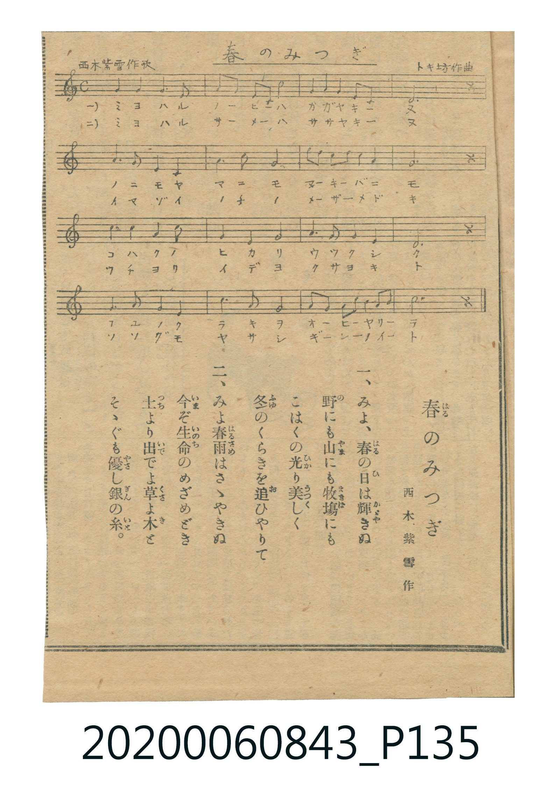

# 春のみつぎ

> Re:Shōka 使用 AI 協助辨識與重建樂譜，可能會有錯誤。歡迎回報。

- **鋼琴伴奏版**：<br><audio controls src="haru_no_mitsugi.mp3"></audio>

- 詞：西木紫雪
- 曲：トキ坊
- 日治時期公學校《唱歌帳》（典藏號 2020.006.0843・P135）

## 說明


- 出處：《唱歌帳》（國立臺灣歷史博物館典藏號 2020.006.0843）第 P135.jpg 頁剪貼雜誌樂譜。
- 作詞／作曲：西木紫雪 作歌、トキ坊 作曲。
- 調性與拍號：ハ長調（C 大調），4/4 拍（C），速度 != 104。
- 背景與曲風：描寫春天來臨時，黃鶯、蝴蝶與孩童各自獻上歌聲、舞蹈與唱歌作為「春之貢禮」（春のみつぎ）。
原印刷五線譜上方留有舊藏者以鉛筆標註之簡譜數字。
- 版本說明：本檔案為原頁單聲部旋律之忠實數位化版本。
【原頁歌詞全文與中文語譯】（對應 P135.jpg）

### 編曲說明（鋼琴伴奏版）：

1. 前奏 (Intro, 4 小節)：取全曲末樂句「春のおみつぎ あげました」，展現春日明朗氣息。
2. 主歌伴奏 (Song, 16 小節 × 3 段)：右手演奏主旋律，左手配以溫暖的三和弦伴奏。


## 歌詞

```text
一、春が來たので　うぐひすは
白い梅の實　たべながら
ホーホケキョーと　お歌ひで
春のおみつぎ　あげました

二、春が來たので　蝶々は
黄ろい菜の蜜　すひながら
ヒラヒラヒラと　おどりして
春のおみつぎ　あげました

三、春が來たので　わたくしは
紅いおリボン　かけながら
うれしい唱歌　うたひして
春のおみつぎ　あげました
```

## ABC

<div class="abc-score" data-abc-src="haru_no_mitsugi.abc" aria-label="五線譜載入中"></div>

[下載 ABC 原始檔](haru_no_mitsugi.abc)

## TMD 檔案連結

- [主旋律 TMD 檔案](haru_no_mitsugi.tmd) [[在 TMD Studio 編輯](https://tmdlang.github.io/Tmd-TS/#tmd=s7IKdvYPcrWy4qpTUCpJTLdSSM7PyUlNLsnMz7MqzsjPTkzOyFeCS5bl55TmploBqXgDQ4RwcX5pUXJqfEFieqpVgKGxKboM3KT4vPyS1KT8_GyEioKi_LLUvMQ8oKrcxLzS4uSizIKS-OT8gkqEmtSyzJRUkIrUlMyS_KLMxBwkJ6UWFYMdC3FDSVFiHsQMoCBCVUlGKtDd5amJQEYRunBxamJxfl4xQhhoRXpmnlVJYibQ4fFAXJ4Yn5uYmZeTmJeixKWlpfBsxtLHjeseN-5_3LjkcWOfgpYWl6KtgqGBCZe9rYIzl42JvokdyLQXK-e93zPrxdL9z-aseL5l9cvZq8CWPJu9CSj8uLnjcdPap3O7IGLTlz7btPvZzKZnc-Y_bV3zdO2OZwsWPm7oejpl47O1PU93bH7c0P1-T8fT1h0vpve_mDlfwcjAyEDPwMBMz8DCxPhx825QwL_f06nExaWvpWBLLcCloKDwuGEC0MXPZ697sWrVsxl9jxsmgkWbdz9t3_Vi5lSQVzDdOaf7-eruF-27njcufrZ2-9P-TU97Zz3vXPlyyQocXgC6_fmaNQogb-hlFaQrvFzQ-LRz1YtNe17OnvNiVc-zFU0v1s553NAEtfvJ3jng0O0HMiDhiRzMCiDRtT2PGxrhoQwWmr0JYcKLVfufNSx_0dH-rLsX6BpwjPS_nLodKA70gLPC0yXLwczO93t6gBGqAFQGEocIvGyY_3TXMgVIrCOZ2dzzbOZ6kJmzN71ctAJo5rP-_qfrVwMTzNMlK5_sa3vRvgIYxyADdje_3LYe6MAXc7e8mLsNqOXp2pXPVy99OqHlRfuq5727n-zoAvrgRSPQxY0vOua92NkBUgMOZaBPnjftetzQAzT2yc7uF5sWPV-27nEDyHloKRPoWKjjFBSe9s1_2rvhacf2J7umPN8-CxiaICum7Xw-deazOZ0vOrpAsdLQ-mT30peds5-vbXu2YuaLFbuB5j_fsBCo-NnUHU_XTkd49Xlnx7M5ayBJAuTPOWuerZrybGEH0GVAm0CxN20d0PUvm1c8m979dF830KCn-xc8Xb8MaNCTvb1Pe6ZBTACZCE1lEH0gX6-c97R1xbNp7UAvP9mxFsRYNe_FWmBwTQSlrQ29z9o74SkF6EewAU92NACDChwAPcCQftw4HxwSyx83NDxuBHInPAaGZePMx43rQaqfz9z7uLHl2aJWoCKgo8CKgBp2Pm5cBdT_uKkT4s3Zj5v3gMimjcBU9Lh5OYjbuAKsGhQ9YCOXg5TCAr4LHvZgRU2PGyc9btz3uHE60HiQOqD7IX4BhtnT2QuAoQVPG092tcETBtAzL5u6nk5ofjFxOtCpQHc-mzcH6E6gAqjUlI1AKWAawO5GUGLogaQioLEQK57PagGmE2AmBAY5PNB2gTIJ1kADpsrHDcDgAQfXy90tj5t6gSH2on8OUMWLOcCsCPQeMDSBAYASYpMeN69EIWHB9bhx5eMmIAkMiWVUDTFIDoKF2A5gsADD8EXnpmebdgJd-6JrI9C18HB7vn8lEL3Yuh2Yp4gMoh3APIQjXTX1g7lAEuhaSLraAgyyFpCvmlc9bp7zuBlYIAJ91f24cSJqQAGTZBMw_QD1tUByNSydAs0DhinVQ-lZx0RoCOxcDfQy0J3Pt256umMbWop6un81sKgFhgPEUYSDCGg35dUMFCho6XNxBefnpVsFZCbm5TvUGNRUgwsvGwstOzADWLcBXWsFDL71wLS2R-FxUzeQ3QPEvQo1QHI-RLRxHRAvBwUyWHQCEG8C4plgfTUKBiCLQMbVKJgq6AKhqYIxkDQE4hoFM7CIGVjGMA4uBOKCaJBCmDYINACJgJMKkvOmQ53XC2S3wBzS1IjkvP1g54KctxOIV0G80dRJyHlGYBEjsAhIFuI6mAshroOowe06cJEBcUrzbKClG4EYWnKAHbQCiLvAjoY5ERh6YIcvB5qH4kBwCIEDCmE9smMgjsblDTwBiBy_oODqArsDGGhgdywB4j4gbgKLTgLifZBAB7sXyX0gG0EuQXUdLH4RwQUJTpALjUC-wnBdLReXrp0CKG0qAGllLgA)]
- [鋼琴伴奏 TMD 檔案](haru_no_mitsugi_piano.tmd) [[在 TMD Studio 編輯](https://tmdlang.github.io/Tmd-TS/#tmd=s7IKdvYPcrWy4tLSUng2Y-njxnWPG_c_blzyuLHv_Z6Ol917nk_Y8mTPlqdL-593drzf06mgpcWlaKtgaGDCZW-r4MxlY6JvYsdVp6D0YuW893tmvVi6_9mcFc-3rH45e5USSPjZ7E1A4cfNHY-b1j6d2wURm7702abdz2Y2PZsz_2nrmqdrdzxbsPBxQ9fTKRufre15umPz44ZuoOVPW3e8mN7_YuZ8BSMDIwM9AwMzPQMLE-PHzbsDDI1NgW5R4uLS11KwpRbgUlBQeNwwAeji57PXvVi16tmMvscNE8Gizbuftu96MXMqyCuY7pzT_Xx194v2Xc8bFz9bu_1p_6anvbOed658uWQFDi8A3f58zRoFkDf0sgrSFV4uaHzc0AS16cneOeCw7AcyIKGHHKgKING1PY8bGuFhChaavQlhwotV-581LH_R0f6suxdoNzj8-19O3Q4UBzrXWeHpkuVgZuf7PT3A6FMAKgOyXjbMf7prmQIkchGGPd--Amg4JDiwpgig8SClCgqGegpPO3uB4goannklRfk6CiYKTzf0P1_foAlU87R_2tNWkFHP5qx-tqLpaf_Sxw09sBTXBU90Co8bmx43TnrcuO9x4_THjfMfN4Dc9nTj1Of9-4CqQUlnRt-zOdOfbVj8rHE91JkKCkZ6Ck927AYGDMRlChrB-XnpOgqGZlAXKByermCs8GzdVohTNj_r7H62ZwpQJUjX9O6n-4AR2fN0-zKg-MvW3ie7lz7btfrZrGnPZ7U82dH5dFLP0z3LICZDbaQ8tUGBgpY-Fxc4uKwCMhPz8oM8HGoMaqrBvrKx0LIDM2qAbtcFQmMFUzCpCxQxA4uYIYkYQVmmQGgM5NUoGILVQKABSA1XLYplPsiWmcAtM4xXiDaMVTCFUDUKJkCGSSxMuAYsYQqRB1Jw9UDKAGIFKPDxeAeYaUHJ3_BRw2RYCgEFA8RykH9AfgD5BOR-VJ8axsGFQFwQDfE8RBuyV5GtMgVaZUGEVaAg1AWSkGCE2QSzDRHMuG2yBNpkaIRhFdjdYOejxiCMB7Eel4NwWWZoDLINnsbhtlExtSCikszEgjvxgBILdjOgaigyA10PDjtIMoNgwte1UwBnLwUgAxRy2GhlLgA)]

## 分析

```text
================================================================================
📊 TMD Song Profile: [ 春のみつぎ ]
================================================================================
⏱  Duration:       0:36 (36.9s), 16 measures total
🎼 Key & Tempo:    首調基準 C, != 104.0 BPM, <4/4>
   - 分析範圍：      由實際發聲的音符與和弦推測調性；播放脈絡另行呈現
🎤 人聲音域:    C4 (MIDI 60) – C5 (MIDI 72) [跨度: 12 個半音 / 1.0 個八度, 難度: easy]
   - 最低音:  C4 in [Song #1 @ m.1, 0:01]
   - 最高音: C5 in [Song #1 @ m.2, 0:04]
   - 適合: soprano, mezzo-soprano, contralto, tenor, baritone, bass
🏛  結構:      Song (36.9s)
⚡ 編曲密度:        Peak 1 軌道同時演奏
🗝  調性診斷：       G 大調（純淨自然大調，未偵測到可信轉調）
   - 風格氣質:    純淨自然大調（陽光明朗、易唱易記，無明顯調外色彩）
   - 轉調歷程:    全曲維持單一推測調性（未偵測到可信轉調）
   - 核心骨幹音:  G, E, C, D, A
   - 調性數值:    G 大調 [相關度: 0.80, 穩定度: Moderate, 自然音純度: 100.0%]
   - 候選調性 (K-S): G 大調 (0.80), C 大調 (0.76), E 小調 (0.72)
   - 五度圈歷程:   +1
   - 各段落調性細節:
     • [Song #1]: G 大調 (r: 0.80, 自然音純度: 100.0%)

  [ 五度圈游移軌跡 ]
               C  
         F           [G ]*
      Bb               D  
      Eb               A  
         Ab           E  
            Db       B  
               F# 
     (* = active key center)

  [ 十二半音累積音高分佈 ]
     C  : █████████████             16.7%
     C# :                            0.0%
     D  : █████████████             15.8%
     D# :                            0.0%
     E  : ██████████████████        22.5%
     F  :                            0.0%
     F# :                            0.0%
     G  : ████████████████████████  30.0%
     G# :                            0.0%
     A  : ████████████              15.0%
     A# :                            0.0%
     B  :                            0.0%
--------------------------------------------------------------------------------
Assignment 軌道音域：
  - Piano         : C4 – C5 (12 個半音 / 1.0 個八度, 54 個音符)
================================================================================
```


## 原書掃描頁




