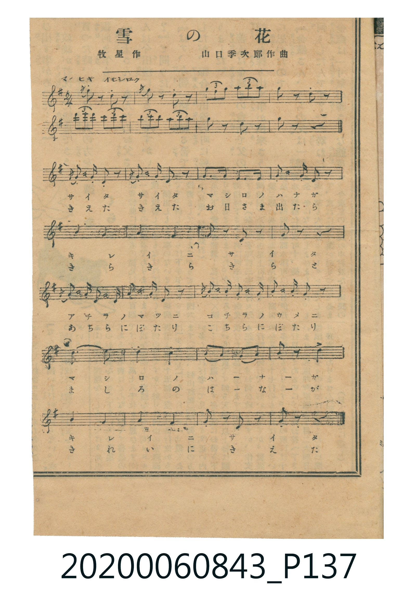

# 雪の花

> Re:Shōka 使用 AI 協助辨識與重建樂譜，可能會有錯誤。歡迎回報。

- **鋼琴伴奏版**：<br><audio controls src="yuki_no_hana.mp3"></audio>

- 詞：牧星
- 曲：山口季次郎
- 日治時期公學校《唱歌帳》（典藏號 2020.006.0843・P137）

## 說明


- 出處：《唱歌帳》（國立臺灣歷史博物館典藏號 2020.006.0843）第 P137.jpg 頁剪貼雜誌樂譜。
- 作詞／作曲：牧星 作、山口季次郎 作曲。
- 調性與拍號：ト長調（G 大調，1♯），2/4 拍，速度 != 96（原譜標示「マエヒキ オモシロク」）。
- 背景與曲風：全曲包含 7 小節活潑的三連音器樂前奏（マエヒキ）與 20 小節歌唱主旋律，
描寫清晨起床推窗看見山茶花謝後滿庭白雪，把飄落的雪花比擬為從天而降的美麗花瓣。
- 版本說明：本檔案完整收錄原譜 7 小節前奏與 20 小節歌唱主旋律。
【原頁歌詞全文與中文語譯】（對應 P137.jpg）

### 編曲說明（鋼琴伴奏版）：

1. 前奏 (Intro, 7 小節)：忠實呈現原譜標示「マエヒキ オモシロク」之三連音前奏，左手配以輕巧跳音和弦。
2. 主歌伴奏 (Song, 20 小節 × 2 段)：右手演奏主旋律，左手以輕快的 2/4 拍步伐伴奏描繪雪花飄落。


## 歌詞

```text
一、朝おきて　庭見れば
いつのまにか　白い花
山茶花の　散つたあと
咲いたのは　雪の花

二、手にとれば　ちよとつめた
いつのまにか　きえてゆく
うつくしい　花びらは
お空から　ちつてくる
```

## ABC

<div class="abc-score" data-abc-src="yuki_no_hana.abc" aria-label="五線譜載入中"></div>

[下載 ABC 原始檔](yuki_no_hana.abc)

## TMD 檔案連結

- [主旋律 TMD 檔案](yuki_no_hana.tmd) [[在 TMD Studio 編輯](https://tmdlang.github.io/Tmd-TS/#tmd=s7IKdvYPcrWy4qpTUCpJTLdSSM7PyUlNLsnMz7MqzsjPTkzOyFeCS5bl55TmploBqXgDQ4RwcX5pUXJqfEFieqpVgKGxOboM3KT4vPyS1KT8_GyEioKi_LLUvMQ8oKrcxLzS4uSizIKS-OT8gkqEmtSyzJRUkIrUlMyS_KLMxBwkJ6UWFYMdC3FDSVFiHsQMoCBCVUlGKtDdBTmJeSXoguWpiUBGEUIYaEF6Zp5VSWIm0NnxQFyeGJ-bmJkH1JyixKWlpfBy9qrHjetedG1U0NLiUrRVsDTjsrdVcOeyMdI3sQMZ82LlvPd7Zj3vXP5sxnywuc9mbwIKPN248Wn_4qdrFz9bs_Blcx9EZvrSZ5t2P5vZ9GzO_Keta56u3fFswcLHDV1Pp2x8trbn6Y7Njxu63-_peNq648X0_hcz5ysYGRgZ6BkYmOkZWJgYP27eDQrv93s6lbi49LUUbKkFuBQUFB43TAC6-_nsdS9WrXo2o-9xw0SwaPPup-27XsycCvQQFnfO6X6-uvtF-67njYufrd3-tH_T015gQKx8uWQFDi8A3f58zRoFkDf0sgrSFV4uaHzauerFpj0vZ895sarn2YqmF2vnPG5ogtr9ZO8ccOj2AxmQUIUEswKQ_7ihES2IQaJAVQjtL1btf9aw_EVH-7PuXqBTQH5o7ng5dTtQHOh6d4WnS5aDmT2Gj2auBzoNyAJGqgJQNZD1smH-013LFMAxDvJr33yg056tmPl8ya7HDT2Pm-c9blrxuHnS46a1Co-bVj1uXvS4afvj5rWPm9Y_bgDq70RyRnPPs5nrQc6YvenlohWgtNG6Ash-2tP6dMJqBXOFpxv6n69veLZl97O9E5_Panmyo_Nlw-KX8zc_nbkCGCJPO3ufLu0HOgHZTqAFQAOBgQvTDIyWKRuf7Nj9bHr3033AyOkBWa6g8Ky__-n61c92tD6bueLF1u1Pd3U961vxfNX053O6XyzrBgbgi55twLT9Ys3cp_t6nu3e_3TX2ucz9wLTPNCEZ11dLxe3vJiwF-gmoAhQ2bP1U55NXvO8adfTffOeLln5oqHn5cxeoOzzfX0vd00HKng-eTHC3887O57NWQNJT0BPA9nPVk15trDj6bqeZ1O3PJuy7WVPCyRY4WEA8Ss-n4GMh6ZXoF5g-gHKA9MIKESntQM1PtmxFsRYNe_FWmBETATF3IbeZ-2d8DQHDDmwAU92NACT0LM5cx83dj1u7H3cuOxxQwPQ-8BgedzU87hxA8QWoKKGx40tjxuXAEuBx437HjeuftwIdEUDMJiA4kA_I9TBgxOktKHh2dTFYG3zHzc2PW5cgaRu0iawkUAJoJFAZzbACxmQIqCbIe4HBdr0lfCYe7oP5L6XMxcBnQ6MP2AMPdnR-3z-0id7pwKLlJfTuoHx92RXG9BhQIPe75n9dM4KuIuetncD4_jJTmAQ9jyfPRuoGBhtQBOAYfhkX9uzGeshEQwMXXj47OoBhU9nN9jHKyBhAg6MhY-bOkAiQL81NQJ9QSCgwIEL1LDscVPb48Z-ZNVAPlB1_-PG6SCdDQ3goNv8uKkTGCrI6rqer9wFMgwoAXEASNsykM6mbowQ610O9DjQ3S8WL3y6bx0ItW14tm0PIrh29L5YtuvltMlPN2x8Ma_3ac-0Z9s6ni7ZCAw6YKBBkjIwcCCp-enEBlBOWLsYkuKB7ni-ZTYQQTLGkx3dwNCDBhrQHZQXxVCgoKXPxeWZV1KUbxWQmZiX71BjUKNQDc7SNhZadmAGsAbAVwopaEAyEzxvaYIMBWmsUTCNUzCAEDUKGsZxCiZxQJ6mqoaurqaCBpijYAbj1ygYgRSCiRqofg2wAgw9Jgg9UFON4SqA-oFCRggVxkDzDMEuMAWSBgq6QNNrubiC8_PSMf1saIbwNDD1WykAsxQQTwXiLiDuBeJlQJOAaQ4YDP1Aej-Q7gHSG5A8DbRCV8EMTIOtwyJiDBYxVjAC00ZAEUMoCyQDcSSaO1qAeAkQrwPifRAXNHYjbIWYBLQlHsrAKQQyHWQbxCXmIEkQE4TBitAtng70IsjjIAesB-JV4AAABck0oMxksDNAzoI7BWof0GQwC2IPzH9IQhD3QQIBJA11DNjBpnBl6M4BZsrFQGo-NGpWwF0Dch9IFBRA6xGuMYyDBQM8FCDxAbIaOVxAPBgNUQOyH6QLmzua2qDpAWIdKFjwxQXMKpgUJEDAFqAGCErsgBKqrp0COIMqABmgRAuilbkA)]
- [鋼琴伴奏 TMD 檔案](yuki_no_hana_piano.tmd) [[在 TMD Studio 編輯](https://tmdlang.github.io/Tmd-TS/#tmd=s7IKdvYPcrWy4tLSUng5e9XjxnUvuja-39PxsnvP8wlbnuzZ8nRp__POjvd7OhW0tLgUbRUszbjsbRXcuWyM9E3suOoUlF6snPd-z6znncufzZivBBJ4NnsTUODpxo1P-xc_Xbv42ZqFL5v7IDLTlz7btPvZzKZnc-Y_bV3zdO2OZwsWPm7oejpl47O1PU93bH7c0A20-2nrjhfT-1_MnK9gZGBkoGdgYKZnYGFi_Lh5d4ChsTnQKUpcXPpaCrbUAlwKCgqPGyYA3f189roXq1Y9m9H3uGEiWLR599P2XS9mTgV6CIs753Q_X939on3X88bFz9Zuf9q_6WkvMCBWvlyyAocXgG5_vmaNAsgbelkF6QovFzQ-bmiC2vRk7xxwWPYDGZAwhASqApD_uKERLUBBokBVCO0vVu1_1rD8RUf7s-5eoMUgFzd3vJy6HSgOdKu7wtMly8HMHsNHM9cDHQJkAaNQAagayHrZMP_prmUK4PhFGPl8-wqgFZAQwZomgJaAlCooGOopPO3sBYoraHjmlRTl6yiYKzzd0P98fYMmKC3sX_B0_bKnEzue9-972jf_xdo5z1bMfL5k1-OGnsfN8x43rXjcPOlx01qFx02rHjcvety0_XHz2sdN6x839D7Z2f1kR-fLhsUv52-GWAB07NPty551dr9s7X2ye-mLPVOfbl_-YvtmkIJJPU_3LIM6X0HBSE_hyY7dwAiDuFhBIzg_L10HGCFQlykcnq5gpPBs3VawE_s3A818tmcKUCVI1_Tup_uAcQy1C2rR_tXPZ7UoQEPt2dqlT_ZMgJj9rL__-c5VwPwDzDwvF7e8mLAX6grKEycUKGjpc3GBg9YqIDMxLz_Iw6HGoEahGuxVGwstOzCjRsE0TsEAQtQoaBjHKZjEAXmaqhq6upoKGmCOghmMX6NgBFIIJmqg-jXACjD0mCD0QE01hqsA6gcKGSFUGAPNMwS7wBRIGijoAk2vRXG9Dw7XRxvGAtVDyBoFw3gw0wRImcSCZE3BsmAS5l6oGiMgZZQLUmQMZBkDWaZAGqgSrALoHBABdA-IgjsIlB6whaahGSI4gWp1FczANFgfFhFjsIgxMC2BaCOQlVAWSAZiG8Q0iAqg7ngoA6cQSBfIFIgN5iBJEBOEwYqgBkJ1AeXBLIhqmO1IQhBbIE4ESUONBFsLDBNUVxrGwdwEdxLE0yATkB0J4sFoiBqQMSBdBDwNMwYmBXEzWDOqm1GCATXKcCUhaIIART-QwsuHJQ8QH5JAYE4GpaZYoGMgNHYBYMaBJyqQUeC0hWICMBVCdIATJjQZI1IqVB9IAOwSbOZANcGzAMK1EN-gmwH2BlA1XpcgLELSBJKH-AaRX0AhrmunAM64CkAGKPSRaWUuAA)]

## 分析

```text
================================================================================
📊 TMD Song Profile: [ 雪の花 ]
================================================================================
⏱  Duration:       0:33 (33.8s), 27 measures total
🎼 Key & Tempo:    首調基準 G, != 96.0 BPM, <2/4>
   - 分析範圍：      由實際發聲的音符與和弦推測調性；播放脈絡另行呈現
🎤 人聲音域:    D4 (MIDI 62) – E6 (MIDI 88) [跨度: 26 個半音 / 2.2 個八度, 難度: difficult]
   - 最低音:  D4 in [Song #1 @ m.19, 0:23]
   - 最高音: E6 in [Intro #1 @ m.2, 0:02]
🏛  結構:      Intro (8.8s) -> Song (25.0s)
⚡ 編曲密度:        Peak 1 軌道同時演奏
🗝  調性診斷：       D 大調（推測轉調經歷 1 次）
   - 風格氣質:    純淨自然大調（陽光明朗、易唱易記，無明顯調外色彩）
   - 轉調歷程:    D 大調起奏 ➔ [Song] 轉至 A 大調 (+7 半音 / 五度圈 +1 步)
   - 核心骨幹音:  A, E, D, B, G
   - 調性數值:    D 大調 [相關度: 0.77, 穩定度: Moderate, 自然音純度: 95.9%]
   - 候選調性 (K-S): D 大調 (0.77), A 大調 (0.72), A 小調 (0.63)
   - 五度圈歷程:   +2 -> +3
   - 各段落調性細節:
     • [Intro #1]: D 大調 (r: 0.69, 自然音純度: 82.5%, 調外音: C)
     • [Song #1]: A 大調 (r: 0.76, 自然音純度: 85.7%, 調外音: G)

  [ 五度圈游移軌跡 ]
               C  
         F            G  
      Bb              [D ]*
      Eb              [A ]*
         Ab           E  
            Db       B  
               F# 
     (* = active key center)

  [ 十二半音累積音高分佈 ]
     C  : ████                       4.1%
     C# :                            0.0%
     D  : ██████████████████        18.7%
     D# :                            0.0%
     E  : ███████████████████       19.9%
     F  :                            0.0%
     F# : ███                        3.7%
     G  : ████████████              12.2%
     G# :                            0.0%
     A  : ████████████████████████  25.4%
     A# :                            0.0%
     B  : ███████████████           16.1%
--------------------------------------------------------------------------------
Assignment 軌道音域：
  - Piano         : D4 – E6 (26 個半音 / 2.2 個八度, 76 個音符)
================================================================================
```


## 原書掃描頁




