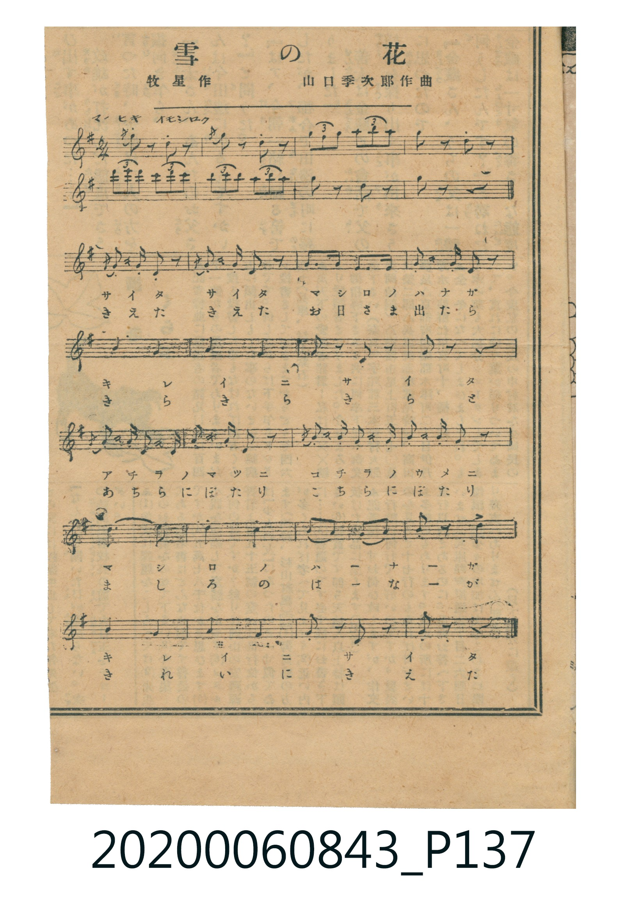

# 雪の花

<audio controls src="yuki_no_hana.mp3"></audio>

- 詞：牧星
- 曲：山口季次郎
- 日治時期公學校《唱歌帳》（典藏號 2020.006.0843・P137）

## 說明

【曲目說明】
・出處：《唱歌帳》（國立臺灣歷史博物館典藏號 2020.006.0843）第 P137.jpg 頁剪貼雜誌樂譜。
・作詞／作曲：牧星 作、山口季次郎 作曲。
・調性與拍號：ト長調（G 大調，1♯），2/4 拍，速度 != 96（原譜標示「マエヒキ オモシロク」）。
・背景與曲風：全曲包含 7 小節活潑的三連音器樂前奏（マエヒキ）與 20 小節歌唱主旋律，
描寫清晨起床推窗看見山茶花謝後滿庭白雪，把飄落的雪花比擬為從天而降的美麗花瓣。
・版本說明：本檔案完整收錄原譜 7 小節前奏與 20 小節歌唱主旋律。
【原頁歌詞全文與中文語譯】（對應 P137.jpg）

・編曲說明（鋼琴伴奏版）：
1. 前奏 (Intro, 7 小節)：忠實呈現原譜標示「マエヒキ オモシロク」之三連音前奏，左手配以輕巧跳音和弦。
2. 主歌伴奏 (Song, 20 小節 × 2 段)：右手演奏主旋律，左手以輕快的 2/4 拍步伐伴奏描繪雪花飄落。

## 歌詞

```text
一、朝おきて　庭見れば
いつのまにか　白い花
山茶花の　散つたあと
咲いたのは　雪の花

二、手にとれば　ちよとつめた
いつのまにか　きえてゆく
うつくしい　花びらは
お空から　ちつてくる
```

## ABC

```abc
X:1
T:雪の花
C:曲：山口季次郎
M:2/4
L:1/16
Q:1/4=96
K:G
V:V1 name="Piano" snm="Pia"
[V:V1]
d'2 z2 d'2 z2 | b4/3 c'4/3 d'4/3 c'4/3 d'4/3 e'4/3 | a2 z2 a2 z2 | d'4/3 e'4/3 d'4/3 c'4/3 d'4/3 c'4/3 |
b4/3 c'4/3 b4/3 a4/3 b4/3 a4/3 | B2 z2 G2 z2 | d2 z2 z4 | d3 e d2 z2 |
d3 e d2 z2 | B3 B A3 A | G3 A B2 z2 | A4 E4 |
A4 E4 | A2 z2 G2 z2 | F2 z2 z4 | E3 F E2 z2 |
G3 A E2 z2 | A3 B A2 G2 | F3 E D2 z2 | g4 e4 |
d4 B4 | A2 B2 A2 B2 | d2 z2 e2 z2 | A4 E4 |
B4 A4 | G2 z2 E2 z2 | A2 z2 G2 z2 |
```

## TMD 檔案連結

- [主旋律 TMD 檔案](yuki_no_hana.tmd) [[在 TMD Studio 編輯](https://tmdlang.github.io/Tmd-TS/#tmd=s7IKdvYPcrWy4qpTUCpJTLdSSM7PyUlNLsnMz7MqzsjPTkzOyFeCS5bl55TmploBqXgDQ4RwcX5pUXJqfEFieqpVgKGxOboM3KT4vPyS1KT8_GyEioKi_LLUvMQ8oKrcxLzS4uSizIKS-OT8gkqEmtSyzJRUkIrUlMyS_KLMxBwkJ6UWFYMdC3FDSVFiHsQMoCBCVUlGKtDdBTmJeSXoguWpiUBGkRKXlpbCy9mrHjeue9G1UUFLi0vRVsHSjMveVsGdy8ZI38QOpO_Fynnv98x63rn82Yz5YIOezd4EFHi6cePT_sVP1y5-tmbhy-Y-iMz0pc827X42s-nZnPlPW9c8Xbvj2YKFjxu6nk7Z-Gxtz9Mdmx83dL_f0_G0dceL6f0vZs5XMDIwMtAzMDDTM7AwMX7cvBsUku_3dCpxcelrKdhSC3ApKCg8bpgAdPfz2eterFr1bEbf44aJYNHm3U_bd72YORXoISzunNP9fHX3i_ZdzxsXP1u7_Wn_pqe9wIBY-XLJChxeALr9-Zo1CiBv6GUVpCu8XND4tHPVi017Xs6e82JVz7MVTS_Wznnc0AS1-8neOeDQ7QcyIKEKCWYFIP9xQyNaEINEgaoQ2l-s2v-sYfmLjvZn3b1Ap4D80Nzxcup2oDjQ9e4KT5csBzN7DB_NXA90GpAFjFQFoGog62XD_Ke7limAYxzk1775QKc9WzHz-ZJdjxt6HjfPe9y04nHzpMdNaxUeN6163LzocdP2x81rHzetf9wA1N-J5Izmnmcz14OcMXvTy0UrQGmjdQWQ_bSn9emE1QrmCk839D9f3_Bsy-5neyc-n9XyZEfny4bFL-dvfjpzBTBEnnb2Pl3aD3QCsp1AC4AGAgMXphkYLVM2Ptmx-9n07qf7gJHTA7JcQeFZf__T9auf7Wh9NnPFi63bn-7qeta34vmq6c_ndL9Y1g0MwBc924Bp-8WauU_39Tzbvf_prrXPZ-4FpnmgCc-6ul4ubnkxYS_QTUARoLJn66c8m7zmedOup_vmPV2y8kVDz8uZvUDZ5_v6Xu6aDlTwfPJihL-fd3Y8m7MGkp6Angayn62a8mxhx9N1Pc-mbnk2ZdvLnhZIsMLDAOJXfD4DGQ9Nr0C9wPQDlAemEVCITmsHanyyYy2IsWrei7XAiJgIirkNvc_aO-FpDhhyYAOe7GgAJqFnc-Y-bux63Nj7uHHZ44YGoPeBwfK4qedx4waILUBFDY8bWx43LgGWAo8b9z1uXP24EeiKBmAwAcWBfkaogwcnSGlDw7Opi8Ha5j9ubHrcuAJJ3aRNYCOBEkAjgc5sgBcyIEVAN0PcDwq06SvhMfd0H8h9L2cuAjodGH_AGHqyo_f5_KVP9k4FFikvp3UD4-_Jrjagw4AGvd8z--mcFXAXPW3vBsbxk53AIOx5Pns2UDEw2oAmAMPwyb62ZzPWQyIYGLrw8NnVAwqfzm6wj1dAwgQcGAsfN3WARIB-a2oE-oJAQIEDF6hh2eOmtseN_ciqgXyg6v7HjdNBOhsawEG3-XFTJzBUkNV1PV-5C2QYUALiAJC2ZSCdTd0YIda7HOhxoLtfLF74dN86EGrb8GzbHkRw7eh9sWzXy2mTn27Y-GJe79Oeac-2dTxdshEYdMBAgyRlYOBAUvPTiQ2gnLB2MSTFA93xfMtsIIJkjCc7uoGhBw00oDsoL4qhQEFLn4vLM6-kKN8qIDMxL9-hxqBGoRqcpW0stOzADGANgK8UUtCAZCZ43tIEGQrSWKNgGqdgACFqFDSM4xRM4oA8TVUNXV1NBQ0wR8EMxq9RMAIpBBM1UP0aYAUYekwQeqCmGsNVAPUDhYwQKoyB5hmCXWAKJA0UdIGm13JxBefnpWP62dAM4Wlg6rdSAGYpIJ4KxF1A3AvEy4AmAdMcMBj6gfR-IN0DpDcgeRpoha6CGZgGW4dFxBgsYqxgBKaNgCKGUBZIBuJINHe0APESIF4HxPsgLmjsRtgKMQloSzyUgVMIZDrINohLzEGSICYIgxWhWzwd6EWQx0EOWA_Eq8ABAAqSaUCZyWBngJwFdwrUPqDJYBbEHpj_kIQg7oMEAkga6hiwg03hytCdA8yUi4HUfGjUrIC7BuQ-kCgogNYjXGMYBwsGeChA4gNkNXK4gHgwGqIGZD9IFzZ3NLVB0wPEOlCw4IsLmFUwKUiAgC1ADRCU2AElVF07BXAGVQAyQIkWRCtzAQA)]
- [鋼琴伴奏 TMD 檔案](yuki_no_hana_piano.tmd) [[在 TMD Studio 編輯](https://tmdlang.github.io/Tmd-TS/#tmd=s7IKdvYPcrWy4tLSUng5e9XjxnUvuja-39PxsnvP8wlbnuzZ8nRp__POjvd7OhW0tLgUbRUszbjsbRXcuWyM9E3suOoUlF6snPd-z6znncufzZivBBJ4NnsTUODpxo1P-xc_Xbv42ZqFL5v7IDLTlz7btPvZzKZnc-Y_bV3zdO2OZwsWPm7oejpl47O1PU93bH7c0A20-2nrjhfT-1_MnK9gZGBkoGdgYKZnYGFi_Lh5d4ChsTnQKUpcXPpaCrbUAlwKCgqPGyYA3f189roXq1Y9m9H3uGEiWLR599P2XS9mTgV6CIs753Q_X939on3X88bFz9Zuf9q_6WkvMCBWvlyyAocXgG5_vmaNAsgbelkF6QovFzQ-bmiC2vRk7xxwWPYDGZAwhASqApD_uKERLUBBokBVCO0vVu1_1rD8RUf7s-5eoMUgFzd3vJy6HSgOdKu7wtMly8HMHsNHM9cDHQJkAaNQAagayHrZMP_prmUK4PhFGPl8-wqgFZAQwZomgJaAlCooGOopPO3sBYoraHjmlRTl6yiYKzzd0P98fYMmKC3sX_B0_bKnEzue9-972jf_xdo5z1bMfL5k1-OGnsfN8x43rXjcPOlx01qFx02rHjcvety0_XHz2sdN6x839D7Z2f1kR-fLhsUv52-GWAB07NPty551dr9s7X2ye-mLPVOfbl_-YvtmkIJJPU_3LIM6X0HBSE_hyY7dwAiDuFhBIzg_L10HGCFQlykcnq5gpPBs3VawE_s3A818tmcKUCVI1_Tup_uAcQy1C2rR_tXPZ7UoQEPt2dqlT_ZMgJj9rL__-c5VwPwDzDwvF7e8mLAX6grKEycUKGjpc3GBg9YqIDMxLz_Iw6HGoEahGuxVGwstOzCjRsE0TsEAQtQoaBjHKZjEAXmaqhq6upoKGmCOghmMX6NgBFIIJmqg-jXACjD0mCD0QE01hqsA6gcKGSFUGAPNMwS7wBRIGijoAk2vRXG9Dw7XRxvGAtVDyBoFw3gw0wRImcSCZE3BsmAS5l6oGiMgZZQLUmQMZBkDWaZAGqgSrALoHBABdA-IgjsIlB6whaahGSI4gWp1FczANFgfFhFjsIgxMC2BaCOQlVAWSAZiG8Q0iAqg7ngoA6cQSBfIFIgN5iBJEBOEwYqgBkJ1AeXBLIhqmO1IQhBbIE4ESUONBFsLDBNUVxrGwdwEdxLE0yATkB0J4sFoiBqQMSBdBDwNMwYmBXEzWDOqm1GCATXKcCUhaIIART-QwsuHJQ8QH5JAYE4GpaZYoGMgNHYBYMaBJyqQUeC0hWICMBVCdIATJjQZI1IqVB9IAOwSbOZANcGzAMK1EN-gmwH2BlA1XpcgLELSBJKH-AaRX0AhrmunAM64CkAGKPSRaWUuAA)]

## 分析

```text
================================================================================
📊 TMD Song Profile: [ 雪の花 ]
================================================================================
⏱  Duration:       0:33 (33.8s), 27 measures total
🎼 Key & Tempo:    首調基準 G, != 96.0 BPM, <2/4>
   - 分析範圍：      由實際發聲的音符與和弦推測調性；播放脈絡另行呈現
🎤 人聲音域:    D4 (MIDI 62) – E6 (MIDI 88) [跨度: 26 個半音 / 2.2 個八度, 難度: difficult]
   - 最低音:  D4 in [Song #1 @ m.19, 0:23]
   - 最高音: E6 in [Intro #1 @ m.2, 0:02]
🏛  結構:      Intro (8.8s) -> Song (25.0s)
⚡ 編曲密度:        Peak 1 軌道同時演奏
🗝  調性診斷：       D 大調（推測轉調經歷 1 次）
   - 風格氣質:    純淨自然大調（陽光明朗、易唱易記，無明顯調外色彩）
   - 轉調歷程:    D 大調起奏 ➔ [Song] 轉至 A 大調 (+7 半音 / 五度圈 +1 步)
   - 核心骨幹音:  A, E, D, B, G
   - 調性數值:    D 大調 [相關度: 0.77, 穩定度: Moderate, 自然音純度: 95.9%]
   - 候選調性 (K-S): D 大調 (0.77), A 大調 (0.72), A 小調 (0.63)
   - 五度圈歷程:   +2 -> +3
   - 各段落調性細節:
     • [Intro #1]: D 大調 (r: 0.69, 自然音純度: 82.5%, 調外音: C)
     • [Song #1]: A 大調 (r: 0.76, 自然音純度: 85.7%, 調外音: G)

  [ 五度圈游移軌跡 ]
               C  
         F            G  
      Bb              [D ]*
      Eb              [A ]*
         Ab           E  
            Db       B  
               F# 
     (* = active key center)

  [ 十二半音累積音高分佈 ]
     C  : ████                       4.1%
     C# :                            0.0%
     D  : ██████████████████        18.7%
     D# :                            0.0%
     E  : ███████████████████       19.9%
     F  :                            0.0%
     F# : ███                        3.7%
     G  : ████████████              12.2%
     G# :                            0.0%
     A  : ████████████████████████  25.4%
     A# :                            0.0%
     B  : ███████████████           16.1%
--------------------------------------------------------------------------------
Assignment 軌道音域：
  - Piano         : D4 – E6 (26 個半音 / 2.2 個八度, 76 個音符)
================================================================================
```


## 原書掃描頁




