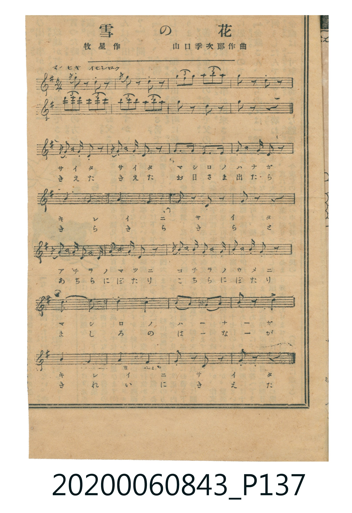

# 雪の花

> Re:Shōka 使用 AI 協助辨識與重建樂譜，可能會有錯誤。歡迎[回報](https://github.com/TMDLang/reshoka/issues)。

- **鋼琴伴奏版**：<br><audio controls src="yuki_no_hana.mp3"></audio>
- **NEUTRINO 歌聲合成版**：<br><audio controls src="yuki_no_hana_neutrino.mp3"></audio>

- 詞：牧星
- 曲：山口季次郎
- 日治時期公學校《唱歌帳》（典藏號 2020.006.0843・P137）

## 說明


- 出處：《唱歌帳》（國立臺灣歷史博物館典藏號 2020.006.0843）第 P137.jpg 頁剪貼雜誌樂譜。
- 作詞／作曲：牧星 作、山口季次郎 作曲。
- 調性與拍號：ト長調（G 大調，1♯），2/4 拍，速度 != 96（原譜標示「マエヒキ オモシロク」）。
- 背景與曲風：全曲包含 7 小節活潑的三連音器樂前奏（マエヒキ）與 20 小節歌唱主旋律，
描寫清晨起床推窗看見山茶花謝後滿庭白雪，把飄落的雪花比擬為從天而降的美麗花瓣。
- 版本說明：本檔案完整收錄原譜 7 小節前奏與 20 小節歌唱主旋律。
【原頁歌詞全文與中文語譯】（對應 P137.jpg）

### 編曲說明（鋼琴伴奏版）：

1. 前奏 (Intro, 7 小節)：忠實呈現原譜標示「マエヒキ オモシロク」之三連音前奏，左手配以輕巧跳音和弦。
2. 主歌伴奏 (Song, 20 小節 × 2 段)：右手演奏主旋律，左手以輕快的 2/4 拍步伐伴奏描繪雪花飄落。


## 歌詞

```text
一、朝おきて　庭見れば
いつのまにか　白い花
山茶花の　散つたあと
咲いたのは　雪の花

二、手にとれば　ちよとつめた
いつのまにか　きえてゆく
うつくしい　花びらは
お空から　ちつてくる
```

## ABC

<div class="abc-score" data-abc-src="yuki_no_hana.abc" aria-label="五線譜載入中"></div>

[下載 ABC 原始檔](yuki_no_hana.abc)

## TMD 檔案連結

- [主旋律 TMD 檔案](yuki_no_hana.tmd) [[在 TMD Studio 編輯](https://tmdlang.github.io/Tmd-TS/#tmd=s7IKdvYPcrWy4qpTUCpJTLdSSM7PyUlNLsnMz7MqzsjPTkzOyFeCS5bl55TmploBqXgDQ4RwcX5pUXJqfEFieqpVgKGxOboM3KT4vPyS1KT8_GyEioKi_LLUvMQ8oKrcxLzS4uSizIKS-OT8gkqEmtSyzJRUkIrUlMyS_KLMxBwkJ6UWFYMdC3FDSVFiHsQMoCBCVUlGKtDdBTmJeSXoguWpiUBGEUIYaEF6Zp5VSWIm0NnxQFyeGJ-bmJkH1JyCrKokIz-9KLEgo9IqI7MY5KzkxJz47MS8RCUuLS2Fl7NXPW5c96Jro4KWFpeirYKlGZe9rYI7l42RvokdyJQXK-e93zPreefyZzPmg419NnsTUODpxo1P-xc_Xbv42ZqFL5v7IDLTlz7btPvZzKZnc-Y_bV3zdO2OZwsWPm7oejpl47O1PU93bH7c0P1-T8fT1h0vpve_mDlfwcjAyEDPwMBMz8DCxPhx825QpLzf06nExaWvpWBLLcCloKDwuGEC0N3PZ697sWrVsxl9jxsmgkWbdz9t3_Vi5lSgh7C4c07389XdL9p3PW9c_Gzt9qf9m572AgNi5cslK3B4Aej252vWKIC8oZdVkK7wckHj085VLzbteTl7zotVPc9WNL1YO-dxQxPU7id754BDtx_IgIQqJJgVgPzHDY1oQQwSBapCaH-xav-zhuUvOtqfdfcCnQLyQ3PHy6nbgeJA17srPF2yHMzsMXw0cz3QaUAWMFIVgKqBrJcN85_uWqYAjnGQX_vmA532bMXM50t2PW7oedw873HTisfNkx43rVV43LTqcfOix03bHzevfdy0_nEDUH8nkjOae57NXA9yxuxNLxetAKWN1hVA9tOe1qcTViuYKzzd0P98fcOzLbuf7Z34fFbLkx2dLxsWv5y_-enMFcAQedrZ-3RpP9AJyHYCLQAaCAxcmGZgtEzZ-GTH7mfTu5_uA0ZOD8hyBYVn_f1P169-tqP12cwVL7Zuf7qr61nfiuerpj-f0_1iWTcwAF_0bAOm7Rdr5j7d1_Ns9_6nu9Y-n7kXmOaBJjzr6nq5uOXFhL1ANwFFgMqerZ_ybPKa5027nu6b93TJyhcNPS9n9gJln-_re7lrOlDB88mLEf5-3tnxbM4aSHoCehrIfrZqyrOFHU_X9TybuuXZlG0ve1ogwQoPA4hf8fkMZDw0vQL1AtMPUB6YRkAhOq0dqPHJjrUgxqp5L9YCI2IiKOY29D5r74SnOWDIgQ14sqMBmISezZn7uLHrcWPv48ZljxsagN4HBsvjpp7HjRvAtjS2PG5cAsz_jxv3PW5c_bgRaH8DMICA4kDfglTAgxCkqKHh2dTFYA3zHzc2PW5cAVYxaRPYGKAQ0BigoxrgRQpIGuhCiGtBQTR9JTyenu4DueblzEVAhwJjCxgfT3b0Pp-_9MneqcAC5OW0bmBsPdnVBnQM0KD3e2Y_nbMC7pan7d3AGH2yExhgPc9nzwYqBkYS0ARgiD3Z1_ZsxnpIdALDEh4au3pAodHZDfblCkgIAJ36uHHh46YOkAjQV02NQF_gDBZwIAKVLnvc1Pa4sR-iDsgCqut_3DgdpKehARxQmx83dQJDAqKi6_nKXSADgEIQ60AaloH0NHVjhE_vcqA3ga58sXjh033rQKhtw7NtexCBs6P3xbJdL6dNfrph44t5vU97pj3b1vF0yUZgQAGDCJJMgUEBSalPJzaAUvnaxZDUDHTH8y2zgQiS6J_s6AaGFTSIgO6gvJiFAgUtfS4uz7ySonyrgMzEvHyHGoOaanButbHQsgMzgIU7vgJGQQOST-DZRhNkJkhjjYKpggEY1yhoGCuYKJhqqmro6moqaACZCmZQTo2CEVAFCNdAdWkAJVHVmsDVgs0xhskZKRgrGMHljIFmGIJtM40HUgYKukAja7m4gvPz0jF8Z2iG8B5mqADrBWBKf7GwB2Q_xFs68EyriUUDkpd1gRDofiAJdgEWEWOwCNDpYNoIKGIIZYFkIO4GmeZjWAMM7UVgucdNW0EhD2TFg80AxQRYvLkNiLsR4s3roeLzgXgNlD0BrGMJlNcCxH0wHRCbjEA626Dy3UDcgWQiwpTHzY1I4iug4h1gMyHshWCb9kPdvAQqA7EJf3jv6iEnvCFhCAxfkBUgiFMIFK6gcIbEgTlIEsQEYbAiRJA3z4OKQQIWYsTjptUw0abtCNFmUDSAzIIELyxo-mGizV2o5oMDGhT4EPNhNoFEYXYhbIJFM8R8UHDDzAdFFcT8ZXDzCSTnTnKCFxqGwNACsyBhB0utSEKQMIckaZA0NIDBkQDMjZipeivUq9uAXtiM8BjU66AgAonAvAtKdSDRZmjaguQKkAwonYIgXDUimJsgQQNO78ByCmEHJPpAEYZsByjKIBH2uHkymLUSRQbZDrxB_XT2bHKC2jAOao0ZLEahRQcoXJETMogHoyFqQIEL0oU9kGFpE5aiIJkTEsiI1IfsSZgYKAAhaQ-WCpGDF1QYQUzfi6QHFGgYqRguimw6rCgBRSuRRcQUKhURsACFSUHSNDgYUdM0SqGBVEIgcjAs3ECisLyOsAiWZBAJDUMEowAGhR2kEIeYCgtH0kwFVny6dgrgql0ByABVgtE-hrEIthGYrcwFAA)]
- [鋼琴伴奏 TMD 檔案](yuki_no_hana_piano.tmd) [[在 TMD Studio 編輯](https://tmdlang.github.io/Tmd-TS/#tmd=s7IKdvYPcrWy4qpTUCpJTLdSyC8qychPL0osyKi0ysgsLskvykxOzInPTsxLVIIrKs4vLUpOjS9ITE-1CjA0NkfIlGSk5qZaFacmFufnFStxaWkpvJy96nHjuhddG9_v6XjZvef5hC1P9mx5urT_eWfH-z2dClpaXIq2CpZmXPa2Cu5cNkb6JnYgw16snPd-z6znncufzZgPNv3Z7E1AgacbNz7tX_x07eJnaxa-bO6DyExf-mzT7mczm57Nmf-0dc3TtTueLVj4uKHr6ZSNz9b2PN2x-XFDN9Dup607XkzvfzFzvoKRgZGBnoGBmZ6BhYnx4-bdIB8AnaLExaWvpWBLLcCloKDwuGEC0N3PZ697sWrVsxl9jxsmgkWbdz9t3_Vi5lSgh7C4c07389XdL9p3PW9c_Gzt9qf9m572AgNi5cslK3B4Aej252vWKIC8oZdVkK7wckHj44YmqE1P9s4Bh2U_kAEJQ0igKgD5jxsa0QIUJApUhdD-YtX-Zw3LX3S0P-vuBVoMcnFzx8up24HiQLe6KzxdshzM7DF8NHM90CFAFjAKFYCqgayXDfOf7lqmAI5fhJHPt68AWgEJEaxpAmgJSKmCgqGewtPOXqC4goZnXklRvo6CucLTDf3P1zdogtLC_gVP1y97OrHjef--p33zX6yd82zFzOdLdj1u6HncPO9x04rHzZMeN61VeNy06nHzosdN2x83r33ctP5xQ--Tnd1PdnS-bFj8cv5miAVAxz7dvuxZZ_fL1t4nu5e-2DP16fblL7ZvBimY1PN0zzKo8xUUjPQUnuzYDYwwiIsVNILz89J1gBECdZnC4ekKRgrP1m0FO7F_M9DMZ3umAFWCdE3vfroPGMdQu6AW7V_9fFaLAjTUnq1d-mTPBIjZz_r7n-9cBcw_wMzzcnHLiwl7oa6gPHFCgYKWPhcXOGitAjIT8_KDPBxqDGqqwT61sdCyAzNqFEwVDMC4RkHDWMFEwVRTVUNXV1NBA8hUMINyaoC-NgDjGqguDaAkqloTuFqwOcYwOSMFYwUjuJwx0AxDsG2m8UDKQEEXaGQtijt9sLsz2jAWqBxC1igYxoOZJkDKJBYkawqWBZMwN0LVGAEpo1yQImMgyxjIAloNUglWAXQOiEB3DyjisQSboRnUPdgKEwVgRn2yo-HFwh5QiEBSjA4852pi0QCMIVgk6AIhMESBJNgNWESMwSLAwATTRiDnQ1kgGYjLQab5GNYAs8UisNzjpq2gLAJkxYPNAGUZsHhzGxB3I8Sb10PF5wPxGih7AljHEiivBYj7YDogNhmBdLZB5buBuAPJRIQpj5sbkcRXQMU7wGZC2AvBNu2HunkJVAZiE_7w3tVDTnhDwhAYviArQBCnEChcQeEMiQNzkCSICcJgRYggb54HFYMELMSIx02rYaJN2xGizaBoAJkFCV5Y0PTDRJu7UM0HBzQo8CHmw2wCicLsQtgEi2aI-aDghpkPiiqI-cvg5hNIzp3kBC80DIGhBWZBwg6WWpGEIGEOSdIgaWgAgyMBmB8xU_VWqFe3Ab2wGeExqNdBQQQSgXkXlOpAos3QtAXJFSAZUDoFQbhqRDA3QYIGnN6bQLkCZgck-kARhmwHKMogEfa4eTKYtRJFBtkOvEH9dPZscoLaMA5qjRksRqFFByhckRMyiAejIWpAgQvShT2QYWkTlqIgmRMSyIjUh-xJmBgoACFpD5YKkYMXVBhBTN-LpAcUaBipGC6KbDqsKAFFK5FFxBQqFRGwAIVJQdI0OBhR0zRKoYFUQiByMCzcQKKwvI6wCJZkEAkNQwSjAAaFHaQQh5gKC0fSTAVWfUh1H46qGFqxgqpRIIWXD6tmQXxIRQsLXlCtHAsMOAiNXQDY5oBXziCjwHU0ignA2hyiA1zBQ5sDiBofqg8kAHYJNnOgmuBNCYRrIb5BNwPsDaBqvC5BWISkCSQP8Q2i3QEKcV07BXD7RwHIAAV-tA_QYjgbGBhAtjIXAA)]

## 分析

```text
================================================================================
📊 TMD Song Profile: [ 雪の花 ]
================================================================================
⏱  Duration:       0:58 (58.8s), 47 measures total
🎼 Key & Tempo:    首調基準 G, != 96.0 BPM, <2/4>
   - 分析範圍：      由實際發聲的音符與和弦推測調性；播放脈絡另行呈現
🎤 人聲音域:    D4 (MIDI 62) – G5 (MIDI 79) [跨度: 17 個半音 / 1.4 個八度, 難度: challenging]
   - 最低音:  D4 in [Intro #1 @ m.7, 0:07]
   - 最高音: G5 in [Song[L1] #1 @ m.20, 0:23]
   - 適合: soprano, mezzo-soprano, tenor, baritone
🏛  結構:      Intro (8.8s) -> Song[L1] (25.0s) -> Song[L2] (25.0s)
⚡ 編曲密度:        Peak 1 軌道同時演奏
🗝  調性診斷：       A 調性不明確（推測轉調經歷 1 次）
   - 風格氣質:    流行大調（略帶和弦色彩音與裝飾副屬和弦）
   - 轉調歷程:    A 調性不明確起奏 ➔ [Song[L1]] 轉至 A 大調 (+7 半音 / 五度圈 +1 步)
   - 核心骨幹音:  A, E, D, B, G
   - 調性數值:    A 調性不明確 [相關度: 0.74, 穩定度: Ambiguous, 自然音純度: 84.6%]
   - 候選調性 (K-S): A 大調 (0.74), D 大調 (0.74), E 小調 (0.64)
   - 五度圈歷程:   +2 -> +3 -> +3
   - 各段落調性細節:
     • [Intro #1]: D 大調 (r: 0.69, 自然音純度: 82.5%, 調外音: C)
     • [Song[L1] #1]: A 大調 (r: 0.76, 自然音純度: 85.7%, 調外音: G)
     • [Song[L2] #1]: A 大調 (r: 0.76, 自然音純度: 85.7%, 調外音: G)

  [ 五度圈游移軌跡 ]
               C  
         F            G  
      Bb              [D ]*
      Eb              [A ]*
         Ab           E  
            Db       B  
               F# 
     (* = active key center)

  [ 十二半音累積音高分佈 ]
     C  : ██                         2.3%
     C# :                            0.0%
     D  : ███████████████           16.8%
     D# :                            0.0%
     E  : ████████████████████      21.6%
     F  :                            0.0%
     F# : ████                       4.1%
     G  : ████████████              13.1%
     G# :                            0.0%
     A  : ████████████████████████  26.4%
     A# :                            0.0%
     B  : ██████████████            15.6%
--------------------------------------------------------------------------------
Assignment 軌道音域：
  - Piano         : D4 – G5 (17 個半音 / 1.4 個八度, 127 個音符)
================================================================================
```


## 原書掃描頁




