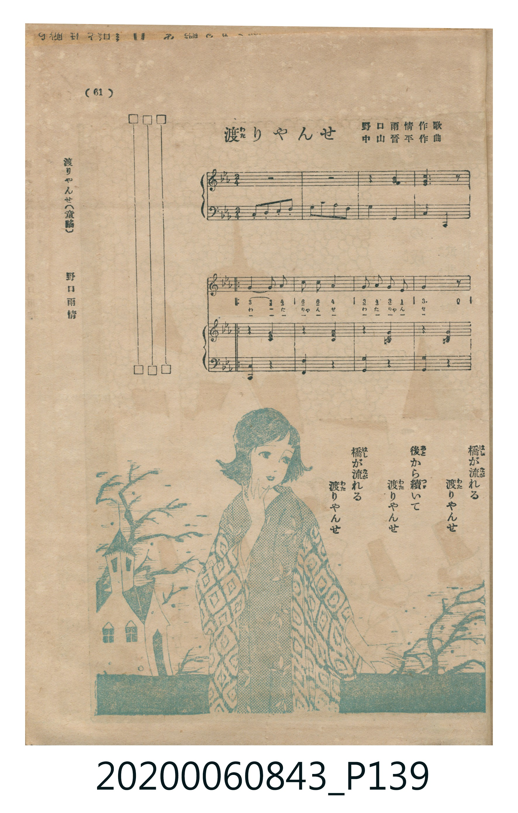
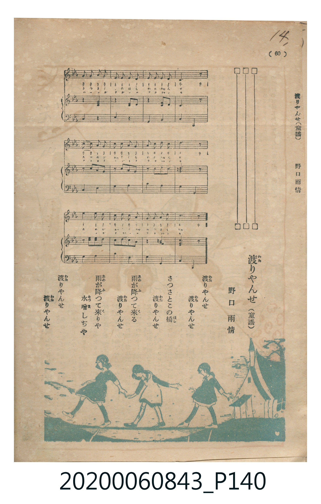

# 渡りやんせ

> Re:Shōka 使用 AI 協助辨識與重建樂譜，可能會有錯誤。歡迎[回報](https://github.com/TMDLang/reshoka/issues)。

- **鋼琴伴奏版**：<br><audio controls src="watariyanse.mp3"></audio>
- **NEUTRINO 歌聲合成版**：<br><audio controls src="watariyanse_neutrino.mp3"></audio>

- 詞：野口雨情
- 曲：中山晋平
- 日治時期公學校《唱歌帳》（典藏號 2020.006.0843・P139–P140）

## 說明


- 出處：《唱歌帳》（國立臺灣歷史博物館典藏號 2020.006.0843）第 P139.jpg–P140.jpg 跨頁（剪貼自《子供の國》第 61–60 頁）。
- 作詞／作曲：野口雨情 作歌、中山晋平 作曲。
- 調性與拍號：變ホ調／ハ短調（Eb major / C minor，3♭），2/4 拍，速度 != 84。
- 背景與曲風：大正時期童謠名家野口雨情與中山晋平合作的經典童謠，採用日本傳統都節／五聲小調音階，
描寫山間小溪上架起獨木橋，石燈籠點亮微光、呼喚孩童過橋的靜謐黃昏情景。
- 版本說明：本檔案為原譜歌唱聲部之忠實數位化版本。
【原頁歌詞全文與中文語譯】（對應 P139.jpg–P140.jpg）

### 編曲說明（鋼琴伴奏版）：

完整數位化原書印刷之雙手鋼琴伴奏譜（含 4 小節前奏與 16 小節主歌伴奏）。


## 歌詞

```text
一、山の小川に　一本橋を
ちよとかけたれば
目高がなくぞ
渡りやんせ　渡りやんせ
石の燈籠の　灯がついた
灯がついた
請過橋吧、請過橋吧，石燈籠的燈火已經點亮了、已經點亮了。）

二、山の小川に　丸木の橋を
ちよとかけたれば
川蝦なくぞ
渡りやんせ　渡りやんせ
石の燈籠の　灯も消えた
灯も消えた
請過橋吧、請過橋吧，石燈籠的燈火也熄滅了、也熄滅了。）
```

## ABC

<div class="abc-score" data-abc-src="watariyanse.abc" aria-label="五線譜載入中"></div>

[下載 ABC 原始檔](watariyanse.abc)

## TMD 檔案連結

- [主旋律 TMD 檔案](watariyanse.tmd) [[在 TMD Studio 編輯](https://tmdlang.github.io/Tmd-TS/#tmd=s7IKdvYPcrWy4qpTUCpJTLdSSM7PyUlNLsnMz7MqzsjPTkzOyFeCS5bl55TmploBqXgDQ4RwcX5pUXJqfEFieqpVgKGxJboM3KT4vPyS1KT8_GyEioKi_LLUvMQ8oKrcxLzS4uSizIKS-OT8gkqEmtSyzJRUkIrUlMyS_KLMxBwkJ6UWFYMdC3FDSVFiHsQMoCBCFVBTemaeVUliJtAp8UBcnhifm5iZl5OYl4KsqiQjP70osSCj0iojsxhkVXJiTnx2Yl4iQlFJRiowCApyEoEO1NJSeLZj4eOmrsdNLY-bJj9unK2gpcWlaKtgYcJlb6vgqsOVnVppq-Ccy2VjpG9iBzLjxcp57_fMetne97R_8cvZK541t4KNfjZ7E1D4yY61TzdufDaz--nOzRDh6Uufbdr9bGbTsznzn7auebp2x7MFCx83dD2dsvHZ2p6nOzY_buh-v6fjaeuOF9P7X8ycr2BkYGSgZ2BgpmdgYWL8uHk3KDoeNUwOMDQxeL-nU4mLS19LwZZagEtBQeFxwwSg25_PXvdi1apnM_oeN0wEizbvftq-68XMqUBPYXHunO7nq7tftO963rj42drtT_s3Pe2d9bxz5cslK3D4BOj252vWKIB8o5dVkA71EYip8GL7ipcLGkGmdq56sWnPi_ZVIAvXTniyb_bjxnVAq4B2gvSaGQJ1mRkogBV3Pm5ogrrzyd454DjpBzIgsYAcOQog0bU9jxsakeMGLDp7E8KQF6v2P2tY_qKj_Vl3L9DxQENerOt63DwbKA40-XFz__P5a8HsDtckhdzErPwiBX0FZ4XczLz8ovd7eowfzVwLdBSQBUwmCkAzgKyXDfOf7lqmAE5MSBY19zybuR5k0exNLxetAFr0dMnyZ2sXQ5LI89VLX6xZ8HRC79N125B9AVSP7PynEzqAHng-q-X5tsnAAIfoAlr5rG_h8ykrQGluzpqnTZufb934snnv8_UNoMDZNeVF46anG_qBvng5f_PLWX1A9SA3KSg86-9_un410PCX0yYDFTzbterJjq5n87a92Lr9ee-KZ3NWPFsJjPSe5_M3P2_veL5xwcvd857sWvd037qnrcBoaHw6cc_TabOerl0JdMbLxj6gYqDDXs6d82LNhJe7m5_N6Ae6H-hlRBA87-wAug-S3ID-B7KfrZrybGHH86ZdT_vmv1gLii9gggM692Xziic7u5_uX_B0_bJnU3c82dv7tGcaRDvIOGjyBWoCpgmgJmAyeNq64tm0dkhwgRir5r1YC7R6Iih5beh91t6JLQkCYw5s1pMdDSD_bNwISncb-p9un_u4cfXjhgagOMiRK7sfN00C29kILDI6HjeueNzY_bhx4uPG-Y-beh43bgDJATPSy9UzHjcC-aseN_Y_bpwHEkUrZIBmoomAtc7fDLQYEsZABlDR88b1YJOWPG5sAdoCVoQpBPQbxJ-gxDRnBdD9LxYvBMYBPC6Bkfe0czYkRp_sagN65-mu5chR-3LupJcbm16unfV0w0agCc82bAGa8LR_9YuJ059OXPR-D9h5CgovVndDIvjphOXAgELmIqcPULoEMhpXP92-CZhAIckFaC8obNFFmuBhvwuUR7GF_Q6gM4GCxAU_UN-LucuoFfZNTc-2AS0CInjYowmRF_ZP50yGhz1QGdDF1A34JzvnP29reba7FRLqqFxwkAMNpbz6gAIFLX0uruD8vHSrgMzEvHyHGoOaarC7bQzNtOzALGCl9bSz9-nSfgUTBWDQAIskBQ2UXL5n4rO1izRBJoGU1ygYKOiCIYwmUwRsmo9hjUI8VARGkykCMc-IeubBQgdUwZkCiyQLaPBYKeAvhhQ00DIGUtgZg802BtMmYHvNwCJmYBoiApMD0YZwEexhB8woYJHHjfuAeB2Y1QXWAyyJIDJN_UD2arAMsFRaDJXcC5aaDBbeACanQ2SA7scVsKRZtg9qXjeY1wsmIXrWQ_WAbITYhz3QQY0rQyN4qIPLlnbMsgVUIGCU7AoaaMUNUiQYxoEtMweHOShsa8DhDWKDwhuSHsxAbgJxYVKQaACJgDAoKpCiAew0aOCsAGKIpydCPTofGjg90MCG2PC4qRGsagGYBOkA0T1gHavA7H4wOQ_VOlBEkGUdRBUwhkBqO6C6N-OxDjkuDI1BkWEGjwyCJTciuMEhCQ9ORIo2gYY32DLiVCGle4hjQV4F2gomQRZDfTob6muQcRDjSdWAlOhpbRNKMJsDg9nIAB7MBNsdChpoNR8x6dwMzIM4F7O0AUcCjuKmEVYCTIfnZmB2bIN6HJTJIdn8ceMmRICA2ZAiAuhuMAkyBpFUsRY2FFjV1ASWg5Q5oJSO3apaLi5dOwVQ7RjtYxirAGcbgdnKXAA)]
- [鋼琴伴奏 TMD 檔案](watariyanse_piano.tmd) [[在 TMD Studio 編輯](https://tmdlang.github.io/Tmd-TS/#tmd=s7IKdvYPcrWy4qpTUCpJTLdSyC8qychPL0osyKi0ysgsLskvykxOzInPTsxLVIIrKs4vLUpOjS9ITE-1CjA0ttQNMDQxQEiXZKTmploV5CRWKnFpaSk827HwcVPX46aWx02THzfOfr-n42X3nucTtjzZs-Xp0v7nnR3v93QqaGlxKdoqWJhw2dsquOpwZadW2io453LZGOmb2IEMfrFy3vs9s1629z3tX_xy9opnza1g-57N3gQUfrJj7dONG5_N7H66czNEePrSZ5t2P5vZ9GzO_Keta56u3fFswcLHDV1Pp2x8trbn6Y7Njxu6ge542rrjxfT-FzPnKxgZGBnoGRiY6RlYmBg_bt4N8tWjhskgfwFdp8TFpa-lYEstwKWgoPC4YQLQ7c9nr3uxatWzGX2PGyaCRZt3P23f9WLmVKCnsDh3Tvfz1d0v2nc9b1z8bO32p_2bnvbOet658uWSFTh8AnT78zVrFEC-0csqSIf6CMRUeLF9xcsFjY8bmqD2Ptk7BxzG_UAGJFSRA1sBJLq253FDI3JYg0Vnb0IY8mLV_mcNy190tD_r7gU6BmjIi3Vdj5tnA8WBJj9u7n8-fy2Y3eGapJCbmJVfpKCv4KyQm5mXX_R-T4_xo5lrgU4GsoDRrgA0A8h62TD_6a5lCuDEgbDo-fYVQIshYYc1QQGtBilVUHi6rufZ1C3Ppu54srf3ac-0p33zn83e8bR3w9OO7U92dr-cPfNZZzey9hdr54CCesJqBROFpxv6n69veNrZCxLvaFcwNIMKPdmxGxgaEA1Ay6DuojxlQIGClj4Xl2deSVG-VUBmYl5-kIdDjUFNNdhDNoZmWnZgVo2CYZyCLhCaK5gBSWMgrgE6GiRiBuaBYA2YBRIF0YZgEbN4qKQBTBFXLYp9Psj2WcCtA-ozhhBAe-KBhkHZxvEK5kAWmASpArNBlAHE5OD8vHR8HgHmLVAqNQUmTwtoAFspABPZ48Z1QN7T7XMfN65-3AAM9IZnc9Y8W9n9uGmSgsaTHTuezVkBVAIR0ASFGcSZEK8bwz0OdBI0UEA0RAQzUGAsEAaFSw3YNB_DGgVgyQXW_7hxHxCvA7O6wHoeN_ZAZJr6gezVYJmWx42LoZJ7wVKTwcIbwOR0iAzQ_ZCAB0UEkmVGpFq2D2peN5jXCyYhetZD9YBshNiHsAs50EGlnKERPNQfNwLL6vbHjcCA7X7cOPFx4_zHTT1A1wODH1hWvVw9A-iKx42rHjf2P26cp6ABjJsXc5fBBZAiAWfSNAaHMCRpghMiiAuTwhsNYKdBA2cFEEM8PRHq0fnQwOmBBjbEhsdNjWBVC8AkSAeI7gHrWAVm94PJeZgRQZZ1EFXAGAKp7YDq3ozHOuS4MDQGRQasjLFCrziBcYAmgghucEjCgxORok2g4Q22jDhVSOke4liQV4G2gkmQxVCfzob6Gp6uSNaAlOhpbRNKMJsDg9nIAB7Mz-dvBuaa5-0dzzcuADJASb1xPTidLwFn5_kKGiCBpqZn2zqAkQoUICadQ4pgiHNxFMEIAj2lw8qA6fD8DMyQbVCvg7I5JKM_btyECBIwG1JIAF0OJkHGIBIr1pCnwKqmJrAcpNQBpXXsVgErAKQaAGfVEq8QbZYbi2CAq5hok1gYhV0NsKKJNgaygDSosoFnBqg6NKMwBOBm4zAHXpMBKTQHAJURVECEe0DGIFkOprEYBAxEXTsFcBWtAGSAwjPaxzAWwTYCs5W5AA)]

## 分析

```text
================================================================================
📊 TMD Song Profile: [ 渡りやんせ ]
================================================================================
⏱  Duration:       0:57 (57.1s), 40 measures total
🎼 Key & Tempo:    首調基準 E,, != 84.0 BPM, <2/4>
   - 分析範圍：      由實際發聲的音符與和弦推測調性；播放脈絡另行呈現
🎤 人聲音域:    C4 (MIDI 60) – D#5 (MIDI 75) [跨度: 15 個半音 / 1.2 個八度, 難度: moderate]
   - 最低音:  C4 in [Song[L1] #1 @ m.11, 0:14]
   - 最高音: D#5 in [Song[L1] #1 @ m.9, 0:11]
   - 適合: soprano, mezzo-soprano, contralto, tenor, baritone, bass
🏛  結構:      Song[L1] (28.6s) -> Song[L2] (28.6s)
⚡ 編曲密度:        Peak 1 軌道同時演奏
🗝  調性診斷：       C 小調（純淨自然小調，未偵測到可信轉調）
   - 風格氣質:    純淨自然小調（陰鬱抒情、旋律集中，無明顯調外色彩）
   - 轉調歷程:    全曲維持單一推測調性（未偵測到可信轉調）
   - 核心骨幹音:  G, D#, C, G#, D
   - 調性數值:    C 小調 [相關度: 0.86, 穩定度: High, 自然音純度: 100.0%]
   - 候選調性 (K-S): C 小調 (0.86), D# 大調 (0.68), G# 大調 (0.54)
   - 五度圈歷程:   +0 -> +0
   - 各段落調性細節:
     • [Song[L1] #1]: C 小調 (r: 0.86, 自然音純度: 100.0%)
     • [Song[L2] #1]: C 小調 (r: 0.86, 自然音純度: 100.0%)

  [ 五度圈游移軌跡 ]
              [C ]*
         F            G  
      Bb               D  
      Eb               A  
         Ab           E  
            Db       B  
               F# 
     (* = active key center)

  [ 十二半音累積音高分佈 ]
     C  : ██████████████████        22.3%
     C# :                            0.0%
     D  : █                          1.8%
     D# : ███████████████████████   28.6%
     E  :                            0.0%
     F  :                            0.0%
     F# :                            0.0%
     G  : ████████████████████████  30.4%
     G# : █████████████             17.0%
     A  :                            0.0%
     A# :                            0.0%
     B  :                            0.0%
--------------------------------------------------------------------------------
Assignment 軌道音域：
  - Piano         : C4 – D#5 (15 個半音 / 1.2 個八度, 110 個音符)
================================================================================
```


## 原書掃描頁






