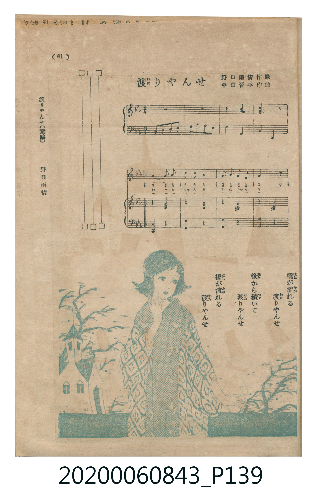
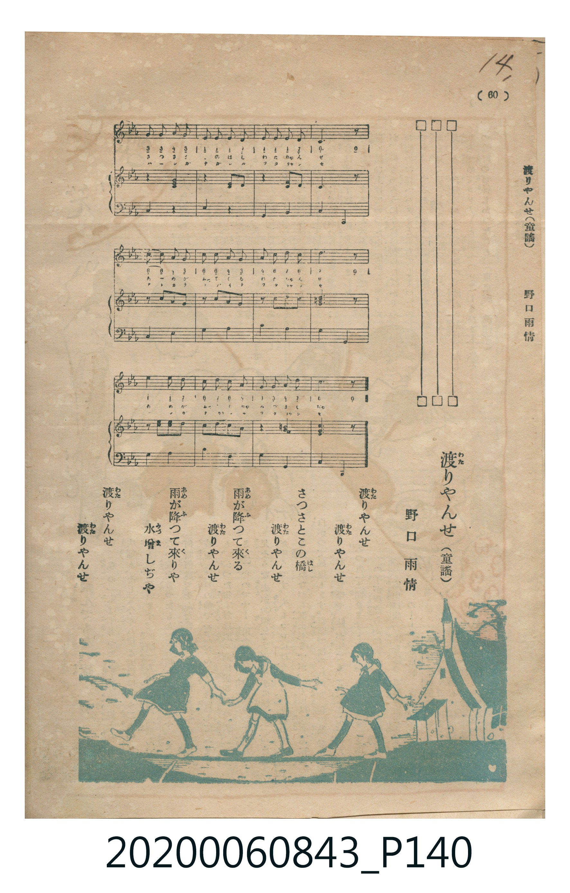

# 渡りやんせ

> Re:Shoka 使用 AI 辨識樂譜，可能會有錯誤。歡迎回報。

<audio controls src="watariyanse.mp3"></audio>

- 詞：野口雨情
- 曲：中山晋平
- 日治時期公學校《唱歌帳》（典藏號 2020.006.0843・P139–P140）

## 說明

【曲目說明】
・出處：《唱歌帳》（國立臺灣歷史博物館典藏號 2020.006.0843）第 P139.jpg–P140.jpg 跨頁（剪貼自《子供の國》第 61–60 頁）。
・作詞／作曲：野口雨情 作歌、中山晋平 作曲。
・調性與拍號：變ホ調／ハ短調（Eb major / C minor，3♭），2/4 拍，速度 != 84。
・背景與曲風：大正時期童謠名家野口雨情與中山晋平合作的經典童謠，採用日本傳統都節／五聲小調音階，
描寫山間小溪上架起獨木橋，石燈籠點亮微光、呼喚孩童過橋的靜謐黃昏情景。
・版本說明：本檔案為原譜歌唱聲部之忠實數位化版本。
【原頁歌詞全文與中文語譯】（對應 P139.jpg–P140.jpg）

・編曲說明（鋼琴伴奏版）：
完整數位化原書印刷之雙手鋼琴伴奏譜（含 4 小節前奏與 16 小節主歌伴奏）。

## 歌詞

```text
一、山の小川に　一本橋を
ちよとかけたれば
目高がなくぞ
渡りやんせ　渡りやんせ
石の燈籠の　灯がついた
灯がついた
請過橋吧、請過橋吧，石燈籠的燈火已經點亮了、已經點亮了。）

二、山の小川に　丸木の橋を
ちよとかけたれば
川蝦なくぞ
渡りやんせ　渡りやんせ
石の燈籠の　灯も消えた
灯も消えた
請過橋吧、請過橋吧，石燈籠的燈火也熄滅了、也熄滅了。）
```

## ABC

```abc
X:1
T:渡りやんせ
C:曲：中山晋平
M:2/4
L:1/16
Q:1/4=84
K:Cm
V:V1 name="Piano" snm="Pia"
[V:V1]
z4 z4 | z4 z4 | z4 z4 | z4 z4 |
G3 G G2 A2 | c3 c c2 A2 | G2 A2 G2 E2 | G4 z4 |
e3 d c2 G2 | A3 G E4 | C2 E2 A3 G | G4 z4 |
C2 C2 E2 E2 | G2 A G E2 z2 | C2 C2 E2 E2 | G2 A G E2 z2 |
e3 d c2 G2 | A3 c G2 z2 | G2 A2 G2 E2 | C4 z4 |
z4 z4 | z4 z4 | z4 z4 | z4 z4 |
G3 G G2 A2 | c3 c c2 A2 | G2 A2 G2 E2 | G4 z4 |
e3 d c2 G2 | A3 G E4 | C2 E2 A3 G | G4 z4 |
C2 C2 E2 E2 | G2 A G E2 z2 | C2 C2 E2 E2 | G2 A G E2 z2 |
e3 d c2 G2 | A3 c G2 z2 | G2 A2 G2 E2 | C4 z4 |
```

## TMD 檔案連結

- [主旋律 TMD 檔案](watariyanse.tmd) [[在 TMD Studio 編輯](https://tmdlang.github.io/Tmd-TS/#tmd=s7IKdvYPcrWy4qpTUCpJTLdSSM7PyUlNLsnMz7MqzsjPTkzOyFeCS5bl55TmploBqXgDQ4RwcX5pUXJqfEFieqpVgKGxJboM3KT4vPyS1KT8_GyEioKi_LLUvMQ8oKrcxLzS4uSizIKS-OT8gkqEmtSyzJRUkIrUlMyS_KLMxBwkJ6UWFYMdC3FDSVFiHsQMoKASl5aWwrMdCx83dT1uanncNPlx42wFLS0uRVsFCxMue1sFVx2u7NRKWwXnXC4bI30TO5CpL1bOe79n1sv2vqf9i1_OXvGsuRVs2bPZm4DCT3asfbpx47OZ3U93boYIT1_6bNPuZzObns2Z_7R1zdO1O54tWPi4oevplI3P1vY83bH5cUP3-z0dT1t3vJje_2LmfAUjAyMDPQMDMz0DCxPjx827QeH1qGFygKGJwfs9nUpcXPpaCrbUAlwKCgqPGyYA3f589roXq1Y9m9H3uGEiWLR599P2XS9mTgV6Cotz53Q_X939on3X88bFz9Zuf9q_6WnvrOedK18uWYHDJ0C3P1-zRgHkG72sgnSoj0BMhRfbV7xc0AgytXPVi017XrSvAlm4dsKTfbMfN64DWgW0E6TXzBCoy8xAAay483FDE9SdT_bOAcdJP5ABiQXkyFEAia7tedzQiBw3YNHZmxCGvFi1_1nD8hcd7c-6e4GOBxryYl3X4-bZQHGgyY-b-5_PXwtmd7gmKeQmZuUXKegrOCvkZublF73f02P8aOZaoKOALGAyUQCaAWS9bJj_dNcyBXBiQrKouefZzPUgi2ZverloBdCip0uWP1u7GJJEnq9e-mLNgqcTep-u24bsC6B6ZOc_ndAB9MDzWS3Pt00GBjhEF9DKZ30Ln09ZAUpzc9Y8bdr8fOvGl817n69vAAXOrikvGjc93dAP9MXL-ZtfzuoDqge5SUHhWX__0_WrgYa_nDYZqODZrlVPdnQ9m7ftxdbtz3tXPJuz4tlKYKT3PJ-_-Xl7x_ONC17unvdk17qn-9Y9bQVGQ-PTiXueTpv1dO1KoDNeNvYBFQMd9nLunBdrJrzc3fxsRj_Q_UAvI4LgeWcH0H2Q5Ab0P5D9bNWUZws7njfteto3_8VaUHwBExzQuS-bVzzZ2f10_4Kn65c9m7rjyd7epz3TINpBxkGTL1ATME0ANQGTwdPWFc-mtUOCC8RYNe_FWqDVE0HJa0Pvs_ZObEkQGHNgs57saAD5Z-NGULrb0P90-9zHjasfNzQAxUGOXNn9uGkSxE6guobHjcCCo-Nx44rHjd2PGyc-bpz_uKnnceMGhApgpnq5esbjRqDoqseN_Y8b5yHk0IodTBEkY-ZvBjoIEvZABkikcT3Y1CWPG1uA9iIpxZQA-hwSCqCkNmcF0HcvFi8ExhA8poFR-7RzNiS-n-xqA3r26a7lyBH_cu6klxubXq6d9XTDRqAJzzZsAZrwtH_1i4nTn05c9H4P2KkKCi9Wd0Oi_-mE5cBgROYipx5QqgUyGlc_3b4JmHwhiQloLyjk0UWa4DGzC5SDscXMDqAzgYKkRw7QjBdzl9EiZpqanm0DWg1EaDGDJkFezDydMxkeM0BlQD9QN1qe7Jz_vK3l2e5WSJygcsERAjSU8qoHChS09Lm4gvPz0q0CMhPz8h1qDGoUqsEOtzE007IDs4A13tPO3qdL-xVMFIBhAyzPFDRQiog9E5-tXaQJMgqkvEbBQEEXDGE0mSLglAeyHRjwVgrA6Fd43LgPiNcBcRdQAzCnAUX7gfRqIAbmt8Vgwb1AwclAegMQTweJNE1COM0YbLQxmDYBW2sGFjED0xARmByINoSL4HMaKLG3A6kVQNwNxBPBDpkPtBroQqBDQI5oBLIWQOV7wPKglI9wmWEc2GhzsENAFtaAHQFigxwBCSOzeKibYFKE3QYOIJBTukBBCAoakN2zwW7CIQV3E9g6uJ2IsDCBOgpkJ5Gq0EMMFJnToZEJLCTawO7phQpsAjtkEySGG5eAlUNClHBwmYF5EJdhxiTYmajBVcvFpWunAMoDCki0MhcA)]
- [鋼琴伴奏 TMD 檔案](watariyanse_piano.tmd) [[在 TMD Studio 編輯](https://tmdlang.github.io/Tmd-TS/#tmd=s7IKdvYPcrWy4tLSUni2Y-Hjpq7HTS2PmyY_bpz9fk_Hy-49zydsebJny9Ol_c87O97v6VTQ0uJStFWwMOGyt1Vw1eHKTq20VXDO5bIx0jex46pTUHqxct77PbNetvc97V_8cvaKZ82tSiDhZ7M3AYWf7Fj7dOPGZzO7n-7cDBGevvTZpt3PZjY9mzP_aeuap2t3PFuw8HFD19MpG5-t7Xm6Y_Pjhm6gO5627ngxvf_FzPkKRgZGBnoGBmZ6BhYmxo-bdwcYGls-apgcYGhiAHSdEheXvpaCLbUAl4KCwuOGCUC3P5-97sWqVc9m9D1umAgWbd79tH3Xi5lTgZ7C4tw53c9Xd79o3_W8cfGztduf9m962jvreefKl0tW4PAJ0O3P16xRAPlGL6sgHeojEFPhxfYVLxc0Pm5ogtr7ZO8ccBj3AxmQUEUObAWQ6Nqexw2NyGENFp29CWHIi1X7nzUsf9HR_qy7F-gYoCEv1nU9bp4NFAea_Li5__n8tWB2h2uSQm5iVn6Rgr6Cs0JuZl5-0fs9PcaPZq4FOhnIAka7AtAMIOtlw_ynu5YpgBMHwqLn21cALYaEHdYEBbQapFRB4em6nmdTtzybuuPJ3t6nPdOe9s1_NnvH094NTzu2P9nZ_XL2zGed3cjaX6ydAwrqCasVTBSebuh_vr7haWcvSLyjXcHQDCr0ZMduYGhANAAtg7qL8pQBBQpa-lxcnnklRflWAZmJeflBHg41BjUK1WAf2RiaadmBWTUKhnEKukBormAGJI2BuAboapCIGZgHgjVgFkgURBuCRczioZIGMEVctSgW-qBYaAG3D6jRGEIALYoHmgZlG8crmANZYBKkCswGUQYQo4Pz89LxegWYvUAJ1RSYQi2gYQwKBIitEK8Ywz0CtAHqSRANEcH0JIwFwiB_1nAh2wTK3YZGGFbhDFBjsDmQAAUHH4gLkyJkmaExyDZY4kHYBjYIbhrC2SZQ68AmEacK1T5zoH1GBsT7DpJcINbhSC4IAmIfSqziTi_xCtFmubEIBjjdRJvEwijsaoCpJ9oYyALSoBQEDy2oOjSjMATgZuMwB548gRSaA4DKCCogwj0gY5AsB9NYDAIGoq6dAjjjKQAZoABFppW5AA)]

## 分析

```text
================================================================================
📊 TMD Song Profile: [ 渡りやんせ ]
================================================================================
⏱  Duration:       0:57 (57.1s), 40 measures total
🎼 Key & Tempo:    首調基準 E,, != 84.0 BPM, <2/4>
   - 分析範圍：      由實際發聲的音符與和弦推測調性；播放脈絡另行呈現
🎤 人聲音域:    C4 (MIDI 60) – D#5 (MIDI 75) [跨度: 15 個半音 / 1.2 個八度, 難度: moderate]
   - 最低音:  C4 in [Song #1 @ m.11, 0:14]
   - 最高音: D#5 in [Song #1 @ m.9, 0:11]
   - 適合: soprano, mezzo-soprano, contralto, tenor, baritone, bass
🏛  結構:      Song (28.6s) -> Song (28.6s)
⚡ 編曲密度:        Peak 1 軌道同時演奏
🗝  調性診斷：       C 小調（純淨自然小調，未偵測到可信轉調）
   - 風格氣質:    純淨自然小調（陰鬱抒情、旋律集中，無明顯調外色彩）
   - 轉調歷程:    全曲維持單一推測調性（未偵測到可信轉調）
   - 核心骨幹音:  G, D#, C, G#, D
   - 調性數值:    C 小調 [相關度: 0.85, 穩定度: High, 自然音純度: 100.0%]
   - 候選調性 (K-S): C 小調 (0.85), D# 大調 (0.64), G# 大調 (0.51)
   - 五度圈歷程:   +0 -> +0
   - 各段落調性細節:
     • [Song #1]: C 小調 (r: 0.85, 自然音純度: 100.0%)
     • [Song #2]: C 小調 (r: 0.85, 自然音純度: 100.0%)

  [ 五度圈游移軌跡 ]
              [C ]*
         F            G  
      Bb               D  
      Eb               A  
         Ab           E  
            Db       B  
               F# 
     (* = active key center)

  [ 十二半音累積音高分佈 ]
     C  : █████████████████         22.7%
     C# :                            0.0%
     D  : █                          1.8%
     D# : ███████████████████       25.5%
     E  :                            0.0%
     F  :                            0.0%
     F# :                            0.0%
     G  : ████████████████████████  32.7%
     G# : █████████████             17.3%
     A  :                            0.0%
     A# :                            0.0%
     B  :                            0.0%
--------------------------------------------------------------------------------
Assignment 軌道音域：
  - Piano         : C4 – D#5 (15 個半音 / 1.2 個八度, 106 個音符)
================================================================================
```


## 原書掃描頁






