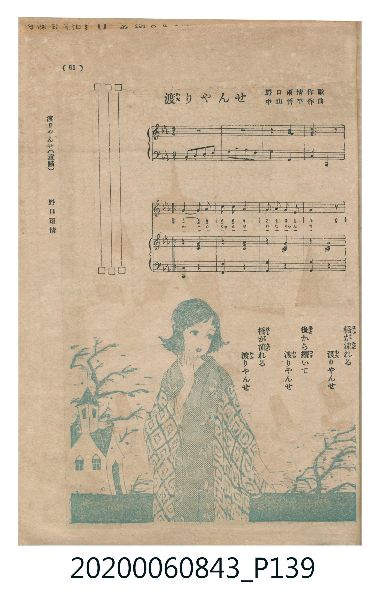
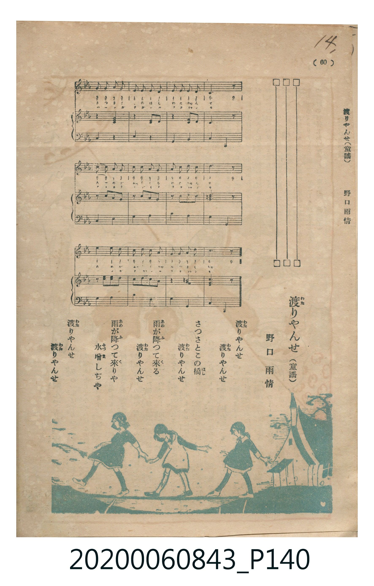

# 渡りやんせ

> Re:Shōka 使用 AI 協助辨識與重建樂譜，可能會有錯誤。歡迎回報。

- **鋼琴伴奏版**：<br><audio controls src="watariyanse.mp3"></audio>

- 詞：野口雨情
- 曲：中山晋平
- 日治時期公學校《唱歌帳》（典藏號 2020.006.0843・P139–P140）

## 說明


- 出處：《唱歌帳》（國立臺灣歷史博物館典藏號 2020.006.0843）第 P139.jpg–P140.jpg 跨頁（剪貼自《子供の國》第 61–60 頁）。
- 作詞／作曲：野口雨情 作歌、中山晋平 作曲。
- 調性與拍號：變ホ調／ハ短調（Eb major / C minor，3♭），2/4 拍，速度 != 84。
- 背景與曲風：大正時期童謠名家野口雨情與中山晋平合作的經典童謠，採用日本傳統都節／五聲小調音階，
描寫山間小溪上架起獨木橋，石燈籠點亮微光、呼喚孩童過橋的靜謐黃昏情景。
- 版本說明：本檔案為原譜歌唱聲部之忠實數位化版本。
【原頁歌詞全文與中文語譯】（對應 P139.jpg–P140.jpg）

### 編曲說明（鋼琴伴奏版）：

完整數位化原書印刷之雙手鋼琴伴奏譜（含 4 小節前奏與 16 小節主歌伴奏）。


## 歌詞

```text
一、山の小川に　一本橋を
ちよとかけたれば
目高がなくぞ
渡りやんせ　渡りやんせ
石の燈籠の　灯がついた
灯がついた
請過橋吧、請過橋吧，石燈籠的燈火已經點亮了、已經點亮了。）

二、山の小川に　丸木の橋を
ちよとかけたれば
川蝦なくぞ
渡りやんせ　渡りやんせ
石の燈籠の　灯も消えた
灯も消えた
請過橋吧、請過橋吧，石燈籠的燈火也熄滅了、也熄滅了。）
```

## ABC

<div class="abc-score" data-abc-src="watariyanse.abc" aria-label="五線譜載入中"></div>

[下載 ABC 原始檔](watariyanse.abc)

## TMD 檔案連結

- [主旋律 TMD 檔案](watariyanse.tmd) [[在 TMD Studio 編輯](https://tmdlang.github.io/Tmd-TS/#tmd=s7IKdvYPcrWy4qpTUCpJTLdSSM7PyUlNLsnMz7MqzsjPTkzOyFeCS5bl55TmploBqXgDQ4RwcX5pUXJqfEFieqpVgKGxJboM3KT4vPyS1KT8_GyEioKi_LLUvMQ8oKrcxLzS4uSizIKS-OT8gkqEmtSyzJRUkIrUlMyS_KLMxBwkJ6UWFYMdC3FDSVFiHsQMoCBCFVBTemaeVUliJtAp8UBcnhifm5iZl5OYl6LEpaWl8GzHwsdNXY-bWh43TX7cOFtBS4tL0VbBwoTL3lbBVYcrO7XSVsE5l8vGSN_EDmTqi5Xz3u-Z9bK972n_4pezVzxrbgVb9mz2JqDwkx1rn27c-Gxm99OdmyHC05c-27T72cymZ3PmP21d83TtjmcLFj5u6Ho6ZeOztT1Pd2x-3ND9fk_H09YdL6b3v5g5X8HIwMhAz8DATM_AwsT4cfNuUKg-apgcYGhi8H5PpxIXl76Wgi21AJeCgsLjhglAtz-fve7FqlXPZvQ9bpgIFm3e_bR914uZU4GewuLcOd3PV3e_aN_1vHHxs7Xbn_Zveto763nnypdLVuDwCdDtz9esUQD5Ri-rIB3qIxBT4cX2FS8XNIJM7Vz1YtOeF-2rQBaunfBk3-zHjeuAVgHtBOk1MwTqMjNQACvufNzQBHXnk71zwHHSD2RAYgE5chRAomt7Hjc0IscNWHT2JoQhL1btf9aw_EVH-7PuXqDjgYa8WNf1uHk2UBxo8uPm_ufz14LZHa5JCrmJWflFCvoKzgq5mXn5Re_39Bg_mrkW6CggC5hMFIBmAFkvG-Y_3bVMAZyYkCxq7nk2cz3IotmbXi5aAbTo6ZLlz9YuhiSR56uXvliz4OmE3qfrtiH7Aqge2flPJ3QAPfB8VsvzbZOBAQ7RBbTyWd_C51NWgNLcnDVPmzY_37rxZfPe5-sbQIGza8qLxk1PN_QDffFy_uaXs_qA6kFuUlB41t__dP1qoOEvp00GKni2a9WTHV3P5m17sXX7894Vz-aseLYSGOk9z-dvft7e8Xzjgpe75z3Zte7pvnVPW4HR0Ph04p6n02Y9XbsS6IyXjX1AxUCHvZw758WaCS93Nz-b0Q90P9DLiCB43tkBdB8kuQH9D2Q_WzXl2cKO5027nvbNf7EWFF_ABAd07svmFU92dj_dv-Dp-mXPpu54srf3ac80iHaQcdDkC9QETBNATcBk8LR1xbNp7ZDgAjFWzXuxFmj1RFDy2tD7rL0TWxIExhzYrCc7GkD-2bgRlO429D_dPvdx4-rHDQ1AcZAjV3Y_bpoEsROoruFxI7Dg6HjcuOJxY_fjxomPG-c_bup53LgBoQKYqV6unvG4ESi66nFj_-PGeQg5tGIHUwTJmPmbgQ6ChD2QARJpXA82dcnjxhagvUhKMSWAPoeEAiipzVkB9N2LxQuBMQSPaWDUPu2cDYnvJ7vagJ59ums5csS_nDvp5caml2tnPd2wEWjCsw1bgCY87V_9YuL0pxMXvd8DdqqCwovV3ZDofzphOTAYkbnIqQeUaoGMxtVPt28CJl9IYgLaCwp5dJEmeMzsAuVgbDGzA-hMoCDpkQM048XcZbSImaamZ9uAVgMRWsygSZAXM0_nTIbHDFAZ0A_UjZYnO-c_b2t5trsVEieoXHCEAA2lvOqBAgUtfS6u4Py8dKuAzMS8fIcagxqFarDDbQzNtOzALGCN97Sz9-nSfgUTBWDYAMszBQ2UImLPxGdrF2mCjAIpr1EwUNAFQxhNpgg45YFsBwa8lQIw-hUeN-4D4nVA3AXUAMxpQNF-IL0aiIH5bTFYcC9QcDKQ3gDE00EiTZMQTjMGG20Mpk3A1pqBRczANEQEJgeiDeEi-JwGSuztQGoFEHcD8USwQ-YDrQa6EOgQkCMagawFUPkesDwo5SNcZhgHNtoc7BCQhTVgR4DYIEdAwsgsHuommBRht4EDCOSULlAQgoIGZPdssJtwSMHdBLYObiciLEygjgLZSaQq9BADReZ0aGQCC4k2sHt6oQKbwA7ZBInhxiVg5ZAQJRxcZmAexGWYMQl2Jmpw1XJx6dopgPKAApBW5gIA)]
- [鋼琴伴奏 TMD 檔案](watariyanse_piano.tmd) [[在 TMD Studio 編輯](https://tmdlang.github.io/Tmd-TS/#tmd=s7IKdvYPcrWy4tLSUni2Y-Hjpq7HTS2PmyY_bpz9fk_Hy-49zydsebJny9Ol_c87O97v6VTQ0uJStFWwMOGyt1Vw1eHKTq20VXDO5bIx0jex46pTUHqxct77PbNetvc97V_8cvaKZ82tSiDhZ7M3AYWf7Fj7dOPGZzO7n-7cDBGevvTZpt3PZjY9mzP_aeuap2t3PFuw8HFD19MpG5-t7Xm6Y_Pjhm6gO5627ngxvf_FzPkKRgZGBnoGBmZ6BhYmxo-bdwcYGls-apgcYGhiAHSdEheXvpaCLbUAl4KCwuOGCUC3P5-97sWqVc9m9D1umAgWbd79tH3Xi5lTgZ7C4tw53c9Xd79o3_W8cfGztduf9m962jvreefKl0tW4PAJ0O3P16xRAPlGL6sgHeojEFPhxfYVLxc0Pm5ogtr7ZO8ccBj3AxmQUEUObAWQ6Nqexw2NyGENFp29CWHIi1X7nzUsf9HR_qy7F-gYoCEv1nU9bp4NFAea_Li5__n8tWB2h2uSQm5iVn6Rgr6Cs0JuZl5-0fs9PcaPZq4FOhnIAka7AtAMIOtlw_ynu5YpgBMHwqLn21cALYaEHdYEBbQapFRB4em6nmdTtzybuuPJ3t6nPdOe9s1_NnvH094NTzu2P9nZ_XL2zGed3cjaX6ydAwrqCasVTBSebuh_vr7haWcvSLyjXcHQDCr0ZMduYGhANAAtg7qL8pQBBQpa-lxcnnklRflWAZmJeflBHg41BjUK1WAf2RiaadmBWTUKhnEKukBormAGJI2BuAboapCIGZgHgjVgFkgURBuCRczioZIGMEVctSgW-qBYaAG3D6jRGEIALYoHmgZlG8crmANZYBKkCswGUQYQo4Pz89LxegWYvUAJ1RSYQi2gYQwKBIitEK8Ywz0CtAHqSRANEcH0JIwFwiB_1nAh2wTK3YZGGFbhDFBjsDmQAAUHH4gLkyJkmaExyDZY4kHYBjYIbhrC2SZQ68AmEacK1T5zoH1GBsT7DpJcINbhSC4IAmIfSqziTi_xCtFmubEIBjjdRJvEwijsaoCpJ9oYyALSoBQEDy2oOjSjMATgZuMwB548gRSaA4DKCCogwj0gY5AsB9NYDAIGoq6dAjjjKQAZoABFppW5AA)]

## 分析

```text
================================================================================
📊 TMD Song Profile: [ 渡りやんせ ]
================================================================================
⏱  Duration:       0:28 (28.6s), 20 measures total
🎼 Key & Tempo:    首調基準 E,, != 84.0 BPM, <2/4>
   - 分析範圍：      由實際發聲的音符與和弦推測調性；播放脈絡另行呈現
🎤 人聲音域:    C4 (MIDI 60) – D#5 (MIDI 75) [跨度: 15 個半音 / 1.2 個八度, 難度: moderate]
   - 最低音:  C4 in [Song #1 @ m.11, 0:14]
   - 最高音: D#5 in [Song #1 @ m.9, 0:11]
   - 適合: soprano, mezzo-soprano, contralto, tenor, baritone, bass
🏛  結構:      Song (28.6s)
⚡ 編曲密度:        Peak 1 軌道同時演奏
🗝  調性診斷：       C 小調（純淨自然小調，未偵測到可信轉調）
   - 風格氣質:    純淨自然小調（陰鬱抒情、旋律集中，無明顯調外色彩）
   - 轉調歷程:    全曲維持單一推測調性（未偵測到可信轉調）
   - 核心骨幹音:  G, D#, C, G#, D
   - 調性數值:    C 小調 [相關度: 0.85, 穩定度: High, 自然音純度: 100.0%]
   - 候選調性 (K-S): C 小調 (0.85), D# 大調 (0.64), G# 大調 (0.51)
   - 五度圈歷程:   +0
   - 各段落調性細節:
     • [Song #1]: C 小調 (r: 0.85, 自然音純度: 100.0%)

  [ 五度圈游移軌跡 ]
              [C ]*
         F            G  
      Bb               D  
      Eb               A  
         Ab           E  
            Db       B  
               F# 
     (* = active key center)

  [ 十二半音累積音高分佈 ]
     C  : █████████████████         22.7%
     C# :                            0.0%
     D  : █                          1.8%
     D# : ███████████████████       25.5%
     E  :                            0.0%
     F  :                            0.0%
     F# :                            0.0%
     G  : ████████████████████████  32.7%
     G# : █████████████             17.3%
     A  :                            0.0%
     A# :                            0.0%
     B  :                            0.0%
--------------------------------------------------------------------------------
Assignment 軌道音域：
  - Piano         : C4 – D#5 (15 個半音 / 1.2 個八度, 53 個音符)
================================================================================
```


## 原書掃描頁






