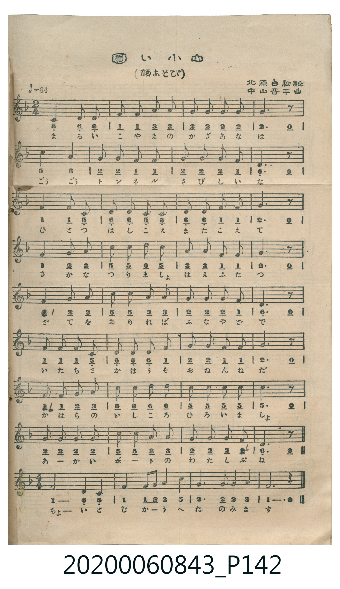

# 圓い小山（顔あそび）

> Re:Shoka 使用 AI 辨識樂譜，可能會有錯誤。歡迎回報。

<audio controls src="marui_koyama.mp3"></audio>

- 詞：北原白秋
- 曲：中山晋平
- 日治時期公學校《唱歌帳》（典藏號 2020.006.0843・P142）

## 說明

【曲目說明】
・出處：《唱歌帳》（國立臺灣歷史博物館典藏號 2020.006.0843）第 P142.jpg 頁印刷曲譜。
・作詞／作曲：北原白秋 歌、中山晋平 曲。
・調性與拍號：ヘ長調（F 大調，1♭），前 32 小節為 2/4 拍，末 4 小節轉為 4/4 拍，速度 != 84。
・背景與曲風：北原白秋與中山晋平創作之幼兒「顔あそび」（臉部五官遊戲歌），把孩子的圓臉比作小山、
眼睛比作兩個月亮、耳朵比作兩朵蘑菇、鼻孔比作兩個山洞、嘴巴比作湧出熱水的小泉，最後逗得孩子哈哈大笑。
・版本說明：本檔案為原譜單聲部旋律（含拍號轉換）之忠實數位化版本。

・編曲說明（鋼琴伴奏版）：
1. 前奏 (Intro, 4 小節)：以首樂句輕巧的大調五聲音階動機展開。
2. 主歌伴奏 (Song, 36 小節)：右手演奏主旋律，左手配以中山晋平風格之輕快和弦伴奏，並在末行跟隨轉為 4/4 拍。

## 歌詞

```text
【原頁歌詞全文與中文語譯】（對應 P142.jpg）

圓い小山に　日がでて落ちて
お月さまが　二つでた
そのまた横つちよに　きのこが二つ
お山の中には　トンネルが二つ
でたり　はいつたり
草の原つぱ　ちよろちよろり
下にはほらほら　あつたかいお湯が
わくわくわいてる　あかいお湯
そらうごいた　わらつた
あつはつはのは
在它的兩旁長出了兩朵小蘑菇〔耳朵〕，小山中間還有兩個隧道〔鼻孔〕，呼吸進進出出；
草地上窸窸窣窣，下面瞧呀瞧，正咕嘟咕嘟湧出溫暖的紅湯〔嘴巴〕；
看呀動起來了、笑起來了，啊哈哈的哈！）
```

## ABC

```abc
X:1
T:圓い小山（顔あそび）
C:曲：中山晋平
M:2/4
L:1/16
Q:1/4=84
K:F
V:V1 name="Piano" snm="Pia"
[V:V1]
d2 d2 d3 c | d2 c2 A2 G2 | F6 G2 | A4 z4 |
G2 G2 G3 F | G2 A2 c2 A2 | D2 F2 G3 A | F4 z4 |
d2 d2 d3 d | f2 d2 c2 z2 | d2 d2 f2 d2 | c4 z4 |
d2 c2 A2 G2 | F2 F2 G2 A2 | c3 A G3 A | F4 z4 |
G4 A4 | c4 z4 | d4 f4 | c4 z4 |
d2 c2 A2 G2 | F2 D2 F2 G2 | A6 c2 | G4 z4 |
d2 d2 d3 c | d2 c2 A2 G2 | F4 G4 | A4 z4 |
G2 G2 A2 c2 | d4 c4 | A2 c2 d2 f2 | c4 z4 |
[M:4/4] d4 c4 A4 G4 | F4 G4 A4 z4 | c4 d4 A4 G4 | F8 z8 |
```

## TMD 檔案連結

- [主旋律 TMD 檔案](marui_koyama.tmd) [[在 TMD Studio 編輯](https://tmdlang.github.io/Tmd-TS/#tmd=s7IKdvYPcrWy4qpTUCpJTLdSSM7PyUlNLsnMz7MqzsjPTkzOyFeCS5bl55TmploBqXgDQ4RwcX5pUXJqfEFieqpVgKGJEboM3KT4vPyS1KT8_GyEioKi_LLUvMQ8oKrcxLzS4uSizIKS-OT8gkqEmtSyzJRUkIrUlMyS_KLMxBwkJ6UWFYMdC3FDSVFiHsQMoCBCVUlGKtDdeYklpUWpSlxaWgpP50x-3NjydEP_040b3-_peLlwyuPGpseNcx83bn6_p1NBS4tL0VbBwoTL3lbBjcvGSN_EDmTWi5Xz3u-Z9bRn-tO--c9n7n2-vBtsxbPZm4DCT3asBRr2bGb3052bIcLTlz7btPvZzKZnc-Y_bV3zdO2OZwsWPm7oejpl47O1PU93bH7c0A20-2nrjhfT-1_MnK9gZGBkoGdgYKZnYGFi_Lh5Nygsga5R4uLS11KwpRbgUlBQeNwwAejo57PXvVi16tmMvscNE8Gizbuftu96MXMq0DdY3Dmn-_nq7hftu543Ln62dvvT_k1Pe2c971z5cskKHF4Auv35mjUKIG_oZRWkK7xc0Pi0d8PTju1Au1-snfO4oQlq65O9c8BB2w9kQAITOYwVgK543NCIHL4KQFUI7S9W7X_WsPxFR_uz7l6gI0Cub57xcup2oDjQ3W4KT5csBzN7DB_NXAt0FJD1tLNXwdhIAZgAnq9veN60SwEYxQpA7UCpZ3NWK5hAZV7s7QRJmsAlXzbMf7prmQI4cSA5oLnn2cz1IAfM3vRy0Qo09wPFkd3-tHMr0JtPdgLZe562Tnrc0IOc-h43AK3peNHe-bJ5xZNdU56um_GysetZxyZgGEBc_qyr6-nalU_XTng-qwWYioEqn62fAjQQkpaB4QRyk4LC8zl7ns-dDZVqXfm0ofvZnI4nu9YBFbxo2Pxszla4FJD9YsbEF_3tQKmXe3Y_XTsFWRfI2VvmAaWeztjydPsWiNSzncuBCeV528ZnG7aAnLGh_9lmsNvmNDzdBwyj6U_3TYc48unkDhBasvz5momI8Hre2fFszhpI2gMGFpD9bNWUZws7gGENDDVg0ng6bd2Lxk3AIHg2vfvpPnDqm7AaErvAKHnWPxsYFqAQ3L_g6fplz6bueLK392nPNIixIGugaRxoGDDNAYMOmLqetq54Nq0dEhcgxqp5L9auByZ8kNkbep-1d8LTKdBssAHIZcTjxtWPGxqAOfpxY8_jxuWPG5e9mLD3ceNCIANsFzCO5nQ8bpz6uHEfSEVDw5NdQHVLwErnQ1QAY3cdWHr-sxWrwHILHzcB9YAMftzYC5YFWtgD0Qk1FWz1OqCTQeoage5teNzc8bh58-Pm3sfNQBEU1SC7Hjd1gc1bD3Q62BKQCEj6RW8n0CRgiIBFgQkFqAjsgCag1TAGROmTHd1Q6xp3P24CagOTIA3ARAo2shGoAGh817OdQDU9YNub-h839iORQOllj5u6YdoQGmChATK47XEjMOkDJeaD1AG1gQRBNkAUQawDWgEhgQEE1g3KIODoA2W0OZOBCJIIgYH1ZEfX0yWrXs7c-7S3_cVWYCHVAYwnoH9AibNv6YuJ04Hp9sm-tie72lAzxRRIfnncACz7ZkNy0NM5K56uawaZDMwj0xuB5QlIL1gjMMsArYPlmimQDAXW2wNzxtqX0ya_bGp5NqcTYtHLWctfAqO3YQoki0EVT9zzdMKOlw2bgAhoOBDBbQdG19M5G4Deeb5qBxgtBiKgFqBfXs5d9Hze8qcTG4AkyF9rFz-dNPXpjPkQEpI3n-1a_WzWNKDjn29pBUVSwxRI_kX24PM53UBDnnZPBQYUJEyA2RyYT-FckAundkGyMCgcJne839MIyh1AzZTXQ1CgoKXPxRWcn5duFZCZmJfvUGNQo1ANdqCNoZmWHZgFrP6AOQeYxrqBdAsQT1aoAfJALKBo42og3gQSaewBli57ILhxOVhkGch8kBk1CmYKunCsq2AKFTEFYmMgNgLiGgVDsBwEQkRAciBoAKVrwGUDxEldQLwEiHuBeCrYOpBzQI6YCnTefpBIM8iRy4F4PthZNUBz4A4CWQDDukCrISIgC2GOAjoxHiwFU2SM5EZsLpoLxOug7pgPDqQOUHA9blwMpIC5vB2oC-ROkItB6iaD3Qty51Sgg0GuxRFcZiCL46BckPNAtiMUwaVqwJJ4Agwea-vADlkFxKBYBcXherBDQMUbkAK6sBkkiMd1mFEHCyhI2EFcYkxk0AEjCZxuYBEFLAyhgQUpS4EhiEUeJTIh1kCNxgwIaFBCQwuHIiQX9YOTFSSiwGEDKh1BEbkRFpnAMhvsQggHlvQhgkDnEQgtlLSFSOmQ3AESgfkJm-OmA21oQo64xt0gB8JpkAiw_MYINXBNQF6mhDkHb6ZsAoUaEENpUECAaiOoM5bBnQFyO6w46QIra8PMmbC8iIg6WHxB3ADiwZM_vsgENipfLOwBtl0QbclZ4NwKDrE2IAbVg2CHAUMK5HZIXEMSICQcQekQTMEzz3qYi6ttgMba1SKFKbJbYaGFCD_0EMUIT7hemFm4zYBBmF4YrOGq5eLStVMAle0KQFqZCwA)]
- [鋼琴伴奏 TMD 檔案](marui_koyama_piano.tmd) [[在 TMD Studio 編輯](https://tmdlang.github.io/Tmd-TS/#tmd=s7IKdvYPcrWy4tLSUng6Z_LjxpanG_qfbtz4fk_Hy4VTHjc2PW6c-7hx8-Pm3S-79zyfsOXJni1Pl_Y_7-x4v6dTQUuLS9FWwcKEy95WwY3LxkjfxI6rTkHpxcp57_fMetoz_Wnf_Ocz9z5f3q0EEn42exNQ-MmOtUDjn83sfrpzM0R4-tJnm3Y_m9n0bM78p61rnq7d8WzBwscNXU-nbHy2tufpjs2PG7qBrnnauuPF9P4XM-crGBkYGegZGJjpGViYGAMdFmBoYgR0jRIXl76Wgi21AJeCgsLjhglARz-fve7FqlXPZvQ9bpgIFm3e_bR914uZU4G-weLOOd3PV3e_aN_1vHHxs7Xbn_Zveto763nnypdLVuDwAtDtz9esUQB5Qy-rIF3h5YLGxw1NUJue7J0DDs5-IAMSgMjhqgC0-XFDI3KYKgBVIbS_WLX_WcPyFx3tz7p7gRaDXNw84-XU7UBxoFvdFJ4uWQ5m9hg-mrkW6BAg62lnr4KxkQIwGTxf36AAjFMFoF6gJc_mrFYwgQmbQISByl82zH-6a5kCOB0g7H2-fQXQHZBgAyUljLQDdAlIqYKCoZ4C0EaguIKGZ15JUb4O3BJNUGrZvfTlsmnPVjQ97V_6Ys_Up9uXP5_VAnH0k11TXjRuejl_88tZfU-7pz5bOf_pxqkvp3VDHaGgYKSn8GTHbmAIQexV0AjOz0vXUTA2QzL_af_mZ53dz_ZMASoAKZ7e_XQfMBZ7nm5fBhR_2doLdABy6L5ctOLZgj1PdnaDHLN_9dNJPU_3LIOYD9T1ZMeyp3NWAAPqxcKeF9vnv5y14sXezudNu2DBBXUa5YkTChS09Lm4wKFmFZCZmJcf5OFQY1CjUA32v42hmZYdmFWjYKagC8e6CqZQEVMgNgZiIyAGisQDKUMoFyRRA-aBoAGUruGqRbHPB8U-C7h1JvEK0SaxMApoDpBhGAuj4PKmQMoUVd4AYgcopqjgJZj7QRAiApJD9RHENJAsDINCASICUg0zkcgAwuY4M5DKOCgXZB5IOUIRXKoGLInLPEyvwdwCcR5ErzERroOogOgDi2PaC3U51HE4FOF1HEpoIQIeElkgEZgr8Icd_oiFmUE4YmFRifAZzDsQvSAePDJw-bXaBpiR7WqRHIpsEMwJCEehOxPDkXC9MLNwmwGDML0wiJZfyM2SUAYoSyLzoVkSYgY0v8KzLZRBZLbG7g4oA6IGjysxTEB3OZyP7kpifIKihiquwO0q3GGBJ06I9gkOd-HxC3KitjFBTzBYPAQKIhxOAxdsoASpa6cAricUgAxQ4gTRylwA)]

## 分析

```text
================================================================================
📊 TMD Song Profile: [ 圓い小山（顔あそび） ]
================================================================================
⏱  Duration:       0:57 (57.1s), 36 measures total
🎼 Key & Tempo:    首調基準 F, != 84.0 BPM, <2/4>
   - 分析範圍：      由實際發聲的音符與和弦推測調性；播放脈絡另行呈現
🎤 人聲音域:    D4 (MIDI 62) – F5 (MIDI 77) [跨度: 15 個半音 / 1.2 個八度, 難度: moderate]
   - 最低音:  D4 in [Song #1 @ m.7, 0:08]
   - 最高音: F5 in [Song #1 @ m.10, 0:12]
   - 適合: soprano, mezzo-soprano, contralto, tenor, baritone, bass
🏛  結構:      Song (57.1s)
⚡ 編曲密度:        Peak 1 軌道同時演奏
🗝  調性診斷：       D 調性不明確（純淨自然大調，未偵測到可信轉調）
   - 風格氣質:    純淨自然大調（陽光明朗、易唱易記，無明顯調外色彩）
   - 轉調歷程:    全曲維持單一推測調性（未偵測到可信轉調）
   - 核心骨幹音:  D, G, C, F, A
   - 調性數值:    D 調性不明確 [相關度: 0.72, 穩定度: Ambiguous, 自然音純度: 100.0%]
   - 候選調性 (K-S): D 小調 (0.72), F 大調 (0.71), C 大調 (0.70)
   - 五度圈歷程:   +2
   - 各段落調性細節:
     • [Song #1]: D 調性不明確 (r: 0.72, 自然音純度: 100.0%)

  [ 五度圈游移軌跡 ]
               C  
         F            G  
      Bb              [D ]*
      Eb               A  
         Ab           E  
            Db       B  
               F# 
     (* = active key center)

  [ 十二半音累積音高分佈 ]
     C  : ████████████████████      18.9%
     C# :                            0.0%
     D  : ████████████████████████  22.2%
     D# :                            0.0%
     E  :                            0.0%
     F  : ████████████████████      18.9%
     F# :                            0.0%
     G  : ███████████████████████   21.1%
     G# :                            0.0%
     A  : ████████████████████      18.9%
     A# :                            0.0%
     B  :                            0.0%
--------------------------------------------------------------------------------
Assignment 軌道音域：
  - Piano         : D4 – F5 (15 個半音 / 1.2 個八度, 100 個音符)
================================================================================
```


## 原書掃描頁




