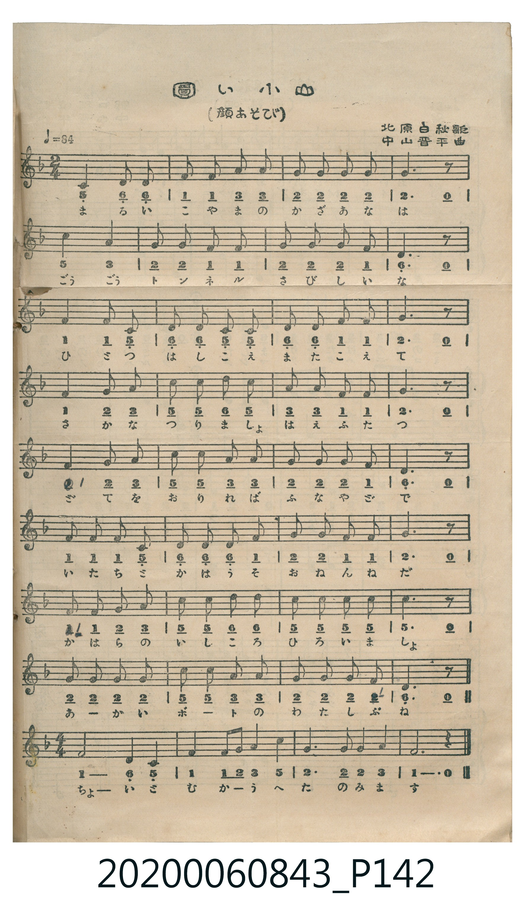

# 圓い小山（顔あそび）

> Re:Shōka 使用 AI 協助辨識與重建樂譜，可能會有錯誤。歡迎[回報](https://github.com/TMDLang/reshoka/issues)。

- **鋼琴伴奏版**：<br><audio controls src="marui_koyama.mp3"></audio>
- **NEUTRINO 歌聲合成版**：<br><audio controls src="marui_koyama_neutrino.mp3"></audio>

- 詞：北原白秋
- 曲：中山晋平
- 日治時期公學校《唱歌帳》（典藏號 2020.006.0843・P142）

## 說明


- 出處：《唱歌帳》（國立臺灣歷史博物館典藏號 2020.006.0843）第 P142.jpg 頁印刷曲譜。
- 作詞／作曲：北原白秋 歌、中山晋平 曲。
- 調性與拍號：ヘ長調（F 大調，1♭），前 32 小節為 2/4 拍，末 4 小節轉為 4/4 拍，速度 != 84。
- 背景與曲風：北原白秋與中山晋平創作之幼兒「顔あそび」（臉部五官遊戲歌），把孩子的圓臉比作小山、
眼睛比作兩個月亮、耳朵比作兩朵蘑菇、鼻孔比作兩個山洞、嘴巴比作湧出熱水的小泉，最後逗得孩子哈哈大笑。
- 版本說明：本檔案為原譜單聲部旋律（含拍號轉換）之忠實數位化版本。

### 編曲說明（鋼琴伴奏版）：

1. 前奏 (Intro, 4 小節)：以首樂句輕巧的大調五聲音階動機展開。
2. 主歌伴奏 (Song, 36 小節)：右手演奏主旋律，左手配以中山晋平風格之輕快和弦伴奏，並在末行跟隨轉為 4/4 拍。


## 歌詞

```text
【原頁歌詞全文與中文語譯】（對應 P142.jpg）

圓い小山に　日がでて落ちて
お月さまが　二つでた
そのまた横つちよに　きのこが二つ
お山の中には　トンネルが二つ
でたり　はいつたり
草の原つぱ　ちよろちよろり
下にはほらほら　あつたかいお湯が
わくわくわいてる　あかいお湯
そらうごいた　わらつた
あつはつはのは
在它的兩旁長出了兩朵小蘑菇〔耳朵〕，小山中間還有兩個隧道〔鼻孔〕，呼吸進進出出；
草地上窸窸窣窣，下面瞧呀瞧，正咕嘟咕嘟湧出溫暖的紅湯〔嘴巴〕；
看呀動起來了、笑起來了，啊哈哈的哈！）
```

## ABC

<div class="abc-score" data-abc-src="marui_koyama.abc" aria-label="五線譜載入中"></div>

[下載 ABC 原始檔](marui_koyama.abc)

## TMD 檔案連結

- [主旋律 TMD 檔案](marui_koyama.tmd) [[在 TMD Studio 編輯](https://tmdlang.github.io/Tmd-TS/#tmd=s7IKdvYPcrWy4qpTUCpJTLdSSM7PyUlNLsnMz7MqzsjPTkzOyFeCS5bl55TmploBqXgDQ4RwcX5pUXJqfEFieqpVgKGJEboM3KT4vPyS1KT8_GyEioKi_LLUvMQ8oKrcxLzS4uSizIKS-OT8gkqEmtSyzJRUkIrUlMyS_KLMxBwkJ6UWFYMdC3FDSVFiHsQMoCBCVUlGKtDdeYklpUWpCFGgUemZeVYliZlAB8YDcXlifG5iZl5OYl4KsqqSjPz0osSCjEqrjMxikAOSE3PisxPzEpW4tLQUns6Z_Lix5emG_qcbN77f0_Fy4ZTHjU2PG-c-btz8fk-ngpYWl6KtgoUJl72tghuXjZG-iR3I6Bcr573fM-tpz_SnffOfz9z7fHk32MZnszcBhZ_sWAs07NnM7qc7N0OEpy99tmn3s5lNz-bMf9q65unaHc8WLHzc0PV0ysZna3ue7tj8uKEbaPfT1h0vpve_mDlfwcjAyEDPwMBMz8DCxPhx825QtABdo8TFpa-lYEstwKWgoPC4YQLQ0c9nr3uxatWzGX2PGyaCRZt3P23f9WLmVKBvsLhzTvfz1d0v2nc9b1z8bO32p_2bnvbOet658uWSFTi8AHT78zVrFEDe0MsqSFd4uaDxae-Gpx3bgXa_WDvncUMT1NYne-eAg7YfyIAEJnIYKwBd8bihETl8FYCqENpfrNr_rGH5i472Z929QEeAXN884-XU7UBxoLvdFJ4uWQ5m9hg-mrkW6Cgg62lnr4KxkQIwATxf3_C8aZcCMIoVgNqBUs_mrFYwgcq82NsJkjSBS75smP901zIFcOJAckBzz7OZ60EOmL3p5aIVaO4HiiO7_WnnVqA3n-wEsvc8bZ30uKEHOfU9bgBa0_GivfNl84onu6Y8XTfjZWPXs45NwDCAuPxZV9fTtSufrp3wfFYLMBUDVT5bPwVoICQtA8MJ5CYFhedz9jyfOxsq1bryaUP3szkdT3atAyp40bD52ZytcCkg-8WMiS_624FSL_fsfrp2CrIukLO3zANKPZ2x5en2LRCpZzuXAxPK87aNzzZsATljQ_-zzWC3zWl4ug8YRtOf7psOceTTyR0gtGT58zUTEeH1vLPj2Zw1kLQHDCwg-9mqKc8WdgDDGhhqwKTxdNq6F42bgEHwbHr3033g1DdhNSR2gVHyrH82MCxAIbh_wdP1y55N3fFkb-_TnmkQY0HWQNM40DBgmgMGHTB1PW1d8WxaOyQuQIxV816sXQ9M-CCzN_Q-a--Ep1Og2WADkMuIx42rHzc0AHP048aex43LHzcuezFh7-PGhUAG2C5gHM3peNw49XHjPpCKhoYnu4DqloCVzoeoAMbuOrD0_GcrVoHlFj5uAuoBGfy4sRcsC7SwB6ITairY6nVAJ4PUNQLd2_C4ueNx8-bHzb2Pm4EiKKpBdj1u6gKbtx7odLAlIBGQ9IveTqBJwBABiwITClAR2AFNQKthDIjSJzu6odY17n7cBNQGJkEagIkUbGQjUAHQ-K5nO4FqesC2N_U_buxHIoHSyx43dcO0ITTAQgNkcNvjRmDSB0rMB6kDagMJgmyAKIJYB7QCQgIDCKwblEHA0QfKaHMmAxEkEQID68mOrqdLVr2cufdpb_uLrcBCqgMYT0D_gBJn39IXE6cD0-2TfW1PdrWhZoopkPzyuAFY9s2G5KCnc1Y8XdcMMhmYR6Y3AssTkF6wRmCWAVoHyzVTIBkKrLcH5oy1L6dNftnU8mxOJ8Sil7OWvwRGb8MUSBaDKp645-mEHS8bNgER0HAggtsOjK6nczYAvfN81Q4wWgxEQC1Av7ycu-j5vOVPJzYASZC_1i5-Omnq0xnzISQkbz7btfrZrGlAxz_f0gqKpIYpkPyL7MHnc7qBhjztngoMKEiYALM5MJ_CuSAXTu2CZGFQOEzueL-nEZQ7gJopr4egQEFLn4srOD8v3SogMzEv36HGoKYa7D4bQzMtOzALW-2nAKpZDB81TIYV1QoawSWJaWkKhppYFAPtABlUo2CmoAvHugqmUBFTIDYGYiMgrlEwBMtBIEQEJAeCBlC6Bmyaj2ENMI3uA_KB6RxENraAZYHZGKjncROIB5VvXA0mN4FNA-YYJBuA2RYqugwqEg-3Bb_vTYG-t0DzvRFe34N8A8O6QH9CREC-g4UAMDxA1oOCAKLIGClAsHm_C-yFJWCyF-qhqWDvQDwO8urjxq1gcj7UoxDVIG9DxMBmwr1NrPctgd43hFXhMP8bkxD7ZiCvxUG5oAAA-Q-hCC5VA5bEFQBzwd5YByZBXoZ4ChT_HWD2ZDAJLGDboX4DaQKFFEwTRAEonEAyW8HFKyiESAkLQ2NQYJihBYYJwcDATPiwmIckBojHjUlJCyjJHuRDkMwqMA-SSSBZYT1EBlyZQUKtuReIQZKQ4KAgMMyBgWFkgBYYpgRzBsSLsOSIEefQVANNGDgUIYUGKH3DkgNMPbCCRfcMKCzAVeBi4tQT8LwRqEw0Qi8UzchICSgFAaIMBEGQYkSYYfN8P9gjU8EkJJlDIxxUwYN8CmyCgEloxgA2PqCBARWAQbgE6SEBKh-N0AtIc6pVDzDv468epoP90AT2Kyxxrwd7dDdYphMsgmCDZIDNHqyJAdyIIjUUQMUkvKcDCwULoqoJWMWASPqw9A7xM4gHLynxZoYmSHoAk0hssAzCT4gqEBwKYBFExQopX0Ba2kgMA2NQ6WiMXjpa6igA-xKwvh2eAKm2Aaqxq0VKIshBAYt8RHJATyAYyQOuF2YWbjNgEKYXBtFrIHDwgRMQJCBhQQRpX8ONRSQnSDRAtSHSG3KxhJIMgWUUEgfOAuVtmHqYKAzCzEK4uZaLS9dOAdTYi_YxjFUAspW5AA)]
- [鋼琴伴奏 TMD 檔案](marui_koyama_piano.tmd) [[在 TMD Studio 編輯](https://tmdlang.github.io/Tmd-TS/#tmd=s7IKdvYPcrWy4qpTUCpJTLdSyC8qychPL0osyKi0ysgsLskvykxOzInPTsxLVIIrKs4vLUpOjS9ITE-1CjA0MULIlGSk5qZapaaUJieWZObnKXFpaSk8nTP5cWPL0w39TzdufL-n4-XCKY8bmx43zn3cuPlx8-6X3XueT9jyZM-Wp0v7n3d2vN_TqaClxaVoq2BhwmVvq-DGZWOkb2IHsuDFynnv98x62jP9ad_85zP3Pl_eDbb32exNQOEnO9YCjX82s_vpzs0Q4elLn23a_Wxm07M585-2rnm6dsezBQsfN3Q9nbLx2dqepzs2P27oBrrmaeuOF9P7X8ycr2BkYGSgZ2BgpmdgYWIMdBjIY0DXKHFx6Wsp2FILcCkoKDxumAB09PPZ616sWvVsRt_jholg0ebdT9t3vZg5FegbLO6c0_18dfeL9l3PGxc_W7v9af-mp72znneufLlkBQ4vAN3-fM0aBZA39LIK0hVeLmh83NAEtenJ3jng4OwHMiABiByuCkCbHzc0IoepAlAVQvuLVfufNSx_0dH-rLsXaDHIxc0zXk7dDhQHutVN4emS5WBmj-GjmWuBDgGynnb2KhgbKQCTwfP1DQrAOFUA6gVa8mzOagUTmLAJRBio_GXD_Ke7limA0wHC3ufbVwDdAQk2UFLCSDtAl4CUKigY6ikAbQSKK2h45pUU5evALdEEpZbdS18um_ZsRdPT_qUv9kx9un3581ktEEc_2TXlReOml_M3v5zV97R76rOV859unPpyWjfUEQoKRnoKT3bsBoYQxF4FjeD8vHQdBWMzJPOf9m9-1tn9bM8UoAKQ4undT_cBY7Hn6fZlQPGXrb1AByCH7stFK54t2PNkZzfIMftXP53U83TPMoj5QF1Pdix7OmcFMKBeLOx5sX3-y1krXuztfN60CxZcUKdRnjihQEFLn4sLHGpWAZmJeflBHg41BjXVYO_bGJpp2YFZNQpmCrpwrKtgChUxBWJjIDYCYqBIPJAyhHJBEjVgHggaQOkarloU63yQrbOA22YSrxBtEgujgMYAGYaxMAoubwqkTFHlDSBWgOIJn4ewZXMFUBYyfNQwGZ5ENYJLEtPSFAw1sSgGhhvxIQMLBhCEiIDkUAMGZJqPYY3C48Z9QP7jpm4Q2dgCln3cOBmo53ETiAeVb1wNJjeBTXvc2INkw-PG5VDRZVARUMRAbMHve1Og7y3QfG-E1_cg38AwKPIhIiDfwUKAyHSB8H4X2AtLwGQv1ENTwd6BeBzk1ceNW8HkfKhHIapB3oaIgc2Ee5tY71sCvW8IL7eg_jcmIfbNQF6Lg3JBAQDyH0IRXKoGLIkrAOaCvbEOTIK8DPEUKP47wOzJYHLh46Z2qN9AmkAhBdMEUQAKJ5DMVqBuSAiREhaGxqDAgBV0sMAwIRgYmAkfFvOQxADxuDEpaQEl2YN8CJJZBeZBMgkkK6yHyDR3PG7eDAm15l4gBklCgoOCwDAHBoaRAVpgmBLMGRAvwpIjRpxDUw00YeBQhBQaoPQNSw4w9Y-bQGGE4hlQWABLjseNi4lTT8DzRqAy0Qi9UDQjIyWgFASIMhAEQYoRYYbN8_1gj0wFk5BkDo3wpk6ITx83bgST0IzxuAmUJUA6oQIwCJcgPSRA5aMRegFpTrXqAeZ9_NXDdLAfmsB-hSXu9WCP7gbLdIJFEGyQDLANjjUxNHbDqhgSQgFUTCKad9BQsCCqmoBVDIikD0vvED-DePCSEm9maIKkBzCJxAbLIPyEqALBoQAWQVSskPIFpKWNxDAwBpWO8GYgLAwsdRSArTVYUw1PgFTbANXY1SIlEeSggEU-IjmgJxCM5AHXCzMLtxkwCNMLg-g1EDj4wAkIEpCwIHrcCOzTwcIXpBiWnCDRANWGSG_IxRJKMgSWUUgcOAuUt2HqYaIwCDML4WZgWw-psUdmcxLKADUnkfnQ5iTEDGhbE97khDKIbJJidweUAVGDx5UYJqC7HM5HdyUxPkFRQxVX4HYV7rDAEydE-wSHu_D4BTkj2pigJxgsHgIFEQ6ngdt6oASpa6cA7uIoABmgtBntA5QFspW5AA)]

## 分析

```text
================================================================================
📊 TMD Song Profile: [ 圓い小山（顔あそび） ]
================================================================================
⏱  Duration:       0:57 (57.1s), 36 measures total
🎼 Key & Tempo:    首調基準 F, != 84.0 BPM, <2/4>
   - 分析範圍：      由實際發聲的音符與和弦推測調性；播放脈絡另行呈現
🎤 人聲音域:    D4 (MIDI 62) – F5 (MIDI 77) [跨度: 15 個半音 / 1.2 個八度, 難度: moderate]
   - 最低音:  D4 in [Song[L1] #1 @ m.7, 0:08]
   - 最高音: F5 in [Song[L1] #1 @ m.10, 0:12]
   - 適合: soprano, mezzo-soprano, contralto, tenor, baritone, bass
🏛  結構:      Song[L1] (57.1s)
⚡ 編曲密度:        Peak 1 軌道同時演奏
🗝  調性診斷：       D 調性不明確（純淨自然大調，未偵測到可信轉調）
   - 風格氣質:    純淨自然大調（陽光明朗、易唱易記，無明顯調外色彩）
   - 轉調歷程:    全曲維持單一推測調性（未偵測到可信轉調）
   - 核心骨幹音:  D, G, C, F, A
   - 調性數值:    D 調性不明確 [相關度: 0.72, 穩定度: Ambiguous, 自然音純度: 100.0%]
   - 候選調性 (K-S): D 小調 (0.72), F 大調 (0.71), C 大調 (0.70)
   - 五度圈歷程:   +2
   - 各段落調性細節:
     • [Song[L1] #1]: D 調性不明確 (r: 0.72, 自然音純度: 100.0%)

  [ 五度圈游移軌跡 ]
               C  
         F            G  
      Bb              [D ]*
      Eb               A  
         Ab           E  
            Db       B  
               F# 
     (* = active key center)

  [ 十二半音累積音高分佈 ]
     C  : ████████████████████      18.9%
     C# :                            0.0%
     D  : ████████████████████████  22.2%
     D# :                            0.0%
     E  :                            0.0%
     F  : ████████████████████      18.9%
     F# :                            0.0%
     G  : ███████████████████████   21.1%
     G# :                            0.0%
     A  : ████████████████████      18.9%
     A# :                            0.0%
     B  :                            0.0%
--------------------------------------------------------------------------------
Assignment 軌道音域：
  - Piano         : D4 – F5 (15 個半音 / 1.2 個八度, 100 個音符)
================================================================================
```


## 原書掃描頁




