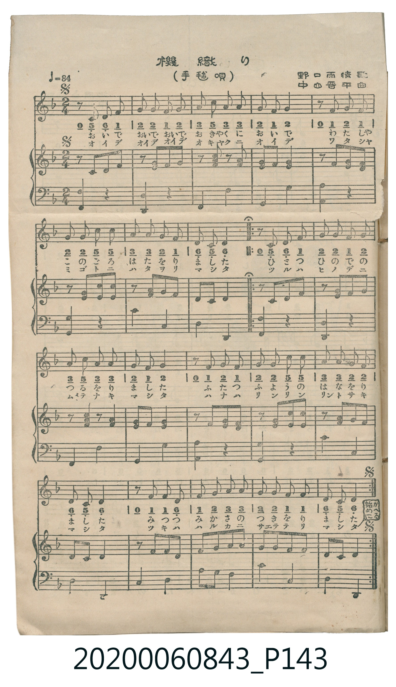

# 機織（手毬唄）

> Re:Shōka 使用 AI 協助辨識與重建樂譜，可能會有錯誤。歡迎[回報](https://github.com/TMDLang/reshoka/issues)。

- **鋼琴伴奏版**：<br><audio controls src="hataori.mp3"></audio>
- **NEUTRINO 歌聲合成版**：<br><audio controls src="hataori_neutrino.mp3"></audio>

- 詞：野口雨情
- 曲：中山晋平
- 日治時期公學校《唱歌帳》（典藏號 2020.006.0843・P143）

## 說明


- 出處：《唱歌帳》（國立臺灣歷史博物館典藏號 2020.006.0843）第 P143.jpg 頁印刷曲譜。
- 作詞／作曲：野口雨情 歌、中山晋平 曲。
- 標題說明：原譜標題為「（手毬唄）」，目錄與書眉作「機織」。
- 調性與拍號：ヘ長調（F 大調，1♭），2/4 拍，速度 != 84。
- 曲式結構：共 20 小節。第 1–8 小節為起首段（おいで、おいで……），第 8 小節末尾帶延長記號；
第 9–20 小節為拍球數數歌段（ひとつ、ふたつ、みつ……），第 20 小節末尾帶 Segno 記號（%）
與「始めにかへる」（回到開頭 Segno 處反覆）。
- 音階特徵：純粹日本民謠五聲音階（律旋律／都節旋律骨幹：C, D, F, G, A，即 5_, 6_, 1, 2, 3），
全曲無 4 (B♭) 與 7 (E)。
- 版本說明：本檔案為原譜歌唱聲部（五線譜與數字簡譜）之忠實數位化版本。

### 編曲說明（鋼琴伴奏版）：

完整數位化原書印刷之雙手鋼琴伴奏譜，忠實重現中山晋平為手毬唄設計之右手跳音和弦與左手定音節奏。


## 歌詞

```text
【原頁歌詞全文與中文語譯】（對應 P143.jpg）

おいで　おいで　お
客においで
わたしゃ　このごろ　機織りました

ひとつ　日の出の　鶴織りました
ふたつ　芙蓉の　花織りました
みつ　三笠の　月織りました
（始めにかへる）

來吧、來吧、來當客人吧！
我這陣子織了布呢。

第一個，織出了日出時分飛舞的丹頂鶴；
第二個，織出了芙蓉盛開的花朵；
第三個，織出了三笠山上升起的明月。
──從頭反覆）
```

## ABC

<div class="abc-score" data-abc-src="hataori.abc" aria-label="五線譜載入中"></div>

[下載 ABC 原始檔](hataori.abc)

## TMD 檔案連結

- [主旋律 TMD 檔案](hataori.tmd) [[在 TMD Studio 編輯](https://tmdlang.github.io/Tmd-TS/#tmd=s7IKdvYPcrWy4qpTUCpJTLdSSM7PyUlNLsnMz7MqzsjPTkzOyFeCS5bl55TmploBqXgDQ4RwcX5pUXJqfEFieqpVgKGJMboM3KT4vPyS1KT8_GyEioKi_LLUvMQ8oKrcxLzS4uSizIKS-OT8gkqEmtSyzJRUkIrUlMyS_KLMxBwkJ6UWFYMdC3FDSVFiHsQMoCBCVUlGKtDdBTmJSKYCDUrPzLMqScwEOi8eiMsT43MTM_NyEvNSkFWVZOSnFyUWZFRaZWQWg6xPTsyJz07MS1Ti0tJSeLZy_vOdU97v6XjW2f1s_ZqnU1re7-lU0NLiUrRVsDDhsrdVcOOyMdI3sQOZ-GLlvPd7Zr1s73vav_jl7BXPmlvBFj2bvQko_GTH2qcbNz6b2f1052aI8PSlzzbtfjaz6dmc-U9b1zxdu-PZgoWPG7qeTtn4bG3P0x2bHzd0Ay1-2rrjxfT-FzPnKxgZGBnoGRiY6RlYmBg_bt4Niguga5S4uPS1FGypBbgUFBQeN0wAOvr57HUvVq16NqPvccNEsGjz7qftu17MnAr0DRZ3zul-vrr7Rfuu542Ln63d_rR_09PeWc87V75csgKHF4Buf75mjQLIG3pZBekKLxc0Pu3d8LRjO9DuF2vnPG5ogtr6ZO8ccND2AxmQwEQOYwWgKx43NCKHrwJQFUL7sxUzXy7sgXgFqPdp33yg6RDB5027Hjf0oEXv44be93t6gL5_2dPyoqP92ewdz-d0Aq0GqoQkB6AChOkvVu1_1rAcpK67F-hFUNg0z3g5dTtQHGium8LTJcvBzB7DRzPXAk0HsoDpRQGoGsh62TD_6a5lCuDEhOTg2Zue7ul_vnXCs-XAkJ31tHUjMOAUnm7of76-AagKFGiGjxomW0CFgJ54sXX7y2XTnq3bCrTycWPX48aWx43LgYECZz9qWAZEEOtB-mF6n81Z_XTDvqc7tj3dvQ3k6BUzwH6YDXKJggJIpSXQJrjtQKuADn8-ofnZ1B0gtLYHZuemx40rHjcuAdu59XHjfBh7P5CBbjncOLjtCsGp6Xn5CjDrO1SBiiFOAAYsMNyfLu9-3AQ0bfXjxu7HjTseN3WDI6nj6ex5Tzs2vJzW_XLBWpgZM6c-7e99sawNHJOwIH05f_PLWX3PO3c-3Qd076znW6Y837QTlAPnrHm2YeKLNQue7JryonETRBnI4H3dz6Z3A0lgqnvZvBfkVjD35aoVT3fuBJrgrKPgoqPgpqPgrqPgCPTX097NCqbxOgpmQGyoo2CkowBK30AJiDeetq4A5aiWhQomChpOwJSgCfKZgrmChqsmwpXPOzuADoKnVJDjVk15trADGOzQVAvMcFM2ghzavALoSqCjn2-fBRQHJb-pO56unf58w0IgF2jzk53dT_cveLp-GVD8yd7epz3TIIaDLINmcaCRwCwHNBKYuUDum9YONAaYjUCMVfNerF0PzPegoNjQ-6y9E55NQTEDNgCRzBrQ2CDpp-sWgaMLKgHW0dQPThjTHzc1gxVOfty47nHjlMdNwOzUAM1aTUAN-0BqGudDrYGnLGAULAXqAJZBIH0NDS-3bUHXAdYAT34NL7pmvpjcCVH9omsjVtWgBAqUfrIDWBgtgCh9NqcDi1JQUGAkQ1hoACUhYQaMNhD_yb62pxNAORCZ8XzqNmCwPNm1Cyjyfk8jSN2zjokvG2a-nLn46doJQDuf7Gp7uqP56cRFsGgCZpcnOxqegkrYHqA80O9AJcBwADKANcfTjraXi2e_6Jj3fFbLkx07Xy5oAoYJNPeCdO7qQdMJCZDns2cDswxQDzBMns0B5ge4hh2daBogwQIsWJ_s6Hra2w4sZ4DagKkTGETQZPtoSgMQPd03D5gF4RkPJEF5VQQFClr6XFzB-XnpVgGZiXn5DjUGNdXgXGVjaKZlB2YBK0BYqWgCLVus8KVQtNQJsgFkTI2CgYIuMBsDCTMQYQjENQpGQBKEQTwQXaNgDFIFxCAahCFqYPIgWAM2z6dGAWQM0B4w2QIml4M1YIpBREAyvSBeE0SmH0yuxqEHYhVyEJgiVQzAIEDOcoTyG2oowHyDGgYgX4MwJAxAGKEGHGSIwMMMhiaIZ-aDSZCToL6aDBZYByangBWCQgAksx6hoWkSmISF0T6IIXB5zJAAVVyGRkipgYSChOYJYhOYXAEml0C9BBGDBAMkQYDYIBmQCmBhQ1YwGBqDwsEMKRyILR_JTw-QQCGYHhq3IqIXHgpgsaYOsFgbSihAEsMq8kLBHLkZAwoFosp9zCAAYbB3auAhghrpsDAiMk807of7HiwJFwHHduNUlBAApwNo8UBMCNRycenaKYCKTgUgrcwFAA)]
- [鋼琴伴奏 TMD 檔案](hataori_piano.tmd) [[在 TMD Studio 編輯](https://tmdlang.github.io/Tmd-TS/#tmd=s7IKdvYPcrWy4qpTUCpJTLdSyC8qychPL0osyKi0ysgsLskvykxOzInPTsxLVIIrKs4vLUpOjS9ITE-1CjA0MUbIlGSk5qZaFeQkVipxaWkpPFs5__nOKe_3dDzr7H62fs3TKS2Pm3e_7N7zfMKWJ3u2PF3a_7yz4_2eTgUtLS5FWwULEy57WwU3LhsjfRM7kJEvVs57v2fWy_a-p_2LX85e8ay5FWzTs9mbgMJPdqx9unHjs5ndT3duhghPX_ps0-5nM5uezZn_tHXN07U7ni1Y-Lih6-mUjc_W9jzdsflxQzfQKU9bd7yY3v9i5nwFIwMjAz0DAzM9AwsTY6DDQF4BukaJi0tfS8GWWoBLQUHhccMEoKOfz173YtWqZzP6HjdMBIs2737avuvFzKlA32Bx55zu56u7X7Tvet64-Nna7U_7Nz3tnfW8c-XLJStweAHo9udr1iiAvKGXVZCu8HJB49PeDU87tgPtfrF2zuOGJqitT_bOAQdtP5ABCUzkMFYAuuJxQyNy-CoAVSG0v1i1_1nD8hcd7c-6e4GOALm-ecbLqduB4kB3uyk8XbIczOwxfDRzLdBRQBYwRhWAqoGslw3zn-5apgCOboSRz7evADkSHDpAMzCTCNASkFIFhafrep5N3fJs6o4ne3uf9kx72jf_2ewdEG8-2dn9cvZMYFJD1g70ONDWp_sXPF2_7GV77_P-fcgee960C540X6xY-2JFB9CQp_2bgYIvtm9-OX_z00k9T_csA_r16fZlQMGn62YBBZ-vbwCaDHU95SkEChS09Lm4gvPz0q0CMhPz8oM8HGoMaqrBvrYxNNOyA7OAKRMUx4aPGiabKDzd0A90ipXC48aux40tjxuXP25oQGM_XbfoceNquCDIDpAxNQoGCroKpvFAwgxEGAIxRMwsXhvEQaUgUobaxkASwaoBSRuhKAbxQLCGC9m1pkDXWiBc29T_uHH-48bpj5uaHzdOfty47nHjlMdNvUAHQ8qLx01A1-4DKWicj-pgkC0gK1CcCxbQNoWTyI6FSpvCvAHkm0H4IJVQHqaDLYEONjRCCt9NjxtXPG5cAnLi9KVAFwPzLcjdDQ0vt23B62IcQYwZahQGsaExyMlmSE7eCg5kkJNfdM18MbkT4t4XXRtpEsJwXxAZwobmQPcaGSC5dz_EsU92AAuxBRDHPpvTQdCxkFABWw1zO8hZkMAD8WC-IZgAapFznw-xuQ_hIkOQK0AQ5DSwkUBrMMXM4GLGMAbQoTAmQgfuLEQdKxGCCBaeXEAnf6KmYwoshdtEjE9RUyMWW5E0IgQJ-AuHvcBkpmunAEppCkBamQsA)]

## 分析

```text
================================================================================
📊 TMD Song Profile: [ 機織（手毬唄） ]
================================================================================
⏱  Duration:       0:28 (28.6s), 20 measures total
🎼 Key & Tempo:    首調基準 F, != 84.0 BPM, <2/4>
   - 分析範圍：      由實際發聲的音符與和弦推測調性；播放脈絡另行呈現
🎤 人聲音域:    C4 (MIDI 60) – C5 (MIDI 72) [跨度: 12 個半音 / 1.0 個八度, 難度: easy]
   - 最低音:  C4 in [Song #1 @ m.1, 0:00]
   - 最高音: C5 in [Song #1 @ m.3, 0:03]
   - 適合: soprano, mezzo-soprano, contralto, tenor, baritone, bass
🏛  結構:      Song (28.6s)
⚡ 編曲密度:        Peak 1 軌道同時演奏
🗝  調性診斷：       C 大調（純淨自然大調，未偵測到可信轉調）
   - 風格氣質:    純淨自然大調（陽光明朗、易唱易記，無明顯調外色彩）
   - 轉調歷程:    全曲維持單一推測調性（未偵測到可信轉調）
   - 核心骨幹音:  G, F, D, A, C
   - 調性數值:    C 大調 [相關度: 0.69, 穩定度: Moderate, 自然音純度: 100.0%]
   - 候選調性 (K-S): C 大調 (0.69), F 大調 (0.64), G 大調 (0.63)
   - 五度圈歷程:   +0
   - 各段落調性細節:
     • [Song #1]: C 大調 (r: 0.69, 自然音純度: 100.0%)

  [ 五度圈游移軌跡 ]
              [C ]*
         F            G  
      Bb               D  
      Eb               A  
         Ab           E  
            Db       B  
               F# 
     (* = active key center)

  [ 十二半音累積音高分佈 ]
     C  : ███████████               14.7%
     C# :                            0.0%
     D  : ████████████              16.0%
     D# :                            0.0%
     E  :                            0.0%
     F  : ████████████████          21.3%
     F# :                            0.0%
     G  : ████████████████████████  32.0%
     G# :                            0.0%
     A  : ████████████              16.0%
     A# :                            0.0%
     B  :                            0.0%
--------------------------------------------------------------------------------
Assignment 軌道音域：
  - Piano         : C4 – C5 (12 個半音 / 1.0 個八度, 70 個音符)
================================================================================
```


## 原書掃描頁




