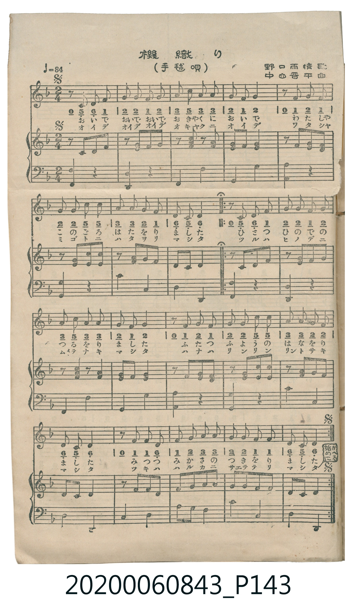

# 機織り（手毬唄）

> Re:Shoka 使用 AI 協助辨識與重建樂譜，可能會有錯誤。歡迎回報。

<audio controls src="hataori.mp3"></audio>

- 詞：野口雨情
- 曲：中山晋平
- 日治時期公學校《唱歌帳》（典藏號 2020.006.0843・P143）

## 說明

【曲目說明】
・出處：《唱歌帳》（國立臺灣歷史博物館典藏號 2020.006.0843）第 P143.jpg 頁印刷曲譜。
・作詞／作曲：野口雨情 歌、中山晋平 曲。
・調性與拍號：ヘ長調（F 大調，1♭），2/4 拍，速度 != 84。
・背景與曲風：野口雨情與中山晋平創作之手毬唄（拍球歌），描寫山裡的小猴子出來燒茶釜熱水、
猴子新娘披上紅襷「トントンからから」織布的可愛情景，節奏輕快、極富拍球韻律感。
・版本說明：本檔案為原譜歌唱聲部之忠實數位化版本。

・編曲說明（鋼琴伴奏版）：
完整數位化原書印刷之雙手鋼琴伴奏譜，以穩定八分音符模仿手毬拍擊與織布機「トントンからから」聲響。

## 歌詞

```text
【原頁歌詞全文與中文語譯】（對應 P143.jpg）

お山のお猿が　出て来て
チャンチャン茶釜の　お湯沸かして
お猿の嫁御は　いつござる
赤い襷を　ちよとかけて
トントンからから　機織り
トントンからから　機織り
小猴子的新娘什麼時候來呢？輕輕挽起紅色的襷帶，
咚咚喀啦喀啦地織著布、咚咚喀啦喀啦地織著布。）
```

## ABC

```abc
X:1
T:機織り（手毬唄）
C:曲：中山晋平
M:2/4
L:1/16
Q:1/4=84
K:F
V:V1 name="Piano" snm="Pia"
[V:V1]
z4 z4 | z4 z4 | F3 G F2 D2 | F3 G A2 c2 |
d2 c A c2 z2 | d2 d2 c2 d2 | A2 c2 G2 A2 | F3 G D2 C2 |
D4 z4 | z4 z4 | c3 c d2 d2 | c3 A G4 |
A3 c d2 c2 | A4 z4 | d2 d2 f2 d2 | c3 d c2 A2 |
G2 A2 c2 G2 | A4 z4 | F3 G F2 D2 | F2 G2 A2 c2 |
d3 c A4 | c4 z4 | d2 d2 c2 d2 | A2 c2 G2 A2 |
F3 G D4 | D4 z4 |
```

## TMD 檔案連結

- [主旋律 TMD 檔案](hataori.tmd) [[在 TMD Studio 編輯](https://tmdlang.github.io/Tmd-TS/#tmd=s7IKdvYPcrWy4qpTUCpJTLdSSM7PyUlNLsnMz7MqzsjPTkzOyFeCS5bl55TmploBqXgDQ4RwcX5pUXJqfEFieqpVgKGJMboM3KT4vPyS1KT8_GyEioKi_LLUvMQ8oKrcxLzS4uSizIKS-OT8gkqEmtSyzJRUkIrUlMyS_KLMxBwkJ6UWFYMdC3FDSVFiHsQMoCBCVUlGKtDd5flFQJu1tBSerZz_fOeUx01d7_d0POvsfrZ-zdMpLe_3dCpoaXEp2ipYmHDZ2yq4cdkY6ZvYgcx4sXLe-z2zXrb3Pe1f_HL2imfNrWCjn83eBBR-smPt040bn83sfrpzM0R4-tJnm3Y_m9n0bM78p61rnq7d8WzBwscNXU-nbHy2tufpjs2PG7qBFj9t3fFiev-LmfMVjAyMDPQMDMz0DCxMjB837waFIdA1Slxc-loKttQCXAoKCo8bJgAd_Xz2uherVj2b0fe4YSJYtHn30_ZdL2ZOBfoGizvndD9f3f2ifdfzxsXP1m5_2r_pae-s550rXy5ZgcMLQLc_X7NGAeQNvayCdIWXCxqf9m542rEdaPeLtXMeNzRBbX2ydw44aPuBDEhgIoexAtAVjxsakcNXAagKof3Fqv3PGpa_6Gh_1t0LdATI9c0zXk7dDhQHuttN4emS5WBmj-GjmWuBjgKygDGqAFQNZL1smP901zIFcHQjGdnc82zmepCRsze9XLQCzUVAcWTXPO3cCnT4k53dSGmoA2j68wnNQKdDLHzW3_90_WqglheLFz6f1fJ0Q__zni1P104ABviTfW3P2ye96Nn2sn3O87aNzzZsAfoW5A4FBYiaZ9M2PF0x41nX6ic7up5vaX2xdPvjhp7HzR2PmzdDycbux02dULKhF5imn-5oBtnSv_5Zy2ygg4F-Abrh-fqGp0v7X-yZ-nT_aqAVz5Zufbq-B-LOl_N3P93X_axlPiIInnd2PJuzBpJAgP4Hsp-tmvJsYcfzpl1P--YD4w-UOKZsfNG46WXzCqDnn-5f8HT9smdTdzzZ2_u0ZxpEO8g4aIIDagImAKAmYFQ_bV3xbFo7JBhBjFXzXqxdD0yFoGS2ofdZeyc80QBDD2JAYxcw8B43rgMynvfsf9wITBINwMB73Ljs2dylQBLi6sbHzYvBwQJlQEIVpK2hAajz2c71zzbtAAVU43SYHqh5656ubny6b-HjRqA7gEpbHjcuedw45XHjtMdN3SB1L7YC-S2gsG-aBFax8HFTx-PGFWDDJsIdgCtSGuBlDSnqgOEBCRtgBGCmnRfbJz7Z1QZJQaCU3D8DiJ7O2fCsqwvib4h6YIICpq-X04CZeDYkWcFNAMmCE9eT3Q0vd-0BllVPG2YCTXs6cdH7PfOBKQWInvXsfbF1OyjddW4CqgeGwNMd24DWQY2aNAuEpjU8nboMSs7ZAPTAi4nTgWkQmMoIKWgCxTDQIMoLNihQ0NLn4grOz0u3CshMzMt3qDGoUagGO9bG0EzLDswClqdPO3uBmUHBCBwY6xsUNFCS856Jz9Yu0gQZBVJeo2CgoAuGMBqLCDiZgkwGpiiFx00tQHofEK8DqgWLNE4FinYD6R6wyHIgXgbEvWAabpEh2DAjMG0WD7YJJmQMJE3BImZgljGYB7IfyW5YwkdmgZJqM9xiiKMgjmwDiTT1A3kgh00HOwUo0rwH4SCQXRD7IHQN3B1GQAxiI1wIdrApxNVgNvYAejltMijoDWFBjzuUUcMUHoLgMG3qAOJGIG8KEK8Hew0U5kugItPAaroRhoOcDHI4zEMwEWOwRyCRCvIOTA0kqCEi2J3UBA03kLXzwQ6YCYnQpkmQQG8HC66AKpuIL3gN49CcZQamIeELC2lYqON1FrhQgVMgm5s6we6AsEBhBXMuKAl0obsIRwpEdgPE2ZA0CAs6iKtp4iKSkyDERVhSYC0Xl66dAqhwUADSylwA)]
- [鋼琴伴奏 TMD 檔案](hataori_piano.tmd) [[在 TMD Studio 編輯](https://tmdlang.github.io/Tmd-TS/#tmd=s7IKdvYPcrWy4tLSUni2cv7znVMeN3W939PxrLP72fo1T6e0PG7e_bJ7z_MJW57s2fJ0af_zzo73ezoVtLS4FG0VLEy47G0V3LhsjPRN7LjqFJRerJz3fs-sl-19T_sXv5y94llzqxJI-NnsTUDhJzvWPt248dnM7qc7N0OEpy99tmn3s5lNz-bMf9q65unaHc8WLHzc0PV0ysZna3ue7tj8uKEb6JSnrTteTO9_MXO-gpGBkYGegYGZnoGFiTHQYQGGJsZA1yhxcelrKdhSC3ApKCg8bpgAdPTz2eterFr1bEbf44aJYNHm3U_bd72YORXoGyzunNP9fHX3i_ZdzxsXP1u7_Wn_pqe9s553rny5ZAUOLwDd_nzNGgWQN_SyCtIVXi5ofNq74WnHdqDdL9bOedzQBLX1yd454KDtBzIggYkcxgpAVzxuaEQOXwWgKoT2F6v2P2tY_qKj_Vl3L9ARINc3z3g5dTtQHOhuN4WnS5aDmT2Gj2auBToKyALGqAJQNZD1smH-013LFMDRjTDy-fYVIEeCQwdoBmYSAVoCUqqg8HRdz7OpW55N3fFkb-_TnmlP--Y_m70D4s0nO7tfzp4JTGrI2oEeB9r6ZPfS5ytXPl0362nr6qcdbS_nb36-ZtmzFQuf7N4PSZpAxz2b3AX0EzDJPt3RDEy7jxt6Hjd3PG7eDCUbux83dULJht4XjZtezt8P9QDliQQKFLT0ubiC8_PSrQIyE_PygzwcagxqFKrBPrcxNNOyA7OAqfNpZy_QbwpGCk839D9f3wDSB5KpUTBT0EXBWES4YIaAEovxo4bJlhimGALV6QJNB9Fm8WBjYELGQNIUbrApkA_iGYANRnUCSBziBJgeIyAGsRGmgQ03hdgAZqMRCMe-nDYZ5GNDTB-j6oC4BNmLhoZAPxpaYGgEuQjkLkRQQUSMwe4EQYjLYWogvgaJwDA2XxvGoRlnBqYh3oYFACwwsBmH4nRLoNONzIiNH2TjIS6CxBDMNyBxGKYoxiDGQQIdiiHm1SInXx-U5GtBTOqNj1cwjodRGHwiUi5IabRZbiyCgSRmCKQNQSImQIYJmG8ADwSoGJQCehii2BSk2RTFGDSjsTkQT2qFawBZTUw6hToEt8PQFaA4lKAH4YECMxCHjzGciyNtkhoDED7CMVSIERQ3A5Okrp0CKFUqAGllLgA)]

## 分析

```text
================================================================================
📊 TMD Song Profile: [ 機織り（手毬唄） ]
================================================================================
⏱  Duration:       0:37 (37.1s), 26 measures total
🎼 Key & Tempo:    首調基準 F, != 84.0 BPM, <2/4>
   - 分析範圍：      由實際發聲的音符與和弦推測調性；播放脈絡另行呈現
🎤 人聲音域:    C4 (MIDI 60) – F5 (MIDI 77) [跨度: 17 個半音 / 1.4 個八度, 難度: challenging]
   - 最低音:  C4 in [Song #1 @ m.8, 0:11]
   - 最高音: F5 in [Song #1 @ m.15, 0:20]
   - 適合: soprano, mezzo-soprano, contralto, tenor, baritone, bass
🏛  結構:      Song (37.1s)
⚡ 編曲密度:        Peak 1 軌道同時演奏
🗝  調性診斷：       D 小調（純淨自然小調，未偵測到可信轉調）
   - 風格氣質:    純淨自然小調（陰鬱抒情、旋律集中，無明顯調外色彩）
   - 轉調歷程:    全曲維持單一推測調性（未偵測到可信轉調）
   - 核心骨幹音:  D, C, A, F, G
   - 調性數值:    D 小調 [相關度: 0.75, 穩定度: Moderate, 自然音純度: 100.0%]
   - 候選調性 (K-S): D 小調 (0.75), F 大調 (0.65), C 大調 (0.62)
   - 五度圈歷程:   +2
   - 各段落調性細節:
     • [Song #1]: D 小調 (r: 0.75, 自然音純度: 100.0%)

  [ 五度圈游移軌跡 ]
               C  
         F            G  
      Bb              [D ]*
      Eb               A  
         Ab           E  
            Db       B  
               F# 
     (* = active key center)

  [ 十二半音累積音高分佈 ]
     C  : ████████████████████      24.1%
     C# :                            0.0%
     D  : ████████████████████████  29.6%
     D# :                            0.0%
     E  :                            0.0%
     F  : ████████████              14.2%
     F# :                            0.0%
     G  : ██████████                11.7%
     G# :                            0.0%
     A  : █████████████████         20.4%
     A# :                            0.0%
     B  :                            0.0%
--------------------------------------------------------------------------------
Assignment 軌道音域：
  - Piano         : C4 – F5 (17 個半音 / 1.4 個八度, 74 個音符)
================================================================================
```


## 原書掃描頁




