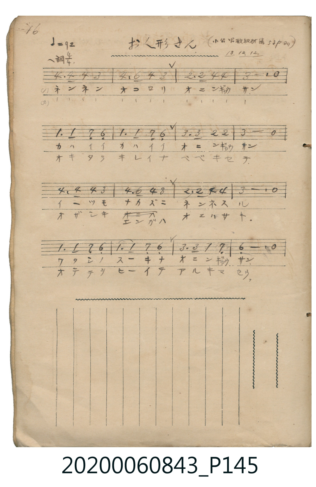

# お人形さん

<audio controls src="oningyosan.mp3"></audio>

- 日治時期公學校《唱歌帳》（典藏號 2020.006.0843・P145）
- 原載《小公唱歌教材集》第 53 頁（大正 13 年 12 月 12 日抄）

## 說明

【曲目說明】
・出處：《唱歌帳》（國立臺灣歷史博物館典藏號 2020.006.0843）第 P145.jpg 頁（手寫頁碼 16）。
・標註：（小公唱歌教材集 53p ヨリ）13.12.12.（大正 13 年 12 月 12 日抄錄）。
・調性與拍號：ヘ調・ニ短調（F 大調關係小調 D minor，自然小調／都節調式），4/4 拍，速度 != 92。
・背景與曲風：溫柔的搖籃曲風，哄著不哭不鬧的可愛洋娃娃入睡，並期待醒來後替她換上漂亮衣裳、牽手散步。
・版本說明：本檔案為原頁單聲部簡譜之忠實數位化版本。
【原頁歌詞全文與中文語譯】（對應 P145.jpg）

・編曲說明（鋼琴伴奏版）：
1. 前奏 (Intro, 4 小節)：引用結尾樂句「ワタシノスーキナ オニンギャウサン」，以輕柔搖籃曲伴奏鋪陳。
2. 主歌伴奏 (Song, 16 小節 × 2 段)：右手演奏主旋律，左手以平穩和弦搖擺伴奏。

## 歌詞

```text
（一）ネンネンオコロリ　オニンギャウサン
カハイイカハイイ　オニンギャウサン
イーツモナカズニ　ネンネスル
ワタシノスーキナ　オニンギャウサン
總是不哭不鬧地乖乖睡覺，我最喜歡的洋娃娃呀。）

（二）ネンネンオコロリ　オニンギャウサン
オキタラキレイナ　ベベキセテ
オザシキエンガハ　オニハサキ
オテテヲヒーイテ　アルキマセウ
在客廳、走廊與庭院前，牽著妳的小手一起散步吧。）
```

## ABC

```abc
X:1
T:お人形さん
M:4/4
L:1/16
Q:1/4=92
K:Dm
V:V1 name="Piano" snm="Pia"
[V:V1]
B6 B2 B4 A4 | B4 d4 B4 A4 | G6 G2 B4 B4 | A12 z4 |
F6 F2 E4 D4 | F6 F2 E4 D4 | A6 A2 G4 G4 | A12 z4 |
B6 B2 B4 A4 | B4 d4 B4 A4 | G6 G2 B4 B4 | A12 z4 |
F6 F2 E4 D4 | F6 F2 E4 D4 | A6 A2 F4 E4 | D12 z4 |
```

## TMD 檔案連結

- [主旋律 TMD 檔案](oningyosan.tmd) [[在 TMD Studio 編輯](https://tmdlang.github.io/Tmd-TS/#tmd=s7IKdvYPcrWy4qpTUCpJTLdSSM7PyUlNLsnMz7MqzsjPTkzOyFeCS5bl55TmploBqXgDQ4RwcX5pUXJqfEFieqpVgKGJKboM3KT4vPyS1KT8_GyEioKi_LLUvMQ8oKrcxLzS4uSizIKS-OT8gkqEmtSyzJRUkIrUlMyS_KLMxBwkJ6UWFYMdC3FDSVFiHsQMoKASl5aWwuPGrie7dj3du-hx49THTZMVtLS4FG0VLI247G0V3LiyUyttFVxyuWxM9E3sQIY-m7702abdz2Y2PZsz_2nrmqdrdzxbsPBxQ9fTKRufre15umPz44bu93s6nrbueDG9_8XM-QpGBkYGegYGZnoGFibGj5t3gwLg_Z5OsAuf9s1_sacTpHtDP8gwsBnPps58NnfCy9ltQJOer1mjYGqs8HJBI8jMJcufrV2sYGis8HTnFgVDI4VnczrAFNBJXS1gM7n0tRRsqQW4FBQUHjdMeDZ70_PZ616sWvVsRt_jholg0ebdT9t3vZg59f2eWVj8Pqf7-eruF-27njcufrZ2-9P-TU97Zz3vXPlyyQocwQJ0O8inoKDRyypIh_r3WWf30_Wrgezni_YoGJoBFT1uaIJa_2zFzBcrdgOtB9mHLfCAwVYAVLjicfMqoEZDYz1DIxAiGIwve0AhibDoxar9zxqWv-hof9bdC3Q3yMPNM4CCQKnHzd3P568FsoGGuikAjQUyX06f82R_E9BFQLaCi0JuZl5-0fs9PS_aVz1v2QYRfr-n_2Xz3ufrG4Dsp3v6gbYBFQCTlwLQBiDrZcP8p7uWKYDTIJIzmnuezVwPcsbsTS8XrQA649mu1c_mT3k-q-XZhGnPNzbDxHueTm55MXH6kx29TyevBZIv1ywHqnnav_5Zy-xnW7qfrmgGodalz-cuBCp-smMZKB3va33ZNunJvran-3qezd7_dOnOZ_2zn-zoeran6cmudS8WLn6xGBi1jc879wKj5NlUYKQuRbjseWfHszlrIMkD5Kw5a56tmvJsYcfzpl3A5A2MvafT1r1o3PSyecXzDQtfrJ3zZGf30_0Lnq5f9mzqjid7e5_2TIOYADIRmuIg-oCx-WLlvKetK55Nawd6_MmOtSDGqnkv1q4HJkNwvPc-a--EpxpgQIINAMo82dEAisTm3sfNm6Fk06rHTUD2WmB6eNzQAOI2d4PF1z1uXvy4adnjpq1ALsQBDVDUtPpxc__jpiVghMQmWv-Sx817Hje3PG5e9Li5C2RE0y6QNqAU3GlNOx83r0bV1rz-cdP-x03bHzf3gaX3PG4COruLgLVAb0MCBxgJwMh9OmE5hHyycxoQQaIbkQAmAgNo9tOleyEJA84AJSckNdBYVlB4vmPvsxnrkRPV0zkb4Ca_WLYLZHjHxGdzGp5Om_Ns7UJMc5BjZ1cPVWIHqGctKKSaV4IDaA04vMHB1DwThECywEzahqltGyh0QdLA4gFoyRpQ1CKsBUbzVqAshrbmNjDa9Lh5EjhSgLYBy2igFDB2gVELdMI8kIVNy8iMjudrO-HZ8OnO1U-XbX6-cj88GwKDFJITgRohkfJ0zoqn6xY93Q3Kmy-2bni6uwuYTZ7uWvty5qKnnaCiBJhhgUUByBxgCbChH5h5gRnjxdbtkCwMdAw0XoBmUV5bQIGClj4XV3B-XrpVQGZiXr5DjUGNQjXYvTYWWnZgBrCO0gA6RBNYeoAiH0bVKAADGYhBAmuBeBVMpLkbiIGisMQAFgelB5BdIANrFEwUdIHQBEwbAzFExAwsBhMxAqsxAouAcA1YHAYNQCLgFIrkvqbVQJv7gfQSMAbZiylCjAvBRu7qARkJ8iLQe037gVpWghWCPLsGYmRzF0ikeSYEg9XtBou0IfxqCHavoYJ5PMiLIAK7GMR3xmB_gzAx_gU5YQ8QtwDxIrDFXRA_N-0C-xIk0gvxK4hu2gkWWY3Dm9uAeDvYGyBvroCGEdCrwBBEDjlQeG6FBgWto7R5PSTsQQ5r7gNbuhPiaXA8gMOfjCgFRhAEbwKHyCSokaDwbANrXQQOJ4gl88AioJKC_FgFyYHFayAyqJ6u5eLStVMAZUMFIK3MBQA)]
- [鋼琴伴奏 TMD 檔案](oningyosan_piano.tmd) [[在 TMD Studio 編輯](https://tmdlang.github.io/Tmd-TS/#tmd=s7IKdvYPcrWy4tLSUnjc2PVk166nexc9bpz6uGny-z0dL7v3PJ-w5cmeLU-X9j_v7Hi_p1NBS4tL0VbB0ojL3lbBjSs7tdJWwSWXy8ZE38SOq05B6dn0pc827X42s-nZnPlPW9c8Xbvj2YKFjxu6nk7Z-Gxtz9Mdmx83dAMNftq648X0_hcz5ysYGRgZ6BkYmOkZWJgYP27eHWBoYgq0Rwlk2NO--S_2dIJ0b-gHGQY249nUmc_mTng5uw1o0vM1axRMjRVeLmhU4uLS11KwpRbgUlBQeNww4dnsTc9nr3uxatWzGX2PGyaCRZt3P23f9WLm1Pd7ZmHx15zu56u7X7Tvet64-Nna7U_7Nz3tnfW8c-XLJStweBnoV5AvQN7WyypIB_nlcUMT1KYXq_Y_a1j-oqP9WXcvUCfIyuYZQEGg1OPm7ufz1wLZQFtdFHIz8_KLgEa939MDjAkFoHIg62XD_Ke7limAowth5vPtK4DegvgJaxQDbQEpVVAw1FN42tkLFFfQ8MwrKcrXUTBRAMbE8_UNmkA1T_dMfT5lxfOtE55u2PdsRdPT_qWPG3oeN69_3LT_cdP2x819j5t2Pm7e87hp7ePmLoXHTauALn7cvPlx07rHzYsfNy173LQVxG0AufTJ7qUv9kx9Nn_KswnTnm9sBroP4qCX3atezgSqAbtdQcFIT-HJjt3A8IbIKmgE5-el6ygYmkGdpXB4uoKRwrN1W8Hu69_8rLP72Z4pQJUgXdO7n-4DRlHP0-3LgOJAG5_u3Px85cqnk3qe7lkGtPfZ5F0QY6HWUZ6IoEBBS5-LCxyAVgGZiXn5QR4ONQY1CtVgP9lYaNmBGTUKhgq6QGioYB4PpMxABHYxY7CYMVgOLF4DkYFBA5AQVy2KnT4odprA7TSLj1eINsuNRTCwixkDWcZAFoxGU2UAsRAUHfj9aAJ2oQmYBvkDImIGFoOJGIHVGIFFQBjmY2TfkRdiIJNBGLeJA-s-gjGKCGBcEWoEjBUj1LgzAbJMUERgimA0SvyC4hItcWCJdSxCBEyjv8uIS7S6dgrgjKIAZIDCF5lW5gIA)]

## 分析

```text
================================================================================
📊 TMD Song Profile: [ お人形さん ]
================================================================================
⏱  Duration:       0:41 (41.7s), 16 measures total
🎼 Key & Tempo:    首調基準 F, != 92.0 BPM, <4/4>
   - 分析範圍：      由實際發聲的音符與和弦推測調性；播放脈絡另行呈現
🎤 人聲音域:    D4 (MIDI 62) – D5 (MIDI 74) [跨度: 12 個半音 / 1.0 個八度, 難度: easy]
   - 最低音:  D4 in [Song #1 @ m.5, 0:12]
   - 最高音: D5 in [Song #1 @ m.2, 0:03]
   - 適合: soprano, mezzo-soprano, contralto, tenor, baritone, bass
🏛  結構:      Song (41.7s)
⚡ 編曲密度:        Peak 1 軌道同時演奏
🗝  調性診斷：       D 小調（純淨自然小調，未偵測到可信轉調）
   - 風格氣質:    純淨自然小調（陰鬱抒情、旋律集中，無明顯調外色彩）
   - 轉調歷程:    全曲維持單一推測調性（未偵測到可信轉調）
   - 核心骨幹音:  A, A#, D, F, G
   - 調性數值:    D 小調 [相關度: 0.72, 穩定度: High, 自然音純度: 100.0%]
   - 候選調性 (K-S): D 小調 (0.72), A# 大調 (0.56), F 大調 (0.54)
   - 五度圈歷程:   +2
   - 各段落調性細節:
     • [Song #1]: D 小調 (r: 0.72, 自然音純度: 100.0%)

  [ 五度圈游移軌跡 ]
               C  
         F            G  
      Bb              [D ]*
      Eb               A  
         Ab           E  
            Db       B  
               F# 
     (* = active key center)

  [ 十二半音累積音高分佈 ]
     C  :                            0.0%
     C# :                            0.0%
     D  : █████████████             15.0%
     D# :                            0.0%
     E  : ███████                    8.3%
     F  : █████████████             15.0%
     F# :                            0.0%
     G  : ████████                  10.0%
     G# :                            0.0%
     A  : ████████████████████████  28.3%
     A# : ████████████████████      23.3%
     B  :                            0.0%
--------------------------------------------------------------------------------
Assignment 軌道音域：
  - Piano         : D4 – D5 (12 個半音 / 1.0 個八度, 52 個音符)
================================================================================
```


## 原書掃描頁




