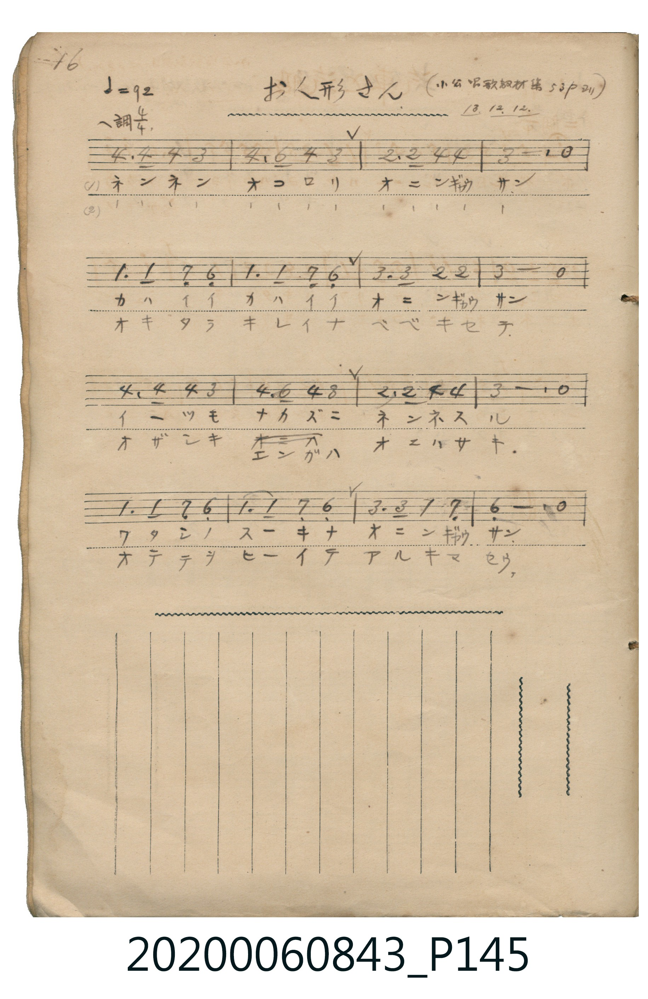

# お人形さん

> Re:Shōka 使用 AI 協助辨識與重建樂譜，可能會有錯誤。歡迎回報。

- **鋼琴伴奏版**：<br><audio controls src="oningyosan.mp3"></audio>

- 日治時期公學校《唱歌帳》（典藏號 2020.006.0843・P145）
- 原載《小公唱歌教材集》第 53 頁（大正 13 年 12 月 12 日抄）

## 說明


- 出處：《唱歌帳》（國立臺灣歷史博物館典藏號 2020.006.0843）第 P145.jpg 頁（手寫頁碼 16）。
- 標註：（小公唱歌教材集 53p ヨリ）13.12.12.（大正 13 年 12 月 12 日抄錄）。
- 調性與拍號：ヘ調- ニ短調（F 大調關係小調 D minor，自然小調／都節調式），4/4 拍，速度 != 92。
- 背景與曲風：溫柔的搖籃曲風，哄著不哭不鬧的可愛洋娃娃入睡，並期待醒來後替她換上漂亮衣裳、牽手散步。
- 版本說明：本檔案為原頁單聲部簡譜之忠實數位化版本。
【原頁歌詞全文與中文語譯】（對應 P145.jpg）

### 編曲說明（鋼琴伴奏版）：

1. 前奏 (Intro, 4 小節)：引用結尾樂句「ワタシノスーキナ オニンギャウサン」，以輕柔搖籃曲伴奏鋪陳。
2. 主歌伴奏 (Song, 16 小節 × 2 段)：右手演奏主旋律，左手以平穩和弦搖擺伴奏。


## 歌詞

```text
（一）ネンネンオコロリ　オニンギャウサン
カハイイカハイイ　オニンギャウサン
イーツモナカズニ　ネンネスル
ワタシノスーキナ　オニンギャウサン
總是不哭不鬧地乖乖睡覺，我最喜歡的洋娃娃呀。）

（二）ネンネンオコロリ　オニンギャウサン
オキタラキレイナ　ベベキセテ
オザシキエンガハ　オニハサキ
オテテヲヒーイテ　アルキマセウ
在客廳、走廊與庭院前，牽著妳的小手一起散步吧。）
```

## ABC

<div class="abc-score" data-abc-src="oningyosan.abc" aria-label="五線譜載入中"></div>

[下載 ABC 原始檔](oningyosan.abc)

## TMD 檔案連結

- [主旋律 TMD 檔案](oningyosan.tmd) [[在 TMD Studio 編輯](https://tmdlang.github.io/Tmd-TS/#tmd=s7IKdvYPcrWy4qpTUCpJTLdSSM7PyUlNLsnMz7MqzsjPTkzOyFeCS5bl55TmploBqXgDQ4RwcX5pUXJqfEFieqpVgKGJKboM3KT4vPyS1KT8_GyEioKi_LLUvMQ8oKrcxLzS4uSizIKS-OT8gkqEmtSyzJRUkIri5MS8-LLUosy0zNQUJGelFhWDHQxxR0lRYh7EHKAgQlV-UWZ6Zp5VaR7IsBI0I_KLSjLy04sSCzIqrTIyi0uAipMTc-KzE_MSEYpKMlKBvi_JBzpNS0vhcWPXk127nu5d9Lhx6uOmyQpaWlyKtgqWRlz2tgpuXNmplbYKLrlcNib6JnYgE55NX_ps0-5nM5uezZn_tHXN07U7ni1Y-Lih6-mUjc_W9jzdsflxQ_f7PR1PW3e8mN7_YuZ8BSMDIwM9AwMzPQMLE-PHzbtBIft-TyfYOU_75r_Y0wnSvaEfZBjYjGdTZz6bO-Hl7DagSc_XrFEwNVZ4uaARZOaS5c_WLlYwNFZ4unOLgqGRwrM5HWAK6KSuFrCZXPpaCrbUAlwKCgqPGyY8m73p-ex1L1atejaj73HDRLBo8-6n7btezJz6fs8sLH6f0_18dfeL9l3PGxc_W7v9af-mp72znneufLlkBY5gAbod5FNQ0OhlFaRD_fuss_vp-tVA9vNFexQMzYCKHjc0Qa1_tmLmixW7gdaD7MMWeMBgKwAqXPG4eRVQo6GxnqERCBEMxpc9oJBEWPRi1f5nDctfdLQ_6-4Fuhvk4eYZQEGg1OPm7ufz1wLZQEPdFIDGApkvp895sr8J6CIgW8FFITczL7_o_Z6eF-2rnrdsgwi_39P_snnv8_UNQPbTPf1A24AKgMlLAWgDkPWyYf7TXcsUwGkQyRnNPc9mrgc5Y_aml4tWAJ3xbNfqZ_OnPJ_V8mzCtOcbm2HiPU8nt7yYOP3Jjt6nk9cCyZdrlgPVPO1f_6xl9rMt3U9XNINQ69LncxcCFT_ZsQyUjve1vmyb9GRf29N9Pc9m73-6dOez_tlPdnQ929P0ZNe6FwsXv1gMjNrG5517gVHybCowUpciXPa8s-PZnDWQ5AFy1pw1z1ZNebaw43nTLmDyBsbe02nrXjRuetm84vmGhS_Wznmys_vp_gVP1y97NnXHk729T3umQUwAmQhNcRB9wNh8sXLe09YVz6a1Az3-ZMdaEGPVvBdr1wOTITjee5-1d8JTDTAgwQYAZZ7saABFYnPv4-bNULJp1eMmIHstMD08bmgAcZu7weLrHjcvfty07HHTViAX7ICm1Y-b-x83LQEjJDYhbUseN-953NzyuHnR4-YukM6mXSDVQG1whzTtfNy8GhJw6x837X_ctP1xcx9YdM_jJqDbughYAvQbJASAIQ2MwacTlkPIJzunAREkThGxPBEYCrOfLt0LiX04A5RmkNRAo1JB4fmOvc9mrEdOOU_nbICb_GLZLpDhHROfzWl4Om3Os7ULMc1BjoJdPZREAVDpWlAANa8Eh8sacOiCQ6d5JgiBZIEZsA2uehsoLEGiwBwPNHINKNoQlgCjcCtQFqa6uQ2MNj1ungQOeaDZwNIWqBoYc8BoA1o4D2R80zIyw_z52k54hnq6c_XTZZufr9wPz1DAcIPkKaBGSMg_nbPi6bpFT3eDctmLrRue7u4CJvinu9a-nLnoaSeoUABmPWCmBpkDzMsb-oHZEJjEX2zdDsmMQMdAAx9oFuXlPhQoaOlzcQXn56VbBWQm5uU71BjUVIOda2OhZQdmACsbDaA7NIGpGRTBMKoGFMZADBJYC8SrYCLN3UAMFIVFOFgcFOcgq0AG1iiYKOgCoQmYNgZiiIgZWAwmYgRWYwQWAeEasDgMGoBEwKb5GALNb-4Fi0KdB2WB9IBcBOQBXQkSWwsmQSIwGRAf4l6QKpiLIfJgN2O10oiuVqLFQtNqoOZ-UEkExiBtmCLExAPYyF09ICNBEQmMxKb9QC0rwQpBUboGYmRzF0ikeSYEg9XtBou0IWLUEOxeQwXzeFBEggjsYpA4NAbHLgjjjVWgvyDBBfEbKLhAJH4ZymIVph0aGiCDVkI1gmISxIeECojVBZEBhgpEBhI6IN27oTJtBCMTFL57gLgFiBeB9XRBIrRpF9gTkJQGS2XASgQsshpHHG4D4u1gV4BcvAKaAIAuBgYUcrIABdtWqK9olyvBwQQJmhYwuQgaLKCAg8QhyJuQ2ILIYGQqoIchMpAYxx9pEO9Dog8SaSugpoHE1oDZ_VAZ5HQCEgMFCHJE44m05vWQrAIK6uY-sJ6dkGgEZxtwdiEjBwJTCwRvAnt4EtRIUAppA2tdBA4GiCXzwCKg2ov8TAiSA4vXQGRwRCPQu5DghXgZFGh90KACRQ4svyDlCCplQmiAgFibIBqBgQKzEJIFQbKQoIHogAQPiDUPKgMOInSrarm4dO0UQNVetI9hrAKcbQRmK3MBAA)]
- [鋼琴伴奏 TMD 檔案](oningyosan_piano.tmd) [[在 TMD Studio 編輯](https://tmdlang.github.io/Tmd-TS/#tmd=s7IKdvYPcrWy4qpTUCpJTLdSyC8qychPL0osyKi0ysgsLskvykxOzInPTsxLVIIrKs4vLUpOjS9ITE-1CjA0MUXIlGSk5qZaleRXKnFpaSk8bux6smvX072LHjdOfdw0-f2ejpfde55P2PJkz5anS_ufd3a839OpoKXFpWirYGnEZW-r4MaVnVppq-CSy2Vjom9iBzL22fSlzzbtfjaz6dmc-U9b1zxdu-PZgoWPG7qeTtn4bG3P0x2bHzd0Aw1-2rrjxfT-FzPnKxgZGBnoGRiY6RlYmBg_bt4NciDQHrAbn_bNf7GnE6R7Qz_IMLAZz6bOfDZ3wsvZbUCTnq9Zo2BqrPByQaMSF5e-loIttQCXgoLC44YJz2Zvej573YtVq57N6HvcMBEs2rz7afuuFzOnvt8zC4u_5nQ_X939on3X88bFz9Zuf9q_6WnvrOedK18uWYHDy0C_gnwB8rZeVkE6yC-PG5qgNr1Ytf9Zw_IXHe3PunuBOkFWNs8ACgKlHjd3P5-_FsgG2uqikJuZl18ENOr9nh5gTCgAlQNZLxvmP921TAEcXQgzn29fAfQWxE9YoxhoC0ipgoKhnsLTzl6guIKGZ15JUb6OgokCMCaer2_QBKp5umfq8ykrnm-d8HTDvmcrmp72L33c0PO4ef3jpv2Pm7Y_bu573LTzcfOex01rHzd3KTxuWgV08ePmzY-b1j1uXvy4adnjpq0gbgPIpU92L32xZ-qz-VOeTZj2fGMz0H0QB73sXvVyJlAN2O0KCkZ6Ck927AaGN0RWQSM4Py9dR8HQDOoshcPTFYwUnq3bCnZf_-Znnd3P9kwBqgTpmt79dB8winqebl8GFAfa-HTn5ucrVz6d1PN0zzKgvc8m74IYC7WO8kQEBQpa-lxc4AC0CshMzMsP8nCoMaipBnvJxkLLDsyoUTBU0AVCQwXzeCBlBiKwixmDxYzBcmDxGogMDBqAhLhqUaz0QbbSBG6lWXy8QrRZbiyCgV3MGMgyBrJgNJoqA4h9oMjA60MTsPtMwDTIFxARM7AYTMQIrMYILALCMP8i-4288AKZDMK4TRxY9xGMT0T44ohOI2CcGKHGnAmQZYIiAlMEo1FiFxSTaEkDS5xjESJgGv1dRlyS1bVTAOcSBSADFLzItDIXAA)]

## 分析

```text
================================================================================
📊 TMD Song Profile: [ お人形さん ]
================================================================================
⏱  Duration:       1:23 (83.5s), 32 measures total
🎼 Key & Tempo:    首調基準 F, != 92.0 BPM, <4/4>
   - 分析範圍：      由實際發聲的音符與和弦推測調性；播放脈絡另行呈現
🎤 人聲音域:    D4 (MIDI 62) – D5 (MIDI 74) [跨度: 12 個半音 / 1.0 個八度, 難度: easy]
   - 最低音:  D4 in [Song[L1] #1 @ m.5, 0:12]
   - 最高音: D5 in [Song[L1] #1 @ m.2, 0:03]
   - 適合: soprano, mezzo-soprano, contralto, tenor, baritone, bass
🏛  結構:      Song[L1] (41.7s) -> Song[L2] (41.7s)
⚡ 編曲密度:        Peak 1 軌道同時演奏
🗝  調性診斷：       D 小調（純淨自然小調，未偵測到可信轉調）
   - 風格氣質:    純淨自然小調（陰鬱抒情、旋律集中，無明顯調外色彩）
   - 轉調歷程:    全曲維持單一推測調性（未偵測到可信轉調）
   - 核心骨幹音:  A, A#, D, F, G
   - 調性數值:    D 小調 [相關度: 0.72, 穩定度: High, 自然音純度: 100.0%]
   - 候選調性 (K-S): D 小調 (0.72), A# 大調 (0.56), F 大調 (0.54)
   - 五度圈歷程:   +2 -> +2
   - 各段落調性細節:
     • [Song[L1] #1]: D 小調 (r: 0.72, 自然音純度: 100.0%)
     • [Song[L2] #1]: D 小調 (r: 0.72, 自然音純度: 100.0%)

  [ 五度圈游移軌跡 ]
               C  
         F            G  
      Bb              [D ]*
      Eb               A  
         Ab           E  
            Db       B  
               F# 
     (* = active key center)

  [ 十二半音累積音高分佈 ]
     C  :                            0.0%
     C# :                            0.0%
     D  : █████████████             15.0%
     D# :                            0.0%
     E  : ███████                    8.3%
     F  : █████████████             15.0%
     F# :                            0.0%
     G  : ████████                  10.0%
     G# :                            0.0%
     A  : ████████████████████████  28.3%
     A# : ████████████████████      23.3%
     B  :                            0.0%
--------------------------------------------------------------------------------
Assignment 軌道音域：
  - Piano         : D4 – D5 (12 個半音 / 1.0 個八度, 104 個音符)
================================================================================
```


## 原書掃描頁




