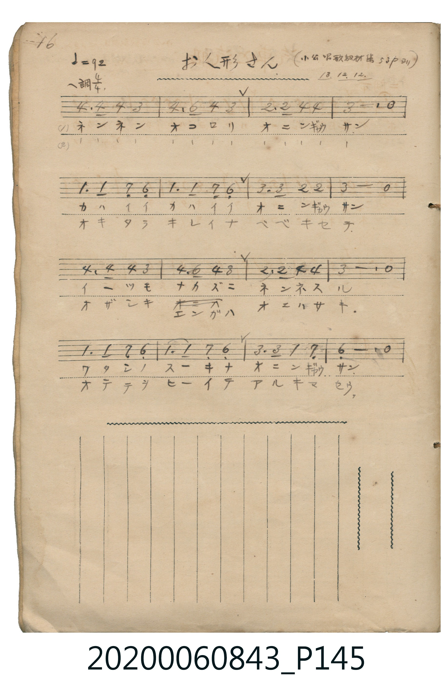

# お人形さん

> Re:Shōka 使用 AI 協助辨識與重建樂譜，可能會有錯誤。歡迎回報。

- **鋼琴伴奏版**：<br><audio controls src="oningyosan.mp3"></audio>

- 日治時期公學校《唱歌帳》（典藏號 2020.006.0843・P145）
- 原載《小公唱歌教材集》第 53 頁（大正 13 年 12 月 12 日抄）

## 說明


- 出處：《唱歌帳》（國立臺灣歷史博物館典藏號 2020.006.0843）第 P145.jpg 頁（手寫頁碼 16）。
- 標註：（小公唱歌教材集 53p ヨリ）13.12.12.（大正 13 年 12 月 12 日抄錄）。
- 調性與拍號：ヘ調- ニ短調（F 大調關係小調 D minor，自然小調／都節調式），4/4 拍，速度 != 92。
- 背景與曲風：溫柔的搖籃曲風，哄著不哭不鬧的可愛洋娃娃入睡，並期待醒來後替她換上漂亮衣裳、牽手散步。
- 版本說明：本檔案為原頁單聲部簡譜之忠實數位化版本。
【原頁歌詞全文與中文語譯】（對應 P145.jpg）

### 編曲說明（鋼琴伴奏版）：

1. 前奏 (Intro, 4 小節)：引用結尾樂句「ワタシノスーキナ オニンギャウサン」，以輕柔搖籃曲伴奏鋪陳。
2. 主歌伴奏 (Song, 16 小節 × 2 段)：右手演奏主旋律，左手以平穩和弦搖擺伴奏。


## 歌詞

```text
（一）ネンネンオコロリ　オニンギャウサン
カハイイカハイイ　オニンギャウサン
イーツモナカズニ　ネンネスル
ワタシノスーキナ　オニンギャウサン
總是不哭不鬧地乖乖睡覺，我最喜歡的洋娃娃呀。）

（二）ネンネンオコロリ　オニンギャウサン
オキタラキレイナ　ベベキセテ
オザシキエンガハ　オニハサキ
オテテヲヒーイテ　アルキマセウ
在客廳、走廊與庭院前，牽著妳的小手一起散步吧。）
```

## ABC

<div class="abc-score" data-abc-src="oningyosan.abc" aria-label="五線譜載入中"></div>

[下載 ABC 原始檔](oningyosan.abc)

## TMD 檔案連結

- [主旋律 TMD 檔案](oningyosan.tmd) [[在 TMD Studio 編輯](https://tmdlang.github.io/Tmd-TS/#tmd=s7IKdvYPcrWy4qpTUCpJTLdSSM7PyUlNLsnMz7MqzsjPTkzOyFeCS5bl55TmploBqXgDQ4RwcX5pUXJqfEFieqpVgKGJKboM3KT4vPyS1KT8_GyEioKi_LLUvMQ8oKrcxLzS4uSizIKS-OT8gkqEmtSyzJRUkIri5MS8-LLUosy0zNQUJGelFhWDHQxxR0lRYh7EHKAgQlV-UWZ6Zp5VaR7IsBKoEVpaCo8bu57s2vV076LHjVMfN01W0NLiUrRVsDTisrdVcOPKTq20VXDJ5bIx0TexA5n1bPrSZ5t2P5vZ9GzO_Keta56u3fFswcLHDV1Pp2x8trbn6Y7Njxu63-_peNq648X0_hcz5ysYGRgZ6BkYmOkZWJgYP27eDQqh93s6wQ572jf_xZ5OkO4N_SDDwGY8mzrz2dwJL2e3AU16vmaNgqmxwssFjSAzlyx_tnaxgqGxwtOdWxQMjRSezekAU0AndbWAzeTS11KwpRbgUlBQeNww4dnsTc9nr3uxatWzGX2PGyaCRZt3P23f9WLm1Pd7ZmHx-5zu56u7X7Tvet64-Nna7U_7Nz3tnfW8c-XLJStwBAvQ7SCfgoJGL6sgHerfZ53dT9evBrKfL9qjYGgGVPS4oQlq_bMVM1-s2A20HmQftsADBlsBUOGKx82rgBoNjfUMjUCIYDC-7AGFJMKiF6v2P2tY_qKj_Vl3L9DdIA83zwAKAqUeN3c_n78WyAYa6qYANBbIfDl9zpP9TUAXAdkKLgq5mXn5Re_39LxoX_W8ZRtE-P2e_pfNe5-vbwCyn-7pB9oGVABMXgpAG4Cslw3zn-5apgBOg0jOaO55NnM9yBmzN71ctALojGe7Vj-bP-X5rJZnE6Y939gME-95OrnlxcTpT3b0Pp28Fki-XLMcqOZp__pnLbOfbel-uqIZhFqXPp-7EKj4yY5loHS8r_Vl26Qn-9qe7ut5Nnv_06U7n_XPfrKj69mepie71r1YuPjFYmDUNj7v3AuMkmdTgZG6FOGy550dz-asgSQPkLPmrHm2asqzhR3Pm3YBkzcw9p5OW_eicdPL5hXPNyx8sXbOk53dT_cveLp-2bOpO57s7X3aMw1iAshEaIqD6APG5ouV8562rng2rR3o8Sc71oIYq-a9WLsemAzB8d77rL0TnmqAAQk2ACjzZEcDKBKbex83b4aSTaseNwHZa4Hp4XFDA4jb3A0WX_e4efHjpmWPm7YCuRAHNEBR0-rHzf2Pm5aAERKbaP1LHjfvedzc8rh50ePmLpARTbtA2oBScKc17XzcvBpVW_P6x037Hzdtf9zcB5be87gJ6OwuAtYCvQ0JHGAkACP36YTlEPLJzmlABIluRAKYCAyg2U-X7oUkDDgDlJyQ1EBjWUHh-Y69z2asR05UT-dsgJv8YtkukOEdE5_NaXg6bc6ztQsxzUGOnV09VIkdoJ61oJBqXgkOoDXg8AYHU_NMEALJAjNpG6a2baDQBUkDiwegJWtAUYuwFhjNW4GyGNqa28Bo0-PmSeBIAdoGLKOBUsDYBUYt0AnzQBY2LSMzOp6v7YRnw6c7Vz9dtvn5yv3wbAgMUkhOBGqERMrTOSuerlv0dDcob77YuuHp7i5gNnm6a-3LmYuedoKKEmCGBRYFIHOAJcCGfmDmBWaMF1u3Q7Iw0DHQeAGaRXltAQUKWvpcXMH5eelWAZmJefkONQY1CtVg99pYaNmBGcA6SgPoEE1g6QGKfBhVowAMZCAGCawF4lUwkeZuIAaKwhIDWByUHkB2gQysUTBR0AVCEzBtDMQQETOwGEzECKzGCCwCwjVgcRg0AImATfMxBJrf3AsWhToPygLpAbkIyAO6EiS2FkyCRGAyID7EvSBVMBdD5MFuxmqlEV2tRIuFptVAzf1AegkYg7RhihATD2Ajd_WAjARFJDASm_YDtawEKwRF6RqIkc1dIJHmmRAMVrcbLNKGiFFDsHsNFczjQREJIrCLQeLQGBy7IIw3VoH-ggQXxG-g4AKR-GUoi1WYdmhogAxaCdUIikkQHxIqIFYXRAYYKhAZSOiAdO-GyrQRjExQ-O4B4hYgXgTW0wWJ0KZdYE9AUhoslQErGLDIahxxuA2It4NdAXLxCmgCALoYGFDIyQIUbFuhvqJdrgQHEyRoWsDkImiwgAIOEocgb0JiCyKDkamAHobIQGIcf6RBvA-JPkikrYCaBhJbA2b3Q2WQ0wlIDBQgyBGNJ9Ka10OyCiiom_vAenZCohGcbcDZhYwcCEwtELwJ7OFJUCNBKaQNrHUROBgglswDi4CqL_IzIUgOLF4DkcERjUDvQoIX4mVQoPVBgwoUObD8gpQjqJQJoQECYm2CaAQGCsxCSBYEyUKCBqIDEjwg1jyoDDiI0K2q5eLStVMA1XvRPoaxCnC2EZitzAUA)]
- [鋼琴伴奏 TMD 檔案](oningyosan_piano.tmd) [[在 TMD Studio 編輯](https://tmdlang.github.io/Tmd-TS/#tmd=s7IKdvYPcrWy4tLSUnjc2PVk166nexc9bpz6uGny-z0dL7v3PJ-w5cmeLU-X9j_v7Hi_p1NBS4tL0VbB0ojL3lbBjSs7tdJWwSWXy8ZE38SOq05B6dn0pc827X42s-nZnPlPW9c8Xbvj2YKFjxu6nk7Z-Gxtz9Mdmx83dAMNftq648X0_hcz5ysYGRgZ6BkYmOkZWJgYP27eHWBoYgq0Rwlk2NO--S_2dIJ0b-gHGQY249nUmc_mTng5uw1o0vM1axRMjRVeLmhU4uLS11KwpRbgUlBQeNww4dnsTc9nr3uxatWzGX2PGyaCRZt3P23f9WLm1Pd7ZmHx15zu56u7X7Tvet64-Nna7U_7Nz3tnfW8c-XLJStweBnoV5AvQN7WyypIB_nlcUMT1KYXq_Y_a1j-oqP9WXcvUCfIyuYZQEGg1OPm7ufz1wLZQFtdFHIz8_KLgEa939MDjAkFoHIg62XD_Ke7limAowth5vPtK4DegvgJaxQDbQEpVVAw1FN42tkLFFfQ8MwrKcrXUTBRAMbE8_UNmkA1T_dMfT5lxfOtE55u2PdsRdPT_qWPG3oeN69_3LT_cdP2x819j5t2Pm7e87hp7ePmLoXHTauALn7cvPlx07rHzYsfNy173LQVxG0AufTJ7qUv9kx9Nn_KswnTnm9sBroP4qCX3atezgSqAbtdQcFIT-HJjt3A8IbIKmgE5-el6ygYmkGdpXB4uoKRwrN1W8Hu69_8rLP72Z4pQJUgXdO7n-4DRlHP0-3LgOJAG5_u3Px85cqnk3qe7lkGtPfZ5F0QY6HWUZ6IoEBBS5-LCxyAVgGZiXn5QR4ONQY1CtVgP9lYaNmBGTUKhgq6QGioYB4PpMxABHYxY7CYMVgOLF4DkYFBA5AQVy2KnT4odprA7TSLj1eINsuNRTCwixkDWcZAFoxGU2UAsRAUHfj9aAJ2oQmYBvkDImIGFoOJGIHVGIFFQBjmY2TfkRdiIJNBGLeJA-s-gjGKCGBcEWoEjBUj1LgzAbJMUERgimA0SvyC4hItcWCJdSxCBEyjv8uIS7S6dgrgjKIAZIDCF5lW5gIA)]

## 分析

```text
================================================================================
📊 TMD Song Profile: [ お人形さん ]
================================================================================
⏱  Duration:       1:23 (83.5s), 32 measures total
🎼 Key & Tempo:    首調基準 F, != 92.0 BPM, <4/4>
   - 分析範圍：      由實際發聲的音符與和弦推測調性；播放脈絡另行呈現
🎤 人聲音域:    D4 (MIDI 62) – D5 (MIDI 74) [跨度: 12 個半音 / 1.0 個八度, 難度: easy]
   - 最低音:  D4 in [Song[L1] #1 @ m.5, 0:12]
   - 最高音: D5 in [Song[L1] #1 @ m.2, 0:03]
   - 適合: soprano, mezzo-soprano, contralto, tenor, baritone, bass
🏛  結構:      Song[L1] (41.7s) -> Song[L2] (41.7s)
⚡ 編曲密度:        Peak 1 軌道同時演奏
🗝  調性診斷：       D 小調（純淨自然小調，未偵測到可信轉調）
   - 風格氣質:    純淨自然小調（陰鬱抒情、旋律集中，無明顯調外色彩）
   - 轉調歷程:    全曲維持單一推測調性（未偵測到可信轉調）
   - 核心骨幹音:  A, A#, D, F, G
   - 調性數值:    D 小調 [相關度: 0.72, 穩定度: High, 自然音純度: 100.0%]
   - 候選調性 (K-S): D 小調 (0.72), A# 大調 (0.56), F 大調 (0.54)
   - 五度圈歷程:   +2 -> +2
   - 各段落調性細節:
     • [Song[L1] #1]: D 小調 (r: 0.72, 自然音純度: 100.0%)
     • [Song[L2] #1]: D 小調 (r: 0.72, 自然音純度: 100.0%)

  [ 五度圈游移軌跡 ]
               C  
         F            G  
      Bb              [D ]*
      Eb               A  
         Ab           E  
            Db       B  
               F# 
     (* = active key center)

  [ 十二半音累積音高分佈 ]
     C  :                            0.0%
     C# :                            0.0%
     D  : █████████████             15.0%
     D# :                            0.0%
     E  : ███████                    8.3%
     F  : █████████████             15.0%
     F# :                            0.0%
     G  : ████████                  10.0%
     G# :                            0.0%
     A  : ████████████████████████  28.3%
     A# : ████████████████████      23.3%
     B  :                            0.0%
--------------------------------------------------------------------------------
Assignment 軌道音域：
  - Piano         : D4 – D5 (12 個半音 / 1.0 個八度, 104 個音符)
================================================================================
```


## 原書掃描頁




