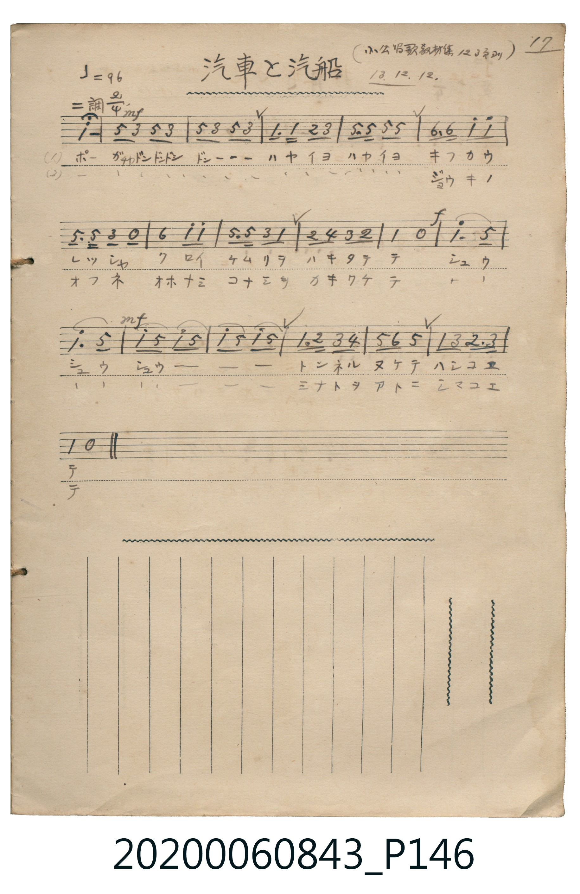

# 汽車と汽船

> Re:Shōka 使用 AI 協助辨識與重建樂譜，可能會有錯誤。歡迎回報。

- **鋼琴伴奏版**：<br><audio controls src="kisha_to_kisen.mp3"></audio>
- **NEUTRINO 歌聲合成版**：<br><audio controls src="kisha_to_kisen_neutrino.mp3"></audio>

- 日治時期公學校《唱歌帳》（典藏號 2020.006.0843・P146）
- 原載《小公唱歌教材集》第 123 頁（大正 13 年 12 月 12 日抄）

## 說明


- 出處：《唱歌帳》（國立臺灣歷史博物館典藏號 2020.006.0843）第 P146.jpg 頁（手寫頁碼 17）。
- 標註：（小公唱歌教材集 123 頁ヨリ）13.12.12.（大正 13 年 12 月 12 日抄錄）。
- 調性與拍號：ニ調（D 大調），2/4 拍，速度 != 96。
- 背景與曲風：共 19 小節，附有強弱記號（mf、f）與延長記號。第一段描寫火車鳴笛「ポー」與車輪「ガチャドンドンドン」、
噴煙「シュウシュウ」穿過隧道與鐵橋；第二段描寫輪船破浪駛離港口、越過重重島嶼。
- 版本說明：本檔案為原頁單聲部簡譜之忠實數位化版本。
【原頁歌詞全文與中文語譯】（對應 P146.jpg）

### 編曲說明（鋼琴伴奏版）：

1. 前奏 (Intro, 4 小節)：以汽笛長音「ポー」與車輪節奏揭開序幕。
2. 主歌伴奏 (Song, 19 小節 × 2 段)：右手演奏主旋律，左手以富有推進力的八分音符和弦模擬蒸汽火車與輪船前進。


## 歌詞

```text
（一）ポー　ガチャドンドンドン　ドンーーー
ハヤイヨハヤイヨ　キフカウレッシャ
クロイケムリヲ　ハキタテテ
シュウ　シュウ　シュウーーー
トンネルヌケテ　ハシコヱテ
噴出陣陣黑煙，咻、咻、咻——，穿過隧道、越過鐵橋！）

（二）ポー　ガチャドンドンドン　ドンーーー
ハヤイヨハヤイヨ　ジョウキノオフネ
オホナミコナミヲ　カキワケテ
シュウ　シュウ　シュウーーー
ミナトヲアトニ　シマコヱテ
破開大浪與小浪，咻、咻、咻——，把港口留在身後、越過島嶼！）
```

## ABC

<div class="abc-score" data-abc-src="kisha_to_kisen.abc" aria-label="五線譜載入中"></div>

[下載 ABC 原始檔](kisha_to_kisen.abc)

## TMD 檔案連結

- [主旋律 TMD 檔案](kisha_to_kisen.tmd) [[在 TMD Studio 編輯](https://tmdlang.github.io/Tmd-TS/#tmd=s7IKdvYPcrWy4qpTUCpJTLdSSM7PyUlNLsnMz7MqzsjPTkzOyFeCS5bl55TmploBqXgDQ4RwcX5pUXJqfEFieqpVgKGJGboM3KT4vPyS1KT8_GyEioKi_LLUvMQ8oKrcxLzS4uSizIKS-OT8gkqEmtSyzJRUkIri5MS8-LLUosy0zNQUJGelFhWDHQxxR0lRYh7EHKAgQlVJRirQ7WDJgvyiEoREflFmemaeVWkeyJYSNLOBKjPy04sSCzIqrTIyi0uAipMTc-KzE_MSlbi0tBSebdz7YnfX48YVIEbHTgUtLS5FWwVLMy57WwUXLhsjfRM7kFnPpi99tmn3s5lNz-bMf9q65unaHc8WLHzc0PV0ysZna3ue7tj8uKH7_Z6Op607XkzvfzFzvoKRgZGBnoGBmZ6BhYnx4-bdoHB9v6cT7LCnffNf7OkE6d7QDzIMbMazqTOfzZ3wcnYb0KTna9YoGBoZK7xc0AgydMnyZ2sXKxgaKzzduQUorvBsTgeYArqpqwVsKJe-loIttQCXgoLC44YJz2Zvej573YtVq57N6HvcMBEs2rz7afuuFzOnvt8zC4vn53Q_X939on3X88bFz9Zuf9q_6WnvrOedK18uWYEjXIBuB3kVFDZ6WQXpUP8-6-x-un41kP180R4FQ3OgoscNTVDrn62Y-WLFbqD1IPuwhR4s3B43r3jcvAqo19BYz9AIhAiG5MseUGAi7Hqxav-zhuUvOtqfdfcCnQ7yc3M3UBBokIsC0Cgws_P9nh5gIlEAqgGyXjbMf7prmQI4BSEZ1NzzbOZ6kEGzN71ctAJo0NPWjQqGlgpAHzxf3wDSN7Pl2ZzOp3u2P92z8cWKGWDbOnLTHjc0pgGtAOp8unvby6nbIVJAg4Gh9mRHw7N1W5_19wPD6nnjamAifrl5y_M1sx839Dxunvu4ec_jhl6gRqD4iz2rQIJNax43A4Nl8ePmzsfNm1HIhl6gTSDHKig8nbnleetMsPrtj5uXPm5ahmA09D5fuf9lY9_LWctfNk4GGv5ywtZnK4FRPxvknl09cPcAbQTmpecLtjzbuurl8tkvZy96tmP90_7FQFtebOsCmdDeC0RPN297ug3oTlg4Pe_seDZnDSTFAQMJyH62asqzhR3Pm3YBswwwUp9OW_eicdPL5hXPNyx8sXbOk53dT_cveLp-2bOpO57s7X3aMw1iAshEaCKG6AMmkBcr5z1tXfFsWjvQ2U92rAUxVs17sXY9MGWDk1Lvs_ZOeEIEhjnYAKAMMJhBiQIaog14Q7EBxt0DQRBv9T9uXvK4aQk4QSKxQWatfdw89XHTalDYNgPNbQYH9WKwtqb1j5vXgpQ2bXzcvACYlB83bwLb0A_S1rT_cXMbEEGUwuMHaCQ2Nqp7OsBO7H3cvPpxMzCWgcYDixyIwdsfNwGlQCJQ30PCCJRgZ05_1DAFiJ5Oa3g6a_LTSbMgCBijQBIi9X5P49Ole5_uX_10YgOcAUzczxqWvljY87RjOjAtAtXA0xmwKHk5czEI7Z4ITHNAlU8n7QYbCCVhxvYgJztEGoImPmCRgYitXT20i60dj5uXg_MDMNr6HjcBY2QqMBwhUQDkzH7c3PW4eT44CMEMSISBoheoYT0kpMmJMKBJQPOA0bbpcdMiMKMbpnoeTSLsxaQdoNoQnInhEQbMzS-ndYNK0K1A8XZg0QVk4ImzZ11dkEz_fOrMp3NWvNi1-um-HnjkQbI-NPKAplNea0GBgpY-F5d3ZnFGYkg-kErNswrITMzLd6gxqKkGe8TG0EzLDszCVmcqQEpWYHpV0DCBls86wHLB2BBULmhi0QC0D2RYjUJ1blqtgmGcgi4KrFEwBUJjIMsUiEE0SATCQogYgtUaKhjBRMBm-hjWAKMflJYxDAWmbKAUMGkvAVKgZAwUxWSAtOOURFHVDzYXbFzTEjBrBcIZRkAVjXuxOqOxB4gXPm5qAVIrHzdNBmnFYIDU4ZREUbUe4gywcS1gVgfYGfjja1cPOfEFCn1QHIBoEK5RMAOLmEEiEUwgVIFixQBJFVQBRBVSbOEISCBvLVRmKpC9Guy3ZdDAXwOVAfoalKlB2uKhmiABApIEaYcYiRwrOAIMyJsBZD5ubIPpb-wFk-ugsl1Q0a1ADDIZal8jsCW8G65lFZjcT0QM7OgEx4AZeTEACltQDqgBp38TIAaJgNiwnAEJe0iaq0ZkM4gBEGEsQogcCRKFM5Ciq2kjNHQXADHYu82boJECikhIpAFrW7AMKCxBMrAwBYUZLDcCow0Um7BYJV4CIozGRY5hUNaARAYkKh43TYKY0NgNFgfHaxPYtY0ToTIwm5Bc2Dj9cRPE4YhEQZwERBiNSyBBPJ09G5wgTElLEFjiCpoAjMBJApQ0IMkGlAlhUQ1RA0syIBaWZIMU53hDHtRAgoQGsGwEVu9gFii7gmR6wOpAaQaRChBpZTuYBJWoIHoF9rSCFLN4wxca27CYBxUiiJhvAouDxRpBboPHGFhkH5iEpZsO7CmCq5aLS9dOAbmmVADylbkA)]
- [鋼琴伴奏 TMD 檔案](kisha_to_kisen_piano.tmd) [[在 TMD Studio 編輯](https://tmdlang.github.io/Tmd-TS/#tmd=s7IKdvYPcrWy4qpTUCpJTLdSyC8qychPL0osyKi0ysgsLskvykxOzInPTsxLVIIrKs4vLUpOjS9ITE-1CjA0MUPIlGSk5qZapaaUJieWZObnKXFpaSk827j3xe6ux40rQIyOne_3dLzs3vN8wpYne7Y8Xdr_vLPj_Z5OBS0tLkVbBUszLntbBRcuGyN9EzuQoc-mL322afezmU3P5sx_2rrm6dodzxYsfNzQ9XTKxmdre57u2Py4oRto4NPWHS-m97-YOV_ByMDIQM_AwEzPwMLE-HHzbpDzgOaDXfi0b_6LPZ0g3Rv6QYaBzXg2deazuRNezm4DmvR8zRoFQyNjhZcLGpW4uPS1FGypBbgUFBQeN0x4NnvT89nrXqxa9WxG3-OGiWDR5t1P23e9mDn1_Z5ZWDw2p_v56u4X7bueNy5-tnb70_5NT3tnPe9c-XLJChx-BnoW5A2Qv_WyCtJBfnnc0AS16cWq_c8alr_oaH_W3QvUCbKyuRsoCLTJReHpkuVgZuf7PT3A8FcAqgGyXjbMf7prmQI4chAGPd--AugXiEewRijQaJBSBQVDPYWnnb1AcQUNz7ySonwdBRMFYPg_X9-gCVTzZPdSYKp4vmb2y6nbX84HerrncfPcx817Hjf0Al0JTDYv9qwCKgVqf9a_9uW07qe7-p_unAp1h4KCkZ7Ckx27gQEGsVpBIzg_L11HwdASaoXC4ekKRgrP1m0F2fW0f_Ozzu5ne6YAVYJ0Te9-ug8Yxj1Pty8DigNd8nR9z7M5nc_6Vrxs2PS0a_bzWS1PW1c_7WgDOuz5mmVPJ_U83bPs2YqFzyaveTFpB8jZjatBLgS6c88qYMIGehOoEeo2ypMMFCho6XNxgUPOKiAzMS8_yMOhxqCmGux_G0MzLTswq0bBME5BFwXWKJgCoTGQZQrEIBqoCMoyAqswhoqAoAFMF1ctinU-yNZZIGyLV4g2jIVRcL5pPDYB03gkESBlALHFO7M4IzEkH0il5uHzG7Z8qABM4092NLxY2KOgAUtPOsBEb2wISvSaWDQAgxHi9OrctFriQgvGQg0_XSAJCj-wCNhMH8MaYJ4AJVsMQx83rQFKNT5uXgKkOh83bwaKYjJA2nFKoqjqB5sLNq5pCZi1AuEMI6CKxr1YndHYA8QLHze1AKmVj5smg7RiMEDqcEqiqFoPcQbYuBYwqwPsDPzxtauHnPgChT4oDkA0CNcomIFFzCCRCCYQqkCxAkrLMFVQBRBVSLGFIyCBvLVQmalA9mqw35ZBA38NVAbo66btIK26CvFQTZAAAUmCtEOMRI4VHAEG5M0AMh83tsH0N_aCyXVQ2S6o6FYgBpkMta8RWJ3uhmtZBSb3ExEDOzrBMWBGXgyAwhaUA2rA6d8EiGFlCZZyRKEakc0gBkCEsQghciRIFM5Aiq6mjdDQXQDEYO82b4JGCigiIZH2uAkUBI-bQWEJkoGFKSjMYLkRGG2g2ITFKvESEGE0LnIMg7IGJDIgUfG4aRLEhMZusDg4XpvArm2cCJWB2YTkwsbpj5sgDkckCuIkIMJoXAIJ4uns2eAEYUpagsASV9AEYAROEqCkAUk2oEwIi2riqh9EnOMNeWD8gnIQKL43AzE4dJtB2RUk0wNWB0oziFSASCvbwSSoRAXRK7CnFaSYxRu-0NiGxTyoEEHEfBNYHCzWCHIbPMbAIvvAJCzddGBPEdgrSmrUylgFUA1CqDMBMkxiYRRaZY4ui8M18LYArkYBFd2LSwDdA_jaJ7p2CuCGkAKQgRwF0T5AZRhiRmAxZS4A)]

## 分析

```text
================================================================================
📊 TMD Song Profile: [ 汽車と汽船 ]
================================================================================
⏱  Duration:       0:23 (23.8s), 19 measures total
🎼 Key & Tempo:    首調基準 D, != 96.0 BPM, <2/4>
   - 分析範圍：      由實際發聲的音符與和弦推測調性；播放脈絡另行呈現
🎤 人聲音域:    D4 (MIDI 62) – D5 (MIDI 74) [跨度: 12 個半音 / 1.0 個八度, 難度: easy]
   - 最低音:  D4 in [KishaToKisen #1 @ m.4, 0:03]
   - 最高音: D5 in [KishaToKisen #1 @ m.1, 0:00]
   - 適合: soprano, mezzo-soprano, contralto, tenor, baritone, bass
🏛  結構:      KishaToKisen (23.8s)
⚡ 編曲密度:        Peak 1 軌道同時演奏
🗝  調性診斷：       D 大調（純淨自然大調，未偵測到可信轉調）
   - 風格氣質:    純淨自然大調（陽光明朗、易唱易記，無明顯調外色彩）
   - 轉調歷程:    全曲維持單一推測調性（未偵測到可信轉調）
   - 核心骨幹音:  D, A, F#, E, B
   - 調性數值:    D 大調 [相關度: 0.92, 穩定度: High, 自然音純度: 100.0%]
   - 候選調性 (K-S): D 大調 (0.92), A 大調 (0.69), D 小調 (0.59)
   - 五度圈歷程:   +2
   - 各段落調性細節:
     • [KishaToKisen #1]: D 大調 (r: 0.92, 自然音純度: 100.0%)

  [ 五度圈游移軌跡 ]
               C  
         F            G  
      Bb              [D ]*
      Eb               A  
         Ab           E  
            Db       B  
               F# 
     (* = active key center)

  [ 十二半音累積音高分佈 ]
     C  :                            0.0%
     C# :                            0.0%
     D  : ████████████████████████  34.5%
     D# :                            0.0%
     E  : █████                      7.0%
     F  :                            0.0%
     F# : ██████████                14.8%
     G  : ██                         2.8%
     G# :                            0.0%
     A  : ████████████████████████  33.8%
     A# :                            0.0%
     B  : █████                      7.0%
--------------------------------------------------------------------------------
Assignment 軌道音域：
  - Piano         : D4 – D5 (12 個半音 / 1.0 個八度, 61 個音符)
================================================================================
```


## 原書掃描頁




