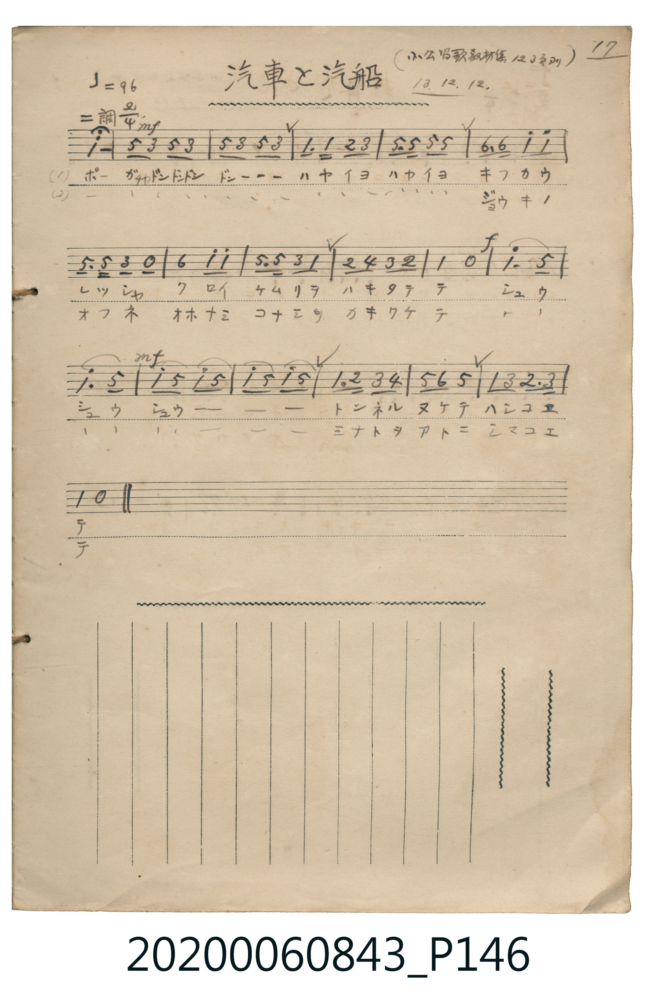

# 汽車と汽船

<audio controls src="kisha_to_kisen.mp3"></audio>

- 日治時期公學校《唱歌帳》（典藏號 2020.006.0843・P146）
- 原載《小公唱歌教材集》第 123 頁（大正 13 年 12 月 12 日抄）

## 說明

【曲目說明】
・出處：《唱歌帳》（國立臺灣歷史博物館典藏號 2020.006.0843）第 P146.jpg 頁（手寫頁碼 17）。
・標註：（小公唱歌教材集 123 頁ヨリ）13.12.12.（大正 13 年 12 月 12 日抄錄）。
・調性與拍號：ニ調（D 大調），2/4 拍，速度 != 96。
・背景與曲風：共 19 小節，附有強弱記號（mf、f）與延長記號。第一段描寫火車鳴笛「ポー」與車輪「ガチャドンドンドン」、
噴煙「シュウシュウ」穿過隧道與鐵橋；第二段描寫輪船破浪駛離港口、越過重重島嶼。
・版本說明：本檔案為原頁單聲部簡譜之忠實數位化版本。
【原頁歌詞全文與中文語譯】（對應 P146.jpg）

・編曲說明（鋼琴伴奏版）：
1. 前奏 (Intro, 4 小節)：以汽笛長音「ポー」與車輪節奏揭開序幕。
2. 主歌伴奏 (Song, 19 小節 × 2 段)：右手演奏主旋律，左手以富有推進力的八分音符和弦模擬蒸汽火車與輪船前進。

## 歌詞

```text
（一）ポー　ガチャドンドンドン　ドンーーー
ハヤイヨハヤイヨ　キフカウレッシャ
クロイケムリヲ　ハキタテテ
シュウ　シュウ　シュウーーー
トンネルヌケテ　ハシコヱテ
噴出陣陣黑煙，咻、咻、咻——，穿過隧道、越過鐵橋！）

（二）ポー　ガチャドンドンドン　ドンーーー
ハヤイヨハヤイヨ　ジョウキノオフネ
オホナミコナミヲ　カキワケテ
シュウ　シュウ　シュウーーー
ミナトヲアトニ　シマコヱテ
破開大浪與小浪，咻、咻、咻——，把港口留在身後、越過島嶼！）
```

## ABC

```abc
X:1
T:汽車と汽船
M:2/4
L:1/16
Q:1/4=96
K:D
V:V1 name="Piano" snm="Pia"
[V:V1]
!mf! d8 | A A F2 A2 F2 | A2 F2 A2 F2 | D3 D E2 F2 |
A3 A A2 A2 | B3 B d2 d2 | A3 A F2 z2 | B4 d2 d2 |
A3 A F2 D2 | E2 G2 F2 E2 | D4 z4 | !f! d3 A5 |
d3 A5 | !mf! d2 A2 d2 A2 | d2 A2 d2 A2 | D3 E F2 G2 |
A2 B2 A4 | D2 F2 E3 F | D4 z4 |
```

## TMD 檔案連結

- [主旋律 TMD 檔案](kisha_to_kisen.tmd) [[在 TMD Studio 編輯](https://tmdlang.github.io/Tmd-TS/#tmd=s7IKdvYPcrWy4qpTUCpJTLdSSM7PyUlNLsnMz7MqzsjPTkzOyFeCS5bl55TmploBqXgDQ4RwcX5pUXJqfEFieqpVgKGJGboM3KT4vPyS1KT8_GyEioKi_LLUvMQ8oKrcxLzS4uSizIKS-OT8gkqEmtSyzJRUkIrUlMyS_KLMxBwkJ6UWFYMdC3FDSVFiHsQMoCBCVUlGKtDdYMmC_KISJS4tLYVnG_e-2N31uHEFiNGxU0FLi0vRVsHSjMveVsGFy8ZI38QOpP_Z9KXPNu1-NrPp2Zz5T1vXPF2749mChY8bup5O2fhsbc_THZsfN3S_39PxtHXHi-n9L2bOVzAyMDLQMzAw0zOwMDF-3LwbFCLv93SCHfO0b_6LPZ0g3Rv6QYaBzXg2deazuRNezm4DmvR8zRoFQyNjhZcLGkGGLln-bO1iBUNjhac7twDFFZ7N6QBTQDd1tYAN5dLXUrClFuBSUFB43DDh2exNz2eve7Fq1bMZfY8bJoJFm3c_bd_1YubU93tmYfH8nO7nq7tftO963rj42drtT_s3Pe2d9bxz5cslK3CEC9DtIK-CwkYvqyAd6t9nnd1P168Gsp8v2qNgaA5U9LihCWr9sxUzX6zYDbQeZB-20IOF2-PmFY-bVwH1GhrrGRqBEMGQfNkDCkyEXS9W7X_WsPxFR_uz7l6g00F-bu4GCgINclEAGgVmdr7f0wNMJApANUDWy4b5T3ctUwCnICSDmnuezVwPMmj2ppeLVgANetq6UcHQUgHog-frG0D6ZrY8m9P5dM_2p3s2vlgxA2xbR27a44bGNKAVQJ1Pd297OXU7RApoMDDUnuxoeLZu67P-fmBYPW9cDUzELzdveb5m9uOGnsfNcx8373nc0AvUCBR_sWcVSLBpzeNmYLAsftzc-bh5MwrZ0Au0CeRYBYWnM7c8b50JVr_9cfPSx03LEIyG3ucr979s7Hs5a_nLxslAw19O2PpsJTDqZ4Pcs6sH7h6gjcC89HzBlmdbV71cPvvl7EXPdqx_2r8YaMuLbV0gE9p7gejp5m1PtwHdCQun550dz-asgaQ4YCAB2c9WTXm2sON50y5glgFG6tNp6140bnrZvOL5hoUv1s55srP76f4FT9cvezZ1x5O9vU97pkFMAJkITcQQfcAE8mLlvKetK55Nawc6-8mOtSDGqnkv1q4HpmxwUup91t4JT4jAMAcbAJQBBjMoUUBDtAFvKDbAuHsgCOKGBihq7n_cvORx0xJwykRigwxd-7h56uOm1aBAbgZa0AwO88Wo-pvWP25eC9LTtPFx8wJg4n7cvAlqLlB_0_7HzW1AhKYHHnU42Dic2gH2Ru_j5tWPm4EpAWghsFiCWLX9cRNQCiQCDSFIOIIS9czpjxqmANHTaQ1PZ01-OmkWBAFjHUhCpN7vaXy6dO_T_aufTmyAM4AZ4FnD0hcLe552TAemV6AaeFoEFjcvZy4God0TgekSqPLppN1gA6EkzNge5KSJSGfQBAosVhAxuquHDjG643HzcnDmAUZt3-MmYGRNBQYoWuwARWc_bu563DwfHKhgBiRSQWkBqHM9JOypE6lAs4E2AKN20-OmRWBGN0zbPJpE6otJO0C1KrgwgEcqsFR4Oa0bVBJvBYq3A4tAIANPvD7r6oIUHs-nznw6Z8WLXauf7uuBRzCkCIFGMNB0yms_KFDQ0ufiCs7PS7cKyEzMy3eoMahRqAb7wMbQTMsOzAJWuhrA8kETWHaBEpNCjQI8MQGFQAkHjQIqgPH3wDFIsB-IlwB1A3HzCuwiTWuBrKlAejUQLwM5D-QEoKNy02oVDOMUdFFgjYIpEBoDWaZADKJBIhAWQsQQrNZQwQhFDUgFiAbhGgUzsIgZxAowUQPOSci-BxVZQFeByiywU9cDxYDOBToexNsI5C0A4lVAvAnmOZB3mvYD2W1gETAJTsCovoO5B-Q6AyT3QJ0CcQ-KKpCfasA-MoH6CsSG-RViCiSEqhEBBzEALIzuOYSjUFwIizlEHHYAMShme4F4NVikB-p5iBdBnt4OxCA1G6GehvsT0x1IEQsShTOgatHFwJqMwP4F-RsSJqCwghkJUQMLDxALS5hw1XJx6dopgNK9ApBW5gIA)]
- [鋼琴伴奏 TMD 檔案](kisha_to_kisen_piano.tmd) [[在 TMD Studio 編輯](https://tmdlang.github.io/Tmd-TS/#tmd=s7IKdvYPcrWy4tLSUni2ce-L3V2PG1eAGB073-_peNm95_mELU_2bHm6tP95Z8f7PZ0KWlpcirYKlmZc9rYKLlw2Rvomdlx1CkrPpi99tmn3s5lNz-bMf9q65unaHc8WLHzc0PV0ysZna3ue7tj8uKEbaODT1h0vpve_mDlfwcjAyEDPwMBMz8DCxPhx8-4AQxMzoPlKIMOe9s1_sacTpHtDP8gwsBnPps58NnfCy9ltQJOer1mjYGhkrPByQaMSF5e-loIttQCXgoLC44YJz2Zvej573YtVq57N6HvcMBEs2rz7afuuFzOnvt8zC4vH5nQ_X939on3X88bFz9Zuf9q_6WnvrOedK18uWYHDz0DPgrwB8rdeVkE6yC-PG5qgNr1Ytf9Zw_IXHe3PunuBOkFWNncDBYE2uSg8XbIczOx8v6cHGP4KQDVA1suG-U93LVMARw7CoOfbVwD9AvEI1ggFGg1SqqBgqKfwtLMXKK6g4ZlXUpSvo2CiAAz_5-sbNIFqnuxeCkwVz9fMfjl1-8v5QE_3PG6e-7h5z-OGXqArgcnmxZ5VQKVA7c_6176c1v10V__TnVOh7lBQMNJTeLJjNzDAIFYraATn56XrKBhaQq1QODxdwUjh2bqtILue9m9-1tn9bM8UoEqQrundT_cBw7jn6fZlQHGgS56u73k2p_NZ34qXDZueds1-Pqvlaevqpx1tQIc9X7Ps6aSep3uWPVux8NnkNS8m7QA5u3E1yIVAd-5ZBUzYQG8CNULdRnmSgQIFLX0uLnDIWQVkJublB3k41BjUKFSDA8DG0EzLDsyqUTCMU9BFgTUKpkBoDGSZAjGIBiqCsozAKoyhIiBoANPFVYtinw-KfRYI6-IVog1jYRScbxqPTcAUSQBIGUBsAUUWAU9V56bVEuczGAvVr7pAEuRXhBqQChANwjUKZmARM4gVYKIGajNMLUgnKGxgaqHKIGpRVIHsqwHbZoIUylhCWKEa4SmIAZCAR4lHJAmkUACJwhlQtehiYE1GYAeAHAJxJMjxMCOJTgaICKJKKiBSwATIMImFUfBgQU496Gow3AFLdThSH4alqJZQ5HyoALrT8OQDXTsFcIZTADJAQY5MK3MBAA)]

## 分析

```text
================================================================================
📊 TMD Song Profile: [ 汽車と汽船 ]
================================================================================
⏱  Duration:       0:23 (23.8s), 19 measures total
🎼 Key & Tempo:    首調基準 D, != 96.0 BPM, <2/4>
   - 分析範圍：      由實際發聲的音符與和弦推測調性；播放脈絡另行呈現
🎤 人聲音域:    D4 (MIDI 62) – D5 (MIDI 74) [跨度: 12 個半音 / 1.0 個八度, 難度: easy]
   - 最低音:  D4 in [Song #1 @ m.4, 0:03]
   - 最高音: D5 in [Song #1 @ m.1, 0:00]
   - 適合: soprano, mezzo-soprano, contralto, tenor, baritone, bass
🏛  結構:      Song (23.8s)
⚡ 編曲密度:        Peak 1 軌道同時演奏
🗝  調性診斷：       D 大調（純淨自然大調，未偵測到可信轉調）
   - 風格氣質:    純淨自然大調（陽光明朗、易唱易記，無明顯調外色彩）
   - 轉調歷程:    全曲維持單一推測調性（未偵測到可信轉調）
   - 核心骨幹音:  D, A, F#, E, B
   - 調性數值:    D 大調 [相關度: 0.92, 穩定度: High, 自然音純度: 100.0%]
   - 候選調性 (K-S): D 大調 (0.92), A 大調 (0.69), D 小調 (0.59)
   - 五度圈歷程:   +2
   - 各段落調性細節:
     • [Song #1]: D 大調 (r: 0.92, 自然音純度: 100.0%)

  [ 五度圈游移軌跡 ]
               C  
         F            G  
      Bb              [D ]*
      Eb               A  
         Ab           E  
            Db       B  
               F# 
     (* = active key center)

  [ 十二半音累積音高分佈 ]
     C  :                            0.0%
     C# :                            0.0%
     D  : ████████████████████████  34.5%
     D# :                            0.0%
     E  : █████                      7.0%
     F  :                            0.0%
     F# : ██████████                14.8%
     G  : ██                         2.8%
     G# :                            0.0%
     A  : ████████████████████████  33.8%
     A# :                            0.0%
     B  : █████                      7.0%
--------------------------------------------------------------------------------
Assignment 軌道音域：
  - Piano         : D4 – D5 (12 個半音 / 1.0 個八度, 61 個音符)
================================================================================
```


## 原書掃描頁




