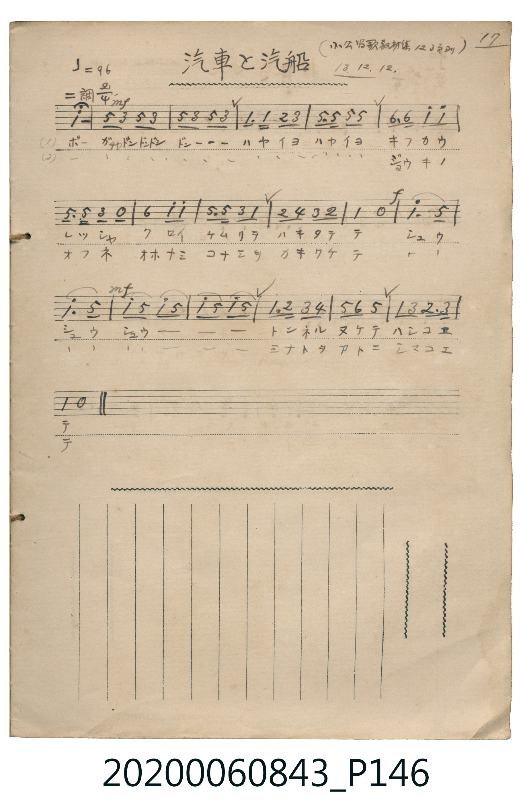

# 汽車と汽船

> Re:Shōka 使用 AI 協助辨識與重建樂譜，可能會有錯誤。歡迎回報。

- **鋼琴伴奏版**：<br><audio controls src="kisha_to_kisen.mp3"></audio>

- 日治時期公學校《唱歌帳》（典藏號 2020.006.0843・P146）
- 原載《小公唱歌教材集》第 123 頁（大正 13 年 12 月 12 日抄）

## 說明


- 出處：《唱歌帳》（國立臺灣歷史博物館典藏號 2020.006.0843）第 P146.jpg 頁（手寫頁碼 17）。
- 標註：（小公唱歌教材集 123 頁ヨリ）13.12.12.（大正 13 年 12 月 12 日抄錄）。
- 調性與拍號：ニ調（D 大調），2/4 拍，速度 != 96。
- 背景與曲風：共 19 小節，附有強弱記號（mf、f）與延長記號。第一段描寫火車鳴笛「ポー」與車輪「ガチャドンドンドン」、
噴煙「シュウシュウ」穿過隧道與鐵橋；第二段描寫輪船破浪駛離港口、越過重重島嶼。
- 版本說明：本檔案為原頁單聲部簡譜之忠實數位化版本。
【原頁歌詞全文與中文語譯】（對應 P146.jpg）

### 編曲說明（鋼琴伴奏版）：

1. 前奏 (Intro, 4 小節)：以汽笛長音「ポー」與車輪節奏揭開序幕。
2. 主歌伴奏 (Song, 19 小節 × 2 段)：右手演奏主旋律，左手以富有推進力的八分音符和弦模擬蒸汽火車與輪船前進。


## 歌詞

```text
（一）ポー　ガチャドンドンドン　ドンーーー
ハヤイヨハヤイヨ　キフカウレッシャ
クロイケムリヲ　ハキタテテ
シュウ　シュウ　シュウーーー
トンネルヌケテ　ハシコヱテ
噴出陣陣黑煙，咻、咻、咻——，穿過隧道、越過鐵橋！）

（二）ポー　ガチャドンドンドン　ドンーーー
ハヤイヨハヤイヨ　ジョウキノオフネ
オホナミコナミヲ　カキワケテ
シュウ　シュウ　シュウーーー
ミナトヲアトニ　シマコヱテ
破開大浪與小浪，咻、咻、咻——，把港口留在身後、越過島嶼！）
```

## ABC

<div class="abc-score" data-abc-src="kisha_to_kisen.abc" aria-label="五線譜載入中"></div>

[下載 ABC 原始檔](kisha_to_kisen.abc)

## TMD 檔案連結

- [主旋律 TMD 檔案](kisha_to_kisen.tmd) [[在 TMD Studio 編輯](https://tmdlang.github.io/Tmd-TS/#tmd=s7IKdvYPcrWy4qpTUCpJTLdSSM7PyUlNLsnMz7MqzsjPTkzOyFeCS5bl55TmploBqXgDQ4RwcX5pUXJqfEFieqpVgKGJGboM3KT4vPyS1KT8_GyEioKi_LLUvMQ8oKrcxLzS4uSizIKS-OT8gkqEmtSyzJRUkIri5MS8-LLUosy0zNQUJGelFhWDHQxxR0lRYh7EHKAgQlVJRirQ7WDJgvyiEoREflFmemaeVWkeyJYSqNlaWgrPNu59sbvrceMKEKNjp4KWFpeirYKlGZe9rYILl42RvokdyIxn05c-27T72cymZ3PmP21d83TtjmcLFj5u6Ho6ZeOztT1Pd2x-3ND9fk_H09YdL6b3v5g5X8HIwMhAz8DATM_AwsT4cfNuUJC939MJdtDTvvkv9nSCdG_oBxkGNuPZ1JnP5k54ObsNaNLzNWsUDI2MFV4uaAQZumT5s7WLFQyNFZ7u3AIUV3g2pwNMAd3U1QI2lEtfS8GWWoBLQUHhccOEZ7M3PZ-97sWqVc9m9D1umAgWbd79tH3Xi5lT3--ZhcXzc7qfr-5-0b7reePiZ2u3P-3f9LR31vPOlS-XrMARLkC3g7wKChu9rIJ0qH-fdXY_Xb8ayH6-aI-CoTlQ0eOGJqj1z1bMfLFiN9B6kH3YQg8Wbo-bVzxuXgXUa2isZ2gEQgRD8mUPKDARdr1Ytf9Zw_IXHe3PunuBTgf5ubkbKAg0yEUBaBSY2fl-Tw8wkSgA1QBZLxvmP921TAGcgpAMau55NnM9yKDZm14uWgE06GnrRgVDSwWgD56vbwDpm9nybE7n0z3bn-7Z-GLFDLBtHblpjxsa04BWAHU-3b3t5dTtECmgwcBQe7Kj4dm6rc_6-4Fh9bxxNTARv9y85fma2Y8beh43z33cvOdxQy9QI1D8xZ5VIMGmNY-bgcGy-HFz5-PmzShkQy_QJpBjFRSeztzyvHUmWP32x81LHzctQzAaep-v3P-yse_lrOUvGycDDX85YeuzlcConw1yz64euHuANgLz0vMFW55tXfVy-eyXsxc927H-af9ioC0vtnWBTGjvBaKnm7c93QZ0Jyycnnd2PJuzBpLigIEEZD9bNeXZwo7nTbuAWQYYqU-nrXvRuOll84rnGxa-WDvnyc7up_sXPF2_7NnUHU_29j7tmQYxAWQiNBFD9AETyIuV8562rng2rR3o7Cc71oIYq-a9WLsemLLBSan3WXsnPCECwxxsAFAGGMygRAEN0Qa8odgA4-6BIIi3-h83L3nctAScIJHYILPWPm6e-rhpNShsm4HmNoODejFYW9P6x81rQUqbNj5uXgBMyo-bN4Ft6Adpa9r_uLkNiCBK4fEDNBIbG9U9HWAn9j5uXv24GRjLQOOBRQ7E4O2Pm4BSIBGo7yFhBEqwM6c_apgCRE-nNTydNfnppFkQBIxRIAmRer-n8enSvU_3r346sQHOACbuZw1LXyzsedoxHZgWgWrg6QxYlLycuRiEdk8EpjmgyqeTdoMNhJIwY3uQkx0iDUETH7DIQMTWrh7axdaOx83LwfkBGG19j5uAMTIVGI6QKAByZj9u7nrcPB8chGAGJMJA0QvUsB4S0uREGNAkoHnAaNv0uGkRmNENUz2PJhH2YtIOUG0IzsTwCAPm5pfTukEl6FageDuw6AIy8MTZs64uSKZ_PnXm0zkrXuxa_XRfDzzyIFkfGnlA0ymvtaBAQUufiys4Py_dKiAzMS_focagphrsARtDMy07MAtYV2oAs7UmMGhB6UShBhgj0HQCFAKlCTQKqADG3wPHIMF-IF4C1A3EzSuwizStBbKmAunVQLwM5DqQE2oUqnPTahUM4xR0UWCNgikQGgNZpkAMokEiEBZCxBCs1lDBCEUNSAWIBuEaBTOwiBnECjBRA84kyL4HFTmQ1LgY7NT1QDGgc4GOB_E2AnkLgHgVEG-CeQ7knab9QHYbWARMgpMtqu9g7gG5zgDJPVCnQNyDogrkpxqwj0ygvgKxYX6FmAIJoWpEwEEMAAujew7hKBQXwmIOEYcdQAyK2V4gXg0W6YF6HuJFkKe3AzFIzUaop-H-xHQHUsSCROEMqFp0MbAmI7B_Qf6GhAkorGBGQtTAwgPEwhImXLVcXLp2CqBkrwCklbkA)]
- [鋼琴伴奏 TMD 檔案](kisha_to_kisen_piano.tmd) [[在 TMD Studio 編輯](https://tmdlang.github.io/Tmd-TS/#tmd=s7IKdvYPcrWy4tLSUni2ce-L3V2PG1eAGB073-_peNm95_mELU_2bHm6tP95Z8f7PZ0KWlpcirYKlmZc9rYKLlw2Rvomdlx1CkrPpi99tmn3s5lNz-bMf9q65unaHc8WLHzc0PV0ysZna3ue7tj8uKEbaODT1h0vpve_mDlfwcjAyEDPwMBMz8DCxPhx8-4AQxMzoPlKIMOe9s1_sacTpHtDP8gwsBnPps58NnfCy9ltQJOer1mjYGhkrPByQaMSF5e-loIttQCXgoLC44YJz2Zvej573YtVq57N6HvcMBEs2rz7afuuFzOnvt8zC4vH5nQ_X939on3X88bFz9Zuf9q_6WnvrOedK18uWYHDz0DPgrwB8rdeVkE6yC-PG5qgNr1Ytf9Zw_IXHe3PunuBOkFWNncDBYE2uSg8XbIczOx8v6cHGP4KQDVA1suG-U93LVMARw7CoOfbVwD9AvEI1ggFGg1SqqBgqKfwtLMXKK6g4ZlXUpSvo2CiAAz_5-sbNIFqnuxeCkwVz9fMfjl1-8v5QE_3PG6e-7h5z-OGXqArgcnmxZ5VQKVA7c_6176c1v10V__TnVOh7lBQMNJTeLJjNzDAIFYraATn56XrKBhaQq1QODxdwUjh2bqtILue9m9-1tn9bM8UoEqQrundT_cBw7jn6fZlQHGgS56u73k2p_NZ34qXDZueds1-Pqvlaevqpx1tQIc9X7Ps6aSep3uWPVux8NnkNS8m7QA5u3E1yIVAd-5ZBUzYQG8CNULdRnmSgQIFLX0uLnDIWQVkJublB3k41BjUVIP9b2NopmUHZtUoGMYp6KLAGgVTIDQGskyBGEQDFUFZRmAVxlAREDSA6eKqRbHOB9k6C4Rt8QrRhrEwCs43jccmYIokAKQMIJaAogq_l6pz02qJ8xeMhepTXSAJ8ilCDUgFiAbhGgUzsIgZxAowUQO1GaYWpBMUMjC1UGUQtSiqQPbVgG0zQQpjLOGrUI3wFMQASLCjxCKSBFIogEThDKhadDGwJiOwA0AOgTgS5HiYkUQnAkT8UCMNEClgAmSYxMIoeKggpx10NRjugKU5HGkPw1JUSyhyPlQA3Wl4coGunQI4tykAGaAQR6aVuQA)]

## 分析

```text
================================================================================
📊 TMD Song Profile: [ 汽車と汽船 ]
================================================================================
⏱  Duration:       0:23 (23.8s), 19 measures total
🎼 Key & Tempo:    首調基準 D, != 96.0 BPM, <2/4>
   - 分析範圍：      由實際發聲的音符與和弦推測調性；播放脈絡另行呈現
🎤 人聲音域:    D4 (MIDI 62) – D5 (MIDI 74) [跨度: 12 個半音 / 1.0 個八度, 難度: easy]
   - 最低音:  D4 in [Song #1 @ m.4, 0:03]
   - 最高音: D5 in [Song #1 @ m.1, 0:00]
   - 適合: soprano, mezzo-soprano, contralto, tenor, baritone, bass
🏛  結構:      Song (23.8s)
⚡ 編曲密度:        Peak 1 軌道同時演奏
🗝  調性診斷：       D 大調（純淨自然大調，未偵測到可信轉調）
   - 風格氣質:    純淨自然大調（陽光明朗、易唱易記，無明顯調外色彩）
   - 轉調歷程:    全曲維持單一推測調性（未偵測到可信轉調）
   - 核心骨幹音:  D, A, F#, E, B
   - 調性數值:    D 大調 [相關度: 0.92, 穩定度: High, 自然音純度: 100.0%]
   - 候選調性 (K-S): D 大調 (0.92), A 大調 (0.69), D 小調 (0.59)
   - 五度圈歷程:   +2
   - 各段落調性細節:
     • [Song #1]: D 大調 (r: 0.92, 自然音純度: 100.0%)

  [ 五度圈游移軌跡 ]
               C  
         F            G  
      Bb              [D ]*
      Eb               A  
         Ab           E  
            Db       B  
               F# 
     (* = active key center)

  [ 十二半音累積音高分佈 ]
     C  :                            0.0%
     C# :                            0.0%
     D  : ████████████████████████  34.5%
     D# :                            0.0%
     E  : █████                      7.0%
     F  :                            0.0%
     F# : ██████████                14.8%
     G  : ██                         2.8%
     G# :                            0.0%
     A  : ████████████████████████  33.8%
     A# :                            0.0%
     B  : █████                      7.0%
--------------------------------------------------------------------------------
Assignment 軌道音域：
  - Piano         : D4 – D5 (12 個半音 / 1.0 個八度, 61 個音符)
================================================================================
```


## 原書掃描頁




