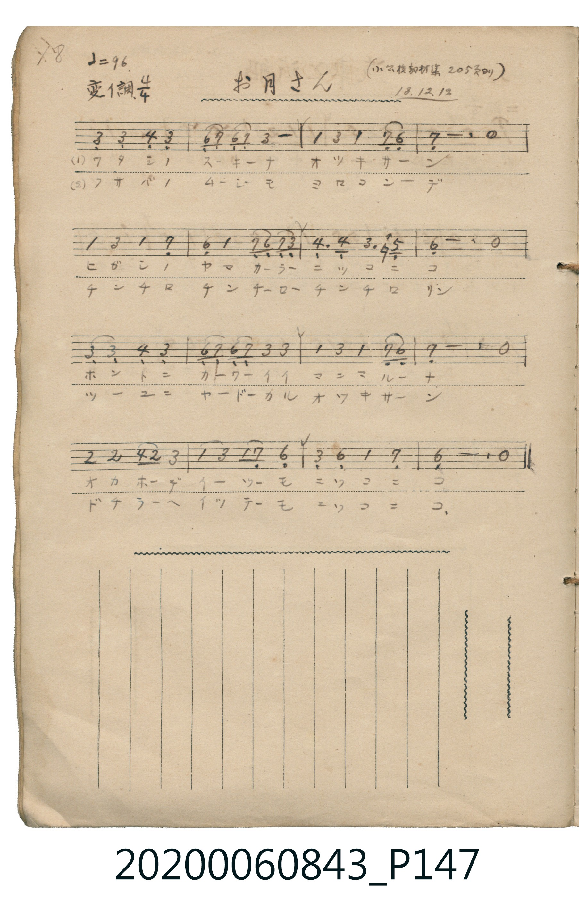

# お月さん

> Re:Shoka 使用 AI 協助辨識與重建樂譜，可能會有錯誤。歡迎回報。

<audio controls src="otsukisan.mp3"></audio>

- 日治時期公學校《唱歌帳》（典藏號 2020.006.0843・P147）
- 原載《小公校教材集》第 205 頁（大正 13 年 12 月 12 日抄）

## 說明

【曲目說明】
・出處：《唱歌帳》（國立臺灣歷史博物館典藏號 2020.006.0843）第 P147.jpg 頁（手寫頁碼 18）。
・標註：（小公校教材集 205 頁ヨリ）13.12.12.（大正 13 年 12 月 12 日抄錄）。
・調性與拍號：變イ調・ヘ短調（Ab 大調關係小調 F minor），4/4 拍，速度 != 96。
・背景與曲風：描寫從東山微笑升起的圓月亮，草叢裡的松蟲也歡喜地「チンチロリン」鳴叫，無論走到哪裡月亮總是笑咪咪地相隨。
・版本說明：本檔案為原頁單聲部簡譜之忠實數位化版本。
【原頁歌詞全文與中文語譯】（對應 P147.jpg）

・編曲說明（鋼琴伴奏版）：
1. 前奏 (Intro, 4 小節)：引用結尾樂句「オカホデイツーモ ニッコニコ」，描繪月夜柔光。
2. 主歌伴奏 (Song, 16 小節 × 2 段)：右手演奏主旋律，左手配以柔和的小調和弦伴奏。

## 跨冊／重複收錄參照

> 同名異曲（各冊收錄之不同詞曲版本）

- **[同名異曲]** 《新定兒童唱歌》尋常科第一學年用（2020.006.0847.0001）：[**〈オツキサマ〉**](../../../shintei_jido_shoka/grade_1_2020.006.0847.0001/4_15_otsukisama/index.md)（`F` / `2/4` — [原始 TMD](../../../shintei_jido_shoka/grade_1_2020.006.0847.0001/4_15_otsukisama/otsukisama.tmd)）
- **[同名異曲]** 《新定兒童唱歌》尋常科第四學年用（2020.006.0847.0004）：[**〈お月さん〉**](../../../shintei_jido_shoka/grade_4_2020.006.0847.0004/4_13_otsukisan/index.md)（`G` / `4/4` — [原始 TMD](../../../shintei_jido_shoka/grade_4_2020.006.0847.0004/4_13_otsukisan/otsukisan.tmd)）
- 總表：[跨冊重複與同名歌曲總索引](../../../duplicate_songs.md)

## 歌詞

```text
（一）ワタシノスーキナ　オツキサーン
ヒガシノヤマカラー　ニッコニコ
ホントニカーワイイ　マンマルーナ
オカホデイツーモ　ニッコニコ
真是可愛呀，圓圓的臉龐總是笑咪咪。）

（二）クサバノムーシモ　ヨロコンーデ
チンチロチンチロー　チンチロリン
ツーユニヤードーカル　オツキサーン
ドチラーヘイッテーモ　ニッコニコ
在露珠上借宿的月亮呀，無論走到哪裡總是笑咪咪。）
```

## ABC

```abc
X:1
T:お月さん
M:4/4
L:1/16
Q:1/4=96
K:Fm
V:V1 name="Piano" snm="Pia"
[V:V1]
C4 C4 D4 C4 | F,2 G,2 F,2 G,2 C8 | A4 c4 A4 G2 F2 | G12 z4 |
A4 c4 A4 G4 | F4 A4 G2 F2 G2 c2 | d6 d2 c6 e2 | F12 z4 |
C4 C4 D4 C4 | F,2 G,2 F,2 G,2 C4 C4 | A4 c4 A4 G2 F2 | G12 z4 |
B4 B4 d2 B2 c4 | A4 c4 A2 G2 F4 | C4 F4 A4 G4 | F12 z4 |
```

## TMD 檔案連結

- [主旋律 TMD 檔案](otsukisan.tmd) [[在 TMD Studio 編輯](https://tmdlang.github.io/Tmd-TS/#tmd=s7IKdvYPcrWy4qpTUCpJTLdSSM7PyUlNLsnMz7MqzsjPTkzOyFeCS5bl55TmploBqXgDQ4RwcX5pUXJqfEFieqpVgKGJOboM3KT4vPyS1KT8_GyEioKi_LLUvMQ8oKrcxLzS4uSizIKS-OT8gkqEmtSyzJRUkIrUlMyS_KLMxBwkJ6UWFYMdC3FDSVFiHsQMoKASl5aWwuPGrmdzOh43Tn3cNFlBS4tL0VbB0ozL3lbBUYcrO7XSVsEtl8vGRN_EDmTks-lLn23a_Wxm07M585-2rnm6dsezBQsfN3Q9nbLx2dqepzs2P27ofr-n42nrjhfT-1_MnK9gZGBkoGdgYKZnYGFi_Lh5N8j77_d0gt33tG_-iz2dIN0b-oGGAU16NnXms7kTXs5uAxrzfM0aoG5ThZcLGkEmLln-bO1iBUNjhac7tygYGikA3QymgA7qagGbyKWvpWBLLcCloKDwuGHCs9mbns9e92LVqmcz-h43TASLNu9-2r7rxcyp7_fMwuLzOd3PV3e_aN_1vHHxs7Xbn_Zveto763nnypdLVuAIFKDbQV4FBYxeVkE61L_POrufrl8NZD9ftEfB0AKo6HFDE9T6ZytmvlixG2g9yD6MoIMF2uPmFY-bVwE1GhrrGRqBEMFgfNkDCkmERS9W7X_WsPxFR_uz7l6gu4E2vljX9bhpCVAcKPu4ecbz-WuBbKC5jkkKQKOB7JfT5zzZ3wR0FZCt4KaQm5mXXwQ08_2eHmASUgCaA2S9bJj_dNcyBXBCQ7KsuefZzPUgy2ZverloBdCyZ_39wDB4um_es7kbn27c-HTfuudrJj7tbX-xdfvzWS1P50wGOv7JrnVAE1_0dj7tX_Ri8UKg-LO5-17M3_Rk5_xnaxc-nTbn6ZwNjxt6HjcDw2MzmFwLDBUQu6H35eYtT_tXA7U_b1n4YvW0F1s3PO3Y8HTyKqA5EJOf79j7bMZ6kKWTVoHQnA3PZ-94OWsFwtHPOzuezVkDSR8gF89Z82zVlGcLO5437QKmbmAsPJ227kXjppfNK55vWPhi7ZwnO7uf7l_wdP2yZ1N3PNnb-7RnGsQEkInQJAfRB0xTL1bOe9q64tm0dmCYPNmxFsRYNe_F2vXAdAiO-N5n7Z3wZAMMY7ABQJknOxpAsdi8_nHT_sdN2x839z1u2vm4ec_jJqDXux43NDxuAgZAC4jbtBUk3rwZYnUDFDVPety0Bqqzecnj5nmPm1Y_bl4JUgqS7X7c3Py4CRiY3UASTedscCh3gOWAeoBmA12xBIRAsvPAskASItWFqhnoKpAeoBHtIA1AF4IULcJuJ9CfkNAAhXrHxGdzGoBxDYxxUAIAx93TicBQ6IEknpdNXaAEs3HjywVrkWMTkpbe75kNMlFB4fmc-cDoftq__lnLbKj2OZOBCKj3RXvny30T0NIDMNKQg31XDyjYm4AeBobqBHDgLQAHOzAgIb4AZkhgmAN9AURAr7WjBR5yEkVmQ4IdPQGjaYaE1jJwUAEDD8gGJgGg5cAQXU1MnANVA80GR3LzDHD4Nz9ubiM2CoAZ8MXEzpfTQGH1fHk3JAO-XD3jRQewRNwALCNfTJyOng0bgCRuLiyTwmPn6ZwVL-dset6_4MmOrqfAEmTdfrS4xszF2OMLaBbl9QMUKGjpc3EF5-elWwVkJublO9QY1ChUg91rY6FlB2YAayUNYJbUBBYX6xWAWRKItwPZfQo1QNZOIGsPkF4LoZu7wKKrgKwWiCg4tkCCzZtBdsEN3NUDNLAJZOBWoNwEmIHNC6AGgqwAGbgILLoCiEGGbQabAzOxHWZijYJxvIIuhDCBs2oUzOLjFcyBGEaDhUGwRsEQpAqIQbQ5SAVQDEhDpEHQAKQMnDeQQ2AS0BFrkEOgeQkQzwOKgIoEIBOUAMHi3UDcDHVyNzhUsARAcyPUQyB6LVgfXARiHij7oIrDVYISGCIE0DwE8T6KB4GkMVDUBOw9E7BiXQVTmDr8_p4Ntb0D7huof9dDogsYCkAMchUwLMAqQTRYDUiwC4vXgQkEbMIymJHgbA-kQPkeZAHIACKSE0mRD5UjL_ZBDgE7C1jEgxzaDnYdKAGAeKACDJ5giYv9Tmh8ghMNsNiCmwfUCi67iDGvRsEI6FgQNgGSIF8h-w_iO5AY2OvISQKeRFA9XcvFpWunACoTFIC0MhcA)]
- [鋼琴伴奏 TMD 檔案](otsukisan_piano.tmd) [[在 TMD Studio 編輯](https://tmdlang.github.io/Tmd-TS/#tmd=s7IKdvYPcrWy4tLSUnjc2PVsTsfjxqmPmya_39PxsnvP8wlbnuzZ8nRp__POjvd7OhW0tLgUbRUszbjsbRUcdbiyUyttFdxyuWxM9E3suOoUlJ5NX_ps0-5nM5uezZn_tHXN07U7ni1Y-Lih6-mUjc_W9jzdsflxQzfQ5KetO15M738xc76CkYGRgZ6BgZmegYWJ8ePm3QGGJuZAi5RAhj3tm_9iTydI94Z-oGFAk55Nnfls7oSXs9uAxjxfswao21Th5YJGJS4ufS0FW2oBLgUFhccNE57N3vR89roXq1Y9m9H3uGEiWLR599P2XS9mTn2_ZxYWX83pfr66-0X7rueNi5-t3f60f9PT3lnPO1e-XLICh4eBPgV5A-RpvayCdJBfHjc0QW16sWr_s4blLzran3X3AnUCrXyxrutx0xKgOFD2cfOM5_PXAtlAix2TFHITs_KLFPQV3BRyM_Pyi4AGv9_TA4wVBaBmIOtlw_ynu5YpgOMOYcPz7SuAnoT4EGt8A-0EKVVQMNRTeNrZCxRX0PDMKynK11EwUQDGyvP1DZpANU_3TH0-ZcXzrROebtj3bEXT0_6ljxt6Hjetety0-nHz7MfN7UBXP25uedy853HzIqDF3Y-bmx83bQYxgGQDyIHP-vuf71wFTH1Pl8x5Nn_K01ZgvIOdqaBgpKfwZMduYEBDXKagEZyfl66jYGgGdYHC4ekKRgrP1m0FO6V_87PO7md7pgBVgnRN7366Dxg3PU-3LwOKv2ztfbJ7Kcj8ST3PZ7UA9QMDEMh-umcZxHCopZSnIShQ0NLn4gKHmFVAZmJefpCHQ41BjUI12Gc2Flp2YEYN0P26YGwCJI2BdI2CIZAEsQwVzOMVzOLBYsYgCswGyQLFQYJgPgwagIS4alHs9EGx0wRhZ7xCtFFuLMjUaGMgDTIKyDQDMuEMsJ1gWRyqDCDWgaIEvw_BbgcTJnAWxCxzIIbRYGEQRA4AsFeB3qyBeBnVrxDT0RTDwwWhGUgaA0VNwFpNwIp1FUyxhx_JLobKkeRkqkc5Ig5wxTi2-IUziU4GoChHMw-LXoQQMPSiTfAmINq4jprpW9dOAZyjFIAMUDgj08pcAA)]

## 分析

```text
================================================================================
📊 TMD Song Profile: [ お月さん ]
================================================================================
⏱  Duration:       0:40 (40.0s), 16 measures total
🎼 Key & Tempo:    首調基準 A,, != 96.0 BPM, <4/4>
   - 分析範圍：      由實際發聲的音符與和弦推測調性；播放脈絡另行呈現
🎤 人聲音域:    F3 (MIDI 53) – D#5 (MIDI 75) [跨度: 22 個半音 / 1.8 個八度, 難度: difficult]
   - 最低音:  F3 in [Song #1 @ m.2, 0:02]
   - 最高音: D#5 in [Song #1 @ m.7, 0:17]
   - 適合: mezzo-soprano, contralto, baritone, bass
🏛  結構:      Song (40.0s)
⚡ 編曲密度:        Peak 1 軌道同時演奏
🗝  調性診斷：       F 小調（純淨自然小調，未偵測到可信轉調）
   - 風格氣質:    純淨自然小調（陰鬱抒情、旋律集中，無明顯調外色彩）
   - 轉調歷程:    全曲維持單一推測調性（未偵測到可信轉調）
   - 核心骨幹音:  C, F, G, G#, C#
   - 調性數值:    F 小調 [相關度: 0.77, 穩定度: Moderate, 自然音純度: 100.0%]
   - 候選調性 (K-S): F 小調 (0.77), C 小調 (0.65), C 大調 (0.65)
   - 五度圈歷程:   -1
   - 各段落調性細節:
     • [Song #1]: F 小調 (r: 0.77, 自然音純度: 100.0%)

  [ 五度圈游移軌跡 ]
               C  
        [F ]*          G  
      Bb               D  
      Eb               A  
         Ab           E  
            Db       B  
               F# 
     (* = active key center)

  [ 十二半音累積音高分佈 ]
     C  : ████████████████████████  30.0%
     C# : ██████                     7.5%
     D  :                            0.0%
     D# : █                          0.8%
     E  :                            0.0%
     F  : █████████████████         20.8%
     F# :                            0.0%
     G  : █████████████████         20.8%
     G# : █████████████             15.8%
     A  :                            0.0%
     A# : ███                        4.2%
     B  :                            0.0%
--------------------------------------------------------------------------------
Assignment 軌道音域：
  - Piano         : F3 – D#5 (22 個半音 / 1.8 個八度, 61 個音符)
================================================================================
```


## 原書掃描頁




