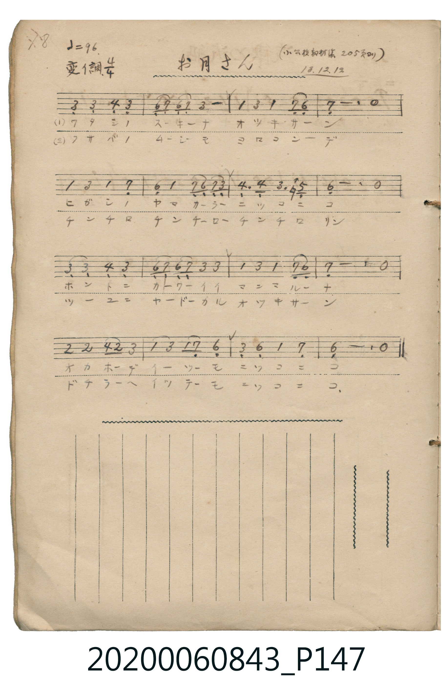

# お月さん

> Re:Shōka 使用 AI 協助辨識與重建樂譜，可能會有錯誤。歡迎[回報](https://github.com/TMDLang/reshoka/issues)。

- **鋼琴伴奏版**：<br><audio controls src="otsukisan.mp3"></audio>
- **NEUTRINO 歌聲合成版**：<br><audio controls src="otsukisan_neutrino.mp3"></audio>

- 日治時期公學校《唱歌帳》（典藏號 2020.006.0843・P147）
- 原載《小公校教材集》第 205 頁（大正 13 年 12 月 12 日抄）

## 說明


- 出處：《唱歌帳》（國立臺灣歷史博物館典藏號 2020.006.0843）第 P147.jpg 頁（手寫頁碼 18）。
- 標註：（小公校教材集 205 頁ヨリ）13.12.12.（大正 13 年 12 月 12 日抄錄）。
- 調性與拍號：變イ調- ヘ短調（Ab 大調關係小調 F minor），4/4 拍，速度 != 96。
- 背景與曲風：描寫從東山微笑升起的圓月亮，草叢裡的松蟲也歡喜地「チンチロリン」鳴叫，無論走到哪裡月亮總是笑咪咪地相隨。
- 版本說明：本檔案為原頁單聲部簡譜之忠實數位化版本。
【原頁歌詞全文與中文語譯】（對應 P147.jpg）

### 編曲說明（鋼琴伴奏版）：

1. 前奏 (Intro, 4 小節)：引用結尾樂句「オカホデイツーモ ニッコニコ」，描繪月夜柔光。
2. 主歌伴奏 (Song, 16 小節 × 2 段)：右手演奏主旋律，左手配以柔和的小調和弦伴奏。


## 歌詞

```text
（一）ワタシノスーキナ　オツキサーン
ヒガシノヤマカラー　ニッコニコ
ホントニカーワイイ　マンマルーナ
オカホデイツーモ　ニッコニコ
真是可愛呀，圓圓的臉龐總是笑咪咪。）

（二）クサバノムーシモ　ヨロコンーデ
チンチロチンチロー　チンチロリン
ツーユニヤードーカル　オツキサーン
ドチラーヘイッテーモ　ニッコニコ
在露珠上借宿的月亮呀，無論走到哪裡總是笑咪咪。）
```

## ABC

<div class="abc-score" data-abc-src="otsukisan.abc" aria-label="五線譜載入中"></div>

[下載 ABC 原始檔](otsukisan.abc)

## TMD 檔案連結

- [主旋律 TMD 檔案](otsukisan.tmd) [[在 TMD Studio 編輯](https://tmdlang.github.io/Tmd-TS/#tmd=s7IKdvYPcrWy4qpTUCpJTLdSSM7PyUlNLsnMz7MqzsjPTkzOyFeCS5bl55TmploBqXgDQ4RwcX5pUXJqfEFieqpVgKGJOboM3KT4vPyS1KT8_GyEioKi_LLUvMQ8oKrcxLzS4uSizIKS-OT8gkqEmtSyzJRUkIri5MS8-LLUosy0zNQUJGelFhWDHQxxR0lRYh7EHKAgQlV-UWZ6Zp5VaR7IsBI0I_KLSjLy04sSCzIqrTIyi0uAipMTc-KzE_MSEYpKMlKBvk8sLinKz8vPBTpQS0vhcWPXszkdjxunPm6arKClxaVoq2BpxmVvq-Cow5WdWmmr4JbLZWOib2IHMuXZ9KXPNu1-NrPp2Zz5T1vXPF2749mChY8bup5O2fhsbc_THZsfN3S_39PxtHXHi-n9L2bOVzAyMDLQMzAw0zOwMDF-3LwbFLrv93SCnfS0b_6LPZ0g3Rv6gYYBTXo2deazuRNezm4DGvN8zRqgblOFlwsaQSYuWf5s7WIFQ2OFpzu3KBgaKQDdDKaADupqAZvIpa-lYEstwKWgoPC4YcKz2Zuez173YtWqZzP6HjdMBIs2737avuvFzKnv98zC4vM53c9Xd79o3_W8cfGztduf9m962jvreefKl0tW4AgUoNtBXgUFjF5WQTrUv886u5-uXw1kP1-0R8HQAqjocUMT1PpnK2a-WLEbaD3IPoyggwXa4-YVj5tXATUaGusZGoEQwWB82QMKSYRFL1btf9aw_EVH-7PuXqC7gTa-WNf1uGkJUBwo-7h5xvP5a4FsoLmOSQpAo4Hsl9PnPNnfBHQVkK3gppCbmZdfBDTz_Z4eYBJSAJoDZL1smP901zIFcEJDsqy559nM9SDLZm96uWgF0LJn_f3AMHi6b96zuRufbtz4dN-652smPu1tf7F1-_NZLU_nTAY6_smudUATX_R2Pu1f9GLxQqD4s7n7Xszf9GTn_GdrFz6dNufpnA2PG3oeNwPDYzOYXAsMFRC7offl5i1P-1cDtT9vWfhi9bQXWzc87djwdPIqoDkQk5_v2PtsxnqQpZNWgdCcDc9n73g5awXC0c87O57NWQNJHyAXz1nzbNWUZws7njftAqZuYCw8nbbuReOml80rnm9Y-GLtnCc7u5_uX_B0_bJnU3c82dv7tGcaxASQidAkB9EHTFMvVs572rri2bR2YJg82bEWxFg178Xa9cB0CI743mftnfBkAwxjsAFAmSc7GkCx2Lz-cdP-x03bHzf3PW7a-bh5z-MmoNe7Hjc0PG4CBkALiNu0FSTevBnim0mPm9ZANTQvedw873HT6sfNK0EqgHqaux83Nz9uAoZhN5CEaJgNDtMOsBBQKdAkoJ1LQAikYR5YFkhCpLrAeoBWg5QCdbaD1AGdAZJbhN0GoGcgXgYFbcfEZ3MagBEKjFZQLIMj6OlEoFd7ICnkZVMXKFVs3PhywVrkKIMkmPd7ZoNMVFB4Pmc-ME6f9q9_1jIbqn3OZCAC6n3R3vly3wS0SAfGDHLY7uoBhW0T0J_AoJsADqoF4LAFBhvEF8BcBwxYoC-ACOi1dkhQISc_ZDYkbNETJ0QPJGyWgQMGGFRANjBWgVYBw281nmgEKgKaBI635hngQG5-3NxGbDgDs9KLiZ0vp4EC5PnybkhWerl6xosOYNm2AVjavZg4HT1DNQBJ3FxYdoNHwdM5K17O2fS8f8GTHV1PgWXBuv1oEYqZH7FHCtAsykt6KFDQ0ufiCs7PS7cKyEzMy3eoMaipBjvXxtBMyw7MAtYvGsDMpQkM4_XAlLwfiLcD2X0KNUDWTiBrD5BeC6Gbu8Ciq0DRCBEFRxJIsHkzyC64gbt6gAY2gQzcCpSbADOweQHUQJAVIAMXgUVXADHIsM1gc2AmtsNMrFEwjlfQBUM4wwRDpEbBDMQ0BxEIljFUFgZrFAxhGqE0jI_QWANhY4MGMGPADvMxBLlzPVQMFHgw1nYYC-hvmMWg4ITJr4XLd2E4EBTAMNkWTB3AEIWrBIYWUe40ApmKcCfMBFDMYHEnMJYw_bEI053AeIPJIlwHcxHCbZC4JORO9MQ4CWjWGuTE2LwEiOcBRUAlL5AJKgvA4t1A3AxNPd3g8MOSFpsboWkLRK8F64OLQMwDlVuo4nCVoLyOSIx4ExDEw-BkhCGHlCohyQyeiEEQzIGnZqiIqXo8snG4gw-RHCdBxUDBB2NhTY7AAIWJzoOrXA0XW4mkshvJTlBgI0c0RAwYCUARkNo9xLkVlCSBQQzTj0g2CLG1SC4gXSVCNboYqDRbRWT2QU-Ws6GJowOe2KDJcT2kYAMmUiAGmQ1MqmCVIBqsBiTYhSVlAotSsAnLYEaC60UgBaoYwVECNICIgpeiYhKLOqoXlLPhMYCIww44C5bGwGEKF0UUWvDUCmdBQhnTTIQYzBxI0BPlUnC6hBW7MAiKHCzuRMpBnXDXIdyOZDtVi3S0NAlKFuBEAmx_gpJNO9hCUGkJ4oHaW0AKUtESV1R2gnMMtIQFNrfg5gG1gttcxJhXo2AEdTCMNoGyYekJewpDpC6IGniCxF6mQhSRUkAiogIpqhBJE1ZTQfyMahpS5MHrQ-TiERQYMLMRyRE5YZNQXyOSFFJBByuUQbGC6U4k-5vbaO7SWi4uXTsFUOsy2scwVgHONgKzlbkA)]
- [鋼琴伴奏 TMD 檔案](otsukisan_piano.tmd) [[在 TMD Studio 編輯](https://tmdlang.github.io/Tmd-TS/#tmd=s7IKdvYPcrWy4qpTUCpJTLdSyC8qychPL0osyKi0ysgsLskvykxOzInPTsxLVIIrKs4vLUpOjS9ITE-1CjA0MUfIlGSk5qZaJRaXFOXn5edWKnFpaSk8bux6NqfjcePUx02T3-_peNm95_mELU_2bHm6tP95Z8f7PZ0KWlpcirYKlmZc9rYKjjpc2amVtgpuuVw2JvomdiCjn01f-mzT7mczm57Nmf-0dc3TtTueLVj4uKHr6ZSNz9b2PN2x-XFDN9Dkp607XkzvfzFzvoKRgZGBnoGBmZ6BhYnx4-bdIEcCLQK782nf_Bd7OkG6N_QDDQOa9GzqzGdzJ7yc3QY05vmaNUDdpgovFzQqcXHpaynYUgtwKSgoPG6Y8Gz2puez171YterZjL7HDRPBos27n7bvejFz6vs9s7D4ak7389XdL9p3PW9c_Gzt9qf9m572znreufLlkhU4PAz0KcgbIE_rZRWkg_zyuKEJatOLVfufNSx_0dH-rLsXqBNo5Yt1XY-blgDFgbKPm2c8n78WyAZa7JikkJuYlV-koK_gppCbmZdfBDT4_Z4eYKwoADUDWS8b5j_dtUwBHHcIG55vXwH0JMSHWOMbaCdIqYKCoZ7C085eoLiChmceMMnoKJgoAGPl-foGTaCap3umPp-y4vnWCU837Hu2oulp_9LHDT2Pm1Y9blr9uHn24-Z2oKsfN7c8bt7zuHkR0OLux83Nj5s2gxhAsgHkwGf9_c93rgKmvqdL5jybP-VpKzDewc5UUDDSU3iyYzcwoCEuU9AIzs9L11EwNIO6QOHwdAUjhWfrtoKd0r_5WWf3sz1TgCpBuqZ3P90HjJuep9uXAcVftvY-2b0UZP6knuezWoD6gQEIZD_dswxiONRSytMQFCho6XNxgUPMKiAzMS8_yMOhxqCmGuwxGwstOzCjBuh8XTA2AZLGQLpGwRBIgliGCubxCmbxYDFjEAVmg2SB4iBBMB8GDUBCXLUoVvogW2mCsDJeIdooNxZkaLQxkAaZBGSaAZlwBthKsCwOVQYQ20ARgsV_hmZQ24CZU-PJjgZNYNSvV3jctB-ItwPZfUDjHjftBLL2AOm1ELq5Cyy6CshqgYg2bQVJAAWbN4OCE27grh6ggU0gA7cC5SbADGxeADUQZAXIwEVg0RVADDJsM9gcmIntMBOhoQuCcIYJhgg0uMFBj2CB4gkZQmIPrBFKw_gIjTUQNjYIikSwMWCH-RiC3LkeKgYKPBhrO4wF9DfMYlBwwuTXwuW7MBwICmCYbAumDmCIwlUCQ4sodxqBTEW4E2YCKGawuBMYS5j-WITpTmC8wWQRroO5COE2SFwScid6YpwENGsNcmJsXgLE84AiwHILlHRWwtJJNxA3Q1NPNzj8sKTF5kZo2gLRa8H64CIQ89bCzMNUuQopeRNIQBAPwzM-ZuKCpEpIMoMnYhAEc-CpGSpiqh6PXo5gDz5EcpwEFQMFH4yFNTkCAxQmOg-ucjVcbCWSym4kO0GBjRzREDFgJABFQGr3EOdWUJIEBjFMPyLZIMTWIrmAdJUI1ehioNJsFZHZBz1ZzoYmjg54YoMmx_WQgg2YSIEYZDYwqYJVgmiwGpBgF5aUCSxKwSYsgxnZDKyQQQKdECNXgwwgouClqJjEoo7qBeVseAwg4rADzoKlMXCYwkURhRY8tcJZkFDGNBMhBjMHEvREuRScLmHFLgyCIgeLO5FyUCfcdQi3I9lO1SIdLU2CkgU4kQBbc6Bk0w62EFRagniglh2QglS0xBWVneAcAy1hgW1ZuHlArc1tRJoHaTiBIIw2gbJh6Ql7CkOkLogaeILEXqZCFJFSQCKiAimqEEkTVlNB_IxqGlLkwetD5OIRFBgwsxHJETlhk1BfI5IUUkEHK5RBsYLpTiT7m9to7lKUxiWOliy2diucSXTzFtSURTMPi16EELDUizbB2zCmjeuo2W7XtVMAdxQUgAxQMEf7GMYi2EZgtjIXAA)]

## 分析

```text
================================================================================
📊 TMD Song Profile: [ お月さん ]
================================================================================
⏱  Duration:       1:20 (80.0s), 32 measures total
🎼 Key & Tempo:    首調基準 A,, != 96.0 BPM, <4/4>
   - 分析範圍：      由實際發聲的音符與和弦推測調性；播放脈絡另行呈現
🎤 人聲音域:    C4 (MIDI 60) – C#5 (MIDI 73) [跨度: 13 個半音 / 1.1 個八度, 難度: moderate]
   - 最低音:  C4 in [Song[L1] #1 @ m.1, 0:00]
   - 最高音: C#5 in [Song[L1] #1 @ m.13, 0:31]
   - 適合: soprano, mezzo-soprano, contralto, tenor, baritone, bass
🏛  結構:      Song[L1] (40.0s) -> Song[L2] (40.0s)
⚡ 編曲密度:        Peak 1 軌道同時演奏
🗝  調性診斷：       F 小調（純淨自然小調，未偵測到可信轉調）
   - 風格氣質:    純淨自然小調（陰鬱抒情、旋律集中，無明顯調外色彩）
   - 轉調歷程:    全曲維持單一推測調性（未偵測到可信轉調）
   - 核心骨幹音:  C, F, G, G#, C#
   - 調性數值:    F 小調 [相關度: 0.77, 穩定度: Moderate, 自然音純度: 99.6%]
   - 候選調性 (K-S): F 小調 (0.77), C 大調 (0.66), C 小調 (0.64)
   - 五度圈歷程:   -1 -> -1
   - 各段落調性細節:
     • [Song[L1] #1]: F 小調 (r: 0.77, 自然音純度: 99.6%, 調外音: E)
     • [Song[L2] #1]: F 小調 (r: 0.77, 自然音純度: 99.6%, 調外音: E)

  [ 五度圈游移軌跡 ]
               C  
        [F ]*          G  
      Bb               D  
      Eb               A  
         Ab           E  
            Db       B  
               F# 
     (* = active key center)

  [ 十二半音累積音高分佈 ]
     C  : ████████████████████████  30.0%
     C# : ██████                     7.9%
     D  :                            0.0%
     D# :                            0.0%
     E  :                            0.4%
     F  : █████████████████         20.8%
     F# :                            0.0%
     G  : █████████████████         20.8%
     G# : █████████████             15.8%
     A  :                            0.0%
     A# : ███                        4.2%
     B  :                            0.0%
--------------------------------------------------------------------------------
Assignment 軌道音域：
  - Piano         : C4 – C#5 (13 個半音 / 1.1 個八度, 124 個音符)
================================================================================
```


## 原書掃描頁




