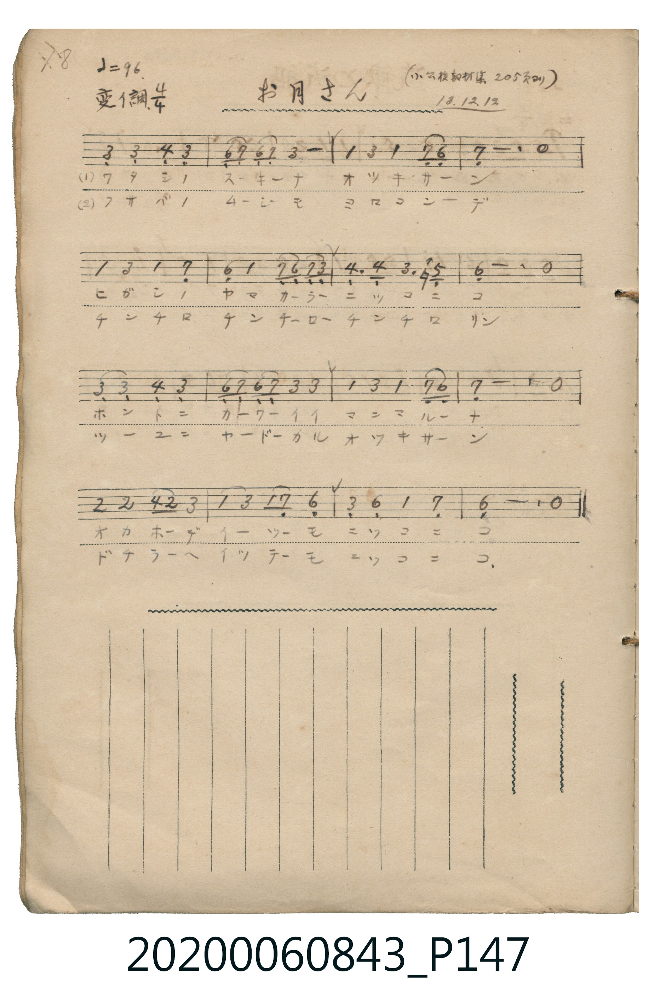

# お月さん

> Re:Shōka 使用 AI 協助辨識與重建樂譜，可能會有錯誤。歡迎回報。

<audio controls src="otsukisan.mp3"></audio>

- 日治時期公學校《唱歌帳》（典藏號 2020.006.0843・P147）
- 原載《小公校教材集》第 205 頁（大正 13 年 12 月 12 日抄）

## 說明


- 出處：《唱歌帳》（國立臺灣歷史博物館典藏號 2020.006.0843）第 P147.jpg 頁（手寫頁碼 18）。
- 標註：（小公校教材集 205 頁ヨリ）13.12.12.（大正 13 年 12 月 12 日抄錄）。
- 調性與拍號：變イ調- ヘ短調（Ab 大調關係小調 F minor），4/4 拍，速度 != 96。
- 背景與曲風：描寫從東山微笑升起的圓月亮，草叢裡的松蟲也歡喜地「チンチロリン」鳴叫，無論走到哪裡月亮總是笑咪咪地相隨。
- 版本說明：本檔案為原頁單聲部簡譜之忠實數位化版本。
【原頁歌詞全文與中文語譯】（對應 P147.jpg）

### 編曲說明（鋼琴伴奏版）：

1. 前奏 (Intro, 4 小節)：引用結尾樂句「オカホデイツーモ ニッコニコ」，描繪月夜柔光。
2. 主歌伴奏 (Song, 16 小節 × 2 段)：右手演奏主旋律，左手配以柔和的小調和弦伴奏。


## 歌詞

```text
（一）ワタシノスーキナ　オツキサーン
ヒガシノヤマカラー　ニッコニコ
ホントニカーワイイ　マンマルーナ
オカホデイツーモ　ニッコニコ
真是可愛呀，圓圓的臉龐總是笑咪咪。）

（二）クサバノムーシモ　ヨロコンーデ
チンチロチンチロー　チンチロリン
ツーユニヤードーカル　オツキサーン
ドチラーヘイッテーモ　ニッコニコ
在露珠上借宿的月亮呀，無論走到哪裡總是笑咪咪。）
```

## ABC

```abc
X:1
T:お月さん
M:4/4
L:1/16
Q:1/4=96
K:Fm
V:V1 name="Piano" snm="Pia"
[V:V1]
C4 C4 D4 C4 | F2 G2 F2 G2 C8 | A4 c4 A4 G2 F2 | G12 z4 |
w: ワ タ シ ノ | ス _ キ _ ナ | オ ツ キ サ _ | ン
A4 c4 A4 G4 | F4 A4 G2 F2 G2 C2 | D6 D2 C6 D =E | F12 z4 |
w: ヒ ガ シ ノ | ヤ マ カ _ ラ _ | ニ ッ コ ニ コ | ー
C4 C4 D4 C4 | F2 G2 F2 G2 C4 C4 | A4 c4 A4 G2 F2 | G12 z4 |
w: ホ ン ト ニ | カ _ ワ _ イ イ | マ ン マ ル _ | ナ
B4 B4 d2 B2 c4 | A4 c4 A2 G2 F4 | C4 F4 A4 G4 | F12 z4 |
w: オ カ ホ _ デ | イ _ ツ _ モ | ニ ッ コ ニ | コ
C4 C4 D4 C4 | F2 G2 F2 G2 C8 | A4 c4 A4 G2 F2 | G12 z4 |
w: ク サ バ ノ | ム _ シ _ モ | ヨ ロ コ ン _ | デ
A4 c4 A4 G4 | F4 A4 G2 F2 G2 C2 | D6 D2 C6 D =E | F12 z4 |
w: チ ン チ ロ | チ ン チ _ ロ _ | チ ン チ ロ リ | ン
C4 C4 D4 C4 | F2 G2 F2 G2 C4 C4 | A4 c4 A4 G2 F2 | G12 z4 |
w: ツ _ ユ ニ | ヤ _ ド _ カ ル | オ ツ キ サ _ | ン
B4 B4 d2 B2 c4 | A4 c4 A2 G2 F4 | C4 F4 A4 G4 | F12 z4 |
w: ド チ ラ _ ヘ | イ ッ テ _ モ | ニ ッ コ ニ | コ
```

## TMD 檔案連結

- [主旋律 TMD 檔案](otsukisan.tmd) [[在 TMD Studio 編輯](https://tmdlang.github.io/Tmd-TS/#tmd=s7IKdvYPcrWy4qpTUCpJTLdSSM7PyUlNLsnMz7MqzsjPTkzOyFeCS5bl55TmploBqXgDQ4RwcX5pUXJqfEFieqpVgKGJOboM3KT4vPyS1KT8_GyEioKi_LLUvMQ8oKrcxLzS4uSizIKS-OT8gkqEmtSyzJRUkIri5MS8-LLUosy0zNQUJGelFhWDHQxxR0lRYh7EHKCgEpeWlsLjxq5nczoeN0593DRZQUuLS9FWwdKMy95WwVGHKzu10lbBLZfLxkTfxA5k5LPpS59t2v1sZtOzOfOftq55unbHswULHzd0PZ2y8dnanqc7Nj9u6H6_p-Np644X0_tfzJyvYGRgZKBnYGCmZ2BhYvy4eTcoCN7v6QS772nf_Bd7OkG6N_QDDQOa9GzqzGdzJ7yc3QY05vmaNUDdpgovFzSCTFyy_NnaxQqGxgpPd25RMDRSALoZTAEd1NUCNpFLX0vBllqAS0FB4XHDhGezNz2fve7FqlXPZvQ9bpgIFm3e_bR914uZU9_vmYXF53O6n6_uftG-63nj4mdrtz_t3_S0d9bzzpUvl6zAEShAt4O8CgoYvayCdKh_n3V2P12_Gsh-vmiPgqEFUNHjhiao9c9WzHyxYjfQepB9GEEHC7THzSseN68CajQ01jM0AiGCwfiyBxSSCIterNr_rGH5i472Z929QHcDbXyxrutx0xKgOFD2cfOM5_PXAtlAcx2TFIBGA9kvp895sr8J6CogW8FNITczL78IaOb7PT3AJKQANAfIetkw_-muZQrghIZkWXPPs5nrQZbN3vRy0QqgZc_6-4Fh8HTfvGdzNz7duPHpvnXP10x82tv-Yuv257Nans6ZDHT8k13rgCa-6O182r_oxeKFQPFnc_e9mL_pyc75z9YufDptztM5Gx439DxuBobHZjC5FhgqIHZD78vNW572rwZqf96y8MXqaS-2bnjaseHp5FVAcyAmP9-x99mM9SBLJ60CoTkbns_e8XLWCoSjn3d2PJuzBpI-QC6es-bZqinPFnY8b9oFTN3AWHg6bd2Lxk0vm1c837Dwxdo5T3Z2P92_4On6Zc-m7niyt_dpzzSICSAToUkOog-Ypl6snPe0dcWzae3AMHmyYy2IsWrei7XrgekQHPG9z9o74ckGGMZgA4AyT3Y0gGKxef3jpv2Pm7Y_bu573LTzcfOex01Ar3c9bmh43AQMgBYQt2krSLx5M8TqBihqnvS4aQ1UZ_OSx83zHjetfty8EqQUJNv9uLn5cRMwMLuBJJrO2eBQ7gDLAfUAzQa6YgkIgWTngWWBJESqC1Uz0FUgPUAj2kEagC4EKVqE3U6gPyGhAQr1jonP5jQA4xoY46AEAI67pxOBodADSTwvm7pACWbjxpcL1iLHJiQtvd8zG2SigsLzOfOB0f20f_2zltlQ7XMmAxFQ74v2zpf7JqClB2CkIQf7rh5QsDcBPQwM1QngwFsADnZgQEJ8AcyQwDAH-gKIgF5rRws85CSKzIYEO3oCRtMMCa1l4KACBh6QDUwCQMuBIbqamDgHqgaaDY7k5hng8G9-3NxGbBQAM-CLiZ0vp4HC6vnybkgGfLl6xosOYIm4AVhGvpg4HT0bNgBJ3FxYJoXHztM5K17O2fS8f8GTHV1PgSXIuv1ocY2Zi7HHF9AsyusHKFDQ0ufiCs7PS7cKyEzMy3eoMahRqAa718bQTMsOzAJWSxrAPKkJLC_WKwDzJBBvB7L7FGqArJ1A1h4gvRZCN3eBRVcBWS0QUXB0gQSbN4Msgxu4qwdoYBPIwK1AuQkwA5sXQA0EWQEycBFYdAUQgwzbDDYHZmI7zMQaBeN4BV0whDNMMERqFMxATHMQgWDBpWGwRsEQphNKw_gInTUQNjZoADMG7DIfQ5BD10PFQKEHY22HsYAeh1kMCk-Y_Fq4fBeGA0EhDJNtwdQBDFK4SmBwEeVOI5CpCHfCTABFDRZ3AqMJ0x-LMN0JjDiYLMJ1MBch3AaJTELuRE-Nk4BmrUFOjc1LgHgeUARUPgOZoNIALN4NxM3Q5NMNDj8sibG5EZq4QPRasD64CMQ8UFmGKg5XCcrtiNSINwFBPAxORhhyaMmyBpGKQRDMQUmvQBFT9Xhk43AHHyI5ToKKgYIPxsKaHIEBChOdB1e5Gi62EkllN5KdoMBGjmiIGDASgCIgtXuIcysoSQKDGKYfkWwQYmuRXEC6SoRqdDFQcbaKyOyDnixnQxNHBzyxQZPjekjJBkykQAwyG5hUwSpBNFgNSLALS8oElqVgE5bBjARXkUAKVEeCowRoABElL1XKSSR1VC8oZ8NjABGHHXAWLI2BwxQuiii04KkVzoKEMqaZCDGYOZCgJ8ql4HQJK3ZhEBQ5WNyJlIM64a5DuB3JdqoW6WhpEpQswIkE2DgFJZt2sIWg0hLEAzW9gBSkpiWuqOwE5xhoCQtscMHNA2oFt7qIMa9GwQjqYBhtAmXD0hP2FIZIXRA18ASJvUyFKCKlgEREBVJUIZImrKaC-BnVNKTIg9eHyMUjKDBgZiOSI3LCJqG-RiQppIIOViiDYgXTnUj2N7fR3KW1XFy6dgqg9mW0j2GsApxtBGYrcwEA)]
- [鋼琴伴奏 TMD 檔案](otsukisan_piano.tmd) [[在 TMD Studio 編輯](https://tmdlang.github.io/Tmd-TS/#tmd=s7IKdvYPcrWy4tLSUnjc2PVsTsfjxqmPmya_39PxsnvP8wlbnuzZ8nRp__POjvd7OhW0tLgUbRUszbjsbRUcdbiyUyttFdxyuWxM9E3suOoUlJ5NX_ps0-5nM5uezZn_tHXN07U7ni1Y-Lih6-mUjc_W9jzdsflxQzfQ5KetO15M738xc76CkYGRgZ6BgZmegYWJ8ePm3QGGJuZAi5RAhj3tm_9iTydI94Z-oGFAk55Nnfls7oSXs9uAxjxfswao21Th5YJGJS4ufS0FW2oBLgUFhccNE57N3vR89roXq1Y9m9H3uGEiWLR599P2XS9mTn2_ZxYWX83pfr66-0X7rueNi5-t3f60f9PT3lnPO1e-XLICh4eBPgV5A-RpvayCdJBfHjc0QW16sWr_s4blLzran3X3AnUCrXyxrutx0xKgOFD2cfOM5_PXAtlAix2TFHITs_KLFPQV3BRyM_Pyi4AGv9_TA4wVBaBmIOtlw_ynu5YpgOMOYcPz7SuAnoT4EGt8A-0EKVVQMNRTeNrZCxRX0PDMKynK11EwUQDGyvP1DZpANU_3TH0-ZcXzrROebtj3bEXT0_6ljxt6Hjetety0-nHz7MfN7UBXP25uedy853HzIqDF3Y-bmx83bQYxgGQDyIHP-vuf71wFTH1Pl8x5Nn_K01ZgvIOdqaBgpKfwZMduYEBDXKagEZyfl66jYGgGdYHC4ekKRgrP1m0FO6V_87PO7md7pgBVgnRN7366Dxg3PU-3LwOKv2ztfbJ7Kcj8ST3PZ7UA9QMDEMh-umcZxHCopZSnIShQ0NLn4gKHmFVAZmJefpCHQ41BjUI12Gc2Flp2YEYN0P26YGwCJI2BdI2CIZAEsQwVzOMVzOLBYsYgCswGyQLFQYJgPgwagIS4alHs9EGx0wRhZ7xCtFFuLMjUaGMgDTIKyDQDMuEMsJ1gWRyqDCDWgaIEmw8NzeDWgR0PgnCGCYYI1DdgnyFYcGkYhIQOWCeUhvEROmsgbGwQFEhgY6Auw2sYkrOwW4RwYg3CR3DvobgdKGKqHo8eZ_icRoVAQ1JH1VADJVcQhNEmUDbMcOzWIayCqIG7DnsII_kPv5tQ0iCuFI8tfcOZRGcDUJJHMw-LXoQQMMaiTfBmINq4jpr5W9dOAVyiKAAZoHBGppW5AA)]

## 分析

```text
================================================================================
📊 TMD Song Profile: [ お月さん ]
================================================================================
⏱  Duration:       1:20 (80.0s), 32 measures total
🎼 Key & Tempo:    首調基準 A,, != 96.0 BPM, <4/4>
   - 分析範圍：      由實際發聲的音符與和弦推測調性；播放脈絡另行呈現
🎤 人聲音域:    C4 (MIDI 60) – C#5 (MIDI 73) [跨度: 13 個半音 / 1.1 個八度, 難度: moderate]
   - 最低音:  C4 in [Song[L1] #1 @ m.1, 0:00]
   - 最高音: C#5 in [Song[L1] #1 @ m.13, 0:31]
   - 適合: soprano, mezzo-soprano, contralto, tenor, baritone, bass
🏛  結構:      Song[L1] (40.0s) -> Song[L2] (40.0s)
⚡ 編曲密度:        Peak 1 軌道同時演奏
🗝  調性診斷：       F 小調（純淨自然小調，未偵測到可信轉調）
   - 風格氣質:    純淨自然小調（陰鬱抒情、旋律集中，無明顯調外色彩）
   - 轉調歷程:    全曲維持單一推測調性（未偵測到可信轉調）
   - 核心骨幹音:  C, F, G, G#, C#
   - 調性數值:    F 小調 [相關度: 0.77, 穩定度: Moderate, 自然音純度: 99.6%]
   - 候選調性 (K-S): F 小調 (0.77), C 大調 (0.66), C 小調 (0.64)
   - 五度圈歷程:   -1 -> -1
   - 各段落調性細節:
     • [Song[L1] #1]: F 小調 (r: 0.77, 自然音純度: 99.6%, 調外音: E)
     • [Song[L2] #1]: F 小調 (r: 0.77, 自然音純度: 99.6%, 調外音: E)

  [ 五度圈游移軌跡 ]
               C  
        [F ]*          G  
      Bb               D  
      Eb               A  
         Ab           E  
            Db       B  
               F# 
     (* = active key center)

  [ 十二半音累積音高分佈 ]
     C  : ████████████████████████  30.0%
     C# : ██████                     7.9%
     D  :                            0.0%
     D# :                            0.0%
     E  :                            0.4%
     F  : █████████████████         20.8%
     F# :                            0.0%
     G  : █████████████████         20.8%
     G# : █████████████             15.8%
     A  :                            0.0%
     A# : ███                        4.2%
     B  :                            0.0%
--------------------------------------------------------------------------------
Assignment 軌道音域：
  - Piano         : C4 – C#5 (13 個半音 / 1.1 個八度, 124 個音符)
================================================================================
```


## 原書掃描頁




