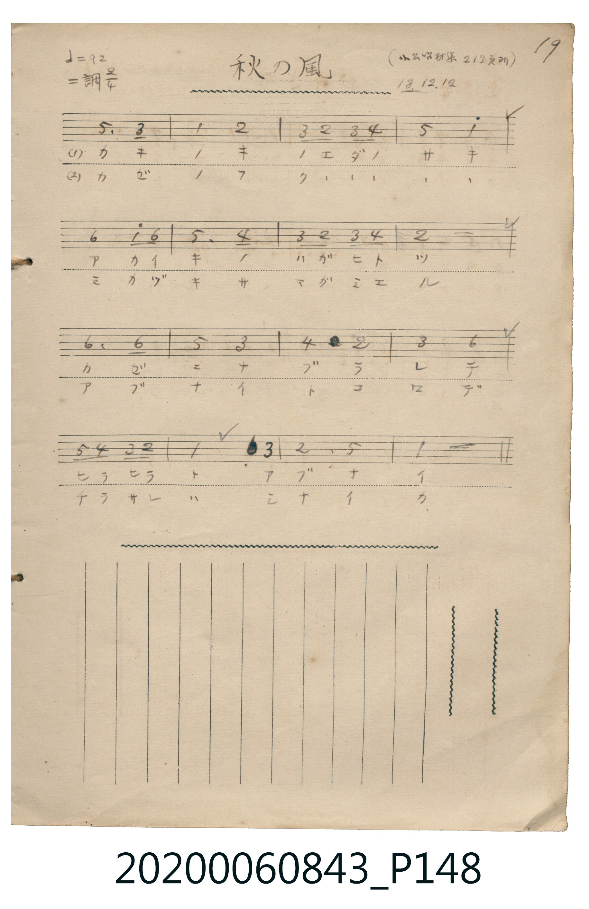

# 秋の風

<audio controls src="aki_no_kaze.mp3"></audio>

- 日治時期公學校《唱歌帳》（典藏號 2020.006.0843・P148）
- 原載《小公唱材集》第 213 頁（大正 13 年 12 月 12 日抄）

## 說明

【曲目說明】
・出處：《唱歌帳》（國立臺灣歷史博物館典藏號 2020.006.0843）第 P148.jpg 頁（手寫頁碼 19）。
・標註：（小公唱材集 213 頁ヨリ）13.12.12.（大正 13 年 12 月 12 日抄錄）。
・調性與拍號：ニ調（D 大調），2/4 拍，速度 != 92。
・背景與曲風：描寫柿子樹枝頭僅剩的一片紅樹葉被秋風吹得搖搖欲墜，以及從葉隙間望見彎彎新月的秋日景致。
・版本說明：本檔案為原頁單聲部簡譜之忠實數位化版本。
【原頁歌詞全文與中文語譯】（對應 P148.jpg）

・編曲說明（鋼琴伴奏版）：
1. 前奏 (Intro, 4 小節)：取末樂句「ヒラヒラトアブナイ」，描繪秋風吹拂紅葉飄搖。
2. 主歌伴奏 (Song, 16 小節 × 2 段)：右手演奏主旋律，左手配以輕巧和弦伴奏。

## 歌詞

```text
（一）カキノキノエダノサキ
アカイキノハガヒトツ
カゼニナブルレテ
ヒラヒラトアブナイ
被秋風吹拂戲弄著，翩翩搖晃好危險呀。）

（二）カゼノフクソノエダノサキ
ミカヅキサマガミエル
アブナイトコロデ
チラサレハシナイカ
在那麼危險的地方，不會被風吹落下來嗎？）
```

## ABC

```abc
X:1
T:秋の風
M:2/4
L:1/16
Q:1/4=92
K:D
V:V1 name="Piano" snm="Pia"
[V:V1]
A6 F2 | D4 E4 | F2 E2 F2 G2 | A4 d4 |
B4 d2 B2 | A6 G2 | F2 E2 F2 G2 | E8 |
B6 B2 | A4 F4 | G4 E4 | F4 B4 |
A2 G2 F2 E2 | D4 F4 | E6 A,2 | D8 |
```

## TMD 檔案連結

- [主旋律 TMD 檔案](aki_no_kaze.tmd) [[在 TMD Studio 編輯](https://tmdlang.github.io/Tmd-TS/#tmd=s7IKdvYPcrWy4tLSUni-vPtx47qXi1YoaGlxKdoqWBpx2dsquHDZGOmb2HHVKSg9m7702abdz2Y2PZsz_2nrmqdrdzxbsPBxQ9fTKRufre15umPz44bu93s6nrbueDG9_8XM-QpGBkYGegYGZnoGFibGj5t3BxiaWLzf06kEMuxp3_wXezpBujf0gwwDmjF3wsvZbUAznq9Zo2BkaKzwckEjyLgly5-tXawA5D_duUXB0Ejh2ZwOMAV0TVcL2DgufS0FW2oBLgUFhccNE57N3vR89roXq1Y9m9H3uGEiWLR599P2XS9mTn2_ZxYWb8_pfr66-0X7rueNi5-t3f60f9PT3lnPO1e-XLICR4gA3Q7yKihU9LIK0qH-fdbZ_XT9aiD7-aI9CoaWQEWPG5qg1j9bMfPFit1A60H2oYYbLMQeN6943LwKqMvQWM_QCIQIhuHLHlAwImx5sWr_s4blLzran3X3Ah0N8m1zN1AQaJCLAtAoMLPz_Z4eYMJQAKoBsl42zH-6a5kCONUgGdTc82zmepBBszcB0xXQoGf9_UDPPZu__-naCc9W7Hw2b-7LBWufNrc-7Vz5fFbLkx0Nzzvbn29pBUq9mNj5YtFqYJoEanw6YefTfdOfTZgGQms2PV00B2jlk91Ln_Z3Pd03D6jy5ayZL6dNfjZn9otl3U_39gHRs2kbgH4Emgk0AeRLoDPatyBc9ryz49mcNZDYBTlrzppnq6Y8W9jxvGkXMGECg_HptHUvGje9bF7xfMPCF2vnPNnZ_XT_gqfrlz2buuPJ3t6nPdMgJoBMhCYYiD5ginixct7T1hXPprUDPf5kx1oQY9W8F2vXA1MRONp6n7V3wiMdGJBgA4AyQN-DoqFp9eOmtY-b-2AkMDobwIytQBGIXQ1Q1LQIrHoJVGlz_-OmNY-bJz1u7njc3IKmFKhuDzAaHzd3PW6e9rh59eNmoNI2VEUgrSthZAfIeJDSLqANUCdCPAIMsKdzVsAjERjI0HjcMO35aqBsz_OpM19MnA6PzRedm0BqwHH6fs9skFkKCsiR-6y76VnHpqd7WoC6QNr3rwQiUFzPbH66dO_T3o0vZ616OhHoxCbk4NrVAwsuoMeAvp_6uGn946a9hAKteT5IT3MrKNCA0s3zwIEGFATqWY0RvrAAAIfH5sfNwIBuRzMPmOVWgk0CGgOMge1QDU1gw9ACDdnLwDB52bQYLeie9q8HJuznc7rhKRmUhud0AhMzPOiA5gA1vty1BxIyQAVP52x4Nm0nKFPs6H02pxkYthBbXkzY-2RH95N9bU-nA5M5MCd3gkygvIyEAgUtfS6u4Py8dKuAzMS8fIcagxqFarAbbSy07MAMYMmsAUwImgrA8ADitQo1wOzXh8JaAaQbwGygSNNWsBzQYLjuXT0w3XtgepqngtWuB-K9cFNAchBzoLprFEwVdIHQGMgyBNJGQFwD5BkBsQlU1jAOJAhOU8huXQS1cQnYnrUw1zX3A3lrgPQkIO4Ai7RgurV5PkR3cytMN9BXILXzoLpB8hD3rka41QziGjO4s0FORDgW5HgQxHQrImS6gbgLzJoGxCvBLJB9bVjCE-hDoCqQii6YP4E-AqZxMAvk43ZUt-nCnWYMDkcTpBAFyWFxGjiYVsJpmBWL4E4EOxZoOWYQNkJ0gpID0AuwoN-O6mCg15Gi2gQcWpCohjgREmam8VBBSPDVcnHp2imAUq0CkFbmAgA)]
- [鋼琴伴奏 TMD 檔案](aki_no_kaze_piano.tmd) [[在 TMD Studio 編輯](https://tmdlang.github.io/Tmd-TS/#tmd=s7IKdvYPcrWy4tLSUni-vPtx47qXi1a839PxsnvP8wlbnuzZ8nRp__POjvd7OhW0tLgUbRUsjbjsbRVcuGyM9E3suOoUlJ5NX_ps0-5nM5uezZn_tHXN07U7ni1Y-Lih6-mUjc_W9jzdsflxQzfQwKetO15M738xc76CkYGRgZ6BgZmegYWJ8ePm3QGGJhZA85VAhj3tm_9iTydI94Z-kGFAM-ZOeDm7DWjG8zVrFIwMjRVeLmhU4uLS11KwpRbgUlBQeNww4dnsTc9nr3uxatWzGX2PGyaCRZt3P23f9WLm1Pd7ZmHx0pzu56u7X7Tvet64-Nna7U_7Nz3tnfW8c-XLJStw-BboTZA3QD7WyypIB_nlcUMT1KYXq_Y_a1j-oqP9WXcvUCfIyuZuoCDQJheFp0uWg5md7_f0AENeAagGyHrZMP_prmUK4GhBGPR8-wqgXyAewRqVQKNBShUUDPUUnnb2AsUVNDzzSorydRRMFIAh_3x9gyZQzdP-ac_mrH62oulp_9LHDT2Pmyc9bl4JIzseNy163DztcXPX46YljxtArnnW3_985ypgKgImoacTdj7rbnq-pfXFxM6Xi1ueTZgGdZ-CgpGewpMdu4EBCXGSgkZwfl66joKhGdRqhcPTFYwUnq3bCnHD5med3c_2TAGqBOma3v10HzDse55uXwYUf9na-2T30hd7pj7dvvzppJ6ne5ZBzITaRXnSgAIFLX0uLnAIWQVkJublB3k41BjUKFSDPWRjoWUHZtQomALDzxjo-BoFQwVdIEsXyDICkroKpvFQQRCs4apFMc4Hl3Hx8QrRprFwGmgCkGEYC6PwqzCA2AMKXUKuBjnKGOpAkHtrwL4wBvoGImsYB3Y1RLkZRMAMrhOkCqEe4l9U5bpw1ZAwMUGyBySHUE1KCCJ8hisAoYEBDh1weCELIAcXzhCGGmQC5JrEwijcBmONGFBE4DWGcHSagQTMchEOokrS0LVTAKdCBSADFJjItDIXAA)]

## 分析

```text
================================================================================
📊 TMD Song Profile: [ 秋の風 ]
================================================================================
⏱  Duration:       0:20 (20.9s), 16 measures total
🎼 Key & Tempo:    首調基準 D, != 92.0 BPM, <2/4>
   - 分析範圍：      由實際發聲的音符與和弦推測調性；播放脈絡另行呈現
🎤 人聲音域:    A3 (MIDI 57) – D5 (MIDI 74) [跨度: 17 個半音 / 1.4 個八度, 難度: challenging]
   - 最低音:  A3 in [Song #1 @ m.15, 0:19]
   - 最高音: D5 in [Song #1 @ m.4, 0:04]
   - 適合: soprano, mezzo-soprano, contralto, tenor, baritone, bass
🏛  結構:      Song (20.9s)
⚡ 編曲密度:        Peak 1 軌道同時演奏
🗝  調性診斷：       D 大調（純淨自然大調，未偵測到可信轉調）
   - 風格氣質:    純淨自然大調（陽光明朗、易唱易記，無明顯調外色彩）
   - 轉調歷程:    全曲維持單一推測調性（未偵測到可信轉調）
   - 核心骨幹音:  E, F#, A, D, B
   - 調性數值:    D 大調 [相關度: 0.80, 穩定度: Moderate, 自然音純度: 100.0%]
   - 候選調性 (K-S): D 大調 (0.80), A 大調 (0.70), B 小調 (0.63)
   - 五度圈歷程:   +2
   - 各段落調性細節:
     • [Song #1]: D 大調 (r: 0.80, 自然音純度: 100.0%)

  [ 五度圈游移軌跡 ]
               C  
         F            G  
      Bb              [D ]*
      Eb               A  
         Ab           E  
            Db       B  
               F# 
     (* = active key center)

  [ 十二半音累積音高分佈 ]
     C  :                            0.0%
     C# :                            0.0%
     D  : ███████████████████       17.2%
     D# :                            0.0%
     E  : ████████████████████████  21.9%
     F  :                            0.0%
     F# : █████████████████████     18.7%
     G  : ██████████                 9.4%
     G# :                            0.0%
     A  : █████████████████████     18.7%
     A# :                            0.0%
     B  : ███████████████           14.1%
--------------------------------------------------------------------------------
Assignment 軌道音域：
  - Piano         : A3 – D5 (17 個半音 / 1.4 個八度, 37 個音符)
================================================================================
```


## 原書掃描頁




