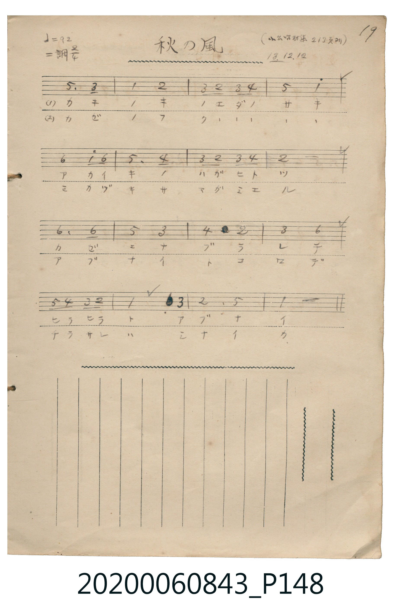

# 秋の風

> Re:Shōka 使用 AI 協助辨識與重建樂譜，可能會有錯誤。歡迎回報。

- **鋼琴伴奏版**：<br><audio controls src="aki_no_kaze.mp3"></audio>
- **NEUTRINO 歌聲合成版**：<br><audio controls src="aki_no_kaze_neutrino.mp3"></audio>

- 日治時期公學校《唱歌帳》（典藏號 2020.006.0843・P148）
- 原載《小公唱材集》第 213 頁（大正 13 年 12 月 12 日抄）

## 說明


- 出處：《唱歌帳》（國立臺灣歷史博物館典藏號 2020.006.0843）第 P148.jpg 頁（手寫頁碼 19）。
- 標註：（小公唱材集 213 頁ヨリ）13.12.12.（大正 13 年 12 月 12 日抄錄）。
- 調性與拍號：ニ調（D 大調），2/4 拍，速度 != 92。
- 背景與曲風：描寫柿子樹枝頭僅剩的一片紅樹葉被秋風吹得搖搖欲墜，以及從葉隙間望見彎彎新月的秋日景致。
- 版本說明：本檔案為原頁單聲部簡譜之忠實數位化版本。
【原頁歌詞全文與中文語譯】（對應 P148.jpg）

### 編曲說明（鋼琴伴奏版）：

1. 前奏 (Intro, 4 小節)：取末樂句「ヒラヒラトアブナイ」，描繪秋風吹拂紅葉飄搖。
2. 主歌伴奏 (Song, 16 小節 × 2 段)：右手演奏主旋律，左手配以輕巧和弦伴奏。


## 歌詞

```text
（一）カキノキノエダノサキ
アカイキノハガヒトツ
カゼニナブラレテ
ヒラヒラトアブナイ
被秋風吹拂戲弄著，翩翩搖晃好危險呀。）

（二）カゼノフクソノエダノサキ
ミカヅキサマガミエル
アブナイトコロデ
チラサレハシナイカ
在那麼危險的地方，不會被風吹落下來嗎？）
```

## ABC

<div class="abc-score" data-abc-src="aki_no_kaze.abc" aria-label="五線譜載入中"></div>

[下載 ABC 原始檔](aki_no_kaze.abc)

## TMD 檔案連結

- [主旋律 TMD 檔案](aki_no_kaze.tmd) [[在 TMD Studio 編輯](https://tmdlang.github.io/Tmd-TS/#tmd=s7IKdvYPcrWy4qpTUCpJTLdSSM7PyUlNLsnMz7MqzsjPTkzOyFeCS5bl55TmploBqXgDQ4RwcX5pUXJqfEFieqpVgKGJBboM3KT4vPyS1KT8_GyEioKi_LLUvMQ8oKrcxLzS4uSizIKS-OT8gkqEmtSyzJRUkIri5MS8-LLUosy0zNQUJGelFhWDHQxxR0lRYh7EHKAgQlVJRirQ7eWpiUBGEbpwcWpicX5eMUI4vygzPTPPqjQPZHUJmoX5RSUZ-elFiQUZlVYZmcUlQMXJiTnx2Yl5iUpcWloKz5d3P25c93LRCgUtLS5FWwVLIy57WwUXLhsjfRM7kCnPpi99tmn3s5lNz-bMf9q65unaHc8WLHzc0PV0ysZna3ue7tj8uKH7_Z6Op607XkzvfzFzvoKRgZGBnoGBmZ6BhYnx4-bdoGB-v6cT7KSnffNf7OkE6d7QDzIMaMbcCS9ntwHNeL5mjYKRobHCywWNIOOWLH-2drECkP905xYFQyOFZ3M6wBTQNV0tYOO49LUUbKkFuBQUFB43THg2e9Pz2eterFr1bEbf44aJYNHm3U_bd72YOfX9nllYvD2n-_nq7hftu543Ln62dvvT_k1Pe2c971z5cskKHCECdDvIq6BQ0csqSIf691ln99P1q4Hs54v2KBhaAhU9bmiCWv9sxcwXK3YDrQfZhxpusBB73LzicfMqoC5DYz1DIxAiGIYve0DBiLDlxar9zxqWv-hof9bdC3Q0yLfN3UBBoEEuCkCjwMzO93t6gAlDAagGyHrZMP_prmUK4FSDZFBzz7OZ60EGzd4ETFdAg5719wM992z-_qdrJzxbsfPZvLkvF6x92tz6tHPl81ktT3Y0PO9sf76lFSj1YmLni0WrgWkSqPHphJ1P901_NmEaCK3Z9HTRHKCVT3Yvfdrf9XTfPKDKl7Nmvpw2-dmc2S-WdT_d2wdEz6ZtAPoRaCbQBJAvgc5o34Jw2fPOjmdz1kBiF-SsOWuerZrybGHH86ZdwIQJDMan09a9aNz0snnF8w0LX6yd82Rn99P9C56uX_Zs6o4ne3uf9kyDmAAyEZpgIPqAKeLFynlPW1c8m9YO9PiTHWtBjFXzXqxdD0xF4GjrfdbeCY90YECCDQDKAH0Pioam1Y-b1j5u7oORwOhsADO2AkXAdjUtAitaAlXR3P-4ac3j5kmPmzseN7dAVACl9wAj7XFz1-PmaY-bVz5uBqpog3geqBDIh5AdIMNAKrqA5kHdAXEtMFSezlkBjylgSEIja8O056uBsj3Pp858MXE6PMpedG4CqQFH3Ps9s0FmKSggx-Cz7qZnHZue7mkB6gJp378SiEAROrP56dK9T3s3vpy16unEBmCIIofJrh5YmAD9A_Tr1MdN6x837cURMs3zQUqbW0EhAxRtngcOGaAgUOlqWNjBvAv2_ebHzcBAbIfoBmaelWB9QE3AQN0OVdcE1ooWMsj-Anr8ZdNitPB52r8emESfz-mGp0lQapzTCUyW8PABmgPU-HLXHoj3gQqeztnwbNpOUPLe0ftsTjMwACG2vJiw98mO7if72p5OByZYYJ7sBJlAeWkHBQpa-lxcwfl56VYBmYl5-Q41BjXVYCfaWGjZgRnAIlYDGNmaoMQFxGsVaoAB1ofCWgGkG8BsoEjTVrAc0Fy47l09MN17YHqap4LVrgfivXBTQHIQc6C6axRMFXSB0BjIMgTSRkBcA-QZAbEJVNYwDiQIVu5jCDJzNVgLwn0QNkgjdtfC5SFmGCGbAXMvkA10MdgMrG4GyYNU1YDTL3KYLYL6fAlY71qYvc39QN4aUKYE4g6wSAtmmDXPh-huboXpBroXpHYeVDdIHuKG1YgwM4OEihk8-EBBhQg0UCCCIHKYLQL7FtmdYP_jcSuKGaAwA7oFagbctZAwxO1imBnY0hkk5LuBuAvMmgbEK8EskCltWNIXMKSBqkAqumD-ALoWmNPBLFDIt6OGkS48iIzBUWuClMJActiTFcxhoODpgiaraWDeSihvDZjXhpakQEEMEoc5EWTWEqiODjBvM5QHCjiQY7EEDTgKVsJpmBcXwYMIHFhAczGTUiNEJyh7Al0Ii9btqAEG9CVS1jMBpxpI1oMEESTtmMZDBdGSEVbXgXwG8jssnCDhBnElZiLC5kqQCduhJoDCDRJyiDgBmVDLxaVrpwAqyKJ9DGMV4GwjMFuZCwA)]
- [鋼琴伴奏 TMD 檔案](aki_no_kaze_piano.tmd) [[在 TMD Studio 編輯](https://tmdlang.github.io/Tmd-TS/#tmd=s7IKdvYPcrWy4qpTUCpJTLdSyC8qychPL0osyKi0ysgsLskvykxOzInPTsxLVIIrKs4vLUpOjS9ITE-1CjA0sUDIlGSk5qZapaaUJieWZObnKXFpaSk8X979uHHdy0Ur3u_peNm95_mELU_2bHm6tP95Z8f7PZ0KWlpcirYKlkZc9rYKLlw2RvomdiDjnk1f-mzT7mczm57Nmf-0dc3TtTueLVj4uKHr6ZSNz9b2PN2x-XFDN9DAp607XkzvfzFzvoKRgZGBnoGBmZ6BhYnx4-bdIIcBzQe77Wnf_Bd7OkG6N_SDDAOaMXfCy9ltQDOer1mjYGRorPByQaMSF5e-loIttQCXgoLC44YJz2Zvej573YtVq57N6HvcMBEs2rz7afuuFzOnvt8zC4uX5nQ_X939on3X88bFz9Zuf9q_6WnvrOedK18uWYHDt0BvgrwB8rFeVkE6yC-PG5qgNr1Ytf9Zw_IXHe3PunuBOkFWNncDBYE2uSg8XbIczOx8v6cHGPIKQDVA1suG-U93LVMARwvCoOfbVwD9AvEI1qgEGg1SqqBgqKfwtLMXKK6g4ZlXUpSvo2CiAAz55-sbNIFqnvZPezZn9bMVTU_7lz5u6HncPOlx80oY2fG4adHj5mmPm7seNy153AByzbP-_uc7VwFTETAJPZ2w81l30_MtrS8mdr5c3PJswjSo-xQUjPQUnuzYDQxIiJMUNILz89J1FAzNoFYrHJ6uYKTwbN1WiBs2P-vsfrZnClAlSNf07qf7gGHf83T7MqD4y9beJ7uXvtgz9en25U8n9TzdswxiJtQuypMGFCho6XNxgUPIKiAzMS8_yMOhxqCmGuwfGwstOzCjRsEUGHzGQLfXKBgq6AJZukCWEZDUVTCNhwqCYA1XLYppPjhMi49XiDaNhdNAA4AMw1gYhV-FAcQaUNgScDPIScZQ54FcWwP2gzHQLxBZwziwmyHKzSACZnCdIFUI9RDfoirXhauGhIgJkj0gOYRqUsIP4TEcwQcNCnDYgEMLWQA5sHCGL9QgEyDXJBZG4TYYa7SAogGvMYQj0wwkYJaLcBBVEoaunQI4CSoAGaCwRKaVuQA)]

## 分析

```text
================================================================================
📊 TMD Song Profile: [ 秋の風 ]
================================================================================
⏱  Duration:       0:41 (41.7s), 32 measures total
🎼 Key & Tempo:    首調基準 D, != 92.0 BPM, <2/4>
   - 分析範圍：      由實際發聲的音符與和弦推測調性；播放脈絡另行呈現
🎤 人聲音域:    A3 (MIDI 57) – D5 (MIDI 74) [跨度: 17 個半音 / 1.4 個八度, 難度: challenging]
   - 最低音:  A3 in [Song[L1] #1 @ m.15, 0:19]
   - 最高音: D5 in [Song[L1] #1 @ m.4, 0:04]
   - 適合: soprano, mezzo-soprano, contralto, tenor, baritone, bass
🏛  結構:      Song[L1] (20.9s) -> Song[L2] (20.9s)
⚡ 編曲密度:        Peak 1 軌道同時演奏
🗝  調性診斷：       D 大調（純淨自然大調，未偵測到可信轉調）
   - 風格氣質:    純淨自然大調（陽光明朗、易唱易記，無明顯調外色彩）
   - 轉調歷程:    全曲維持單一推測調性（未偵測到可信轉調）
   - 核心骨幹音:  E, F#, A, D, B
   - 調性數值:    D 大調 [相關度: 0.80, 穩定度: Moderate, 自然音純度: 100.0%]
   - 候選調性 (K-S): D 大調 (0.80), A 大調 (0.70), B 小調 (0.63)
   - 五度圈歷程:   +2 -> +2
   - 各段落調性細節:
     • [Song[L1] #1]: D 大調 (r: 0.80, 自然音純度: 100.0%)
     • [Song[L2] #1]: D 大調 (r: 0.80, 自然音純度: 100.0%)

  [ 五度圈游移軌跡 ]
               C  
         F            G  
      Bb              [D ]*
      Eb               A  
         Ab           E  
            Db       B  
               F# 
     (* = active key center)

  [ 十二半音累積音高分佈 ]
     C  :                            0.0%
     C# :                            0.0%
     D  : ███████████████████       17.2%
     D# :                            0.0%
     E  : ████████████████████████  21.9%
     F  :                            0.0%
     F# : █████████████████████     18.7%
     G  : ██████████                 9.4%
     G# :                            0.0%
     A  : █████████████████████     18.7%
     A# :                            0.0%
     B  : ███████████████           14.1%
--------------------------------------------------------------------------------
Assignment 軌道音域：
  - Piano         : A3 – D5 (17 個半音 / 1.4 個八度, 74 個音符)
================================================================================
```


## 原書掃描頁




