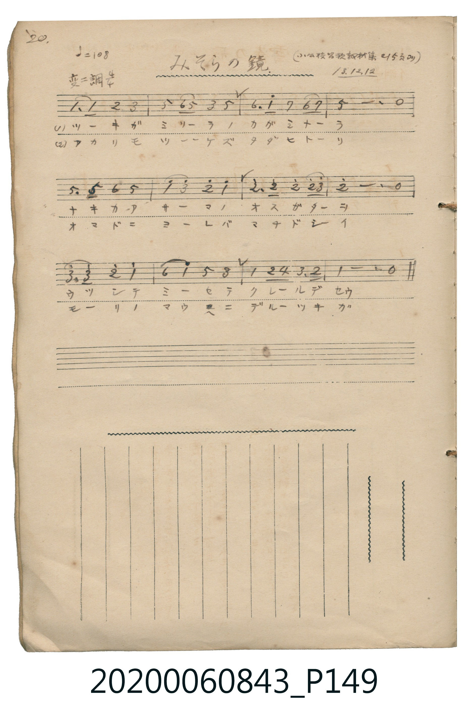

# みそらの鏡

> Re:Shōka 使用 AI 協助辨識與重建樂譜，可能會有錯誤。歡迎[回報](https://github.com/TMDLang/reshoka/issues)。

- **鋼琴伴奏版**：<br><audio controls src="misora_no_kagami.mp3"></audio>
- **NEUTRINO 歌聲合成版**：<br><audio controls src="misora_no_kagami_neutrino.mp3"></audio>

- 日治時期公學校《唱歌帳》（典藏號 2020.006.0843・P149）
- 原載《小公校唱歌教材集》第 215 頁（大正 13 年 12 月 12 日抄）

## 說明


- 出處：《唱歌帳》（國立臺灣歷史博物館典藏號 2020.006.0843）第 P149.jpg 頁（手寫頁碼 20）。
- 標註：（小公校唱歌教材集 215 頁ヨリ）13.12.12.（大正 13 年 12 月 12 日抄錄）。
- 調性與拍號：變ニ調（Db 大調），4/4 拍，速度 != 108。
- 背景與曲風：共 12 小節，將明月比作高掛天際的「天空之鏡」（みそらの鏡），孩童在未點燈的窗邊仰望森林上方的明月，
期盼月亮能映照出已故母親（なきかあさま）溫柔的身影，情感真摯動人。
- 版本說明：本檔案為原頁單聲部簡譜之忠實數位化版本。
【原頁歌詞全文與中文語譯】（對應 P149.jpg）

### 編曲說明（鋼琴伴奏版）：

1. 前奏 (Intro, 4 小節)：引用結尾樂句「ウツシテミーセテ クレールデセウ」，營造澄澈溫柔的月夜氛圍。
2. 主歌伴奏 (Song, 12 小節 × 2 段)：右手演奏主旋律，左手配以抒情和弦伴奏。


## 歌詞

```text
（一）ツーキガ　ミソーラノ　カガミナーラ
ナキカーアサーマノ　オスガターヲ
ウツシテミーセテ　クレールデセウ
一定會把已故母親的身影，映照出來給我看吧。）

（二）アカリモツーケズ　タダヒトーリ
オマドニヨーレバ　マチドシーイ
モーリノマウヘニ　デルーツキガ
多麼期盼那輪即將升上森林正上方的明月呀。）
```

## ABC

<div class="abc-score" data-abc-src="misora_no_kagami.abc" aria-label="五線譜載入中"></div>

[下載 ABC 原始檔](misora_no_kagami.abc)

## TMD 檔案連結

- [主旋律 TMD 檔案](misora_no_kagami.tmd) [[在 TMD Studio 編輯](https://tmdlang.github.io/Tmd-TS/#tmd=s7IKdvYPcrWy4qpTUCpJTLdSSM7PyUlNLsnMz7MqzsjPTkzOyFeCS5bl55TmploBqXgDQ4RwcX5pUXJqfEFieqpVgKGJJboM3KT4vPyS1KT8_GyEioKi_LLUvMQ8oKrcxLzS4uSizIKS-OT8gkqEmtSyzJRUkIri5MS8-LLUosy0zNQUJGelFhWDHQxxR0lRYh7EHKAgQlV-UWZ6Zp5VaR7IsBI0I_KLSjLy04sSCzIqrTIyi0uAipMTc-KzE_MSEYpKMlKBvk9NKU1OhBitpaXwuHH_48a5j5s6Hzeue9m_UEFLi0vRVsHQwILL3lbBRYfLxkTfxA5kwrPpS59t2v1sZtOzOfOftq55unbHswULHzd0PZ2y8dnanqc7Nj9u6H6_p-Np644X0_tfzJyvYGRgZKBnYGCmZ2BhYvy4eTcoZN_v6QQ752nf_Bd7OkG6N_QDDQOaBDHm2dSZz-ZOeDm7DWjY8zVrFIwMTRVeLmgEmbtk-bO1ixUMjRWe7tyiYGik8GxOB5gCOqurBWwul76Wgi21AJeCgsLjhgnPZm96Pnvdi1Wrns3oe9wwESzavPtp-64XM6e-3zMLi__ndD9f3f2ifdfzxsXP1m5_2r_pae-s550rXy5ZgSNogG4HeRUUPHpZBelQ_z7r7H66fjWQ_XzRHqB6oKLHDU1Q65-tmPlixW6g9SD7cAQgLOgeN6943LwKqN3QWM_QCIQIBubLHlB4Iqx7sWr_s4blLzran3X3Al0PtPfFuq7Hzd1AcaBZLkkKQOPA7M73e3qAyUUBqA7Ietkw_-muZQqQ1IRkWnPPs5nrQabN3vRy0QqgaU9bN4IsB_rk-foGoManG9qBoQ100rP1U57snfNy9YxnfbOfLln5ctbs57NaHjf0ANnPV-56srMbmGAfNwDt6kBLxRCnPF278vnqpU_nrHg2Z9XL3fOet3cAtT9fNf1lU9eT3RuezZn9bPG6Z_OmP9nR9WzaTqAUxFKgRpBLFYBhMv_57D1AkSe71r1o3vtsxoLnrcuBMf90-6ZnU1ufre99sQwYrkCrVz1u7H3c2P24selx49THjfuAtj_btfrZ_ClAM1_sWv1070agmc-aW5-1zH8-Z_6zieufdk99smsXIkied3Y8m7MGksiA4QFkP1s15dnCjudNu4AZBRiJT6ete9G46WXziucbFr5YOwfo86f7Fzxdv-zZ1B1P9vY-7ZkGMQFkIjTdQvQBE8SLlfOetq54Nq0dGOJPdqwFMVbNe7F2PTAxg1NP77P2TnjaA7ocbABQ5skOYFR0Pm5uedy853HT2sdNQNMbHjfPf9y0FyTSvPJxMzBDNDxuWg2SAoo3A5MESBzipy6wntVgzYseN20Fy82D6Vn1uGknSFvTfrD4JrCepmUg25q2P25uA5sH1LkbxAZpWP-4GWgJUCnQxHaQeNMyqDshvgGlomVNz-bNgUTXsxnroWlkx1pgJAD98nLuImDggpMGNHqBgk_XAcO6-VlXF3KUokQaLM6f7Gt7vnXZs46Jz-d0P52wHBjQyEG1qwcUVCB_Ap236nHzIliwbXzcBIxmoPuB_gQG3qTHzR1gX6yCeBioFBgkwEDuBudSoATQkxPA4QwUB2ZdoKHA4AAatAQSqkCDQbpBwQhUAQqwGSDNIA3t4LABygKDEBRb6MHzsmExMAM82Tn_2aZJz-Z0AvMDMJyAXnzeu-JF-ypgYABT5Mu5C4C5BZJD4OH0dMmsl7uA2QCUGV42LX6xZ9XT3s3ALPq0F5ieuiBZCFiYoOWipxMboIEENILy0hgKFLT0ubiC8_PSrQIyE_PyHWoMaqrBrrSx0LIDM4BVgAbQM5rAwAJFATCQ1wLxGoUaoMB8IAuUeIHMlUDcBxJsWg2WBkuCUzBYskbBAGQV3MBdPUADmxZBlDevAsUE2ESoFRuBeBfYtP1AwQYgngTEoKgGq0YyrUbBUEEXCA0VjICkMRDXKJgCSTMgCeKB2DVAHlhNnII5WMocqggGDUCKwMb5GAItbVwCFQcWQ2CyB2wIsEgE8-aCyKZOMHsdVKYbqr4HrmoVRAasDgbjEfYYgXQ1QXV1A9V1gU0FiaC6YCKYXAoVnw8VXQDEm8CsFVB7QPpR7UGPvi5o3IFSNTjwQdpA5QhQbh48-oBx0bQTEoXgwgQosQlH9IGiDaSxE4i7wdEHynNAChT9E8ACIOlGiBJwxgNSS1CjDxIPpuAogkQWMJqAMQkijEAEmFsDYYOFwCwgAVQCF8Yej6A4gMQiJIYgIQ6SmQoP330o8QgJxceNM6GxDglxULhMwhOPMF37gHglmLUaqqsDZk8TxLQNUHtAtoL4C-E6pkNlWgjFY9MyUD4BhSeQboPkQ0jI7oYJNK0HRQIkLkD5qx0sCCrjMWMRXARC8yA4BYDiDGzHDHi0toPMgSgDWbwWbNwaRByCIwscZ8gxBopRMBMUrZCcCcqrRgomYB6IBcu92KOvDRpIS6DB87hxGTSQQFkMIjcbRbwfEdRNsCy5HCwzG2Yc1hgE5ztIPIHzITw9QFIHSOfjxh3IMQs0FmYJLLeC0hlIBmQ9qj21XFy6dgqgYjbaxzBWAc42ArOVuQA)]
- [鋼琴伴奏 TMD 檔案](misora_no_kagami_piano.tmd) [[在 TMD Studio 編輯](https://tmdlang.github.io/Tmd-TS/#tmd=s7IKdvYPcrWy4qpTUCpJTLdSyC8qychPL0osyKi0ysgsLskvykxOzInPTsxLVIIrKs4vLUpOjS9ITE-1CjA0sUTIlGSk5qZapaaUJieWZObnKXFpaSk8btz_uHHu46bOx43rXvYvfL-n42X3nucTtjzZs-Xp0v7nnR3v93QqaGlxKdoqGBpYcNnbKrjocNmY6JvYgYx9Nn3ps027n81sejZn_tPWNU_X7ni2YOHjhq6nUzY-W9vzdMfmxw3dQCOftu54Mb3_xcz5CkYGRgZ6BgZmegYWJsaPm3eDHAi0AezGp33zX-zpBOne0A80DGgSxJhnU2c-mzvh5ew2oGHP16xRMDI0VXi5oFGJi0tfS8GWWoBLQUHhccOEZ7M3PZ-97sWqVc9m9D1umAgWbd79tH3Xi5lT3--ZhcVvc7qfr-5-0b7reePiZ2u3P-3f9LR31vPOlS-XrMDhbaB_Qd4AeV0vqyAd5JfHDU1Qm16s2v-sYfmLjvZn3b1AnUArX6zretzcDRQHWuaSpPB0yXIwu_P9nh5gNCgA1QFZLxvmP921TAESSwjTnm9fAfQQxDdYoxZoPkipgoKhnsLTzl6guIKGZ15JUb6OgokCMB6er2_QBKp5umfq8ykrnm-d8HTDvmcrmp72L33c0PO4adnj5pbHTdsfN7c9bp7_uHnP46bdQLbC46b1j5vXgPjNqx83t4NEgUobQO583j7_ZcOCZ_tanu3reLZr9bP5U57Pank2p-PpkjnPNsx-OqcX6nYFBSM9hSc7dgNDGuJcBY3g_Lx0HQVDI6izFA5PVzBSeLZuK9h9_ZufdXY_2zMFqBKka3r3033AyOl5un0ZUPxla--T3UufdU161tz6dFLP0z3LIGZC7aI87UCBgpY-Fxc49KwCMhPz8oM8HGoMaqrB_rGx0LIDM2oUjOMUdIEQSBmBWIYgokbBDMY0BcmBhQyBpBEwHkA8EAsiAoMGIDVctSg2-iDbaAK30TBeIdowVsEUSJnGAvkmQIZJLEwYzofLQyWAlAHEClDY4_UTxGGGQEfCHA_yhhmQBPFAbIgPwX40B0uZQxWh-gdiHETcFKwFohkcNOCQQw40MBssBGYBCaASuDCmudQOekS4EBnyiJBFCXkjIGUE4kMVAilQyKOYAVUK55sBKbNckABUNzGGkJ8EdO0UwAlNAcgAeRuZVuYCAA)]

## 分析

```text
================================================================================
📊 TMD Song Profile: [ みそらの鏡 ]
================================================================================
⏱  Duration:       0:53 (53.3s), 24 measures total
🎼 Key & Tempo:    首調基準 D,, != 108.0 BPM, <4/4>
   - 分析範圍：      由實際發聲的音符與和弦推測調性；播放脈絡另行呈現
🎤 人聲音域:    C#4 (MIDI 61) – F5 (MIDI 77) [跨度: 16 個半音 / 1.3 個八度, 難度: moderate]
   - 最低音:  C#4 in [Song[L1] #1 @ m.1, 0:00]
   - 最高音: F5 in [Song[L1] #1 @ m.6, 0:11]
   - 適合: soprano, mezzo-soprano, contralto, tenor, baritone, bass
🏛  結構:      Song[L1] (26.7s) -> Song[L2] (26.7s)
⚡ 編曲密度:        Peak 1 軌道同時演奏
🗝  調性診斷：       G# 調性不明確（純淨自然大調，未偵測到可信轉調）
   - 風格氣質:    純淨自然大調（陽光明朗、易唱易記，無明顯調外色彩）
   - 轉調歷程:    全曲維持單一推測調性（未偵測到可信轉調）
   - 核心骨幹音:  C#, D#, G#, F, A#
   - 調性數值:    G# 調性不明確 [相關度: 0.81, 穩定度: Ambiguous, 自然音純度: 98.9%]
   - 候選調性 (K-S): G# 大調 (0.81), C# 大調 (0.81), F 小調 (0.60)
   - 五度圈歷程:   -4 -> -4
   - 各段落調性細節:
     • [Song[L1] #1]: G# 調性不明確 (r: 0.81, 自然音純度: 98.9%, 調外音: F#)
     • [Song[L2] #1]: G# 調性不明確 (r: 0.81, 自然音純度: 98.9%, 調外音: F#)

  [ 五度圈游移軌跡 ]
               C  
         F            G  
      Bb               D  
      Eb               A  
        [Ab]*          E  
            Db       B  
               F# 
     (* = active key center)

  [ 十二半音累積音高分佈 ]
     C  : ███                        3.3%
     C# : ████████████████████████  23.3%
     D  :                            0.0%
     D# : ████████████████████████  23.3%
     E  :                            0.0%
     F  : ██████████████████        17.8%
     F# : █                          1.1%
     G  :                            0.0%
     G# : ██████████████████████    21.1%
     A  :                            0.0%
     A# : ██████████                10.0%
     B  :                            0.0%
--------------------------------------------------------------------------------
Assignment 軌道音域：
  - Piano         : C#4 – F5 (16 個半音 / 1.3 個八度, 86 個音符)
================================================================================
```


## 原書掃描頁




