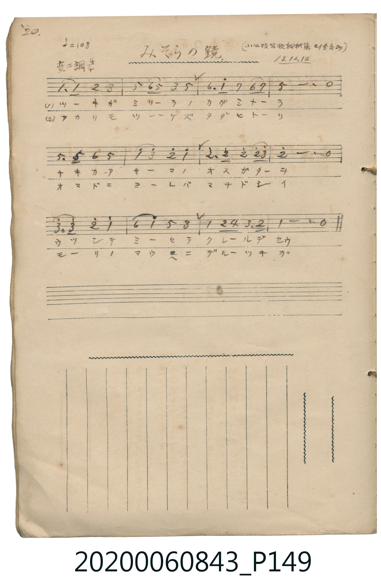

# みそらの鏡

<audio controls src="misora_no_kagami.mp3"></audio>

- 日治時期公學校《唱歌帳》（典藏號 2020.006.0843・P149）
- 原載《小公校唱歌教材集》第 215 頁（大正 13 年 12 月 12 日抄）

## 說明

【曲目說明】
・出處：《唱歌帳》（國立臺灣歷史博物館典藏號 2020.006.0843）第 P149.jpg 頁（手寫頁碼 20）。
・標註：（小公校唱歌教材集 215 頁ヨリ）13.12.12.（大正 13 年 12 月 12 日抄錄）。
・調性與拍號：變ニ調（Db 大調），4/4 拍，速度 != 108。
・背景與曲風：共 12 小節，將明月比作高掛天際的「天空之鏡」（みそらの鏡），孩童在未點燈的窗邊仰望森林上方的明月，
期盼月亮能映照出已故母親（なきかあさま）溫柔的身影，情感真摯動人。
・版本說明：本檔案為原頁單聲部簡譜之忠實數位化版本。
【原頁歌詞全文與中文語譯】（對應 P149.jpg）

・編曲說明（鋼琴伴奏版）：
1. 前奏 (Intro, 4 小節)：引用結尾樂句「ウツシテミーセテ クレールデセウ」，營造澄澈溫柔的月夜氛圍。
2. 主歌伴奏 (Song, 12 小節 × 2 段)：右手演奏主旋律，左手配以抒情和弦伴奏。

## 歌詞

```text
（一）ツーキガ　ミソーラノ　カガミナーラ
ナキカーアサーマノ　オスガターヲ
ウツシテミーセテ　クレールデセウ
一定會把已故母親的身影，映照出來給我看吧。）

（二）アカリモツーケズ　タダヒトーリ
オマドニヨーレバ　マチドシーイ
モーリノマウヘニ　デルーツキガ
多麼期盼那輪即將升上森林正上方的明月呀。）
```

## ABC

```abc
X:1
T:みそらの鏡
M:4/4
L:1/16
Q:1/4=108
K:Db
V:V1 name="Piano" snm="Pia"
[V:V1]
D6 D2 E4 F4 | A4 B2 A2 F4 A4 | B6 d2 c4 B2 c2 | A12 z4 |
A6 A2 B4 A4 | d4 f4 e4 d4 | e6 e2 e4 e2 f2 | e12 z4 |
f6 f2 e4 d4 | B4 d4 A4 F4 | D4 E2 G2 F6 E2 | D12 z4 |
```

## TMD 檔案連結

- [主旋律 TMD 檔案](misora_no_kagami.tmd) [[在 TMD Studio 編輯](https://tmdlang.github.io/Tmd-TS/#tmd=s7IKdvYPcrWy4tLSUnjcuP9x49zHTZ2PG9e97F-ooKXFpWirYGhgwWVvq-Ciw2Vjom9ix1WnoPRs-tJnm3Y_m9n0bM78p61rnq7d8WzBwscNXU-nbHy2tufpjs2PG7rf7-l42rrjxfT-FzPnKxgZGBnoGRiY6RlYmBg_bt4dYGhi-X5PpxLIsKd981_s6QTp3tAPNAxoEsSYZ1NnPps74eXsNqBhz9esUTAyNFV4uaARZO6S5c_WLlYwNFZ4unOLgqGRwrM5HWAK6KyuFrC5XPpaCrbUAlwKCgqPGyY8m73p-ex1L1atejaj73HDRLBo8-6n7btezJz6fs8sLP6f0_18dfeL9l3PGxc_W7v9af-mp72znneufLlkBY6gAbod5FVQ8OhlFaRD_fuss_vp-tVA9vNFe4DqgYoeNzRBrX-2YuaLFbuB1oPswxGAsKB73LzicfMqoHZDYz1DIxAiGJgve0DhibDuxar9zxqWv-hof9bdC3Q90N4X67oeN3cDxYFmuSQpAI0Dszvf7-kBJhcFoDog62XD_Ke7lilAUhOSac09z2auB5k2e9PLRSuApj1t3QiyHOiT5-sbgBqfbmgHhjbQSc_WT3myd87L1TOe9c1-umTly1mzn89qedzQA2Q_X7nryc5uYIJ93AC0qwMtFUOc8nTtyuerlz6ds-LZnFUvd8973t4B1P581fSXTV1Pdm94Nmf2s8Xrns2b_mRH17NpO4FSEEuBGkEuVQCGyfzns_cARZ7sWveiee-zGQuety4HxvzT7ZueTW19tr73xTJguAKtXvW4sfdxY_fjxqbHjVMfN-4D2v5s1-pn86cAzXyxa_XTvRuBZj5rbn3WMv_5nPnPJq5_2j31ya5diCB53tnxbM4aSCIDhgeQ_WzVlGcLO5437QJmFGAkPp227kXjppfNK55vWPhi7Rygz5_uX_B0_bJnU3c82dv7tGcaxASQidB0C9EHTBAvVs572rri2bR2YIg_2bEWxFg178Xa9cDEDE49vc_aO-FpD-hysAFAmSc7gFHR-bi55XHznsdNax83AU1veNw8_3HTXpBI88rHzcAM0fC4aTVICijeDEwSIHGIAxqgCCgK0rwabMqix01bwYrmwTSvety0E6S_aT9YfBOq5qZlIPubtj9ubgPbADRiN4gNklr_uBloLVAP0Oh2kHjTMqjLIf4DpatlTc_mzYFE4LMZ66GpZsdaYLQAffdy7iJgcIMTCzTCgYJP1wFDv_lZVxdyJKNEIywVPNnX9nzrsmcdE5_P6X46YTkw6JEDb1cPKPBAHgY6b9Xj5kWwgNz4uAkY8UD3Az0MDJ1Jj5s7wL5YheZzoB5gIAHDvxucgYEqgL6dAA5RoDgwVwNNB4YL0MQlaAEOtApkHiiEgUpBQTgDZApIqh0cWkBZYKCCYhQ9wF42LAZmkic75z_bNOnZnE5gngGGHNDTz3tXvGhfBQweYKp9OXcBMEdBchE85J4umfVyFzCrgDLMy6bFL_asetq7GZiNn_YC01wXJJsBCxy0nPZ0ItDF4GADGkF5iQ0FClr6XFzB-XnpVgGZiXn5DjUGNQrVYGfaWGjZgRnAekID6BtNYN4DxYoCMDSAeI1CDVBgPpAFSuFA5kog7gMJNq0GS4MlwckcLFmjYACyC27grh6ggU2LIMqbVwHxIrCJUCs2AvEusGn7gYINQDwJiEGxD1aNZFqNgqGCLhAaKhgBSWMgrlEwBZJmQBLEA7FrgDywmjgFc7CUOVQRDBqAFIHTI7J3u6B-BSUDsGNB7gHlSaDcPLh3gW5v2gnxMjhjAiU24fAuyJsgjZ1A3A32Lii1AilQcE0AC4CkGyFKwEkWSC1B9S7E3aZgL0E8B_QW0OcgwghEgLk1EDZYCMwCEkAlcGE8_m5aBooHkP1Aug0SzxCX7IYJNK0HORridlD8tYMFQcUKpq_BeQwax-AQA_kRbMcMeDC0g8yBKANZvBZs3BqEn8GeA_sR2YegEAAzQcEAiXlQWjBSMAHzQCxY6kD2bi0Xl66dAijRKwBpZS4A)]
- [鋼琴伴奏 TMD 檔案](misora_no_kagami_piano.tmd) [[在 TMD Studio 編輯](https://tmdlang.github.io/Tmd-TS/#tmd=s7IKdvYPcrWy4tLSUnjcuP9x49zHTZ2PG9e97F_4fk_Hy-49zydsebJny9Ol_c87O97v6VTQ0uJStFUwNLDgsrdVcNHhsjHRN7HjqlNQejZ96bNNu5_NbHo2Z_7T1jVP1-54tmDh44aup1M2Plvb83TH5scN3UAjn7bueDG9_8XM-QpGBkYGegYGZnoGFibGj5t3BxiaWAJtUAIZ9rRv_os9nSDdG_qBhgFNghjzbOrMZ3MnvJzdBjTs-Zo1CkaGpgovFzQqcXHpaynYUgtwKSgoPG6Y8Gz2puez171YterZjL7HDRPBos27n7bvejFz6vs9s7D4bU7389XdL9p3PW9c_Gzt9qf9m572znreufLlkhU4vA30L8gbIK_rZRWkg_zyuKEJatOLVfufNSx_0dH-rLsXqBNo5Yt1XY-bu4HiQMtckhSeLlkOZne-39MDjAYFoDog62XD_Ke7lilAYglh2vPtK4AegvgGa9QCzQcpVVAw1FN42tkLFFfQ8MwrKcrXUTBRAMbD8_UNmkA1T_dMfT5lxfOtE55u2PdsRdPT_qWPG3oeNy173NzyuGn74-a2x83zHzfvedy0G8hWeNy0_nHzGhC_efXj5naQKFBpA8idz9vnv2xY8Gxfy7N9Hc92rX42f8rzWS3P5nQ8XTLn2YbZT-f0Qt2uoGCkp_Bkx25gSEOcq6ARnJ-XrqNgaAR1lsLh6QpGCs_WbQW7r3_zs87uZ3umAFWCdE3vfroPGDk9T7cvA4q_bO19snvps65Jz5pbn07qebpnGcRMqF2Upx0oUNDS5-ICh55VQGZiXn6Qh0ONQY1CNdhDNhZadmBGjYJxnIIuEAIpIxDLEETUKJjBmKYgObCQIZA0AkYEiAdiQURg0ACkhqsWxUofFCtN4FYaxitEG8YqmAIp01gg3wTIMImFCcP5cHmoBJAygNgBCn38voI4zRDoTJjzQR4xA5IgHogN8SPYl-ZgKXOoIlQfQYyDiJuCtUA0gwMHHHbIwQZmg4XALCABVAIXxjSX2oGPCBhiwx4RtihhbwSkjEB8qEIgBQp7FDOgSuF8MyBllgsSgOomxhDyE4GunQI4rSkAGSB_I9PKXAA)]

## 分析

```text
================================================================================
📊 TMD Song Profile: [ みそらの鏡 ]
================================================================================
⏱  Duration:       0:26 (26.7s), 12 measures total
🎼 Key & Tempo:    首調基準 D,, != 108.0 BPM, <4/4>
   - 分析範圍：      由實際發聲的音符與和弦推測調性；播放脈絡另行呈現
🎤 人聲音域:    C#4 (MIDI 61) – F5 (MIDI 77) [跨度: 16 個半音 / 1.3 個八度, 難度: moderate]
   - 最低音:  C#4 in [Song #1 @ m.1, 0:00]
   - 最高音: F5 in [Song #1 @ m.6, 0:11]
   - 適合: soprano, mezzo-soprano, contralto, tenor, baritone, bass
🏛  結構:      Song (26.7s)
⚡ 編曲密度:        Peak 1 軌道同時演奏
🗝  調性診斷：       G# 調性不明確（純淨自然大調，未偵測到可信轉調）
   - 風格氣質:    純淨自然大調（陽光明朗、易唱易記，無明顯調外色彩）
   - 轉調歷程:    全曲維持單一推測調性（未偵測到可信轉調）
   - 核心骨幹音:  C#, D#, G#, F, A#
   - 調性數值:    G# 調性不明確 [相關度: 0.81, 穩定度: Ambiguous, 自然音純度: 98.9%]
   - 候選調性 (K-S): G# 大調 (0.81), C# 大調 (0.81), F 小調 (0.60)
   - 五度圈歷程:   -4
   - 各段落調性細節:
     • [Song #1]: G# 調性不明確 (r: 0.81, 自然音純度: 98.9%, 調外音: F#)

  [ 五度圈游移軌跡 ]
               C  
         F            G  
      Bb               D  
      Eb               A  
        [Ab]*          E  
            Db       B  
               F# 
     (* = active key center)

  [ 十二半音累積音高分佈 ]
     C  : ███                        3.3%
     C# : ████████████████████████  23.3%
     D  :                            0.0%
     D# : ████████████████████████  23.3%
     E  :                            0.0%
     F  : ██████████████████        17.8%
     F# : █                          1.1%
     G  :                            0.0%
     G# : ██████████████████████    21.1%
     A  :                            0.0%
     A# : ██████████                10.0%
     B  :                            0.0%
--------------------------------------------------------------------------------
Assignment 軌道音域：
  - Piano         : C#4 – F5 (16 個半音 / 1.3 個八度, 43 個音符)
================================================================================
```


## 原書掃描頁




