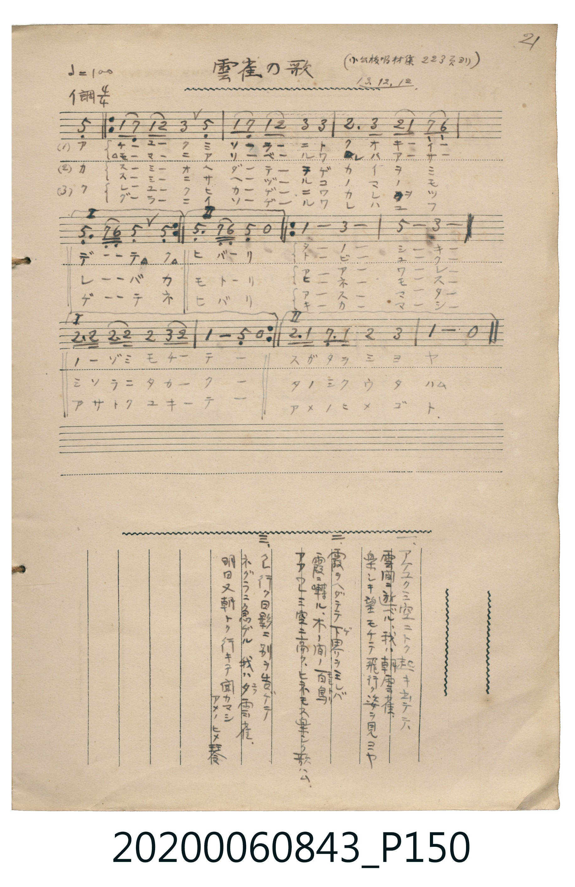

# 雲雀の歌

> Re:Shoka 使用 AI 協助辨識與重建樂譜，可能會有錯誤。歡迎回報。

<audio controls src="hibari_no_uta.mp3"></audio>

- 日治時期公學校《唱歌帳》（典藏號 2020.006.0843・P150）
- 原載《小公校唱材集》第 223 頁（大正 13 年 12 月 12 日抄）

## 說明

【曲目說明】
・出處：《唱歌帳》（國立臺灣歷史博物館典藏號 2020.006.0843）第 P150.jpg 頁（手寫頁碼 21）。
・標註：（小公校唱材集 223 頁ヨリ）13.12.12.（大正 13 年 12 月 12 日抄錄）。
・調性與拍號：イ調（A 大調），4/4 拍，速度 != 100，弱起拍（第 4 拍起唱），含前後兩段反覆（I、II 結尾）。
・背景與曲風：歌頌破曉飛上青空的朝雲雀、穿過春霞整日歡唱的百鳥之王、以及暮色中歸巢預告明日再奏天琴的夕雲雀。
・版本說明：本檔案完整展開原頁前後反覆記號（I、II 括號），忠實呈現完整曲式。
【原頁歌詞全文與中文語譯】（對應 P150.jpg）

・編曲說明（鋼琴伴奏版）：
1. 前奏 (Intro, 4 小節)：以雲雀展翅高飛的明亮大調樂句導引，第 4 小節末拍銜接弱起唱音。
2. 主歌伴奏 (Song, 16 小節 × 3 段)：右手演奏主旋律，左手配以輕盈流暢的和弦伴奏。

## 歌詞

```text
一、アケユクミ空ニトク起キ出デテ、
雲間ニ遊ベル我ハ朝雲雀、
樂シキ望モチテ飛行ク姿ヲ見ヨヤ。
請看我懷著快樂的希望展翅高飛的姿態吧！）

二、霞ヲヘダテテ下界ヲ見レバ、
霞ニ囀ル木ノ間ノ百鳥、
アアウレミ空ニ高クヒネモス樂シク歌ハム。
啊，我要在高高的天空中整日快樂地歌唱！）

三、入行ク日影ニ別ヲ告ゲテ、
ネグラニ急ゲル我ハ夕雲雀、
明日又朝トク行キテ聞カマシアメノヒメ琴。
明天一早我還要早早飛上天空，讓大家聽聽天上的美妙琴音。）
```

## ABC

```abc
X:1
T:雲雀の歌
M:4/4
L:1/16
Q:1/4=100
K:A
V:V1 name="Piano" snm="Pia"
[V:V1]
z4 z4 z4 E4 | A2 G2 A2 B2 c4 E4 | A2 G2 A2 B2 c4 c4 | B6 c2 B2 A2 G2 F2 |
E6 G F E4 E4 | A2 G2 A2 B2 c4 E4 | A2 G2 A2 B2 c4 c4 | B6 c2 B2 A2 G2 F2 |
E6 G F E4 z4 | A8 c8 | e8 c8 | B3 B B3 B B4 c2 B2 |
A8 E4 z4 | A8 c8 | e8 c8 | B3 A G3 A B4 c4 |
A8 z8 | z4 z4 z4 E4 | A2 G2 A2 B2 c4 E4 | A2 G2 A2 B2 c4 c4 |
B6 c2 B2 A2 G2 F2 | E6 G F E4 E4 | A2 G2 A2 B2 c4 E4 | A2 G2 A2 B2 c4 c4 |
B6 c2 B2 A2 G2 F2 | E6 G F E4 z4 | A8 c8 | e8 c8 |
B3 B B3 B B4 c2 B2 | A8 E4 z4 | A8 c8 | e8 c8 |
B3 A G3 A B4 c4 | A8 z8 | z4 z4 z4 E4 | A2 G2 A2 B2 c4 E4 |
A2 G2 A2 B2 c4 c4 | B6 c2 B2 A2 G2 F2 | E6 G F E4 E4 | A2 G2 A2 B2 c4 E4 |
A2 G2 A2 B2 c4 c4 | B6 c2 B2 A2 G2 F2 | E6 G F E4 z4 | A8 c8 |
e8 c8 | B3 B B3 B B4 c2 B2 | A8 E4 z4 | A8 c8 |
e8 c8 | B3 A G3 A B4 c4 | A8 z8 |
```

## TMD 檔案連結

- [主旋律 TMD 檔案](hibari_no_uta.tmd) [[在 TMD Studio 編輯](https://tmdlang.github.io/Tmd-TS/#tmd=s7IKdvYPcrWy4qpTUCpJTLdSSM7PyUlNLsnMz7MqzsjPTkzOyFeCS5bl55TmploBqXgDQ4RwcX5pUXJqfEFieqpVgKGpAboM3KT4vPyS1KT8_GyEioKi_LLUvMQ8oKrcxLzS4uSizIKS-OT8gkqEmtSyzJRUkIrUlMyS_KLMxBwkJ6UWFYMdC3FDSVFiHsQMoCBCVUlGKtDdiXmZuSC9WloKL2dvejm74XHjumdrexS0tLgUbRUMDQy47G0VHLlsTPRN7EBan01f-mzT7mczm57Nmf-0dc3TtTueLVj4uKHr6ZSNQG1Pd2x-3ND9fk_H09YdL6b3v5g5X8HIwMhAz8DATM_AwsT4cfNuUGC839MJdsfTvvkv9nSCdG_oBxoGNAlkzNwJL2e3AY15vmaNgpGRscLLBY0gE5csf7Z2sYKhscLTnVsUDI0Uns3pAFNAB3W1gE3k0tdSsKUW4FJQUHjcMOHZ7E3PZ697sWrVsxl9jxsmgkWbdz9t3_Vi5tT3e2Zh8fmc7ueru1-073reuPjZ2u1P-zc97Z31vHPlyyUrcAQK0O0gr4ICRi-rIB3q32ed3U_Xrwayny_ao2BkCFT0uKEJav2zFTNfrNgNtB5kH0bQwQLtcfOKx82rgBoNjfUMjUCIYDC-7AGFJMKiF6v2P2tY_qKj_Vl3L9DdIA83LQEKAg1yVAAaBWZ2vt_TA0weCkA1QNbLhvlPdy1TgCQeIP_pno0vtm4Hy3WAvAlWBxQBOhei9emE1U87e5_u63nauvLZuq1P-3tfLGsDKvZ83NDo6anwfOuEpxv2obqquefZzPUgVwFT7KIVQFcBI-Dlgp7nC7Y8m935cvHsJzu6Xs6d9HzlruezWp7NmQtN2A2Nz1fuf9nY92zG0pdz5j2bugXk57WgcAMqez5z38vNS5_s7H7e1w1U-WT30qf9Xc9mrXvRuenJjrXP1u54un3RywUTnk7sAiYEoManbb1Pl_Y_XbLy-YQtQO1Pl0yF2QJz5fPOjmdz1kBSDsiJc9Y8WzXl2cKOp-t6gHY_3Tj15bRuYAYARhTU-2CPv1gxAxzQMO8_614D5oNDav-Cp-uXPZ3Y8bx_H8QUYAA83dMPshOaXCEGAoPjxcp5T1tXPJvWDgwmkAeAjFXzXqxdD0zD4ETT-6y9E57kgMaDDXiyAxRKj5sWPW7a-Lh52eOm9Y-b5wOD8XFz9-PmDiAXGG-Pm9YCU__j5vbHzcBM2gixF6itAeT_aZOBSl82dj1unvm4efWzjomPm_uRIwCh-tmKpsdNIMOezZn9uHnR42Zgcm0DRt2LhT1Ae54u3_-4edOLZUBrgWl4CTRQgQ6HeAIYnE_nrHi2ZwcQQSIdHAUrgU4F-XX6SiACOvXFrtWgUJuzAuK0p2s6gU4DJYmOic9mrIe76_2e2SDTFRRerO5-PqcbJNu-_cXE6U_3rwa6EmTyjh6gK4Ex9nx_68vVM4CuBAku3_-stfvphOXv9wCzKzT8dvUAPQlMXEDHP26e8bi5ARRIzW1PdnQ_n9oD89Gax80TUEMOpKH7KTCEgGE2B-jhPnBA9kHSJIpScNwA0TKwMdC4AboJHFWTHjf3gsKyaScsdNcDUwIwCh43L8AShC9nTQH6EpIbnuxf_3zehie7dgFtBobZi8a9QKcCxV_OWQ4K0RU7n82bDpSCuOjp1D0vN2-BB9vTqV1ALcBge7GsERTYwBBaPQMlQsBZDRKcT-dsAJWWoMyPCLYdwMzd-LR1KSTyQWr3AtNf99OOpcAwA2a5x03A4ERNbSCvNm143LwSqO5Zw1KwCmiCQ8qLyAkOkm37gZlyLjQxg2xbCzT4ReO8x02rHzcDSWCYAdPiQmDgg4NzITB3Y0t8Eya-WLr_2SZIspv6cubel42Tga4FBUMD0KMzgUnk6ex5wCLj-UpQ6QBJcHB3wUMO6CZgIAFzHSjJdkx82dQCDEJI8oWUYpAgBEXIusnA4vbpum2gmGncC9YFSsrP9_U9XTYT6MqX84H1TxMoRIHmUl77QYGClj4XV3B-XrpVQGZiXr5DjUGNQjXY7TaGZlp2YBaw0oWU8cCa6Pn6BgUNYHGmYAwq5Z_smfhs7SKg6-HlvgIweDVBhoI01igYKOiCITptGg9l1IDTB9iKzl545QA0DhhmLxt7FTQ8NcF10kZggbsMaPh6ID1fARhkQLobiDvAYkC3Aem1CsByCyjWDsRtQLwH4Q5DoFXmIDtBDCMgNsZwCG41MLoGLAqDIFEQH67NDETUIEwEQaAEUBguRIS3d_VAvA32NzA1KQAzJdivwJINSM8E4tUKwKQEpPuBVftcUKMOiBsGnV9hUY3k1X09eGJ4P9BHfcBYhMQkhL0PHNvAEg-IG7HHKjKEOR4GgQ4kqALiTSM0GuFlTFtI8CFKZIITazMoMqEJuWknEK8BYpDXN0G9ugKIl9DCi4aQmAMxkP0IUYJuDcxrcEO4arm4dO0UQCWFAhZamQsA)]
- [鋼琴伴奏 TMD 檔案](hibari_no_uta_piano.tmd) [[在 TMD Studio 編輯](https://tmdlang.github.io/Tmd-TS/#tmd=s7IKdvYPcrWy4tLSUng5e9PL2Q2PG9c9W9vzfk_Hy-49zydsebJny9Ol_c87O97v6VTQ0uJStFUwNDDgsrdVcOSyMdE3seOqU1B6Nn3ps027n81sejZn_tPWNU_X7ni2YOHjhq6nUzYCzXq6Y_Pjhm6giU9bd7yY3v9i5nwFIwMjAz0DAzM9AwsT48fNuwMMTQ2AFiiBDHvaN__Fnk6Q7g39QMOAJoGMmTvh5ew2oDHP16xRMDIyVni5oFGJi0tfS8GWWoBLQUHhccOEZ7M3PZ-97sWqVc9m9D1umAgWbd79tH3Xi5lT3--ZhcVXc7qfr-5-0b7reePiZ2u3P-3f9LR31vPOlS-XrMDhYaBPQd4AeVovqyAd5JfHDU1Qm16s2v-sYfmLjvZn3b1AnSArm5YABYE2OSo8XbIczOx8v6cHGPgKQDVA1suG-U93LVOARA3CpOfbVwA9A_EJ1vgEmg1SqqBgqKfwtLMXKK6g4ZlXUpSvo2CiAAz95-sbNIFqnuxeCkkaTzdOfb6_9eXqGS8Xz34-qwVo7JNd6yBOerai6Wn_0qcb-p7uAYZSD8h7MCOezVkNdObLrjnP-pY-3bPxxdbtwAB8OR8YemCHKigY6Sk82bEbGKQQtyloBOfnpesoGJpBDVA4PF3BWOHZuq0gxzzt3_yss_vZnilAlSBd07uf7gPGQs_T7cuA4i9be4GufbFn6vPZHc-2Nj6btQjozqeTep7uWQYxHGop5akFChS09Lm4wGFmFZCZmJcf5OFQY1CjUA32mY2hmZYdmFWjYKigiwKN0fg1CqYEVRiBaUMF83goAyKAUIppjQGUNoVoASrhqkVxsA-Kg00Q7o1XiDaMBeqD0FgEwCxTqAiQhisBUgYQe0ARiTdcgPkXmPCAUfu0v_fFsjZgsnmyo-FlYy8wHWqCghYRdmA_gxggP8P8i_AVbjWIsIGFFkwUxIdrMwMRIE8hKQJKAIXhQkhhiMvxu3ogjh-EroelBCTH7-shJuSRIfmp1giNRngC0xYS3IwrwKnjaCpkNUQWoDynGQEpI_SsB8pqA2YQRt6nmkGIQsQ1LyUTezGCFIbQ8MfQQCDQ4Xp07RTAhaICkAGKMmw0xFwQS5kLAA)]

## 分析

```text
================================================================================
📊 TMD Song Profile: [ 雲雀の歌 ]
================================================================================
⏱  Duration:       2:02 (122.4s), 51 measures total
🎼 Key & Tempo:    首調基準 A, != 100.0 BPM, <4/4>
   - 分析範圍：      由實際發聲的音符與和弦推測調性；播放脈絡另行呈現
🎤 人聲音域:    E4 (MIDI 64) – E5 (MIDI 76) [跨度: 12 個半音 / 1.0 個八度, 難度: easy]
   - 最低音:  E4 in [Song #1 @ m.1, 0:01]
   - 最高音: E5 in [Song #1 @ m.11, 0:24]
   - 適合: soprano, mezzo-soprano, contralto, tenor, baritone, bass
🏛  結構:      Song (40.8s) -> Song (40.8s) -> Song (40.8s)
⚡ 編曲密度:        Peak 1 軌道同時演奏
🗝  調性診斷：       C# 調性不明確（純淨自然大調，未偵測到可信轉調）
   - 風格氣質:    純淨自然大調（陽光明朗、易唱易記，無明顯調外色彩）
   - 轉調歷程:    全曲維持單一推測調性（未偵測到可信轉調）
   - 核心骨幹音:  C#, E, A, B, G#
   - 調性數值:    C# 調性不明確 [相關度: 0.80, 穩定度: Ambiguous, 自然音純度: 100.0%]
   - 候選調性 (K-S): C# 小調 (0.80), A 大調 (0.78), E 大調 (0.77)
   - 五度圈歷程:   -5 -> -5 -> -5
   - 各段落調性細節:
     • [Song #1]: C# 調性不明確 (r: 0.80, 自然音純度: 100.0%)
     • [Song #2]: C# 調性不明確 (r: 0.80, 自然音純度: 100.0%)
     • [Song #3]: C# 調性不明確 (r: 0.80, 自然音純度: 100.0%)

  [ 五度圈游移軌跡 ]
               C  
         F            G  
      Bb               D  
      Eb               A  
         Ab           E  
           [Db]*      B  
               F# 
     (* = active key center)

  [ 十二半音累積音高分佈 ]
     C  :                            0.0%
     C# : ████████████████████████  27.0%
     D  :                            0.0%
     D# :                            0.0%
     E  : ████████████████████      23.0%
     F  :                            0.0%
     F# : ██                         2.5%
     G  :                            0.0%
     G# : ██████                     7.0%
     A  : ████████████████████      22.1%
     A# :                            0.0%
     B  : ████████████████          18.4%
--------------------------------------------------------------------------------
Assignment 軌道音域：
  - Piano         : E4 – E5 (12 個半音 / 1.0 個八度, 210 個音符)
================================================================================
```


## 原書掃描頁




