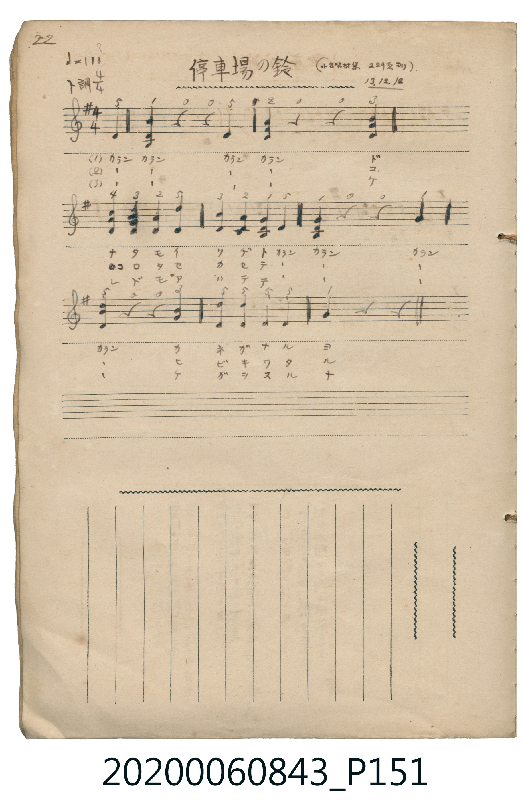

# 停車場の鈴

> Re:Shōka 使用 AI 協助辨識與重建樂譜，可能會有錯誤。歡迎[回報](https://github.com/TMDLang/reshoka/issues)。

- **鋼琴伴奏版**：<br><audio controls src="teishaba_no_suzu.mp3"></audio>
- **NEUTRINO 歌聲合成版**：<br><audio controls src="teishaba_no_suzu_neutrino.mp3"></audio>

- 日治時期公學校《唱歌帳》（典藏號 2020.006.0843・P151）
- 原載《小公唱材集》第 229 頁（大正 13 年 12 月 12 日抄）

## 說明


- 出處：《唱歌帳》（國立臺灣歷史博物館典藏號 2020.006.0843）第 P151.jpg 頁（手寫頁碼 22）。
- 標註：（小公唱材集 229 頁ヨリ）13.12.12.（大正 13 年 12 月 12 日抄錄）。
- 調性與拍號：ト調（G 大調，1♯），4/4 拍，速度 != 118，弱起拍（第 4 拍「カラン」起唱）。
- 背景與曲風：原譜以五線譜與簡譜對照抄錄，並在五線譜中標出三和弦，生動模擬火車站發車前搖鈴「カラン、カラン」清脆響聲，
提醒旅客排隊莫爭先、買好車票、莫忘隨身行李。
- 版本說明：本檔案為原頁歌唱主旋律之忠實數位化版本。
【原頁歌詞全文與中文語譯】（對應 P151.jpg）

### 編曲說明（鋼琴伴奏版）：

依據原譜五線譜所記之三和弦鈴聲位置（第 1 拍與第 4 拍強奏和弦），完整重現車站手搖鈴「カラン、カラン」音響效果。


## 歌詞

```text
（一）カラン　カラン　カラン　カラン
ドナタモイソゲト　カラン　カラン
カラン　カラン　カネガナルヨ
噹啷、噹啷、噹啷、噹啷，車站的鈴聲響起來囉！）

（二）カラン　カラン　カラン　カラン
コゝロヲセカセテ　カラン　カラン
カラン　カラン　ヒビキワタル
噹啷、噹啷、噹啷、噹啷，鈴聲響徹四周！）

（三）カラン　カラン　カラン　カラン
ケレドモアハテテ　カラン　カラン
カラン　カラン　ケガヲスルナ
噹啷、噹啷、噹啷、噹啷，小心別受傷或忘記東西囉！）
```

## ABC

<div class="abc-score" data-abc-src="teishaba_no_suzu.abc" aria-label="五線譜載入中"></div>

[下載 ABC 原始檔](teishaba_no_suzu.abc)

## TMD 檔案連結

- [主旋律 TMD 檔案](teishaba_no_suzu.tmd) [[在 TMD Studio 編輯](https://tmdlang.github.io/Tmd-TS/#tmd=s7IKdvYPcrWy4qpTUCpJTLdSSM7PyUlNLsnMz7MqzsjPTkzOyFeCS5bl55TmploBqXgDQ4RwcX5pUXJqfEFieqpVgKEphgzcpPi8_JLUpPz8bISKgqL8stS8xDygqtzEvNLi5KLMgpL45PyCSoSa1LLMlFSQitSUzJL8oszEHCQnpRYVgx0LcUNJUWIexAygIEIVUFN6Zp5VaR7IoJLMtMzUFGTJkoz89KLEgoxKq4zMYpANyYk58dmJeYkIRSUZqUCfpyRm5lTG52SmpSpxaWkpPG2c82J319MFWx43rnvZsUVBS4tL0VbB0NCCy95WwZ3LxkTfxA5kwrPpS59t2v1sZtOzOfOftq55unbHswULHzd0PZ2y8dnanqc7Nj9u6H6_p-Np644X0_tfzJyvYGRgZKBnYGCmZ2BhYvy4eTcoVN_v6QQ752nf_Bd7OkG6N_SDDAOaMXfCy9ltQDOer1mjYGRkqfByQSPIuCXLn61drGBorPB05xYFQyOFZ3M6wBTQNV0tYOO49LUUbKkFuBQUFB43THg2e9Pz2eterFr1bEbf44aJYNHm3U_bd72YOfX9nllYvD2n-_nq7hftu543Ln62dvvT_k1Pe2c971z5cskKHCECdDvIq6BQ0csqSIf691ln99P1q4Hs54v2AIMBqOhxQxPU-mcrZr5YsRtoPcg-1HCDhdjj5hWPm1cBdRka6xkagRDBMHzZAwpGhC0vVu1_1rD8RUf7s-5eoKNBvm3uAAoCDXJXABoFZvYYPpq5HqgNyAKmDwWgUiDrZcP8p7uWKUBSD5D_dM_GF1u3g-U6QF4Fq3vc0PO4afXj5pWPm4FB1wtUAPQEqgOae57NXA9ywOxNLxetADoAlFrWznmye-mTXVOeb58FZANln29YCGQ83dD7vHU5zBs9T3YsezpnBVzZkx1rgYEGjLYnOzqfTgI6aBlQzfMp8592T322YuGzyWueN64GJv7nq2c-n7kHlAs6e59NmAbMBaiubER28bMdrS9a2l7O3_-icRPQNJCjFRSe9U942Tbp2fTWp-sWPeub9HJW14u-1c871j5t7QBqf7Fp-9Ole0EWLV0B4vatfrp_xstZK17sWv1iYc-zucAkBvP8886OZ3PWQBIe0OdA9rNVU54t7HjetAsYCsAYBiW6KRuf7Nj9bHr3033dT3Z2P92_4On6Zc-m7niyt_dpzzSICSAToWkZru_FynlPW1c8m9YODD1QyAAZq-a9WLsemMDBKar3WXsnPD0CowRsAFDmyY4GUAQhwqCBIBvim87HzV2Pm_Y_bl70uGnJ46a9j5s2AdMSXj34DO593LQGZGIzkL0C6jaID0BpZObOp1O3A0MXF-P9nsanE1qAYQSJpRergQG3-uXueS8bNgHj_-lsUFqGRCYRRvVAU82sFmBiASYEUHLYuv3JvjawOcCMjAi8XT1kBV7T5sdNcx83r33cvOlx026QHJBsBhaQZARe86THzZMfNwHNWg-OjtVkBV7Tmif7m19MnP5k166nDROBXn-6v_lZw1ySgg0eWk_37Xw6e_bTicDsjRJaO4DBR05obXzcDEwbwAQHTGqLHjf3g4KKzNACmgVKZ8Bg3wlOal3khNaTvW1Pe5tfTFjzZEfvi2WNz1qBhc_WZ30rnk1eQFKAgcr5_c1PO5Y-7Z_-tGn7s45pwKLjxYoZz-ZufLF0PyK1AY2jvPKDAgUtfS6u4Py8dKuAzMS8fIcag5pqsIttTLTswAxgjYtUuM-CF-6IQFXQMI3XBBkEUl6jYACGpvEKNWABH8MahXgwRGiAyhjBZRq7HzcBk8JkmIwxNj0w52gACylNJBmQdUjq0GWaOxFuM4S7TcEIzDRGciVCH5rN6DKNK5F8gHA7mk8wZJB9R7xdEzF93twFVLUfSC8C0kvAevYC8SagSAe-kIDz4OFhAgwAIwVTIAtEG0JCBhFIiKBpXAXE84FGNAHpFrDn5gLxJCBegc_5WKIcFBCPm0DpB6R7NiSgwKzHjcvwBiBmInnc1AOODoi7msB61kPNAWKi3EUgWYH0NoNcuwYS8M0QkRVgeXhAwlMTMDCBMB45JA1wpzGgx0FOXgvEII8AA7kJLNLUAU3_uNPZJrDOzUAMclw_OHpAOrtRdWKmNVCKgtgHjoCZMDuBtsN01nJx6dopgIqFaB_DWAU42wiJbQxmK3MBAA)]
- [鋼琴伴奏 TMD 檔案](teishaba_no_suzu_piano.tmd) [[在 TMD Studio 編輯](https://tmdlang.github.io/Tmd-TS/#tmd=s7IKdvYPcrWy4qpTUCpJTLdSyC8qychPL0osyKi0ysgsLskvykxOzInPTsxLVIIrKs4vLUpOjS9ITE-1CjA0NUTIlGSk5qZapSRm5lTG52SmpSpxaWkpPG2c82J319MFWx43rnvZseX9no6X3XueT9jyZM-Wp0v7n3d2vN_TqaClxaVoq2BoaMFlb6vgzmVjom9iBzL22fSlzzbtfjaz6dmc-U9b1zxdu-PZgoWPG7qeTtn4bG3P0x2bHzd0A0182rrjxfT-FzPnKxgZGBnoGRiY6RlYmBg_bt4NciDQArAbn_bNf7GnE6R7Qz_IMKAZcye8nN0GNOP5mjUKRkaWCi8XNCpxcelrKdhSC3ApKCg8bpjwbPam57PXvVi16tmMvscNE8Gizbuftu96MXPq-z2zsHhpTvfz1d0v2nc9b1z8bO32p_2bnvbOet658uWSFTh8C_QmyBsgH-tlFaSD_PK4oQlq04tV-581LH_R0f6suxeoE2RlcwdQEGiTu8LTJcvBzB7DRzPXA40BsoARoABUCmS9bJj_dNcyBUj0IAx8vn0F0E8QD2GNU6AVIKUKCk_2zX02eRYo8NfOebJryvPts4CMZ50NL1bMeLKz-8mOzqeTep7uWQZMGy8aNz3Z2_t87zqggSCvGIKcAHQziA12ztM924HmQ9RD3Pl0Xc-zqVtetvc-798HTGbPV8981tn9bMI0oGmPG3oeN61-3LzycTMwTBuR2L0v529-OX__s6kdz-bNgXqJ8piGAgUtfS4uz7ySonyrgMzEvPwgD4cag5pqcFjYmGjZgRk1CgZgaBoPZBoimEZwJlctiik--E0B6Y02jEXmmSLxQIYF5-el43URhjOMgRohUiZAtpGCKZAFog3RnQ1VBdFlBGSZQiGKIhQ34PAPdj-ARGGWgMRAfBgN0QPjYQkJJH1gs4A00IFAGRALRqPrAbrVNS8lk6gQM8BUT8B3UB26dgrgGFYAMkAhg42GmApiKXMBAA)]

## 分析

```text
================================================================================
📊 TMD Song Profile: [ 停車場の鈴 ]
================================================================================
⏱  Duration:       0:54 (54.9s), 27 measures total
🎼 Key & Tempo:    首調基準 G, != 118.0 BPM, <4/4>
   - 分析範圍：      由實際發聲的音符與和弦推測調性；播放脈絡另行呈現
🎤 人聲音域:    D4 (MIDI 62) – D5 (MIDI 74) [跨度: 12 個半音 / 1.0 個八度, 難度: easy]
   - 最低音:  D4 in [Song[L1] #1 @ m.1, 0:01]
   - 最高音: D5 in [Song[L1] #1 @ m.4, 0:07]
   - 適合: soprano, mezzo-soprano, contralto, tenor, baritone, bass
🏛  結構:      Song[L1] (18.3s) -> Song[L2] (18.3s) -> Song[L3] (18.3s)
⚡ 編曲密度:        Peak 1 軌道同時演奏
🗝  調性診斷：       D 大調（純淨自然大調，未偵測到可信轉調）
   - 風格氣質:    純淨自然大調（陽光明朗、易唱易記，無明顯調外色彩）
   - 轉調歷程:    全曲維持單一推測調性（未偵測到可信轉調）
   - 核心骨幹音:  D, G, A, B, C
   - 調性數值:    D 大調 [相關度: 0.83, 穩定度: Moderate, 自然音純度: 95.5%]
   - 候選調性 (K-S): D 大調 (0.83), G 大調 (0.75), B 小調 (0.64)
   - 五度圈歷程:   +2 -> +2 -> +2
   - 各段落調性細節:
     • [Song[L1] #1]: D 大調 (r: 0.83, 自然音純度: 95.5%, 調外音: C)
     • [Song[L2] #1]: D 大調 (r: 0.83, 自然音純度: 95.5%, 調外音: C)
     • [Song[L3] #1]: D 大調 (r: 0.83, 自然音純度: 95.5%, 調外音: C)

  [ 五度圈游移軌跡 ]
               C  
         F            G  
      Bb              [D ]*
      Eb               A  
         Ab           E  
            Db       B  
               F# 
     (* = active key center)

  [ 十二半音累積音高分佈 ]
     C  : ███                        4.5%
     C# :                            0.0%
     D  : ████████████████████████  40.9%
     D# :                            0.0%
     E  :                            0.0%
     F  :                            0.0%
     F# :                            0.0%
     G  : ███████████               18.2%
     G# :                            0.0%
     A  : ███████████               18.2%
     A# :                            0.0%
     B  : ███████████               18.2%
--------------------------------------------------------------------------------
Assignment 軌道音域：
  - Piano         : D4 – D5 (12 個半音 / 1.0 個八度, 66 個音符)
================================================================================
```


## 原書掃描頁




