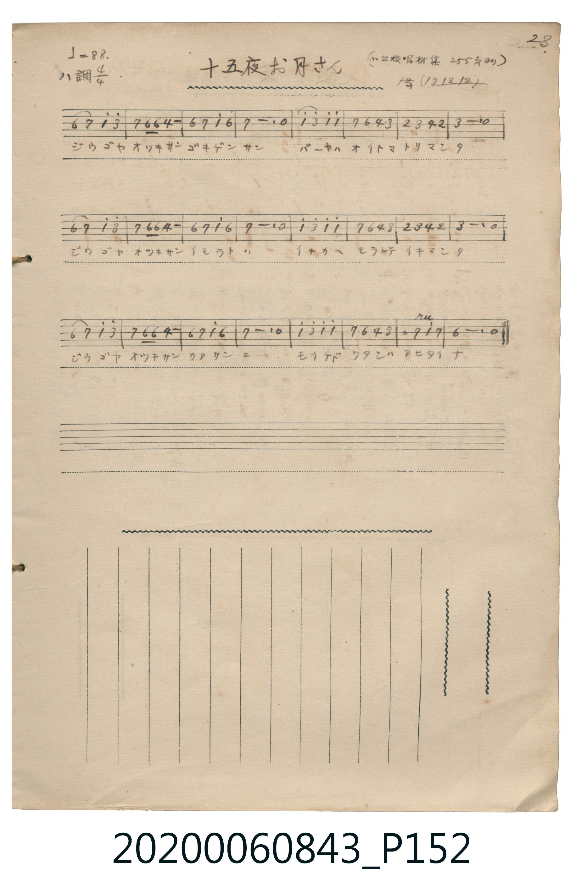

# 十五夜お月さん

<audio controls src="jugoya_otsukisan.mp3"></audio>

- 詞：野口雨情
- 曲：本居長世
- 日治時期公學校《唱歌帳》（典藏號 2020.006.0843・P152）

## 說明

【曲目說明】
・出處：《唱歌帳》（國立臺灣歷史博物館典藏號 2020.006.0843）第 P152.jpg 頁（手寫頁碼 23）。
・標註：（小公校唱材集 255 頁ヨリ）13.12.12（大正 13 年 12 月 12 日抄錄）。
・作詞／作曲：野口雨情 作詞、本居長世 作曲（大正 9 年〔1920〕發表之日本近代代表童謠）。
・調性與拍號：ハ調・イ短調（A minor，都節五聲小調），4/4 拍，速度 != 88。
・背景與曲風：全曲 24 小節（三行各 8 小節對應三段歌詞），孩童向十五夜的圓月訴說奶媽被遣返、
妹妹被送往鄉下領養、思念母親的哀愁，第 23 小節 `1^` 上方標有顫音記號（tr）。
・版本說明：本檔案為原頁單聲部簡譜之忠實數位化版本。

・編曲說明（鋼琴伴奏版）：
1. 前奏 (Intro, 4 小節)：以全曲末句「モイチドワタシハ アヒタイナ」帶出靜謐淒美之月夜思念。
2. 主歌伴奏 (Song, 24 小節)：右手演奏主旋律，左手配以本居長世風格之柔和分解和弦伴奏。

## 跨冊／重複收錄參照

> 同名異曲（各冊收錄之不同詞曲版本）

- **[同名異曲]** 《新定兒童唱歌》尋常科第二學年用（2020.006.0847.0002）：[**〈十五ヤ〉**](../../../shintei_jido_shoka/grade_2_2020.006.0847.0002/2_02_jugoya/index.md)（`G` / `2/4` — [原始 TMD](../../../shintei_jido_shoka/grade_2_2020.006.0847.0002/2_02_jugoya/jugoya.tmd)）
- 總表：[跨冊重複與同名歌曲總索引](../../../duplicate_songs.md)

## 歌詞

```text
【原頁歌詞全文與中文語譯】（對應 P152.jpg）

ジウゴヤオツキサン　ゴキゲンサン
バーヤハオイトマ　トリマシタ

ジウゴヤオツキサン　イモウトハ
イナカヘモラレテ　イキマシタ

ジウゴヤオツキサン　カアサンニ
モイチドワタシハ　アヒタイナ
十五夜的月亮呀，小妹妹已經被送到鄉下讓人領養去了。
十五夜的月亮呀，我好想再見媽媽一面啊。）
```

## ABC

```abc
X:1
T:十五夜お月さん
C:曲：本居長世
M:4/4
L:1/16
Q:1/4=88
K:Am
V:V1 name="Piano" snm="Pia"
[V:V1]
A4 B4 c4 e4 | B4 A2 A2 F8 | A4 B4 c4 A4 | B12 z4 |
c4 e4 c4 c4 | B4 A4 F4 E4 | D4 E4 F4 D4 | E12 z4 |
A4 B4 c4 e4 | B4 A2 A2 F8 | A4 B4 c4 A4 | B12 z4 |
c4 e4 c4 c4 | B4 A4 F4 E4 | D4 E4 F4 D4 | E12 z4 |
A4 B4 c4 e4 | B4 A2 A2 F8 | A4 B4 c4 A4 | B12 z4 |
c4 e4 c4 c4 | B4 A4 F4 E4 | A4 B4 c4 B4 | A12 z4 |
```

## TMD 檔案連結

- [主旋律 TMD 檔案](jugoya_otsukisan.tmd) [[在 TMD Studio 編輯](https://tmdlang.github.io/Tmd-TS/#tmd=s7IKdvYPcrWy4tLSUnja2_hk15SnS-Y8bux6NqfjcePUx02TFbS0uBRtFSwsuOxtFZy5slMrbRUcc7lsTPRN7LjqFJRerJz3fs-sl-19T_sXv5y94llzqxJI-NnsTUDhZ3PWPN3Y-nLq9ic7pkGEpy99tmn3s5lNz-bMf9q65unaHc8WLHzc0PV0ysZna3ue7tj8uKH7_Z6Op607XkzvfzFzvoKRgZGBnoGBmZ6BhYnx4-bdAYamRu_3dCpxcelrKdhSC3ApKCg8bpgAdPTz2eterFr1bEbf44aJYNHm3U_bd72YORXoGyzunNP9fHX3i_ZdzxsXP1u7_Wn_pqe9s553rny5ZAUOLwDd_nzNGgWQN_SyCtIVXi5oBJrzrLP76frVQPbzRXsUjECKHjc0Qa1_tmLmixW7gdaD7NvQDww1YJCB3DF3wsvZbQpGpqYgQx43r3jcvAqo0dBYz9AIiECqlyx_tnaxgqGxwtOdWxQMjRSAkQqmgJHQ1fKypwXFnid754Djsh_IgMQecqQqQKQfNzQixylIFKwWZpclyKrHDVMMLY0MHjdMfT5zz4uFK57s7AZZOWfNi_0Tn-xeDERAweerl75YswDFBS9W7X_WsPxFR_uz7l5gwIFCvLkfKAiUety05Pn8tUA20CpHhdzMvPyi93t6Xjbvfb6-AZhmXzRuAgYNWLoTKA5MmwpAM0AqGuY_3bVMAZyAkSxq7nk2cz3IotmbXi5aAbToaesKIFvByEQBaA7QTKA1T3Z0vljY83RCi4IFVPDpht5n7Z1A8WfrtgJTATi0QNY9XbsS6JunEybCM9DzWS1P50wGBveLFVuAyenp0m1PV-19sWj1y8bFL_ZPAQYiyCEKCk-X7QQikHhD49N9DS9bgIZ3v1ww4-WSLlBAN8x9un_rs_W9L5atAhk4ueFZCzCx9IDSjxEwTsFuUkgwjEtQeLKj69m0ncCU8mxO58uFq1_O3_xixQxwEHaUAAMKKYyfd3aAIgKcxCEZ9NmqKc8Wdjxv2vW0bz4wIT2dtg4Ymi-bVzzfsPDF2jnAuHu6f8HT9cueTd3xZG_v055pEBNAJkJzDUQfJEBA4TitHRiyT3asBTFWzXuxdj0wK4HTLij04Ckf6CqIAU07Hjcte9y05XHzksdNqx43tzxuWvu4aevjZmAeawCJg7ibQFywIMQfEx437wFpaO4H6WkCMjoeNwNTZwOYATRl3uOm7Y-b9hNlBVD3IpACkNZ-iAagUNfjptWPm2eA5JpXPm5e87i5DaoaqJkk81c_bgKaD-Y2d0PcD-QDrQDm2s7HzeuB5oBMA_oFpBpo3SSwCMgNINXAsIOEIyidIqUwYPJ6smvd04nAxNrzrGnF06V7n04Hxul8SGp7un3T822TX-xbC0zEL2cvejmt-8kuoAfA6QCY8nCYAypgwIkSqh2SNDs2QJLmi3WTn-zaBUmgT_t2E2Pgs46JQIc9a978tA2YjrtBDlu198mOhpdzFz2dCkzlTaB0ANRPeRkOBQpa-lxcwfl56VYBmYl5-Q41BjUK1WA32lho2YEZwJoDGGVAvAyItwBjY4lCDZC1CshqBtJrgRgUWWBBoDRYYBNQEiICkwKnQbBmYMzBDGgC8TqAeB5YCYgFMnYeUGY7WM1-kPtAjqhRMFPQVTAHYsM4IGEMImrAfDMgNAHSIIimCsSBKIJBA7AIwggwC0zADNMFG2YMFjGCskAiIHYNmIdiFjhF4wuiFvQgAnl5EUQp0MMgb0OCAyTeBaRXA-kZYHGgquaVQLwGiNtgakCGDe8AAgZAEyiA4CmnGxYa4DBqBOJOsMh6sP9BIQELQ1CITYKKgm0AhuhAhg-KYSAGRAg1gGq5uHTtFEB5UAFIK3MBAA)]
- [鋼琴伴奏 TMD 檔案](jugoya_otsukisan_piano.tmd) [[在 TMD Studio 編輯](https://tmdlang.github.io/Tmd-TS/#tmd=s7IKdvYPcrWy4tLSUnja2_hk15SnS-Y8bux6NqfjcePUx02T3-_peNm95_mELU_2bHm6tP95Z8f7PZ0KWlpcirYKFhZc9rYKzlzZqZW2Co65XDYm-iZ2XHUKSi9Wznu_Z9bL9r6n_Ytfzl7xrLlVCST8bPYmoPCzOWuebmx9OXX7kx3TIMLTlz7btPvZzKZnc-Y_bV3zdO2OZwsWPm7oejpl47O1PU93bH7c0A10xtPWHS-m97-YOV_ByMDIQM_AwEzPwMLE-HHz7gBDUyOgq5S4uPS1FGypBbgUFBQeN0wAOvr57HUvVq16NqPvccNEsGjz7qftu17MnAr0DRZ3zul-vrr7Rfuu542Ln63d_rR_09PeWc87V75csgKHF4Buf75mjQLIG3pZBekKLxc0Pm5ogtr0ZO8ccHD2AxmQAEQOVwWI9OOGRuRgBYkC1SIMebFq_7OG5S862p919wKtB7m7uR8oCJR63LTk-fy1QDbQ6Y4KuZl5-UVA97zf0wOMTAWgciDrZcP8p7uWKYBjHGHm8-0rgHZAAgZrKgHaAlKqoGCop_C0sxcorqDhmVdSlK-jYKLwdEP_8_UNmkA1T3YvfdoKMurZnNVP-5c-buh53LwI6KrHzY2PmzsfN69_3LT_cdN2oIMVHjctetw8CcwHSnc9buh9umMbMCpezp3zYs2EZ9snPd_X92RnNzDxAlPxs4a5T_dvhbpXQcFIT-HJjt3AiII4UUEjOD8vXUfBCNkpT_s3P-vsfrZnClABSPH07qf7gFHa83T7MqD4y9ZeoFuRw_nlohXPFuwB2Th_ytNJPU872l4sXwxi7FkGsQVqO-WJEQoUtPS5uMBhaBWQmZiXH-ThUGNQo1AN9qKNhZYdmFGjYBinoKtgDCLALDBRo2AOJM2A2AQkCRYB8UCiYAUgBkQIBg1AIly1KFb6oFhpArfSLF4h2iw3Fk7XKJgAWSaxCsZAyhgsAJPCFAHSBhCbQLGC328obgb7EeYzM7DPQBBNFYgDUYTiM6KDyQjKAomA2DVgHmoojTqOkgSGiHaS0xeUwqYCltCANDB5EZNEjYAsIyALRqObMXIdQ0zm1bVTAJcUCkAGKEZBtDIXAA)]

## 分析

```text
================================================================================
📊 TMD Song Profile: [ 十五夜お月さん ]
================================================================================
⏱  Duration:       1:05 (65.5s), 24 measures total
🎼 Key & Tempo:    首調基準 C, != 88.0 BPM, <4/4>
   - 分析範圍：      由實際發聲的音符與和弦推測調性；播放脈絡另行呈現
🎤 人聲音域:    D4 (MIDI 62) – E5 (MIDI 76) [跨度: 14 個半音 / 1.2 個八度, 難度: moderate]
   - 最低音:  D4 in [Song #1 @ m.7, 0:16]
   - 最高音: E5 in [Song #1 @ m.1, 0:02]
   - 適合: soprano, mezzo-soprano, contralto, tenor, baritone, bass
🏛  結構:      Song (65.5s)
⚡ 編曲密度:        Peak 1 軌道同時演奏
🗝  調性診斷：       A 小調（純淨自然小調，未偵測到可信轉調）
   - 風格氣質:    純淨自然小調（陰鬱抒情、旋律集中，無明顯調外色彩）
   - 轉調歷程:    全曲維持單一推測調性（未偵測到可信轉調）
   - 核心骨幹音:  B, A, E, C, F
   - 調性數值:    A 小調 [相關度: 0.77, 穩定度: High, 自然音純度: 100.0%]
   - 候選調性 (K-S): A 小調 (0.77), E 大調 (0.48), E 小調 (0.47)
   - 五度圈歷程:   +3
   - 各段落調性細節:
     • [Song #1]: A 小調 (r: 0.77, 自然音純度: 100.0%)

  [ 五度圈游移軌跡 ]
               C  
         F            G  
      Bb               D  
      Eb              [A ]*
         Ab           E  
            Db       B  
               F# 
     (* = active key center)

  [ 十二半音累積音高分佈 ]
     C  : █████████████████         17.8%
     C# :                            0.0%
     D  : ████                       4.4%
     D# :                            0.0%
     E  : ██████████████████        18.9%
     F  : ███████████               12.2%
     F# :                            0.0%
     G  :                            0.0%
     G# :                            0.0%
     A  : ████████████████████      21.1%
     A# :                            0.0%
     B  : ████████████████████████  25.6%
--------------------------------------------------------------------------------
Assignment 軌道音域：
  - Piano         : D4 – E5 (14 個半音 / 1.2 個八度, 78 個音符)
================================================================================
```


## 原書掃描頁




