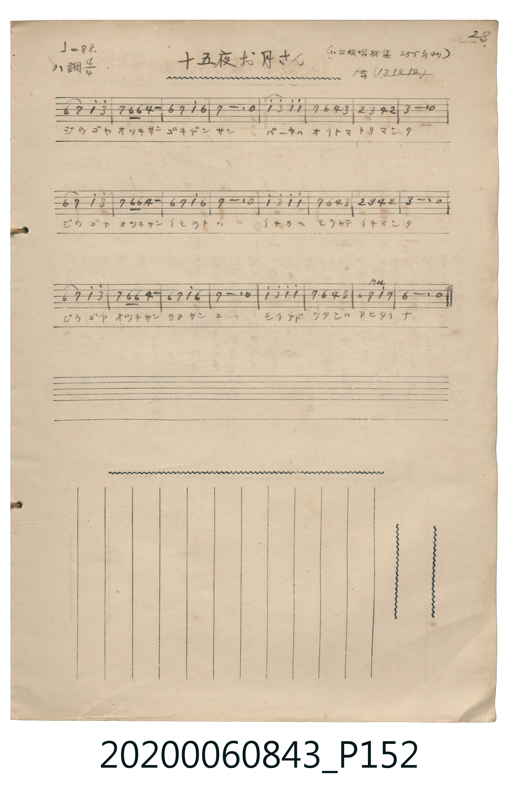

# 十五夜お月さん

> Re:Shōka 使用 AI 協助辨識與重建樂譜，可能會有錯誤。歡迎回報。

- **鋼琴伴奏版**：<br><audio controls src="jugoya_otsukisan.mp3"></audio>

- 詞：野口雨情
- 曲：本居長世
- 日治時期公學校《唱歌帳》（典藏號 2020.006.0843・P152）

## 說明


- 出處：《唱歌帳》（國立臺灣歷史博物館典藏號 2020.006.0843）第 P152.jpg 頁（手寫頁碼 23）。
- 標註：（小公校唱材集 255 頁ヨリ）13.12.12（大正 13 年 12 月 12 日抄錄）。
- 作詞／作曲：野口雨情 作詞、本居長世 作曲（大正 9 年〔1920〕發表之日本近代代表童謠）。
- 調性與拍號：ハ調- イ短調（A minor，都節五聲小調），4/4 拍，速度 != 88。
- 背景與曲風：全曲 24 小節（三行各 8 小節對應三段歌詞），孩童向十五夜的圓月訴說奶媽被遣返、
妹妹被送往鄉下領養、思念母親的哀愁，第 23 小節 `1^` 上方標有顫音記號（tr）。
- 版本說明：本檔案為原頁單聲部簡譜之忠實數位化版本。

### 編曲說明（鋼琴伴奏版）：

1. 前奏 (Intro, 4 小節)：以全曲末句「モイチドワタシハ アヒタイナ」帶出靜謐淒美之月夜思念。
2. 主歌伴奏 (Song, 24 小節)：右手演奏主旋律，左手配以本居長世風格之柔和分解和弦伴奏。


## 歌詞

```text
【原頁歌詞全文與中文語譯】（對應 P152.jpg）

ジウゴヤオツキサン　ゴキゲンサン
バーヤハオイトマ　トリマシタ

ジウゴヤオツキサン　イモウトハ
イナカヘモラレテ　イキマシタ

ジウゴヤオツキサン　カアサンニ
モイチドワタシハ　アヒタイナ
十五夜的月亮呀，小妹妹已經被送到鄉下讓人領養去了。
十五夜的月亮呀，我好想再見媽媽一面啊。）
```

## ABC

<div class="abc-score" data-abc-src="jugoya_otsukisan.abc" aria-label="五線譜載入中"></div>

[下載 ABC 原始檔](jugoya_otsukisan.abc)

## TMD 檔案連結

- [主旋律 TMD 檔案](jugoya_otsukisan.tmd) [[在 TMD Studio 編輯](https://tmdlang.github.io/Tmd-TS/#tmd=s7IKdvYPcrWy4qpTUCpJTLdSSM7PyUlNLsnMz7MqzsjPTkzOyFeCS5bl55TmploBqXgDQ4RwcX5pUXJqfEFieqpVgKGpEboM3KT4vPyS1KT8_GyEioKi_LLUvMQ8oKrcxLzS4uSizIKS-OT8gkqEmtSyzJRUkIrUlMyS_KLMxBwkJ6UWFYMdC3FDSVFiHsQMoCBCVUlGKtDdxamJxfl5xQhhoFnpmXlWJYmZQBfGA3F5YnxuYmZeTmJeCrKqkoz89KLEgoxKq4zMYpALkhNz4rMT8xKVuLS0FJ72Nj7ZNeXpkjmPG7uezel43Dj1cdNkBS0tLkVbBQsLLntbBWeu7NRKWwXHXC4bE30TO5DJL1bOe79n1sv2vqf9i1_OXvGsuRVs4bPZm4DCz-asebqx9eXU7U92TIMIT1_6bNPuZzObns2Z_7R1zdO1O54tWPi4oevplI3P1vY83bH5cUP3-z0dT1t3vJje_2LmfAUjAyMDPQMDMz0DCxPjx827QdHyfk-nEheXvpaCLbUAl4KCwuOGCUBHP5-97sWqVc9m9D1umAgWbd79tH3Xi5lTgb7B4s453c9Xd79o3_W8cfGztduf9m962jvreefKl0tW4PAC0O3P16xRAHlDL6sgXeHlgkagOc86u5-uXw1kP1-0R8EIpOhxQxPU-mcrZr5YsRtoPci-Df3AUAMGGcgdcye8nN2mYGRqCjLkcfOKx82rgBoNjfUMjYAIpHrJ8mdrFysYGis83blFwdBIARipYAoYCV0tL3taUOx5sncOOC77gQxI7CFHqgJE-nFDI3KcgkTBamF2WYKsetwwxdDSyOBxw9TnM_e8WLjiyc5ukJVz1rzYP_HJ7sVABBR8vnrpizULUFzwYtX-Zw3LX3S0P-vuBQYcKMSb-4GCQKnHTUuez18LZAOtclTIzczLL3q_p-dl897n6xuAafZF4yZg0IClO4HiwLSpADQDpKJh_tNdyxTACRjJouaeZzPXgyyavenlohVAi562rgCyFYxMFIDmAM0EWvNkR-eLhT1PJ7QoWEAFn27ofdbeCRR_tm4rMBWAQwtk3dO1K4G-eTphIjwDPZ_V8nTOZGBwv1ixBZicni7d9nTV3heLVr9sXPxi_xRgIIIcoqDwdNlOIAKJNzQ-3dfwsgVoePfLBTNeLukCBXTD3Kf7tz5b3_ti2SqQgZMbnrUAE0sPKP0YAeMU7CaFBMO4BIUnO7qeTdsJTCnP5nS-XLj65fzNL1bMAAdhRwkwoJDC-HlnBygiwEkckkGfrZrybGHH86ZdT_vmAxPS02nrgKH5snnF8w0LX6ydA4y7p_sXPF2_7NnUHU_29j7tmQYxAWQiNNdA9EECBBSO09qBIftkx1oQY9W8F2vXA7MSOO2CQg-e8oGughjQtONx07LHTVseNy953LTqcXPL46a1j5u2Pm4G5rEGkDiIuwnEBQtC_DHhcfMekIbmfpCeJiCj43EzMHU2gBlAU-Y9btr-uGk_UVYAdS8CKQBp7YdoAAp1PW5a_bh5BkiueeXj5jWPm9ugqoGaSTJ_9eMmoPlgbnM3xP1APtAKYK7tfNy8HmgOyDSgX0CqgdZNAouA3ABSDQw7SDiC0ilSCgMmrye71j2dCEysPc-aVjxduvfpdGCczoektqfbNz3fNvnFvrXARPxy9qKX07qf7AJ6AJwOgCkPhzmgAgacKKHaIUmzYwMkab5YN_nJrl2QBPq0bzcxBj7rmAh02LPmzU_bgOm4G-SwVXuf7Gh4OXfR06nAVN4ESgdA_ZSX4VCgoKXPxRWcn5duFZCZmJfvUGNQUw12oo2Flh2YAaw4gDEGxMuAeAswMpYo1ABZq4CsZiC9FohBcQUWBEqDBTYBJSEiMClwEgRrBkYczIAmEK8DiOeBlYBYIGPnAWW2g9XsBzkP5IgaBTMFXQVzIDaMAxLGIKIGzDcDQhMgDYJoqkAciCIYNACLIIwAs8AEzDBdsGHGYBEjKAskAmLXgHkoZoETNL4gakEPIpCXF0GUAj0M8jYkOEDiXUB6NZCeARYHqmpeCcRrgLgNpgZk2PAOIGAANIECCJ5yumGhAQ6jRiDuBIusB_sfFBKwMASF2CSoKNgGYIgOZPigGAZiQIRQA6iWi0vXTgGUBRWAtDIXAA)]
- [鋼琴伴奏 TMD 檔案](jugoya_otsukisan_piano.tmd) [[在 TMD Studio 編輯](https://tmdlang.github.io/Tmd-TS/#tmd=s7IKdvYPcrWy4qpTUCpJTLdSyC8qychPL0osyKi0ysgsLskvykxOzInPTsxLVIIrKs4vLUpOjS9ITE-1CjA0NULIlGSk5qZaJRaXFOXn5edWKnFpaSk87W18smvK0yVzHjd2PZvT8bhx6uOmye_3dLzs3vN8wpYne7Y8Xdr_vLPj_Z5OBS0tLkVbBQsLLntbBWeu7NRKWwXHXC4bE30TO5AVL1bOe79n1sv2vqf9i1_OXvGsuRVs87PZm4DCz-asebqx9eXU7U92TIMIT1_6bNPuZzObns2Z_7R1zdO1O54tWPi4oevplI3P1vY83bH5cUM30BlPW3e8mN7_YuZ8BSMDIwM9AwMzPQMLE-PHzbtBXgO6SomLS19LwZZagEtBQeFxwwSgo5_PXvdi1apnM_oeN0wEizbvftq-68XMqUDfYHHnnO7nq7tftO963rj42drtT_s3Pe2d9bxz5cslK3B4Aej252vWKIC8oZdVkK7wckHj44YmqE1P9s4BB2c_kAEJQORwVYBIP25oRA5WkChQLcKQF6v2P2tY_qKj_Vl3L9B6kLub-4GCQKnHTUuez18LZAOd7qiQm5mXXwR0z_s9PcDIVAAqB7JeNsx_umuZAjjGEWY-374CaAckYLCmEqAtIKUKCoZ6Ck87e4HiChqeecAUp6NgovB0Q__z9Q2aQDVPdi992goy6tmc1U_7lz5u6HncvAjoqsfNjY-bOx83r3_ctP9x03aggxUeNy163DwJzAdKdz1u6H26YxswKl7OnfNizYRn2yc939f3ZGc3MPECU_GzhrlP92-FuldBwUhP4cmO3cCIgjhRQSM4Py9dR8EI2SlP-zc_6-x-tmcKUAFI8fTup_uAUdrzdPsyoPjL1l6gW5HD-eWiFc8W7AHZOH_K00k9TzvaXixfDGLsWQaxBWo75YkRChS09Lm4wGFoFZCZmJcf5OFQY1BTDfahjYmWHZhRo2AYp2AcByKBqEbBXMEMGODGQJYZkA0UMgczdYHQQKGGqxbFRB_sJprFK0Sb5cbC6RoFEyDLJFbBGEgZgwVgUpgiQBpqESjMsbjcAmEP0FHmQAx0pS7ID7pg9-sCxUF-ADkZJIKiCsSBKIJBA7AIwggwC0zADNMFG2YMFjGCskAiIHYNmIdi1qjjsDoOxTAQA5askF2HEuukpi4ohU0FLJkBaWDiIiaBGgFZRkAWjEY3Y-Q6hpisq2unAC4mFIAMUISCaGUuAA)]

## 分析

```text
================================================================================
📊 TMD Song Profile: [ 十五夜お月さん ]
================================================================================
⏱  Duration:       1:05 (65.5s), 24 measures total
🎼 Key & Tempo:    首調基準 C, != 88.0 BPM, <4/4>
   - 分析範圍：      由實際發聲的音符與和弦推測調性；播放脈絡另行呈現
🎤 人聲音域:    D4 (MIDI 62) – E5 (MIDI 76) [跨度: 14 個半音 / 1.2 個八度, 難度: moderate]
   - 最低音:  D4 in [Song #1 @ m.7, 0:16]
   - 最高音: E5 in [Song #1 @ m.1, 0:02]
   - 適合: soprano, mezzo-soprano, contralto, tenor, baritone, bass
🏛  結構:      Song (65.5s)
⚡ 編曲密度:        Peak 1 軌道同時演奏
🗝  調性診斷：       A 小調（純淨自然小調，未偵測到可信轉調）
   - 風格氣質:    純淨自然小調（陰鬱抒情、旋律集中，無明顯調外色彩）
   - 轉調歷程:    全曲維持單一推測調性（未偵測到可信轉調）
   - 核心骨幹音:  B, A, E, C, F
   - 調性數值:    A 小調 [相關度: 0.77, 穩定度: High, 自然音純度: 100.0%]
   - 候選調性 (K-S): A 小調 (0.77), E 大調 (0.48), E 小調 (0.47)
   - 五度圈歷程:   +3
   - 各段落調性細節:
     • [Song #1]: A 小調 (r: 0.77, 自然音純度: 100.0%)

  [ 五度圈游移軌跡 ]
               C  
         F            G  
      Bb               D  
      Eb              [A ]*
         Ab           E  
            Db       B  
               F# 
     (* = active key center)

  [ 十二半音累積音高分佈 ]
     C  : █████████████████         17.8%
     C# :                            0.0%
     D  : ████                       4.4%
     D# :                            0.0%
     E  : ██████████████████        18.9%
     F  : ███████████               12.2%
     F# :                            0.0%
     G  :                            0.0%
     G# :                            0.0%
     A  : ████████████████████      21.1%
     A# :                            0.0%
     B  : ████████████████████████  25.6%
--------------------------------------------------------------------------------
Assignment 軌道音域：
  - Piano         : D4 – E5 (14 個半音 / 1.2 個八度, 78 個音符)
================================================================================
```


## 原書掃描頁




