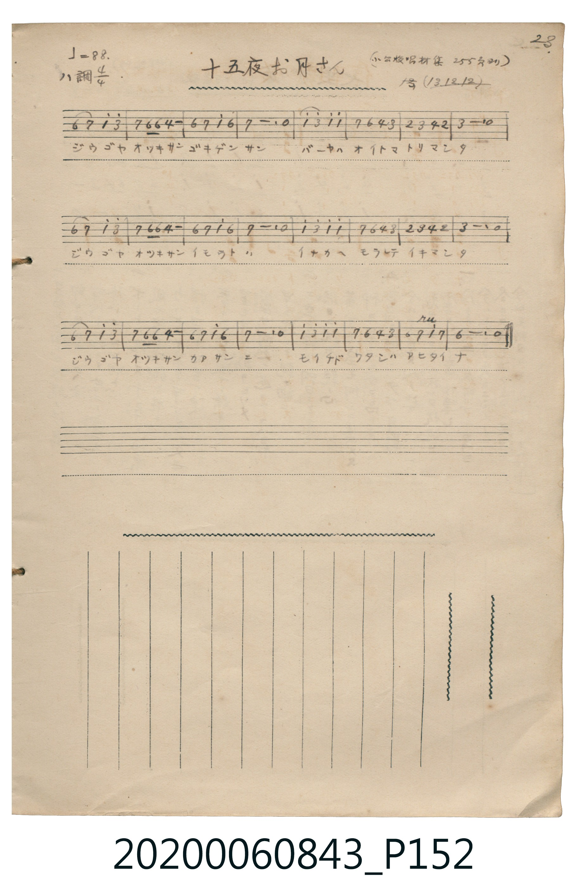

# 十五夜お月さん

> Re:Shōka 使用 AI 協助辨識與重建樂譜，可能會有錯誤。歡迎回報。

- **鋼琴伴奏版**：<br><audio controls src="jugoya_otsukisan.mp3"></audio>

- 詞：野口雨情
- 曲：本居長世
- 日治時期公學校《唱歌帳》（典藏號 2020.006.0843・P152）

## 說明


- 出處：《唱歌帳》（國立臺灣歷史博物館典藏號 2020.006.0843）第 P152.jpg 頁（手寫頁碼 23）。
- 標註：（小公校唱材集 255 頁ヨリ）13.12.12（大正 13 年 12 月 12 日抄錄）。
- 作詞／作曲：野口雨情 作詞、本居長世 作曲（大正 9 年〔1920〕發表之日本近代代表童謠）。
- 調性與拍號：ハ調- イ短調（A minor，都節五聲小調），4/4 拍，速度 != 88。
- 背景與曲風：全曲 24 小節（三行各 8 小節對應三段歌詞），孩童向十五夜的圓月訴說奶媽被遣返、
妹妹被送往鄉下領養、思念母親的哀愁，第 23 小節 `1^` 上方標有顫音記號（tr）。
- 版本說明：本檔案為原頁單聲部簡譜之忠實數位化版本。

### 編曲說明（鋼琴伴奏版）：

1. 前奏 (Intro, 4 小節)：以全曲末句「モイチドワタシハ アヒタイナ」帶出靜謐淒美之月夜思念。
2. 主歌伴奏 (Song, 24 小節)：右手演奏主旋律，左手配以本居長世風格之柔和分解和弦伴奏。


## 歌詞

```text
【原頁歌詞全文與中文語譯】（對應 P152.jpg）

ジウゴヤオツキサン　ゴキゲンサン
バーヤハオイトマ　トリマシタ

ジウゴヤオツキサン　イモウトハ
イナカヘモラレテ　イキマシタ

ジウゴヤオツキサン　カアサンニ
モイチドワタシハ　アヒタイナ
十五夜的月亮呀，小妹妹已經被送到鄉下讓人領養去了。
十五夜的月亮呀，我好想再見媽媽一面啊。）
```

## ABC

<div class="abc-score" data-abc-src="jugoya_otsukisan.abc" aria-label="五線譜載入中"></div>

[下載 ABC 原始檔](jugoya_otsukisan.abc)

## TMD 檔案連結

- [主旋律 TMD 檔案](jugoya_otsukisan.tmd) [[在 TMD Studio 編輯](https://tmdlang.github.io/Tmd-TS/#tmd=s7IKdvYPcrWy4qpTUCpJTLdSSM7PyUlNLsnMz7MqzsjPTkzOyFeCS5bl55TmploBqXgDQ4RwcX5pUXJqfEFieqpVgKGpEboM3KT4vPyS1KT8_GyEioKi_LLUvMQ8oKrcxLzS4uSizIKS-OT8gkqEmtSyzJRUkIrUlMyS_KLMxBwkJ6UWFYMdC3FDSVFiHsQMoCBCVUlGKtDdxamJxfl5xQhhoFnpmXlWJYmZQBfGA3F5YnxuYmZeTmJeihKXlpbC097GJ7umPF0y53Fj17M5HY8bpz5umqygpcWlaKtgYcFlb6vgzJWdWmmr4JjLZWOib2IHMvrFynnv98x62d73tH_xy9krnjW3gm18NnsTUPjZnDVPN7a-nLr9yY5pEOHpS59t2v1sZtOzOfOftq55unbHswULHzd0PZ2y8dnanqc7Nj9u6H6_p-Np644X0_tfzJyvYGRgZKBnYGCmZ2BhYvy4eTcoxN_v6VTi4tLXUrClFuBSUFB43DAB6Ojns9e9WLXq2Yy-xw0TwaLNu5-273oxcyrQN1jcOaf7-eruF-27njcufrZ2-9P-TU97Zz3vXPlyyQocXgC6_fmaNQogb-hlFaQrvFzQCDTnWWf30_Wrgezni_YoGIEUPW5oglr_bMXMFyt2A60H2behHxhqwCADuWPuhJez2xSMTE1BhjxuXvG4eRVQo6GxnqEREIFUL1n-bO1iBUNjhac7tygYGikAIxVMASOhq-VlTwuKPU_2zgHHZT-QAYk95EhVgEg_bmhEjlOQKFgtzC5LkFWPG6YYWhoZPG6Y-nzmnhcLVzzZ2Q2ycs6aF_snPtm9GIiAgs9XL32xZgGKC16s2v-sYfmLjvZn3b3AgAOFeHM_UBAo9bhpyfP5a4FsoFWOCrmZeflF7_f0vGze-3x9AzDNvmjcBAwasHQnUByYNhWAZoBUNMx_umuZAjgBI1nU3PNs5nqQRbM3vVy0AmjR09YVQLaCkYkC0BygmUBrnuzofLGw5-mEFgULqODTDb3P2juB4s_WbQWmAnBogax7unYl0DdPJ0yEZ6Dns1qezpkMDO4XK7YAk9PTpduertr7YtHql42LX-yfAgxEkEMUFJ4u2wlEIPGGxqf7Gl62AA3vfrlgxsslXaCAbpj7dP_WZ-t7XyxbBTJwcsOzFmBi6QGlHyNgnILdpJBgGJeg8GRH17NpO4Ep5dmczpcLV7-cv_nFihngIOwoAQYUUhg_7-wARQQ4iUMy6LNVU54t7HjetOtp33xgQno6bR0wNF82r3i-YeGLtXOAcfd0_4Kn65c9m7rjyd7epz3TICaATITmGog-SICAwnFaOzBkn-xYC2Ksmvdi7XpgVgKnXVDowVM-0FUQA5p2PG5a9rhpy-PmJY-bVj1ubnnctPZx09bHzcA81gASB3E3gbhgQYg_Jjxu3gPS0NwP0tMEZHQ8bgamzgYwA2jKvMdN2x837SfKCqDuRSAFIK39EA1Aoa7HTasfN88AyTWvfNy85nFzG1Q1UDNJ5q9-3AQ0H8xt7oa4H8gHWgHMtZ2Pm9cDzQGZBvQLSDXQuklgEZAbQKqBYQcJR1A6RUphwOT1ZNe6pxOBibXnWdOKp0v3Pp0OjNP5kNT2dPum59smv9i3FpiIX85e9HJa95NdQA-A0wEw5eEwB1TAgBMlVDskaXZsgCTNF-smP9m1C5JAn_btJsbAZx0TgQ571rz5aRswHXeDHLZq75MdDS_nLno6FZjKm0DpAKif8jIcChS09Lm4gvPz0q0CMhPz8h1qDGqqwU60sdCyAzOAFQcwxoB4GRBvAUbGEoUaIGsVkNUMpNcCMSiuwIJAabDAJqAkRAQmBU6CYM3AiIMZ0ATidQDxPLASEAtk7DygzHawmv0g54EcUaNgpqCrYA7EhnFAwhhE1ID5ZkBoAqRBEE0ViANRBIMGYBGEEWAWmIAZpgs2zBgsYgRlgURA7BowD8UscILGF0Qt6EEE8vIiiFKgh0HehgQHSLwLSK8G0jPA4kBVzSuBeA0Qt8HUgAwb3gEEDIAmUADBU043LDTAYdQIxJ1gkfVg_4NCAhaGoBCbBBUF2wAM0YEMHxTDQAyIEGoA1XJx6dopgLKgApBW5gIA)]
- [鋼琴伴奏 TMD 檔案](jugoya_otsukisan_piano.tmd) [[在 TMD Studio 編輯](https://tmdlang.github.io/Tmd-TS/#tmd=s7IKdvYPcrWy4tLSUnja2_hk15SnS-Y8bux6NqfjcePUx02T3-_peNm95_mELU_2bHm6tP95Z8f7PZ0KWlpcirYKFhZc9rYKzlzZqZW2Co65XDYm-iZ2XHUKSi9Wznu_Z9bL9r6n_Ytfzl7xrLlVCST8bPYmoPCzOWuebmx9OXX7kx3TIMLTlz7btPvZzKZnc-Y_bV3zdO2OZwsWPm7oejpl47O1PU93bH7c0A10xtPWHS-m97-YOV_ByMDIQM_AwEzPwMLE-HHz7gBDUyOgq5S4uPS1FGypBbgUFBQeN0wAOvr57HUvVq16NqPvccNEsGjz7qftu17MnAr0DRZ3zul-vrr7Rfuu542Ln63d_rR_09PeWc87V75csgKHF4Buf75mjQLIG3pZBekKLxc0Pm5ogtr0ZO8ccHD2AxmQAEQOVwWI9OOGRuRgBYkC1SIMebFq_7OG5S862p919wKtB7m7uR8oCJR63LTk-fy1QDbQ6Y4KuZl5-UVA97zf0wOMTAWgciDrZcP8p7uWKYBjHGHm8-0rgHZAAgZrKgHaAlKqoGCop_C0sxcorqDhmVdSlK-jYKLwdEP_8_UNmkA1T3YvfdoKMurZnNVP-5c-buh53LwI6KrHzY2PmzsfN69_3LT_cdN2oIMVHjctetw8CcwHSnc9buh9umMbMCpezp3zYs2EZ9snPd_X92RnNzDxAlPxs4a5T_dvhbpXQcFIT-HJjt3AiII4UUEjOD8vXUfBCNkpT_s3P-vsfrZnClABSPH07qf7gFHa83T7MqD4y9ZeoFuRw_nlohXPFuwB2Th_ytNJPU872l4sXwxi7FkGsQVqO-WJEQoUtPS5uMBhaBWQmZiXH-ThUGNQUw32oY2Jlh2YUaNgGKdgHAcigahGwVzBDBjgxkCWGZANFDIHM3WB0EChhqsWxUQf7CaaxStEm-XGwukaBRMgyyRWwRhIGYMFYFKYIkAaahEozLG43AJhD9BR5kAMdKUuyA-6YPfrAsVBfgA5GSSCogrEgSiCQQOwCMIIMAtMwAzTBRtmDBYxgrJAIiB2DZiHYtao47A6DsUwEAOWrJBdhxLrpKYuKIVNBSyZAWlg4iImgRoBWUZAFoxGN2PkOoaYrKtrpwAuJhSADFCEgmhlLgA)]

## 分析

```text
================================================================================
📊 TMD Song Profile: [ 十五夜お月さん ]
================================================================================
⏱  Duration:       1:05 (65.5s), 24 measures total
🎼 Key & Tempo:    首調基準 C, != 88.0 BPM, <4/4>
   - 分析範圍：      由實際發聲的音符與和弦推測調性；播放脈絡另行呈現
🎤 人聲音域:    D4 (MIDI 62) – E5 (MIDI 76) [跨度: 14 個半音 / 1.2 個八度, 難度: moderate]
   - 最低音:  D4 in [Song #1 @ m.7, 0:16]
   - 最高音: E5 in [Song #1 @ m.1, 0:02]
   - 適合: soprano, mezzo-soprano, contralto, tenor, baritone, bass
🏛  結構:      Song (65.5s)
⚡ 編曲密度:        Peak 1 軌道同時演奏
🗝  調性診斷：       A 小調（純淨自然小調，未偵測到可信轉調）
   - 風格氣質:    純淨自然小調（陰鬱抒情、旋律集中，無明顯調外色彩）
   - 轉調歷程:    全曲維持單一推測調性（未偵測到可信轉調）
   - 核心骨幹音:  B, A, E, C, F
   - 調性數值:    A 小調 [相關度: 0.77, 穩定度: High, 自然音純度: 100.0%]
   - 候選調性 (K-S): A 小調 (0.77), E 大調 (0.48), E 小調 (0.47)
   - 五度圈歷程:   +3
   - 各段落調性細節:
     • [Song #1]: A 小調 (r: 0.77, 自然音純度: 100.0%)

  [ 五度圈游移軌跡 ]
               C  
         F            G  
      Bb               D  
      Eb              [A ]*
         Ab           E  
            Db       B  
               F# 
     (* = active key center)

  [ 十二半音累積音高分佈 ]
     C  : █████████████████         17.8%
     C# :                            0.0%
     D  : ████                       4.4%
     D# :                            0.0%
     E  : ██████████████████        18.9%
     F  : ███████████               12.2%
     F# :                            0.0%
     G  :                            0.0%
     G# :                            0.0%
     A  : ████████████████████      21.1%
     A# :                            0.0%
     B  : ████████████████████████  25.6%
--------------------------------------------------------------------------------
Assignment 軌道音域：
  - Piano         : D4 – E5 (14 個半音 / 1.2 個八度, 78 個音符)
================================================================================
```


## 原書掃描頁




