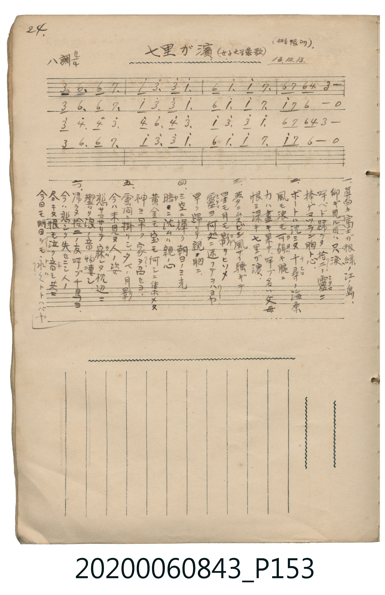

# 七里が濱（女子大學校歌）

> Re:Shōka 使用 AI 協助辨識與重建樂譜，可能會有錯誤。歡迎回報。

- **鋼琴伴奏版**：<br><audio controls src="shichirigahama.mp3"></audio>

- 詞：三角錫子
- 曲：J. P. Webster（日本化旋律）
- 日治時期公學校《唱歌帳》（典藏號 2020.006.0843・P153）
- 原載《林幸ノ帳ヨリ》（大正 13 年 12 月 13 日抄）

## 說明


- 出處：《唱歌帳》（國立臺灣歷史博物館典藏號 2020.006.0843）第 P153.jpg 頁。
- 標註：（林幸ノ帳ヨリ）13.12.13（大正 13 年 12 月 13 日抄錄）。
- 調性與拍號：ハ調（C 大調），4/4 拍，速度 != 92。
- 背景與曲風：日本鎌倉海難哀悼紀念名曲《七里ヶ浜の哀歌》（真白き富士の根），
旋律源自 J. P. Webster 的《When the Swallows Homeward Fly》變體。

### 編曲說明（鋼琴伴奏版）：

1. 前奏 (Intro, 4 小節)：引用結尾樂句，以低迴和弦烘托七里ヶ浜海濤哀思。
2. 主歌伴奏 (Song, 16 小節 × 3 段)：右手演奏主旋律，左手配以莊重抒情之和弦伴奏。


## 歌詞

```text
（TMD 檔案未包含歌詞註解）
```

## ABC

<div class="abc-score" data-abc-src="shichirigahama.abc" aria-label="五線譜載入中"></div>

[下載 ABC 原始檔](shichirigahama.abc)

## TMD 檔案連結

- [主旋律 TMD 檔案](shichirigahama.tmd) [[在 TMD Studio 編輯](https://tmdlang.github.io/Tmd-TS/#tmd=s7IKdvYPcrWy4qpTUCpJTLdSSM7PyUlNLsnMz7MqzsjPTkzOyFeCS5bl55TmploBqXgDQ4RwcX5pUXJqfEFieqpVgKGpMboM3KT4vPyS1KT8_GyEioKi_LLUvMQ8oKrcxLzS4uSizIKS-OT8gkqEmtSyzJRUkIrUlMyS_KLMxBwkJ6UWFYMdC3FDSVFiHsQMoCBCFVBTemaeVXlqcUlqUV58bmpOfgqSBflFJRn56UWJBRmVVhmZxSA7khNz4rMT8xIRikoyUoF-T00pTU6EGK6lpfBkR_PL9p7HjT3P9m98v6fj6dLNT9dOeLpk-dO1O54tWPhsbc_7PZ0KWlpcirYKlkZc9rYKzlw2JvomdiBDn01f-mzT7mczm57Nmf-0dQ1Ey-OGrqdTNgI1Pt2x-XFDN8jM1h0vpve_mDlfwcjAyEDPwMBMz8DCxPhx825QUAPNB7vwad_8F3s6gbqfzZv-dOeOx819IAOaVzxuXgU1ZsnyZ2sXKxgaKzzduUXB0Ejh2ZwOEA_kiq4WmDEvVs57v2fWkx2dL5ZPetmzGugZsPCz2ZuAwl56CgF6CuGpSaBABBoJ0jpnzdOeac-mdz_dB7QEaAaXvpaCLbUAl4KCwuOGCUDbn89e92LVqmcz-h43TASLNu9-2r7rxcypQGdhCbI53c9Xd79o3_W8cfGztduf9m962jvreefKl0tW4AhNoNufr1mjAApRvayCdIWXCxofNzRBbXq2YuaLFbuBNoH8jBG8QK2GxnqGRnqGQFMIBPPLHlBII0x-sWr_s4blLzran3X3At0E8kxzP1AQaJCzAtAoMLPz_Z4eYJpRAKoBsl42zH-6a5kCOEEhGdTc82zmepBBsze9XLQCaBAkcl729Txt6Hy2dfvL2YufTm541rTn-ZaGp_u3Pp3QC1QJDDloAm7e9mzrnMeN60Bq1vZAQvH5nPnPZ-593Nj7dH3P08WrgbLPFuyEOAdkqwLQT6Bof7Zrwov2VQooiUPh-awWoOHhGal5oGyjEFyemJOTX16s4JGfm1qeWJSi4JZTCbTlxbqul6unQL1BeXqBAgUtfS6u4Py8dKuAzMS8fIcag5pqsIttLLTswAxgIn2yo8FK4XHjPiCe_ripF0iB8FaFGiA5A4h7gHgtmLf_ceNKhcdNXUDmOiDuAAuCWNNB2oF2gUysUTBWMFPQBUIzBXMwXaNgGKdgHAdmAykgByJqBmMCKZhKkB4zBROgGSA-UARspo8hyCawC8GiMGdC9IAcC3IqWAbqXJjMfiBeCdUDcTdMpgPmdojJzXtQbTQCqmmeAxd_3AxSvx6q-9kmEG8_1MY1MJ0KT3ubFZ5u6IaKQ-wCq9-6XQFYLkH5MHvQIqDpcSPIhX0QVzd1g13ZAvH2ejBnFcQ_C8BmQyNkFdhjVAl7MBOiXVfBAC3wm4C4C-oxiBOhAQl0KNCZUBmIW2FBDHQbPJAgjkaOFojLIbbFowQ8MN8C5ZrAMs-2gtRB2DXAoOpVeNoPseFZ2wSkRPCidSqQtxo1iFF4EDtQA70JFI87wWnkcSMkxHcARTvBsQrOAI-bWh83toGNhoc6EM-H-HU1UsjHKZhAghRIQUO8BsQ2wxTFFSc40z7UnZCghLgVFpQQ96KnREjW3QoVh7gdOfBBaRHmBfR0_7RrNlQMFPDPZy-E6-xVeDZvDtTMZXC7nk7cA-RvA_OAxSlSdD3v2KbwbD0kinCm-6lABKQmQd2zBJyogDHQNBnMagBl58eNwBTRCBZonAzK_bRP8CA3TYX6FeI2WCgsQYQ40I3wEG9qAMqtheqAOBemYzK4xEJNiLDQfgZWC8kmz7ZvRErSwBpJAVglQU2E0ODSZP9GlBDFntBrubh07RRAhX-0j2GsApxtBGYrcwEA)]
- [鋼琴伴奏 TMD 檔案](shichirigahama_piano.tmd) [[在 TMD Studio 編輯](https://tmdlang.github.io/Tmd-TS/#tmd=s7IKdvYPcrWy4qpTUCpJTLdSyC8qychPL0osyKi0ysgsLskvykxOzInPTsxLVIIrKs4vLUpOjS9ITE-1CjA0NUbIlGSk5qZapaaUJieWZObnKXFpaSk82dH8sr3ncWPPs_0b3-_peLp089O1E54uWf507bJnCxY-W9vzuHn3y-49zydsebJny9Ol_c87O97v6VTQ0uJStFWwNOKyt1Vw5spOrbRVcMzlsjHRN7EDWfdi5bz3e2Y92dH5Yvmklz2rgUaCXfFs9iagsJeeQoCeQnhqUnFJahHQzmfTlz6bs-Zpz7Rn07uf7usGGg9RDBTetPvZzKZnc-Y_bV3zdO0OoIMeN3Q9nbIR6KynOzY_bgCq7XjauuPF9P4XM-crGBkYGegZGJjpGViYGAOdDfI82DAufS0FW2oBLgUFhccNE4BeeT573YtVq57N6HvcMBEs2rz7afuuFzOnAv2IxZ1zup-v7n7Rvut54-Jna7c_7d_0tHfW886VL5eswOEFoNufr1mjAPKGXlZBusLLBY2PG5qgNr1Ytf9Zw_IXHe3PunuBOkFWNvcDBYFSj5uWPJ-_FsgG2uqokJuZlw8M5c73e3qAsaMAVA5kvWyY_3TXMgVwFCLMfL59BdBbED8B9WJGO9AWkFIFBUM9haedvUBxBQ3PvJKifB0FE4WnG_qfr2_QBKp5umfq8ykrnm-d8HTDvmcrmp72LwVa-WT30id7-17s3_J0Us_TPcueN8941jkDmvqatz3bOufZ1u3P9i95OrnhWcNcqJsUFIz0gCl0NzAcIc5Q0AjOz0vXUTA0g1qncHi6grHCs3Vbwfb2b37W2f1szxSgSpAuaHLqebp9GVD8ZWsv0A0v-rpetvc-65r0rLn1yc5uiGMghkMtpTyJQIGClj4XFzh4rAIyE_PygzwcagxqqsEes7HQsgMzaoDON1PQBUIzBXMwXaNgGKdgHAdmAykgByJqBmMCKSSV5lDtugoGICGuWhQ7fZDtNIHbaRavEG2WGwunsYmYAFkmsQrGQMoYXYkBxCJQZNDMbyA9ZsB0ZQz1Xg1twgtqaJyCCUQ1kIIaBgyCOAUzTFFc1tHFuSihTs3YRRegYkqBmARVhaGNFJOpm3x17RTAWUUByAAFKim0MhcA)]

## 分析

```text
================================================================================
📊 TMD Song Profile: [ 七里が濱（女子大學校歌） ]
================================================================================
⏱  Duration:       1:23 (83.5s), 32 measures total
🎼 Key & Tempo:    首調基準 C, != 92.0 BPM, <4/4>
   - 分析範圍：      由實際發聲的音符與和弦推測調性；播放脈絡另行呈現
🎤 人聲音域:    E4 (MIDI 64) – A5 (MIDI 81) [跨度: 17 個半音 / 1.4 個八度, 難度: challenging]
   - 最低音:  E4 in [Song[L1] #1 @ m.1, 0:00]
   - 最高音: A5 in [Song[L1] #1 @ m.10, 0:23]
   - 適合: soprano, mezzo-soprano, tenor, baritone
🏛  結構:      Song[L1] (41.7s) -> Song[L2] (41.7s)
⚡ 編曲密度:        Peak 1 軌道同時演奏
🗝  調性診斷：       A 小調（純淨自然小調，未偵測到可信轉調）
   - 風格氣質:    純淨自然小調（陰鬱抒情、旋律集中，無明顯調外色彩）
   - 轉調歷程:    全曲維持單一推測調性（未偵測到可信轉調）
   - 核心骨幹音:  E, C, A, B, F
   - 調性數值:    A 小調 [相關度: 0.86, 穩定度: High, 自然音純度: 100.0%]
   - 候選調性 (K-S): A 小調 (0.86), E 小調 (0.56), C 大調 (0.55)
   - 五度圈歷程:   +3 -> +3
   - 各段落調性細節:
     • [Song[L1] #1]: A 小調 (r: 0.86, 自然音純度: 100.0%)
     • [Song[L2] #1]: A 小調 (r: 0.86, 自然音純度: 100.0%)

  [ 五度圈游移軌跡 ]
               C  
         F            G  
      Bb               D  
      Eb              [A ]*
         Ab           E  
            Db       B  
               F# 
     (* = active key center)

  [ 十二半音累積音高分佈 ]
     C  : █████████████████████     24.2%
     C# :                            0.0%
     D  :                            0.0%
     D# :                            0.0%
     E  : ████████████████████████  27.4%
     F  : ██████                     6.5%
     F# :                            0.0%
     G  :                            0.0%
     G# :                            0.0%
     A  : █████████████████████     24.2%
     A# :                            0.0%
     B  : ████████████████          17.7%
--------------------------------------------------------------------------------
Assignment 軌道音域：
  - Piano         : E4 – A5 (17 個半音 / 1.4 個八度, 128 個音符)
================================================================================
```


## 原書掃描頁




