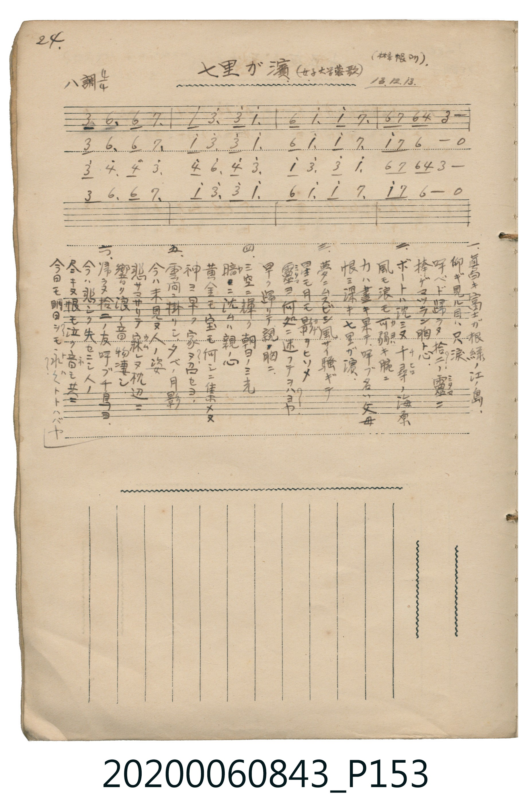

# 七里が濱（女子大学校歌）

> Re:Shoka 使用 AI 協助辨識與重建樂譜，可能會有錯誤。歡迎回報。

<audio controls src="shichirigahama.mp3"></audio>

- 詞：三角錫子
- 曲：J. P. Webster（日本化旋律）
- 日治時期公學校《唱歌帳》（典藏號 2020.006.0843・P153）

## 說明

【曲目說明】
・出處：《唱歌帳》（國立臺灣歷史博物館典藏號 2020.006.0843）第 P153.jpg 頁（手寫頁碼 24）。
・標註：（林サンノ帳ヨリ）13.12.13.（大正 13 年 12 月 13 日抄自林氏筆記）。
・作詞／作曲：三角錫子 作詞，原曲為 J. P. Webster〈In the Sweet By and By〉，經日本傳唱轉化為五聲小調（都節調式）哀歌〈真白き富士の根〉（七里ヶ浜の哀歌）。
・調性與拍號：ハ調・イ短調（A minor），4/4 拍，速度 != 92。
・背景與曲風：悼念明治 43 年（1910）逗子開成中學校 12 名少年於七里ヶ浜翻船罹難事件之名曲，原頁下方工整抄錄全六節漢字與假名歌詞。
・版本說明：本檔案為原頁單聲部簡譜之忠實數位化版本。
【原頁歌詞全文與中文語譯】（對應 P153.jpg）

・編曲說明（鋼琴伴奏版）：
1. 前奏 (Intro, 4 小節)：引用結尾樂句，以低迴和弦烘托七里ヶ浜海濤哀思。
2. 主歌伴奏 (Song, 16 小節 × 3 段)：右手演奏主旋律，左手配以莊重抒情之和弦伴奏。

## 歌詞

```text
一、真白キ富士が根　綠ノ江ノ島
仰ギ見ル目ハ　只涙
呼ベド歸ラヌ　拾二ノ靈（ミタマ）ニ
捧ゲマツラン　胸ト心
向呼喚也不歸來的十二位英靈，獻上我們滿懷的胸臆與真心。）

二、ボートハ沈ミヌ　千尋（チヒロ）ノ海原
風モ浪モ　可弱（カヨワ）キ腕ニ
力ハ盡キ果テ　呼ブ名ハ父母
恨ハ深キ　七里が濱
氣力耗盡時呼喚著父母的名字，遺恨深深留在七里之濱。）

三、夢ニムスビシ　風サワ騒ギテ
星モ月モ　影ヲヒソメ
靈（ミタマ）ヨ何処ニ　迷フテオハスヤ
早ク歸リテ　親ノ胸ニ
英靈啊，你們在何處徘徊迷途？快快回到父母的懷抱裡吧。）

四、ミ空ニ輝ク　朝日ノミ光
暗ニ沈ムハ　親ノ心
黄金モ宝モ　何シニ集メヌ
神ヨ早ク　我ガ子カヘセヨ
黃金與財寶又有何用？神啊，請快把我的孩子還給我吧。）

五、雲間ニ掛リシ　夕べノ月影
今ハ末見ヌ　人ノ姿
悲サマサリテ　寐レヌ枕辺ニ
響ク浪ノ音　物淒シ
悲傷益發深重、徹夜難眠的枕邊，迴盪著淒厲的波濤聲。）

六、歸ラヌ拾二ノ　友呼ブ千鳥ヨ
今ハ悲シク　失セニシ人ノ
尽キヌ恨モ　泣ク音（ネ）モ共ニ
今日モ明日モ　かくトトハバヤ
無論今日或明日，都將如此長存。）
```

## ABC

```abc
X:1
T:七里が濱（女子大学校歌）
C:曲：J. P. Webster（日本化旋律）
M:4/4
L:1/16
Q:1/4=92
K:Am
V:V1 name="Piano" snm="Pia"
[V:V1]
E2 A6 A2 B6 | c2 e6 e2 c6 | A2 c6 c2 B6 | A2 B2 A2 F2 E8 |
E2 A6 A2 B6 | c2 e6 e2 c6 | A2 c6 c2 B6 | c2 B2 A8 z4 |
e2 f6 f2 e6 | f2 a6 f2 e6 | c2 e6 e2 c6 | A2 B2 A2 F2 E8 |
E2 A6 A2 B6 | c2 e6 e2 c6 | A2 c6 c2 B6 | c2 B2 A8 z4 |
E2 A6 A2 B6 | c2 e6 e2 c6 | A2 c6 c2 B6 | A2 B2 A2 F2 E8 |
E2 A6 A2 B6 | c2 e6 e2 c6 | A2 c6 c2 B6 | c2 B2 A8 z4 |
e2 f6 f2 e6 | f2 a6 f2 e6 | c2 e6 e2 c6 | A2 B2 A2 F2 E8 |
E2 A6 A2 B6 | c2 e6 e2 c6 | A2 c6 c2 B6 | c2 B2 A8 z4 |
E2 A6 A2 B6 | c2 e6 e2 c6 | A2 c6 c2 B6 | A2 B2 A2 F2 E8 |
E2 A6 A2 B6 | c2 e6 e2 c6 | A2 c6 c2 B6 | c2 B2 A8 z4 |
e2 f6 f2 e6 | f2 a6 f2 e6 | c2 e6 e2 c6 | A2 B2 A2 F2 E8 |
E2 A6 A2 B6 | c2 e6 e2 c6 | A2 c6 c2 B6 | c2 B2 A8 z4 |
E2 A6 A2 B6 | c2 e6 e2 c6 | A2 c6 c2 B6 | A2 B2 A2 F2 E8 |
E2 A6 A2 B6 | c2 e6 e2 c6 | A2 c6 c2 B6 | c2 B2 A8 z4 |
e2 f6 f2 e6 | f2 a6 f2 e6 | c2 e6 e2 c6 | A2 B2 A2 F2 E8 |
E2 A6 A2 B6 | c2 e6 e2 c6 | A2 c6 c2 B6 | c2 B2 A8 z4 |
E2 A6 A2 B6 | c2 e6 e2 c6 | A2 c6 c2 B6 | A2 B2 A2 F2 E8 |
E2 A6 A2 B6 | c2 e6 e2 c6 | A2 c6 c2 B6 | c2 B2 A8 z4 |
e2 f6 f2 e6 | f2 a6 f2 e6 | c2 e6 e2 c6 | A2 B2 A2 F2 E8 |
E2 A6 A2 B6 | c2 e6 e2 c6 | A2 c6 c2 B6 | c2 B2 A8 z4 |
E2 A6 A2 B6 | c2 e6 e2 c6 | A2 c6 c2 B6 | A2 B2 A2 F2 E8 |
E2 A6 A2 B6 | c2 e6 e2 c6 | A2 c6 c2 B6 | c2 B2 A8 z4 |
e2 f6 f2 e6 | f2 a6 f2 e6 | c2 e6 e2 c6 | A2 B2 A2 F2 E8 |
E2 A6 A2 B6 | c2 e6 e2 c6 | A2 c6 c2 B6 | c2 B2 A8 z4 |
```

## TMD 檔案連結

- [主旋律 TMD 檔案](shichirigahama.tmd) [[在 TMD Studio 編輯](https://tmdlang.github.io/Tmd-TS/#tmd=s7IKdvYPcrWy4qpTUCpJTLdSSM7PyUlNLsnMz7MqzsjPTkzOyFeCS5bl55TmploBqXgDQ4RwcX5pUXJqfEFieqpVgKGpMboM3KT4vPyS1KT8_GyEioKi_LLUvMQ8oKrcxLzS4uSizIKS-OT8gkqEmtSyzJRUkIrUlMyS_KLMxBwkJ6UWFYMdC3FDSVFiHsQMoKASl5aWwpMdzS_bex439jzbv_H9no6nSzc_XTvh6ZLlT9cue7Zg4bO1Pe_3dCpoaXEp2ipYGnHZ2yo4c2WnVtoqOOZy2Zjom9iBbHqxct77PbOe7Oh8sXzSy57VQAPADng2exNQ2EtPIUBPITw1qbgktQhow7PpS5_NWfO0Z9qz6d1P93UDjYcoBgpv2v1sZtOzOfOftq55unYH0PrHDV1Pp2wEOuLpjs2PG4BqO5627ngxvf_FzPkKRgZGBnoGBmZ6BhYmxo-bd4NCFmwYl76Wgi21AJeCgsLjhglArzyfve7FqlXPZvQ9bpgIFm3e_bR914uZU4F-xOLOOd3PV3e_aN_1vHHxs7Xbn_Zveto763nnypdLVuDwAtDtz9esUQB5Qy-rIF3h5YJGUGh1dj9dvxrIfr5oj4KRCVDR44YmqPXPVsx8sWI30HqQunnTHzdtfdy8-XFzH8gRzSseN68CqjY01jM00gOSIDctWf5s7WIFQ2OFpzu3KBgaKTyb0wHigYK-q-VF-yqgIc829D9f2_ZixQwUm57snQOO434gAxKryJGtAJPuedo3HxRSTbsUUGL9cUOHZ55CSUaqQnB5amqJglOlQmJeCpB63NAJ1PV822RoomjaDAzGF3s7gakDaMiTXVNeNG56uqH_xar9QOe_bN77fH0DkP10Tz_QdU8nNwADHGj08znzn8_c-7ix9-n6nqeLVz9uXPdswU6wyR3QxN287dnWOUBxiBYUnwGNe9aw_EVH-7PuXmCUgOKyGWQfUOpx05Ln89dC7HZUyM3MywcmX5B7gcleAagcyHrZMP_prmUK4LyBZGZzz7OZ60Fmzt70ctEKoJnPmvY83b8VmHaASVzBBBz-QEMNLQ0NgCa-bJgODMSX07qfdUx4smMtJOWDoufphN6nGyYC1T6btgfZJ8_3737RsfP53p0vZy9-sqv7ye5tT3Z2AxWDYwYUB8Dk8mRH97NpO59uX_ps6hZg5L7saXnaCkx5a4Eh-GzPoqdrpwOd97SxHaRrbQ8w8hCuf97ZAYwKSFIHOX3Ommerpjxb2AGMEIjRT6etA0bLy-YVzzcsfLF2Dsju_Querl_2bOqOJ3t7QVEHNgFkIjT3QPRBLAI649m0dqDtQK-CGKvmvVi7HpilQOlzQ--z9k54DgAGDdiAJzsaHjc0QmO5aS0slnvAsdzwfNsCYJJ_tnE-KOFv3gaxEaih4cnuDY-b1r1Y1v24eTUw7wKjFSj4tH_Vs20zEYqeTtzzuHnm4-bOZ2t3PG5e-bgZmKAannXve7ILGNZ9L-d2AJ31uHn-4yZgggAm8M7Hzd0Izc96lz9u2gSUeNzcAtYMzPsNL5qBBnU83d8MUgfUDfEgMCCfb5kC9MDzWS0QDzzduPHlrskgj-1fAPQDUBzoB1BYbt4GjESg45_NmQ0UfD5nz_M5O14sXghy-ZzOZ9tnPdsATDuzQaYrAFPIRKAPnk6b9WTn_Cc7gFG548m-NpAVvY1AHwBj40X3RrAnep737n6yo-tZx8SnDROf7d7_rH07UBnQrS_a24BxAQxcoIuBMQYPc6D_GxofN8953AwMIGAQ9D_bBA4IcAA97W1-ugFUyj1uBqqZ9Lh5LTho-p5t3Q6MakQAARP_4-ZFz7auApLgwF__dA-oknnctBpcQAGDpRMYoy9ap6KE69Ou2UALn89eCJR7Ng_ohDZYTE0DpleQVMe2Z-t7kSKiEWhY_7PtG4EaQDGPVKWhxwKoNOlsf7ap82nr0ie72iA-AeoEOh0USt1NQDeDssb2FUBnv1i6CRjCz-ZPATobFEGdwAIdGETQwH-2YTHQpS8apgNdCqy3IBHxYuJ0iOtAsQDMv2ung4qJxl1AJ4Js2b7x-dSZT-esgDgRGN1AJyIH-w5g0dT4dMkiYHg8bl7wuGnn4-bJj5u2Q8MSVMCvf7liEjBdAwMFyf8zgBGzCFiaQ8N578bHzcB0CVS393HzQqT4wJKeVzzZO_Vp-zKQhcDEu3_742ZgZLQ9bgLGWT_Y_iVI9kxf-bhpPTirAKVBsfJiGZDRB07z4AhECeoli54uagZmc1CQAstxYPjMALp--9NuYJXZA3Tzi30bQIUksFSc0wFMwC9nbXy2aRIoUlo7gV6AhzMkDT-d2gXKF3sXABMwKAD3TgVWvU_3zXi6rwvo6pcNU97vAabh1SA0e97Tjg3wWAAm9WddG0E5aMJypKB-Ons2OIXPf75yF9DxL_bMBXoN5Mc5c4GVEdBTQCmgQ5A8P2s6UB04GwBLHFBhAvE8NKtDQ3h3y8v2icBoeLpuLiQygA4FRWBz98vZbcDIAGYghOrnS4FFxwpIqIJs6Jj4uAnY8pkAzh8zHjftBspihupKoItBoTqt-QXQDROnA138ElKwtHYCvQEKW3Dyfrl7ItDN4NJg97MZ6xHJcn8zPGxf7gamw4nAWHixaeHT9due9gNL7k6gk59PAVZb84HugwT7i9XAMn71sy5QAQIyYe1KUI3V1PJ86zJQkYISsMBaGxiwL4FV37TJoADrA2bmVZA0_HTJ1MeNwCQFinBgDCOX1V2gDDxnNbi4BhUxT3YBY6Xv6fL9SBEALGtBOWAemIQmwKfrJzxuXgPU82ze1Bf7QDGJFBnz94OSK6j46Xs5H1Q4Axtgz7YDs8V29FCFOPfl6hlA5wKD9GlT77OZs0CJB-xQUK26rAnoSGBIPm3rBaZVoDuB5S0wmT2b2gp0Kqgs3bUaOdECHfu0afvz2V3PZ-4B5vqX7b2gjL1v59Mlc4C19vM54AJ_3tSXTeDg3b_l-exVoKjcPulp3yaQ1OZFz_YvAeYa5BTbCizcgLUotKKC11LgkrUbWj72Nr_cDEy94GSDEragwNsOSWdPlwALSmDa6gaKQMIZqezdAKpjQcaDylRQAn62eTFQGzD8wEUHsNUDLDQWPW0FFjFIQQ20BJxrFoFyM5gBEm_sftzYD64-QDXI42ZgVIFLE5T0DCs2IfUXcuX1bOJ6oMfAIiBfQZIiJCIgwfuyYe7Tvt3AUhQSBc9bFgKLYkhhCyrDJ68Fuh0YhkBdkEgBKnixehrErc86pkHcCiqfm_c-3dAONPnZ2iUvp25_unYGNNiBeijvQkCBgpY-F1dwfl66VUBmYl6-Q41BjUI12F02Flp2YAaw4wJs7FgpPG7cB8TABn0vkALhrQo1QHIGEPcA8Vowb__jxpUKj5u6gMx1QNwBFgSxpoO0Ay0DmVijYKxgpqALhGYK5mC6RsEwTsE4DswGUkAORNQMxgRSMJUgPWYKJkAzQHygCDgdIjmz6XEjyP4-kHOAbukGu6EF4vz1YM4qsEzjArDboM5eBXY2VVwIZkK06yoYYHFiUwfQzp1ADAyrRoj7dgBFO4H0GkigPm5qfdzYBmStRrgRiOdDfLEayZ1xCiYQBwApqPtqQGwzTFFcPiAQnsDicSqQmgRNAUtArgG5tWkymAXMUWuBwiuAGCzQCGwb9NIsIGu5uHTtFEApVoEEWpkLAA)]
- [鋼琴伴奏 TMD 檔案](shichirigahama_piano.tmd) [[在 TMD Studio 編輯](https://tmdlang.github.io/Tmd-TS/#tmd=s7IKdvYPcrWy4tLSUniyo_lle8_jxp5n-ze-39PxdOnmp2snPF2y_OnaZc8WLHy2tudx8-6X3XueT9jyZM-Wp0v7n3d2vN_TqaClxaVoq2BpxGVvq-DMlZ1aaavgmMtlY6JvYsdVp6D0YuW893tmPdnR-WL5pJc9q4FGKoGEn83eBBT20lMI0FMIT00qLkktAtr5bPrSZ3PWPO2Z9mx699N93UDjIYqBwpt2P5vZ9GzO_Keta56u3QF00OOGrqdTNgKd9XTH5scNQLUdT1t3vJje_2LmfAUjAyMDPQMDMz0DCxNjoLMDDE2NwYZx6Wsp2FILcCkoKDxumAD0yvPZ616sWvVsRt_jholg0ebdT9t3vZg5FehHLO6c0_18dfeL9l3PGxc_W7v9af-mp72znneufLlkBQ4vAN3-fM0aBZA39LIK0hVeLmh83NAEtenFqv3PGpa_6Gh_1t0L1AmysrkfKAiUety05Pn8tUA20FZHhdzMvHxgKHe-39MDjB0FoHIg62XD_Ke7limAoxBh5vPtK4DegvgJqBcz2oG2gJQqKBjqKTzt7AWKK2h45pUU5esomCg83dD_fH2DJlDN0z1Tn09Z8XzrhKcb9j1b0fS0fynQyie7lz7Z2_di_5ank3qe7ln2vHnGs84Z0NTXvO3Z1jnPtm5_tn_J08kNzxrmQt2koGCkB0yhu4HhCHGGgkZwfl66joKhGdQ6hcPTFYwVnq3bCra3f_Ozzu5ne6YAVYJ0QZNTz9Pty4DiL1t7gW540df1sr33WdekZ82tT3Z2QxwDMRxqKeVJBAoUtPS5uMDBYxWQmZiXH-ThUGNQo1AN9pmNhZYdmFEDdL-Zgi4QmimYg-kaBcM4BeM4MBtIATkQUTMYE0ghqTSHatdVMAAJcdWiWOqDYqkJ3FKzeIVos9xYOI1NxATIMolVMAZSxuhKDCA2gaKDdr4D6TEDJi1jqAdraBNiUEPjFEwgqoEU1DBgGMQpmGGK4rKOLs5FCXaqxi-6ABXTCsQkqCoMbaSYTN0ErGunAM4tCkAGKFRJoZW5AA)]

## 分析

```text
================================================================================
📊 TMD Song Profile: [ 七里が濱（女子大学校歌） ]
================================================================================
⏱  Duration:       4:10 (250.4s), 96 measures total
🎼 Key & Tempo:    首調基準 C, != 92.0 BPM, <4/4>
   - 分析範圍：      由實際發聲的音符與和弦推測調性；播放脈絡另行呈現
🎤 人聲音域:    E4 (MIDI 64) – A5 (MIDI 81) [跨度: 17 個半音 / 1.4 個八度, 難度: challenging]
   - 最低音:  E4 in [Song #1 @ m.1, 0:00]
   - 最高音: A5 in [Song #1 @ m.10, 0:23]
   - 適合: soprano, mezzo-soprano, tenor, baritone
🏛  結構:      Song (41.7s) -> Song (41.7s) -> Song (41.7s) -> Song (41.7s) -> Song (41.7s) -> Song (41.7s)
⚡ 編曲密度:        Peak 1 軌道同時演奏
🗝  調性診斷：       A 小調（純淨自然小調，未偵測到可信轉調）
   - 風格氣質:    純淨自然小調（陰鬱抒情、旋律集中，無明顯調外色彩）
   - 轉調歷程:    全曲維持單一推測調性（未偵測到可信轉調）
   - 核心骨幹音:  E, C, A, B, F
   - 調性數值:    A 小調 [相關度: 0.86, 穩定度: High, 自然音純度: 100.0%]
   - 候選調性 (K-S): A 小調 (0.86), E 小調 (0.56), C 大調 (0.55)
   - 五度圈歷程:   +3 -> +3 -> +3 -> +3 -> +3 -> +3
   - 各段落調性細節:
     • [Song #1]: A 小調 (r: 0.86, 自然音純度: 100.0%)
     • [Song #2]: A 小調 (r: 0.86, 自然音純度: 100.0%)
     • [Song #3]: A 小調 (r: 0.86, 自然音純度: 100.0%)
     • [Song #4]: A 小調 (r: 0.86, 自然音純度: 100.0%)
     • [Song #5]: A 小調 (r: 0.86, 自然音純度: 100.0%)
     • [Song #6]: A 小調 (r: 0.86, 自然音純度: 100.0%)

  [ 五度圈游移軌跡 ]
               C  
         F            G  
      Bb               D  
      Eb              [A ]*
         Ab           E  
            Db       B  
               F# 
     (* = active key center)

  [ 十二半音累積音高分佈 ]
     C  : █████████████████████     24.2%
     C# :                            0.0%
     D  :                            0.0%
     D# :                            0.0%
     E  : ████████████████████████  27.4%
     F  : ██████                     6.5%
     F# :                            0.0%
     G  :                            0.0%
     G# :                            0.0%
     A  : █████████████████████     24.2%
     A# :                            0.0%
     B  : ████████████████          17.7%
--------------------------------------------------------------------------------
Assignment 軌道音域：
  - Piano         : E4 – A5 (17 個半音 / 1.4 個八度, 384 個音符)
================================================================================
```


## 原書掃描頁




