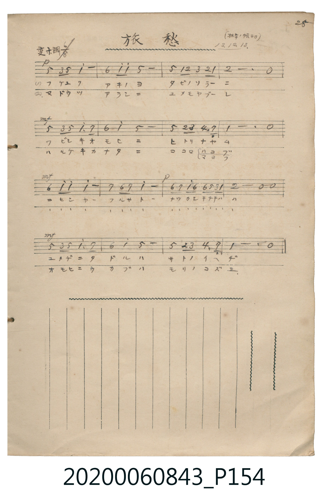

# 旅愁

> Re:Shōka 使用 AI 協助辨識與重建樂譜，可能會有錯誤。歡迎回報。

- **鋼琴伴奏版**：<br><audio controls src="ryoshu.mp3"></audio>
- **NEUTRINO 歌聲合成版**：<br><audio controls src="ryoshu_neutrino.mp3"></audio>

- 詞：犬童球渓
- 曲：J. P. Ordway
- 日治時期公學校《唱歌帳》（典藏號 2020.006.0843・P154）
- 原載《林幸ノ帳ヨリ》（大正 13 年 12 月 13 日抄）

## 說明


- 出處：《唱歌帳》（國立臺灣歷史博物館典藏號 2020.006.0843）第 P154.jpg 頁。
- 標註：（林幸ノ帳ヨリ）13.12.13（大正 13 年 12 月 13 日抄錄）。
- 作詞／作曲：犬童球渓 作詞（明治 40 年〔1907〕）、J. P. Ordway 作曲（原曲《Dreaming of Home and Mother》）。
- 調性與拍號：變ホ調（E♭ 大調），6/8 拍，速度 != 72。

### 編曲說明（鋼琴伴奏版）：

1. 前奏 (Intro, 4 小節)：引用結尾樂句，以 6/8 拍分解和弦鋪陳溫柔鄉愁。
2. 主歌伴奏 (Song, 16 小節 × 2 段)：右手演奏主旋律，左手配以優美的 6/8 拍琶音與和弦伴奏。


## 歌詞

```text
（TMD 檔案未包含歌詞註解）
```

## ABC

<div class="abc-score" data-abc-src="ryoshu.abc" aria-label="五線譜載入中"></div>

[下載 ABC 原始檔](ryoshu.abc)

## TMD 檔案連結

- [主旋律 TMD 檔案](ryoshu.tmd) [[在 TMD Studio 編輯](https://tmdlang.github.io/Tmd-TS/#tmd=s7IKdvYPcrWy4qpTUCpJTLdSSM7PyUlNLsnMz7MqzsjPTkzOyFeCS5bl55TmploBqXgDQ4RwcX5pUXJqfEFieqpVgKGpCboM3KT4vPyS1KT8_GyEioKi_LLUvMQ8oKrcxLzS4uSizIKS-OT8gkqEmtSyzJRUkIrUlMyS_KLMxBwkJ6UWFYMdC3FDSVFiHsQMoCBCVUlGKtDdxamJxfl5xQhhoFnpmXlWJYmZQBfGA3F5YnxuYmZeTmJeCoaq8tTiktSivPjc1Jz8FCTX5ReVZOSnFyUWZFRaZWQWgxyYnJgTn52Yl6jEpaWl8Gx667OWRgUtLS5FWwVzIy57WwVXHS4bM30LO5AZz6YvfbZp97OZTc_mzH_auubp2h3PFix83ND1dMrGZ2t7nu7Y_Lih-_2ejqetO15M738xc76CkYGRgZ6BgZmegYWJ8ePm3aAQf7-nE-ygp33zX-zpBOp-Nm_60507Hjf3gQxoXvG4eRXUmCXLn61drGBorPB05xYFQyOFZ3M6QDyQK7paYMa8WDnv_Z5Zz7vWPF-99PmE5mc7JoOFn83eBBT20lMI0FPwL0opTwSGApe-loIttQCXgoLC44YJQHuez173YtWqZzP6HjdMBIs2737avuvFzKlAB2AJnDndz1d3v2jf9bxx8bO125_2b3raO-t558qXS1bgCDegT5-vWaMACju9rIJ0hZcLGh83NEFterZi5osVu4E2AY3GDEigVkNjPUMjPUOgKQQC9GUPKEwRJj_ZOwcctv1ABiQ0kQNZASbdAfQ4MFEomBiATH3cMMXQ0sD8cQPQ80CzGpEjAKQFbFAHMOqBDGDYuBSlJuZm5qUr5KcpeOTnpioAE7OCbz4wCxSBQwvJOS9W7X_WsPxFR_uz7l5gEAGd82Jd1-Pm2UBxoImuj2auVQD6D8zrfL-nB5hkFYAqgayXDfOf7lqmAE7QUOMoj30oUNDS5-IKzs9LtwrITMzLd6gxqKkGWaBgY2imZQdmAdOcxpMdDZpAP0xVeNy0EUgvA9LrFWqA5CIgXgsU6QPiFWCR_UDWZIhI014gvfJx8x4g1Q2UNADZBjdyVw_IyHlA3AlUCjSyuQVmZPNKIL0dqgtsXfNCIAbJLAHiaRAj1yAbWaNQXVCrYKqgq2AMxCDaMA5IwGCNghlMCEyAFCDkwMqB2AiqHUSD-DVgFgwaIOsBW-pjCHLeVCAfFC5AEuhUEHs9iukgL4FE14JV9IHJFWgq9oNFJyNUAMMOxAaHHojRDVEI5sFgPKaDjEBq5oF1dIKNATsIGLJYHAQMZZCK7XDzkVRAPAIMdRAJUb0ETILDHsRYQ9BB6KlnPSRlgCIWlGaaVoH1gyJ1EjyqQawOIF4FxF1gS0GiC7AknH4gXg1Jj2DTVoNVAvWAUyDYtKbNENwMSqGghAZOocD4QqSZ3DSsicYcGg6gRAOCONIMLL2YQDRBvF8DTjqEEg0oiUAjHBID4OQBolfB4wAU7mAxYLBgiyOIaAeYBOkCeR-iHhRXEDULkPTgSi_9YD2rwbaDkzHcLSAxiDkQk0FikKSK5hZgMIPkwCQwuEEkKBUikjosoxCVVMCRBkwK4DJgCSiNQbRDYnwryNMwQVAiaQG7FKK6EYr7wbL9aFGNWgiglRCgSAcpANFoUqCyBSIFlAAxQNgUGPdElxLQoAFHGTTLgT2GGqPgogQaE1vBbLBHURWBogLZ0yBeI5SE5AtQhBJZWAwyd6GXGcuAGFT0N4GTHCjxgfQDKwxQSoBEMiQ9ADGoxgFVDzPAapowywxg1kIub0CFI0g_yKRp8CQDkgepA5kGKj92gUU3DoYyA7lMbgKTkFwIyZOQoAWV-mAxSGyBgxwpkmCxByYhFQ2krAAFG8wMkNmEkg2kvIHUDMilE6TGgdgFKT3AtQY2t0B1Q0yCuAWUGEH0LrgaUHmE3S21XFy6dgqgtku0j2GsApxtBGYrcwEA)]
- [鋼琴伴奏 TMD 檔案](ryoshu_piano.tmd) [[在 TMD Studio 編輯](https://tmdlang.github.io/Tmd-TS/#tmd=s7IKdvYPcrWy4qpTUCpJTLdSyC8qychPL0osyKi0ysgsLskvykxOzInPTsxLVIIrKs4vLUpOjS9ITE-1CjA0NUHIlGSk5qZapaaUJieWZObnKXFpaSk8m976rKXx_Z6Ol917nk_Y8mTPlqdL-593drzf06mgpcWlaKtgbsRlb6vgqsNlY6ZvYQcy7MXKee_3zHreteb56qXPJzQ_2zEZbMez2ZuAwl56CgF6Cv5FKeWJlRDh6Uufbdr9bGbTsznzn7auebp2x7MFCx83dD2dsvHZ2p6nOzY_bugG2v-0dceL6f0vZs5XMDIwMtAzMDDTM7AwMX7cvBvkCaBzlLi49LUUbKkFuBQUFB43TAA6-vnsdS9WrXo2o-9xw0SwaPPup-27XsycCvQNFnfO6X6-uvtF-67njYufrd3-tH_T095ZzztXvlyyAocXgG5_vmaNAsgbelkF6QovFzQ-bmiC2vRk7xxwcPYDGZAARA5XBYj044ZG5GAFiQLVIgx5sWr_s4blLzran3X3Aq0HGvJiXdfj5tlAcaCLXZMUni5ZDmZ3vt_TA4xFBaA6IOtlw_ynu5YpgOMYYdjz7SuAhkNCBGu6ABoPUqqgYKin8LSzFyiuoOGZV1KUr6NgovB0Q__z9Q2aQDVP90x9PmXF860Tnm7Y92xF09P-pUArn-xeqgB1wNOOthfLFz-d1PN0z7KX3ateztz8bNfqZ_OnvGzpBKZIqHsUFIz0FJ7s2A2MAYgTFDSC8_PSdRQMzaBWKRyermCk8GzdVrCd_ZufdXY_2zMFqBKka3r3033ASOt5un0ZUPxlay_Q_qctq57v63s-qwXmkOcTtr2cvxkYehC3QOyB2k95OoMCBS19Li5wKFkFZCbm5Qd5ONQY1FSD_WhjaKZlB2bVKJgq6CoYAzGINowDEroK5mCyRsEMTEOFQfIwCNFlBNVpAtEUD5UyRFJogKyJqxbFQT7IDrKAu8cwXsE0XiHaMBaJVaNgEg80N9oEVdA0Pl7BCMgxjUVmohkBcgLYalA04g-K6oJabMEB8zMoOMBCOMID5HFYmIBoEL8GzMIeHFBLc9Ow2kqrSECyFdVDaL4F2Q9SAKLRpEDhBJECSoAYIGwKdMbg9DFK3FOe6hBsM2CiMwYyzXKxpEZIuqNlmoaYDTcFzkAxhFQLae9sYHTo2imACwIFIAMUNci0MhcA)]

## 分析

```text
================================================================================
📊 TMD Song Profile: [ 旅愁 ]
================================================================================
⏱  Duration:       1:20 (80.0s), 32 measures total
🎼 Key & Tempo:    首調基準 E,, != 72.0 BPM, <6/8>
   - 分析範圍：      由實際發聲的音符與和弦推測調性；播放脈絡另行呈現
🎤 人聲音域:    D4 (MIDI 62) – D#5 (MIDI 75) [跨度: 13 個半音 / 1.1 個八度, 難度: moderate]
   - 最低音:  D4 in [Song[L1] #1 @ m.7, 0:16]
   - 最高音: D#5 in [Song[L1] #1 @ m.1, 0:01]
   - 適合: soprano, mezzo-soprano, contralto, tenor, baritone, bass
🏛  結構:      Song[L1] (40.0s) -> Song[L2] (40.0s)
⚡ 編曲密度:        Peak 1 軌道同時演奏
🗝  調性診斷：       D# 大調（純淨自然大調，未偵測到可信轉調）
   - 風格氣質:    純淨自然大調（陽光明朗、易唱易記，無明顯調外色彩）
   - 轉調歷程:    全曲維持單一推測調性（未偵測到可信轉調）
   - 核心骨幹音:  D#, A#, C, F, D
   - 調性數值:    D# 大調 [相關度: 0.91, 穩定度: High, 自然音純度: 100.0%]
   - 候選調性 (K-S): D# 大調 (0.91), A# 大調 (0.73), C 小調 (0.60)
   - 五度圈歷程:   -3 -> -3
   - 各段落調性細節:
     • [Song[L1] #1]: D# 大調 (r: 0.91, 自然音純度: 100.0%)
     • [Song[L2] #1]: D# 大調 (r: 0.91, 自然音純度: 100.0%)

  [ 五度圈游移軌跡 ]
               C  
         F            G  
      Bb               D  
     [Eb]*              A  
         Ab           E  
            Db       B  
               F# 
     (* = active key center)

  [ 十二半音累積音高分佈 ]
     C  : █████████                 11.9%
     C# :                            0.0%
     D  : ███████                   10.1%
     D# : ████████████████████████  32.7%
     E  :                            0.0%
     F  : █████████                 11.9%
     F# :                            0.0%
     G  : ██████                     7.7%
     G# : ███                        3.6%
     A  :                            0.0%
     A# : ████████████████          22.0%
     B  :                            0.0%
--------------------------------------------------------------------------------
Assignment 軌道音域：
  - Piano         : D4 – D#5 (13 個半音 / 1.1 個八度, 120 個音符)
================================================================================
```


## 原書掃描頁




