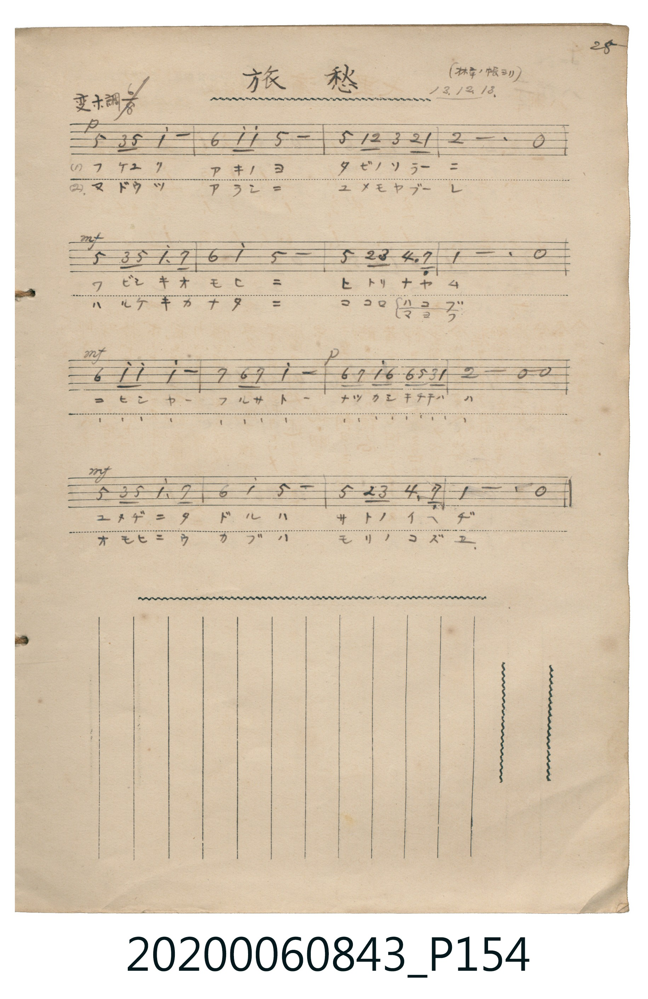

# 旅愁

<audio controls src="ryoshu.mp3"></audio>

- 詞：犬童球渓
- 曲：J. P. Ordway
- 日治時期公學校《唱歌帳》（典藏號 2020.006.0843・P154）

## 說明

【曲目說明】
・出處：《唱歌帳》（國立臺灣歷史博物館典藏號 2020.006.0843）第 P154.jpg 頁（手寫頁碼 25）。
・標註：（林サンノ帳ヨリ）13.12.13.（大正 13 年 12 月 13 日抄自林氏筆記）。
・作詞／作曲：犬童球渓 作詞（明治 40 年『中等教育唱歌集』），原曲為 J. P. Ordway〈Dreaming of Home and Mother〉。
・調性與拍號：變ホ調（Eb 大調），6/8 拍，速度 != 72。
・背景與曲風：原譜細膩標註 p、mf 等力度變化，抒發深秋羈旅異鄉、思念故鄉雙親與家園樹梢的濃厚鄉愁。
・版本說明：本檔案為原頁單聲部簡譜之忠實數位化版本。
【原頁歌詞全文與中文語譯】（對應 P154.jpg）

・編曲說明（鋼琴伴奏版）：
1. 前奏 (Intro, 4 小節)：引用結尾樂句，以 6/8 拍分解和弦鋪陳溫柔鄉愁。
2. 主歌伴奏 (Song, 16 小節 × 2 段)：右手演奏主旋律，左手配以優美的 6/8 拍琶音與和弦伴奏。

## 歌詞

```text
（一）フケユクアキノヨ　タビノソラーニ
ワビシキオモヒニ　ヒトリナヤム
コヒシヤーフルサトー　ナツカシチチハハ
ユメヂニタドルハ　サトノイヘヂ
多麼眷戀的故鄉啊、多麼令人懷念的父母，在夢境中尋覓的是通往故里家園的道路。）

（二）マドウツアラシニ　ユメモヤブーレ
ハルケキカナタニ　ココロマヨフ
コヒシヤーフルサトー　ナツカシチチハハ
オモヒニウカブハ　モリノコズヱ
多麼眷戀的故鄉啊、多麼令人懷念的父母，腦海中浮現的是故鄉森林的樹梢。）
```

## ABC

```abc
X:1
T:旅愁
C:曲：J. P. Ordway
M:6/8
L:1/16
Q:3/8=48
K:Eb
V:V1 name="Piano" snm="Pia"
[V:V1]
!p! B2 G2 B2 e6 | c2 e2 e2 B6 | B2 E2 F2 G2 F2 E2 | F6 z6 |
!mf! B2 G2 B2 e3 d3 | c4 e2 B6 | B2 F2 G2 A3 D3 | E6 z6 |
!mf! c2 e2 e2 e6 | d2 c2 d2 e6 | !p! c2 d e c2 c2 B G E2 | F6 z6 |
!mf! B2 G2 B2 e3 d3 | c4 e2 B6 | B2 F2 G2 A3 D3 | E6 z6 |
```

## TMD 檔案連結

- [主旋律 TMD 檔案](ryoshu.tmd) [[在 TMD Studio 編輯](https://tmdlang.github.io/Tmd-TS/#tmd=s7IKdvYPcrWy4qpTUCpJTLdSSM7PyUlNLsnMz7MqzsjPTkzOyFeCS5bl55TmploBqXgDQ4RwcX5pUXJqfEFieqpVgKGpCboM3KT4vPyS1KT8_GyEioKi_LLUvMQ8oKrcxLzS4uSizIKS-OT8gkqEmtSyzJRUkIrUlMyS_KLMxBwkJ6UWFYMdC3FDSVFiHsQMoKASl5aWwrPprc9aGhW0tLgUbRXMjbjsbRVcdbhszPQt7ECGvFg57_2eWc-71jxfvfT5hOZnOyaDzX42exNQ2EtPIUBPwb8opTwR4pxn05c-27T72cymZ3PmP21d83TtjmcLFj5u6Ho6ZeOztT1Pd2x-3ND9fk_H09YdL6b3v5g5X8HIwMhAz8DATM_AwsT4cfNuUPC839OpxMWlr6VgSy3ApaCg8LhhAtDRz2eve7Fq1bMZfY8bJoJFm3c_bd_1YuZUoG-wuHNO9_PV3S_adz1vXPxs7fan_Zue9s563rny5ZIVOLwAdPvzNWsUQN7QyypIV3i5oBFozrPO7qfrVwPZzxftUTAyBSp63NAEtf7ZipkvVuwGWg9SN2_646atj5s3P27uAzmiecXj5lVA1YbGeoZGekAS5KYly5-tXaxgaKzwdOcWBUMjhWdzOkA8UNB3tbxoXwU05NmG_udr216smIFi05O9c8Cx2Q9kQOIPOVoVYNIdwNABRqKCiQHIhscNfU92rH2-tvPZ1JkvmjZBAujl7LbHDf1Aw9_v6XnaNx8Urk27FJBTw-OGDpei1MTczLx0hfw0BY_83FSFxLwUBd_8kozUoscNSM56sWr_s4blLzran3X3AsMT6KwX67oeN88GigMd45qkAPQxmA2yDZgsFYDqgKyXDfOf7lqmAE60SIY19zybuR5k2OxNLxetABoGdN-LtXOeb9nwom0lJKwVCh43NOamKQA99bRrNtAQoH1Pe6YBzXzWNen5zD3Ptm98vrz7-b4OYNZ4PnXDyxagYxufNcx9un_rs6mtQO7L2TNfLFsFtOTpum1P50x6tmLns0WLns9qeba_-WnfLKACYIZCOOl5Z8ezOWsgqQ7oHiD72aopzxZ2AIMM6DZgong6bd2Lxk0vm1c837AQ6NQnO7uf7l_wdP2yZ1N3PNnbC3QZxASQidCEDNEHjAhghD1tXfFsWjvQMcBoAjFWzXuxdj0wdYOSyobeZ-2d8MQIDEGwAUCZJzsaQEmjeerjpo2Pm5c9blr_uGnR46a1wHQHSnQNDY-b9j9ungziNu193LzycfOex83dENsboKh5PUhF03aQtqZVj5sXPW6eBFQElgIyOoBJ93EzMCKXPG5egKqzCZiyJ4F0guSABk993LwanO6BevaA9QO1tTxuAgoC1TSCUT8Qodm_7HHzwsfNTSA7Qa4Femc1SB3IAohZQMcDLZgBVAP1NiRwQIlizopne3aAInpWCzCuny6Z82IxsJxqRI50oNTTJSufr9z1ZAewLOh5unbJ894VwIB7smsXKOrWNz1dvxQU6Q1zn2-f9Kyz4UX3svd7ZoNsUgAm2Vkvd-15Pmf7s44GkBpwsnk6tQtoBUTqye4lQHOetW8HJiqQGzq2PVsPStVAhz1dsujpomZgbD7d0P1i2WSQ9hnrXzbMerqvAWROew8k1QHFXzZOfrEdGNdNyDG7qwccs_NAAdIEDCJgOAJjZiU4KCGRAwk3oCAwcKaBI2ANWsgCAxsY9hvBMQsM0y5w-II1A6MOFHvAhAK0AFg6TaVFzCKnJqAXQE4AuhMcsyBxoCwwZoEO2fW4eSN6zAILh2edk5-vmv6sExSDwDLg5ewVL1fOer5gy5NdbZCwBYXz_ubnS-e9XNzydMLEl40zXzYuAEX33j3Ppu2kPBJftC57tnU7KD9uXfe8fx8kBiHany1eByyfQSLgQgMad0DLKK_koEBBS5-LKzg_L90qIDMxL9-hxqBGoRrsIRtDMy07MAtYt2oAU7ImsHiaqgCMaCC9DEivV6gBkouAeC1QpA-IV4BF9gNZkyEiTXuBNKg4AFLdQEkDkHVwI3f1gIycB8SdQKVAI5tbYEY2rwTS26G6wNY1LwRikMwSIAalQyC1BtlIoLsLahVMFXQVjIEYRBvGAQkYrFEwgwmBCZAChBxYORAbQbWDaBC_BsyCQQNkPeAshBw26yH-BjkbFCJNq8BOBzl5EtwjIFYHEK8C4i6wZ0CiC7AESz8Qr4aENti01WCVQD3g8AWb1rQZgptB4Q8KRnD4A-MIESK5aViDxBwpSEAQR4jAQsMEoikeKgUKGKKCBOw4oJfBMQnK4lD3QXy2FRQWMEFQYLSAvQlR3QjF_WDZfjQvoUYlWjyDPAdSAKLRpEApBCIFlAAxQNgU6EdS4xqWIJvAcQGKE5AzgckY5DOIoyH-g-YDUKKdAVbThBnXwJSCnE5AWQGkH2TSNHgQgORB6kCmgeJ9F1h048DFdS0Xl66dAqjoUADSylwA)]
- [鋼琴伴奏 TMD 檔案](ryoshu_piano.tmd) [[在 TMD Studio 編輯](https://tmdlang.github.io/Tmd-TS/#tmd=s7IKdvYPcrWy4tLSUng2vfVZS-P7PR0vu_c8n7DlyZ4tT5f2P-_seL-nU0FLi0vRVsHciMveVsFVh8vGTN_CjqtOQenFynnv98x63rXm-eqlzyc0P9sxWQkk_Gz2JqCwl55CgJ6Cf1FKeWIlRHj60mebdj-b2fRszvynrWuert3xbMHCxw1dT6dsfLa25-mOzY8buoH2P23d8WJ6_4uZ8xWMDIwM9AwMzPQMLEyMHzfvDjA0NQE6R4mLS19LwZZagEtBQeFxwwSgo5_PXvdi1apnM_oeN0wEizbvftq-68XMqUDfYHHnnO7nq7tftO963rj42drtT_s3Pe2d9bxz5cslK3B4Aej252vWKIC8oZdVkK7wckHj44YmqE1P9s4BB2c_kAEJQORwVYBIP25oRA5WkChQLcKQF6v2P2tY_qKj_Vl3L9B6oCEv1nU9bp4NFAe62DVJ4emS5WB25_s9PcBYVACqA7JeNsx_umuZAjiOEYY9374CaDgkRLCmC6DxIKUKCoZ6Ck87e4HiChqeeSVF-ToKJgpPN_Q_X9-gCVTzdM_U51NWPN864emGfc9WND3tXwq08snupQpQBzztaHuxfPHTST1P9yx72b3q5czNz3atfjZ_ysuWTmCKhLpHQcFIT-HJjt3AGIA4QUEjOD8vXUfB0AxqlcLh6QpGCs_WbQXb2b_5WWf3sz1TgCpBuqZ3P90HjLSep9uXAcVftvYC7X_asur5vr7ns1pgDnk-YdvL-ZuBoQdxC8QeqP2UpzMoUNDS5-ICh5JVQGZiXn6Qh0ONQY1CNdiTNoZmWnZgVo2CqYKugjEQg2jDOCChq2AOJmsUzMA0VBgkD4MQXUZQnSYQTfFQKUMkhQbImrhqUVzkg-IiC7iDDOMVTOMVog1jkVg1CibxQIOjTVAFTePjFYyAHNNYZCaaESA3gO0GRSSBwKguqMUWIDBfgwIELIQjREBeh4UKiAbxa8As7AECtTQ3DauttIoGJFtRPYTmW5D9IAUgGk0KFE4QKaAEiAHCpkBnDE4fo0Q-FdIdgm0GTHbGQKZZLpb0CEl5tEzVELPhpsAZKIaQaiHtnQ2MD107BXBZoABkgOIGmVbmAgA)]

## 分析

```text
================================================================================
📊 TMD Song Profile: [ 旅愁 ]
================================================================================
⏱  Duration:       0:40 (40.0s), 16 measures total
🎼 Key & Tempo:    首調基準 E,, != 72.0 BPM, <6/8>
   - 分析範圍：      由實際發聲的音符與和弦推測調性；播放脈絡另行呈現
🎤 人聲音域:    D4 (MIDI 62) – D#5 (MIDI 75) [跨度: 13 個半音 / 1.1 個八度, 難度: moderate]
   - 最低音:  D4 in [Song #1 @ m.7, 0:16]
   - 最高音: D#5 in [Song #1 @ m.1, 0:01]
   - 適合: soprano, mezzo-soprano, contralto, tenor, baritone, bass
🏛  結構:      Song (40.0s)
⚡ 編曲密度:        Peak 1 軌道同時演奏
🗝  調性診斷：       D# 大調（純淨自然大調，未偵測到可信轉調）
   - 風格氣質:    純淨自然大調（陽光明朗、易唱易記，無明顯調外色彩）
   - 轉調歷程:    全曲維持單一推測調性（未偵測到可信轉調）
   - 核心骨幹音:  D#, A#, C, F, D
   - 調性數值:    D# 大調 [相關度: 0.91, 穩定度: High, 自然音純度: 100.0%]
   - 候選調性 (K-S): D# 大調 (0.91), A# 大調 (0.73), C 小調 (0.60)
   - 五度圈歷程:   -3
   - 各段落調性細節:
     • [Song #1]: D# 大調 (r: 0.91, 自然音純度: 100.0%)

  [ 五度圈游移軌跡 ]
               C  
         F            G  
      Bb               D  
     [Eb]*              A  
         Ab           E  
            Db       B  
               F# 
     (* = active key center)

  [ 十二半音累積音高分佈 ]
     C  : █████████                 11.9%
     C# :                            0.0%
     D  : ███████                   10.1%
     D# : ████████████████████████  32.7%
     E  :                            0.0%
     F  : █████████                 11.9%
     F# :                            0.0%
     G  : ██████                     7.7%
     G# : ███                        3.6%
     A  :                            0.0%
     A# : ████████████████          22.0%
     B  :                            0.0%
--------------------------------------------------------------------------------
Assignment 軌道音域：
  - Piano         : D4 – D#5 (13 個半音 / 1.1 個八度, 60 個音符)
================================================================================
```


## 原書掃描頁




