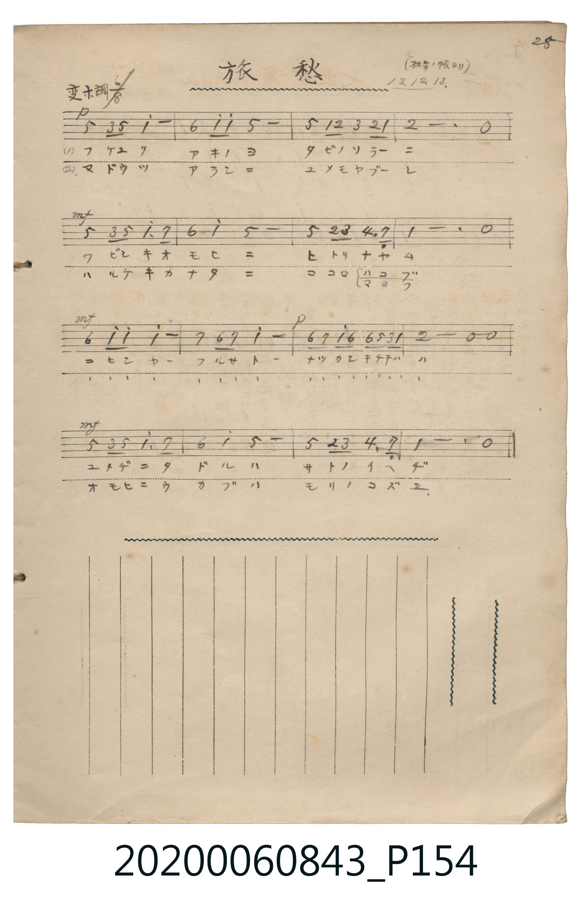

# 旅愁

> Re:Shōka 使用 AI 協助辨識與重建樂譜，可能會有錯誤。歡迎回報。

- **鋼琴伴奏版**：<br><audio controls src="ryoshu.mp3"></audio>

- 詞：犬童球渓
- 曲：J. P. Ordway
- 日治時期公學校《唱歌帳》（典藏號 2020.006.0843・P154）

## 說明


- 出處：《唱歌帳》（國立臺灣歷史博物館典藏號 2020.006.0843）第 P154.jpg 頁（手寫頁碼 25）。
- 標註：（林サンノ帳ヨリ）13.12.13.（大正 13 年 12 月 13 日抄自林氏筆記）。
- 作詞／作曲：犬童球渓 作詞（明治 40 年『中等教育唱歌集』），原曲為 J. P. Ordway〈Dreaming of Home and Mother〉。
- 調性與拍號：變ホ調（Eb 大調），6/8 拍，速度 != 72。
- 背景與曲風：原譜細膩標註 p、mf 等力度變化，抒發深秋羈旅異鄉、思念故鄉雙親與家園樹梢的濃厚鄉愁。
- 版本說明：本檔案為原頁單聲部簡譜之忠實數位化版本。
【原頁歌詞全文與中文語譯】（對應 P154.jpg）

### 編曲說明（鋼琴伴奏版）：

1. 前奏 (Intro, 4 小節)：引用結尾樂句，以 6/8 拍分解和弦鋪陳溫柔鄉愁。
2. 主歌伴奏 (Song, 16 小節 × 2 段)：右手演奏主旋律，左手配以優美的 6/8 拍琶音與和弦伴奏。


## 歌詞

```text
（一）フケユクアキノヨ　タビノソラーニ
ワビシキオモヒニ　ヒトリナヤム
コヒシヤーフルサトー　ナツカシチチハハ
ユメヂニタドルハ　サトノイヘヂ
多麼眷戀的故鄉啊、多麼令人懷念的父母，在夢境中尋覓的是通往故里家園的道路。）

（二）マドウツアラシニ　ユメモヤブーレ
ハルケキカナタニ　ココロマヨフ
コヒシヤーフルサトー　ナツカシチチハハ
オモヒニウカブハ　モリノコズヱ
多麼眷戀的故鄉啊、多麼令人懷念的父母，腦海中浮現的是故鄉森林的樹梢。）
```

## ABC

<div class="abc-score" data-abc-src="ryoshu.abc" aria-label="五線譜載入中"></div>

[下載 ABC 原始檔](ryoshu.abc)

## TMD 檔案連結

- [主旋律 TMD 檔案](ryoshu.tmd) [[在 TMD Studio 編輯](https://tmdlang.github.io/Tmd-TS/#tmd=s7IKdvYPcrWy4qpTUCpJTLdSSM7PyUlNLsnMz7MqzsjPTkzOyFeCS5bl55TmploBqXgDQ4RwcX5pUXJqfEFieqpVgKGpCboM3KT4vPyS1KT8_GyEioKi_LLUvMQ8oKrcxLzS4uSizIKS-OT8gkqEmtSyzJRUkIrUlMyS_KLMxBwkJ6UWFYMdC3FDSVFiHsQMoCBCFVBTemaeVW5qZlZmfElqRQnEEVpaCs-mtz5raVTQ0uJStFUwN-Kyt1Vw1eGyMdO3sAPpfrFy3vs9s553rXm-eunzCc3PdkwGG_ps9iagsJeeQoCegn9RSnkixLXPpi99tmn3s5lNz-bMf9q65unaHc8WLHzc0PV0ysZna3ue7tj8uKH7_Z6Op607XkzvfzFzvoKRgZGBnoGBmZ6BhYnx4-bdoNB7v6dTiYtLX0vBllqAS0FB4XHDBKCjn89e92LVqmcz-h43TASLNu9-2r7rxcypQN9gceec7ueru1-073reuPjZ2u1P-zc97Z31vHPlyyUrcHgB6Pbna9YogLyhl1WQrvByQSPQnGed3U_Xrwayny_ao2BkClT0uKEJav2zFTNfrNgNtB6kbt70x01bHzdvftzcB3JE84rHzauAqg2N9QyN9IAkyE1Llj9bu1jB0Fjh6c4tCoZGCs_mdIB4oKDvannRvgpoyLMN_c_Xtr1YMQPFpid754Bjsx_IgMQfcrQqwKQ7gKEDjEQFEwOQDY8b-p7sWPt8beezqTNfNG2CBNDL2W2PG_qBhr_f0_O0bz4oXJt2KSCnhscNHS5FqYm5mXnpCvlpCh75uakKiXkpCr75JRmpRY8bkJz1YtX-Zw3LX3S0P-vuBYYn0Fkv1nU9bp4NFAc6xjVJAehjMBtkGzBZKgDVAVkvG-Y_3bVMAZxokQxr7nk2cz3IsNmbXi5aATQM6L4Xa-c837LhRdtKSFgrFDxuaMxNUwB66mnXbKAhQPue9kwDmvmsa9LzmXuebd_4fHn3830dwKzxfOqGly1AxzY-a5j7dP_WZ1NbgdyXs2e-WLYKaMnTdduezpn0bMXOZ4sWPZ_V8mx_89O-WUAFwAyFcNLzzo5nc9ZAUh3QPUD2s1VTni3sAAYZ0G3ARPF02roXjZteNq94vmEh0KlPdnY_3b_g6fplz6bueLK3F-gyiAkgE6EJGaIPGBHACHvauuLZtHagY4DRBGKsmvdi7Xpg6gYllQ29z9o74YkRGIJgA4AyT3Y0gJJG89THTRsfNy973LT-cdOix01rgekOlOgaGh437X_cPBnEbdr7uHnl4-Y9j5u7IR5aD5Jo2g5S3bTqcfOix82TgHIgPSBGBzDFPm4Gxt-Sx80LwBqagOl4EkgDSAhozNTHzavBqRyodA9YG1B1y-MmoCBQTSMY9QMRxLZlj5sXPm5uAtkAchLQzatB0iAXQowAuhBo7gygGqjfICEAivk5K57t2QGKzVktwAh9umTOi8XAwqgROWaBUk-XrHy-cteTHcAM3_N07ZLnvSuAofNk1y5Q_Kxverp-KShmG-Y-3z7pWWfDi-5l7_fMBtmkAEyXs17u2vN8zvZnHQ0gNeC08XRqF9AKiNST3UuA5jxr3w5MOSA3dGx7th6UdIEOe7pk0dNFzcAoe7qh-8WyySDtM9a_bJj1dF8DyJz2HkjSAoq_bJz8YjswQpuQo29XDzj65oECpAkYRMDgA8bDSnAIQqICEm5AQWDgTAOH-xpIgAKDFhjSG8HRBwzKLnCwgvUAIwoUV8BEADQXWPJMpTz6kBMI0J0gC4GOAUcfSBwoC4w-oLW7HjdvRI8-YDZ_1jn5-arpzzpB0QTMzS9nr3i5ctbzBVue7GqDBCAoMPc3P1867-XilqcTJr5snPmycQEoTvfueTZtJ-Ux9aJ12bOt20E5a-u65_37INEE0f5s8TpgSQsSAWd_aAQBLaO8uoICBS19Lq7g_Lx0q4DMxLx8hxqDmmqwf2wMzbTswCxgJakBTK2awHidCgztjaAMA6TXK9QAyUVAvBYo0gfEK8Ai-4GsyRCRpr1AGpSvgVQ3UNIAZBvcyF09ICPnAXEnUCnQyOYWmJHNK4H0dqgusHXNC4EYJLMEiEFpDUitQTayRqG6oFbBVEFXwRiIQbRhHJCAwRoFM5gQmAApQMiBlQOxEVQ7iAbxa8AsGDRA1gPOJshhsx7ib5CzQSHStArsdJCTJ8E9AmJ1APEqIO4CewYkugBLsPQD8WpIaINNWw1WCdQDDl-waU2bIbgZFP6gYASHPzCOECGSm4Y1SMyRggQEcYQILDRMIJrioVKggCEqSMCOA3oZHJOgjA11H8RnW0FhARMEBUYL2JsQ1Y1Q3A-W7UfzEmpUosUzyHMgBSAaTQqUQiBSQAkQA4RNgX4kNa5hCbIJHBegOAE5E5iMQT6DOBriP2g-ACXaGWA1TZhxDUwpyOkElBVA-kEmTYMHAUgepA5kGijed4FFNw5cXNdycenaKYBKDgUgrcwFAA)]
- [鋼琴伴奏 TMD 檔案](ryoshu_piano.tmd) [[在 TMD Studio 編輯](https://tmdlang.github.io/Tmd-TS/#tmd=s7IKdvYPcrWy4tLSUng2vfVZS-P7PR0vu_c8n7DlyZ4tT5f2P-_seL-nU0FLi0vRVsHciMveVsFVh8vGTN_CjqtOQenFynnv98x63rXm-eqlzyc0P9sxWQkk_Gz2JqCwl55CgJ6Cf1FKeWIlRHj60mebdj-b2fRszvynrWuert3xbMHCxw1dT6dsfLa25-mOzY8buoH2P23d8WJ6_4uZ8xWMDIwM9AwMzPQMLEyMHzfvDjA0NQE6R4mLS19LwZZagEtBQeFxwwSgo5_PXvdi1apnM_oeN0wEizbvftq-68XMqUDfYHHnnO7nq7tftO963rj42drtT_s3Pe2d9bxz5cslK3B4Aej252vWKIC8oZdVkK7wckHj44YmqE1P9s4BB2c_kAEJQORwVYBIP25oRA5WkChQLcKQF6v2P2tY_qKj_Vl3L9B6oCEv1nU9bp4NFAe62DVJ4emS5WB25_s9PcBYVACqA7JeNsx_umuZAjiOEYY9374CaDgkRLCmC6DxIKUKCoZ6Ck87e4HiChqeeSVF-ToKJgpPN_Q_X9-gCVTzdM_U51NWPN864emGfc9WND3tXwq08snupQpQBzztaHuxfPHTST1P9yx72b3q5czNz3atfjZ_ysuWTmCKhLpHQcFIT-HJjt3AGIA4QUEjOD8vXUfB0AxqlcLh6QpGCs_WbQXb2b_5WWf3sz1TgCpBuqZ3P90HjLSep9uXAcVftvYC7X_asur5vr7ns1pgDnk-YdvL-ZuBoQdxC8QeqP2UpzMoUNDS5-ICh5JVQGZiXn6Qh0ONQU012I82hmZadmBWjYKpgq6CMRCDaMM4IKGrYA4maxTMwDRUGCQPgxBdRlCdJhBN8VApQySFBsiauGpRHOSD7CALuHsM4xVM4xWiDWORWDUKJvFAc6NNUAVN4-MVjIAc01hkJpoRICeArQZFI_6gqC6oxRYcMD-DggMshCM8QB6HhQmIBvFrwCzswQG1NDcNq620igQkW1E9hOZbkP0gBSAaTQoUThApoASIAcKmQGcMTh-jxD3lqQ7BNgMmOmMg0ywXS2qEpDtapmmI2XBT4AwUQ0i1kPbOBkaHrp0CuCBQADJAUYNMK3MBAA)]

## 分析

```text
================================================================================
📊 TMD Song Profile: [ 旅愁 ]
================================================================================
⏱  Duration:       0:40 (40.0s), 16 measures total
🎼 Key & Tempo:    首調基準 E,, != 72.0 BPM, <6/8>
   - 分析範圍：      由實際發聲的音符與和弦推測調性；播放脈絡另行呈現
🎤 人聲音域:    D4 (MIDI 62) – D#5 (MIDI 75) [跨度: 13 個半音 / 1.1 個八度, 難度: moderate]
   - 最低音:  D4 in [Song #1 @ m.7, 0:16]
   - 最高音: D#5 in [Song #1 @ m.1, 0:01]
   - 適合: soprano, mezzo-soprano, contralto, tenor, baritone, bass
🏛  結構:      Song (40.0s)
⚡ 編曲密度:        Peak 1 軌道同時演奏
🗝  調性診斷：       D# 大調（純淨自然大調，未偵測到可信轉調）
   - 風格氣質:    純淨自然大調（陽光明朗、易唱易記，無明顯調外色彩）
   - 轉調歷程:    全曲維持單一推測調性（未偵測到可信轉調）
   - 核心骨幹音:  D#, A#, C, F, D
   - 調性數值:    D# 大調 [相關度: 0.91, 穩定度: High, 自然音純度: 100.0%]
   - 候選調性 (K-S): D# 大調 (0.91), A# 大調 (0.73), C 小調 (0.60)
   - 五度圈歷程:   -3
   - 各段落調性細節:
     • [Song #1]: D# 大調 (r: 0.91, 自然音純度: 100.0%)

  [ 五度圈游移軌跡 ]
               C  
         F            G  
      Bb               D  
     [Eb]*              A  
         Ab           E  
            Db       B  
               F# 
     (* = active key center)

  [ 十二半音累積音高分佈 ]
     C  : █████████                 11.9%
     C# :                            0.0%
     D  : ███████                   10.1%
     D# : ████████████████████████  32.7%
     E  :                            0.0%
     F  : █████████                 11.9%
     F# :                            0.0%
     G  : ██████                     7.7%
     G# : ███                        3.6%
     A  :                            0.0%
     A# : ████████████████          22.0%
     B  :                            0.0%
--------------------------------------------------------------------------------
Assignment 軌道音域：
  - Piano         : D4 – D#5 (13 個半音 / 1.1 個八度, 60 個音符)
================================================================================
```


## 原書掃描頁




