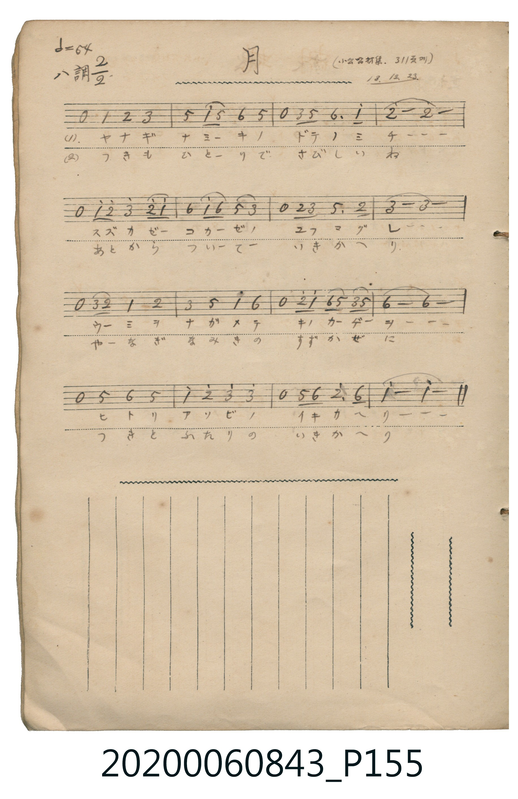

# 月

> Re:Shōka 使用 AI 協助辨識與重建樂譜，可能會有錯誤。歡迎回報。

- **鋼琴伴奏版**：<br><audio controls src="tsuki.mp3"></audio>

- 日治時期公學校《唱歌帳》（典藏號 2020.006.0843・P155）
- 原載《小公唱材集》第 311 頁（大正 13 年 12 月 23 日抄）

## 說明


- 出處：《唱歌帳》（國立臺灣歷史博物館典藏號 2020.006.0843）第 P155.jpg 頁。
- 標註：（小公唱材集 311 頁ヨリ）13.12.23.（大正 13 年 12 月 23 日抄錄）。
- 調性與拍號：ハ調（C 大調），2/2 拍，原譜速度 𝅗𝅥=64（換算四分音符 != 128）。
- 背景與曲風：每一樂句均以四分休止符後接優雅上行旋律展開，描寫黃昏柳樹並木堤岸上涼風習習，
孩童獨自散步回家時，天邊明月宛如也怕孤單似地一路相隨，變成了與月亮兩人的同行。
- 版本說明：本檔案為原頁單聲部簡譜之忠實數位化版本。
【原頁歌詞全文與中文語譯】（對應 P155.jpg）

### 編曲說明（鋼琴伴奏版）：

1. 前奏 (Intro, 4 小節)：取末樂句旋律，描繪柳堤微風與明月相伴的悠然步調。
2. 主歌伴奏 (Song, 16 小節 × 2 段)：左手在第 1 拍歌唱休止處以低音先導，帶動流暢的 2/2 拍律動。


## 歌詞

```text
（一）ヤナギナミキノ　ドテノミチーーー
スズカゼコカゼノ　ユフマグレーーー
ウミヲナガメテ　キノカゲーヲーーー
ヒトリアソビノ　イキカヘリーーー
一邊眺望大海、一邊走在樹蔭下，獨自遊玩後往返歸途。）

（二）つきもひとりで　さびしいね
あとからついて　いきかへり
やなぎなみきの　すずかぜに
つきとふたりの　いきかへり
在柳樹成排的涼風中，變成了與月亮兩人的往返同行。）
```

## ABC

```abc
X:1
T:月
M:2/2
L:1/16
Q:1/2=64
K:C
V:V1 name="Piano" snm="Pia"
[V:V1]
z4 C4 D4 E4 | G4 c2 G2 A4 G4 | z4 E2 G2 A6 c2 | d16 |
z4 c2 d2 e4 d2 c2 | A4 c2 A2 G4 E4 | z4 D2 E2 G6 D2 | E16 |
z4 E2 D2 C4 D4 | E4 G4 c4 A4 | z4 d2 c2 A2 G2 E2 G2 | A16 |
z4 G4 A4 G4 | c4 d4 e4 e4 | z4 G2 A2 d6 A2 | c16 |
```

## TMD 檔案連結

- [主旋律 TMD 檔案](tsuki.tmd) [[在 TMD Studio 編輯](https://tmdlang.github.io/Tmd-TS/#tmd=s7IKdvYPcrWy4qpTUCpJTLdSSM7PyUlNLsnMz7MqzsjPTkzOyFeCS5bl55TmploBqXgDQ4RwcX5pUXJqfEFieqpVgKGpKboM3KT4vPyS1KT8_GyEioKi_LLUvMQ8oKrcxLzS4uSizIKS-OT8gkqEmtSyzJRUkIrUlMyS_KLMxBwkJ6UWFYMdC3FDSVFiHsQMoCBCVUlGKtDdeYklpUWpCFGgUemZeValeSDjSzLTMlNTlLi0tBSezelQ0NLiUrRVMDSy4LK3VXDmsjHSN7IDaXw2femzTbufzWx6Nmf-09Y1T9fueLZg4eOGrqdTNj5b2_N0x-bHDd3v93Q8bd3xYnr_i5nzFYwMjAz0DAzM9AwsTIwfN-8GBdD7PZ1gVzztm_9iTydI94Z-kGFAM-ZOeDm7DWjG8zVrFIwNDRVeLmgEGbdk-bO1ixUMjRWe7twCdBXYiUbGCiDXdLWAjePS11KwpRbgUlBQeNww4dnsTc9nr3uxatWzGX2PGyaCRZt3P23f9WLm1Pd7ZmHx9pzu56u7X7Tvet64-Nna7U_7Nz3tnfW8c-XLJStwhAjQ7SCvgkJFL6sgHeTfxw1NUJuerZj5YsVuoE0go1GDCBY4j5tXPG5eBTTF0FjP0EjPyFiPYHC97AGFGMKWF6v2P2tY_qKj_Vl3L9B9II819wMFgQY5KwCNAjM73-_pAaYBBaAaIAsUcWvnvGyY_3TXMoUPc1unA_FSWzMToJZn_bOfr5v-dPbspx1tL-dvfr5mmQIkIaHa2dzzbOZ6kJ2zN71ctAJo57P1_U92NDxb0fS0f-nTue1Pdi-FmPFkz8RnaxcBjXm6r-dZ39KnLatezm59sqPrxcKeZ9O7n-7rfrpx6stpwMDvedbf_3T96pe7m5_N6H82f_OzFTuf7Fj2bM6KpwuWPN20A6jl2bY9QLue758ERED1IKcoKDxdu_L56qXPe1e8aF_1bCow1oD2znu6bhswiYM8umTly6YuYPQDQ_DputlPlzU92Tn_WcPUp2uXPJ227smePU_nbAA6-8X29c9n73g5C-iRnhfrup51THiyqw3kuzkdT3ate9q68smuXc9ntTyd0AN0NiIUnnd2PJuzBpK-QEEwZ82zVVOeLex43rQLGMLA2AXa8aJx08vmFc83LAQG-JOd3U_3L3i6ftmzqTue7O192jMNYgLIRGiShegDpskXK-c9bV3xbFo70BlPdqwFMVbNe7F2PTAdg1NT77P2TniyA8YN2ACgDNA3oJhqXvK4uetx0zoQ2Tz_cdPax83ALNDwuBko1QZiAwWbgalvDwRBbG-Aoqadj5t2PW5a_bhpz-OmzVAGVP-yx81THzfPe9y04XHzGlz6gYqAxm8COwGoaCHITpA42BUg44BSQG0QElN_86THzR3AbPG4adHjpr2PmydDLW9aAjICqL95BkgWWTPQ55DwAcbD0zkrIOkHGI_P-iaBIg6chIBZEBjRwIQESmzgtAQM26f71gEZTyfsfNbdBFQJTX4zm4BJ9_2e2ZA0BgxTYCp6PmfXszmzQXlz6_bHDY0QwRdbN4CsW7HzxZS1T3aAkjEkKb5s7HretxKY5p_ua3ixf8qztTteNkwBxjNyTO3qAcVU45LHjb2Pm5oeN2563LjicVPX48blIM82Tn3cuPlx4_THjS2PG9eiBlAjUPWKx43dj5sg-oEqloHFgYxekHjjDqBBaJEClFv1uLEPTO4Hq1sH1jPzceMssJ45jxtXo9kDdhvIqq2PG4GpCOg2iB4Me5DDH5JrQBltxnpoRtvRAMxBT_d1PF3f9HT9vKcTloMy2vb5oKDrmAgM9he7VgPDCpQTt25_sq8NmIXhgY8Zm5C4A2YKArkVHPLwPAsKeaBxlFcuUKCgpc_FFZyfl24VkJmYl-9QY1CjUA12so2Flh2YAazSNIB-0lQwAJYWS4C4SwGYJRVqICxQFtkDFFgLZPYBBUGKOoG4DcwHSoMVNgIxUBUUA-2EG7yrB2xwI9Dgxl6gOU0g9Y2bgBhYpYAMBtrRuBxicONUIN4MxNOBuAWsEGQthsEgxboKhkBsBMTGQFyjYAoSiQNSZkAGiANRZAwVAUvWKBjFgdkIWANO5yhh0LQTiHcB8WogBuVckEOagM4CZWmQi0FugQXFMiAGurp5HlB8Azgo1hAMiiaQ54G4G6inE-xLUOC0gLU0ggwE2QhS2AIJM5DCxh1gV4AiBFdwxIF8ZwzyIJAG-xbkcSDDDBwekGACqTQChwrI90ZAEZA4oRABlpQgG-cD8SZYwmgCeXQhOCWAXQtNIfBQAhWbYLXAuMYfIMA8D_b6KiAGhSuEtR_qeVBKBAXGTCCeBQ2MOWBVwPjBFRjGQK_B0gfEi9D0oQsOFGg4gIMJFDqg8IAEF4GQaJ4ExB1AvAocHYuAeC-QNxmRIpqAcQkKClDqgUQaUC2RmQOYKkD-2grEwKAG5wyY70lKCiC_IrIB2NfghA9OHGACps4MliPMYApRA6CWi0vXTgFUfigAaWUuAA)]
- [鋼琴伴奏 TMD 檔案](tsuki_piano.tmd) [[在 TMD Studio 編輯](https://tmdlang.github.io/Tmd-TS/#tmd=s7IKdvYPcrWy4tLSUng2p-P9no6X3XueT9jyZM-Wp0v7n3cCRToVtLS4FG0VDI0suOxtFZy5bIz0jey46hSUnk1f-mzT7mczm57Nmf-0dc3TtTueLVj4uKHr6ZSNz9b2PN2x-XFDN9DEp607XkzvfzFzvoKRgZGBnoGBmZ6BhYnx4-bdAYampkALlECGPe2b_2JPJ0j3hn6QYUAz5k54ObsNaMbzNWsUjA0NFV4uaFTi4tLXUrClFuBSUFB43DDh2exNz2eve7Fq1bMZfY8bJoJFm3c_bd_1YubU93tmYfHSnO7nq7tftO963rj42drtT_s3Pe2d9bxz5cslK3D4FuhNkDdAPtbLKkgH-eVxQxPUpher9j9rWP6io_1Zdy9QJ8jK5n6gINAmZ4WnS5aDmZ3v9_QAQ14BqAbIetkw_-muZQqQeAGq-zC3dToQL7U1MwEqRRj9fPsKoO8gXsMau0DLQEoVFAz1FJ529gLFFTQ880qK8nUUTBSAcfF8fYMmUM3T_mnP5qx-tqLpaf_SZ9O7n-4DBkPPs_7-5ztXPZu_-emCJU_3rXu5aAXIDzP6gCnp-ewdQFuez2p51rTgecu2Z2uXAj0BdZaCgpGewpMdu4EhCnGJgkZwfl66joKhGdRGhcPTFYA-XbcVbPX2Zc86u5_OWQEKQEOQ_0FRMWXjkz0Tn61dBIyiJ7uXPtnb9xLojNaOpxuA3gRG1Lan3VOfbW18NmsR0A0K0HADuhooDHUF5akHChS09Lm4wEFmFZCZmJcf5OFQY1CjUA32qo2Flh2YUaNgoKCrYArEZlC6RsEwDkgZgQhjOAFTZwaRACmHKoRBkHwNVy2KnT4odprA7TSMV4g2jFUwhVCYfBDDFMIHUnB5IGUAsQMUMYS9ZQjyB8gHYA-APAd0McgPMJ-CFBlDRcCSNTDvIWANsoFxIHlwgABpsHqQViDDDGwixCKQSiOwuSD9RkARkDguM42BKmAOhaiEOhQSJVDjwLaBLAEZC7EVl4HUiEyImSgBTWJcmgApEyS-GZAyy0WKXCNo5OIwBqofKowzScDUE-kYqHZjIGUMdgzMWSARsPOolUJ17RTAGUEByAAFIjKtzAUA)]

## 分析

```text
================================================================================
📊 TMD Song Profile: [ 月 ]
================================================================================
⏱  Duration:       0:30 (30.0s), 16 measures total
🎼 Key & Tempo:    首調基準 C, != 128.0 BPM, <2/2>
   - 分析範圍：      由實際發聲的音符與和弦推測調性；播放脈絡另行呈現
🎤 人聲音域:    C4 (MIDI 60) – E5 (MIDI 76) [跨度: 16 個半音 / 1.3 個八度, 難度: moderate]
   - 最低音:  C4 in [Song #1 @ m.1, 0:00]
   - 最高音: E5 in [Song #1 @ m.5, 0:08]
   - 適合: soprano, mezzo-soprano, contralto, tenor, baritone, bass
🏛  結構:      Song (30.0s)
⚡ 編曲密度:        Peak 1 軌道同時演奏
🗝  調性診斷：       C 調性不明確（純淨自然大調，未偵測到可信轉調）
   - 風格氣質:    純淨自然大調（陽光明朗、易唱易記，無明顯調外色彩）
   - 轉調歷程:    全曲維持單一推測調性（未偵測到可信轉調）
   - 核心骨幹音:  E, D, A, C, G
   - 調性數值:    C 調性不明確 [相關度: 0.73, 穩定度: Ambiguous, 自然音純度: 100.0%]
   - 候選調性 (K-S): C 大調 (0.73), A 小調 (0.72), G 大調 (0.68)
   - 五度圈歷程:   +0
   - 各段落調性細節:
     • [Song #1]: C 調性不明確 (r: 0.73, 自然音純度: 100.0%)

  [ 五度圈游移軌跡 ]
              [C ]*
         F            G  
      Bb               D  
      Eb               A  
         Ab           E  
            Db       B  
               F# 
     (* = active key center)

  [ 十二半音累積音高分佈 ]
     C  : ██████████████████████    19.6%
     C# :                            0.0%
     D  : ███████████████████████   20.5%
     D# :                            0.0%
     E  : ████████████████████████  21.4%
     F  :                            0.0%
     F# :                            0.0%
     G  : ████████████████████      17.9%
     G# :                            0.0%
     A  : ███████████████████████   20.5%
     A# :                            0.0%
     B  :                            0.0%
--------------------------------------------------------------------------------
Assignment 軌道音域：
  - Piano         : C4 – E5 (16 個半音 / 1.3 個八度, 55 個音符)
================================================================================
```


## 原書掃描頁




