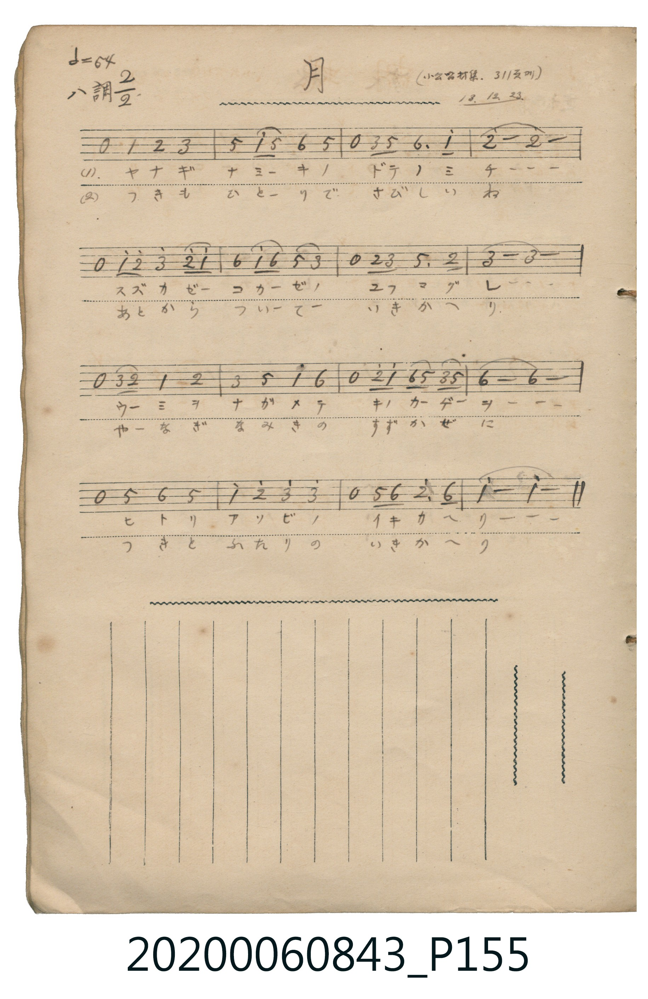

# 月

> Re:Shōka 使用 AI 協助辨識與重建樂譜，可能會有錯誤。歡迎回報。

- **鋼琴伴奏版**：<br><audio controls src="tsuki.mp3"></audio>

- 日治時期公學校《唱歌帳》（典藏號 2020.006.0843・P155）
- 原載《小公唱材集》第 311 頁（大正 13 年 12 月 23 日抄）

## 說明


- 出處：《唱歌帳》（國立臺灣歷史博物館典藏號 2020.006.0843）第 P155.jpg 頁。
- 標註：（小公唱材集 311 頁ヨリ）13.12.23.（大正 13 年 12 月 23 日抄錄）。
- 調性與拍號：ハ調（C 大調），2/2 拍，原譜速度 != 128。

### 編曲說明（鋼琴伴奏版）：

1. 前奏 (Intro, 4 小節)：取末樂句旋律，描繪柳堤微風與明月相伴的悠然步調。
2. 主歌伴奏 (Song, 16 小節 × 2 段)：左手在第 1 拍歌唱休止處以低音先導，帶動流暢的 2/2 拍律動。


## 歌詞

```text
（TMD 檔案未包含歌詞註解）
```

## ABC

<div class="abc-score" data-abc-src="tsuki.abc" aria-label="五線譜載入中"></div>

[下載 ABC 原始檔](tsuki.abc)

## TMD 檔案連結

- [主旋律 TMD 檔案](tsuki.tmd) [[在 TMD Studio 編輯](https://tmdlang.github.io/Tmd-TS/#tmd=s7IKdvYPcrWy4qpTUCpJTLdSSM7PyUlNLsnMz7MqzsjPTkzOyFeCS5bl55TmploBqXgDQ4RwcX5pUXJqfEFieqpVgKGpKboM3KT4vPyS1KT8_GyEioKi_LLUvMQ8oKrcxLzS4uSizIKS-OT8gkqEmtSyzJRUkIrUlMyS_KLMxBwkJ6UWFYMdC3FDSVFiHsQMoCBCVUlGKtDdeYklpUWpCFGgUemZeValeSDjSzLTMlNTkCVLMvLTixILMiqtMjKLQfYmJ-bEZyfmJSpxaWkpPJvToaClxaVoq2BoZMFlb6vgzGVjpG9kBzLg2fSlzzbtfjaz6dmc-U9b1zxdu-PZgoWPG7qeTtn4bG3P0x2bHzd0v9_T8bR1x4vp_S9mzlcwMjAy0DMwMNMzsDAxfty8GxSK7_d0gl3ztG_-iz2dIN0b-kGGAc2YO-Hl7DagGc_XrFEwNjRUeLmgEWTckuXP1i5WMDRWeLpzC9BVYCcaGSuAXNPVAjaOS19LwZZagEtBQeFxw4Rnszc9n73uxapVz2b0PW6YCBZt3v20fdeLmVPf75mFxdtzup-v7n7Rvut54-Jna7c_7d_0tHfW886VL5eswBEiQLeDvAoKFb2sgnSQfx83NEFterZi5osVu4E2gYxGDSJY4DxuXvG4eRXQFENjPUMjPSNjPYLB9bIHFGIIW16s2v-sYfmLjvZn3b1A94E81twPFAQa5KwANArM7Hy_pweYBhSAaoAsUMStnfOyYf7TXcsUIOkEah7lYQ8FClr6XFzB-XnpVgGZiXn5DjUGNdUgCxRsLLTswAxghGs82dGgqWAA9MUSIO5SeNy0TqEGwmqe_7h5D1BgLZDZBxQEKeoE4jYwHygNVtgIxEBVUAy0Em7wrh6wwY1Agxt7geY0gdQ3bgJiYICDDAba0bgcYnDjVCDeDMTTgbgFrBBkLYbBIMW6CoZAbATExkBco2AKEokDUmZABogDUWQMFQFL1igYxYHZCFgDNtDHsEYhHsgD-R9EdoFIYBiATIHyIOEAEl4L5vaBJSGaEOEBMhIRJlitMoLqAoYIiOwFm9kEsQoYLiAxcMiAhME2A0MHbhVSCIGtgocSulUYMdu0E4h3AfFqIN4DsgCosQloVNNqSDyAQhgWwcuAGGhT8zyg-AawZ9YQjOAmkMOBuBuopxPsKlCUt4C1NIIMBNkIUtgCSQkghY07wK4AJTNckRwHijNjULQBaXAcgqITyDADxzIk8kEqjcBxDfK9EVAEJI4nnpFCA8QDhwc4BoAhAhIAhwlYBiOyEWEDjgF4-OCPbETogPR0QqMbkgTAYQRiLANbAHEJRBsirCDRDQsvwtG9DBKc84F4EywvN4FicSE4sYKjApqp4UlgEzRZAHUQiO0maLyuAmJQooGw9kNdCyo8QDE9E4hnQWN6DlgVMPHhimljYLzBsjQk_qBZWhcc49BIBqcBUNSDIhuSFvBFMzgUIFkSRIKyFzxHA0MDJLYQTLYhAh1rqIANh5qAJ54h4QKKqVVgEpJwYLz9YBKc44FhhIhlRDiBeHOgekBJk0AsN08C4g4gXgVOF4uAeC-QNxmRlZuAmRDkIVC2h6QeoFoiy2pgggW5YysQA5MRuKCGxSxJeRgUj4hSGRyj4HIYnKvBBEydGayANoMpxBO5QM-DyA4wCQpgSBCAYmEvWGwymETKu0iBgZSdwHqJLKiBQQKJnK1gHjhVQUtp5AglNtvWcnHp2imAaudoH8NYBTjbCMxW5gIA)]
- [鋼琴伴奏 TMD 檔案](tsuki_piano.tmd) [[在 TMD Studio 編輯](https://tmdlang.github.io/Tmd-TS/#tmd=s7IKdvYPcrWy4qpTUCpJTLdSyC8qychPL0osyKi0ysgsLskvykxOzInPTsxLVIIrKs4vLUpOjS9ITE-1CjA0NUXIlGSk5qZaJRaXFOXn5edWKnFpaSk8m9Pxfk_Hy-49zydsebJny9Ol_c87gSKdClpaXIq2CoZGFlz2tgrOXDZG-kZ2IJOeTV_6bNPuZzObns2Z_7R1zdO1O54tWPi4oevplI3P1vY83bH5cUM30MSnrTteTO9_MXO-gpGBkYGegYGZnoGFifHj5t0gNwEtADvrad_8F3s6Qbo39IMMA5oxd8LL2W1AM56vWaNgbGio8HJBoxIXl76Wgi21AJeCgsLjhgnPZm96Pnvdi1Wrns3oe9wwESzavPtp-64XM6e-3zMLi5fmdD9f3f2ifdfzxsXP1m5_2r_pae-s550rXy5ZgcO3QG-CvAHysV5WQTrIL48bmqA2vVi1_1nD8hcd7c-6e4E6QVY29wMFgTY5KzxdshzM7Hy_pwcY8gpANUDWy4b5T3ctU4DEC1Ddh7mt04F4qa2ZCVApwujn21cAfQfxGtbYBVoGUqqgYKin8LSzFyiuoOGZB0wXOgomCsC4eL6-QROo5mn_tGdzVj9b0fS0f-mz6d1P9wGDoedZf__znauezd_8dMGSp_vWvVy0AuSHGX3AlPR89g6gLc9ntTxrWvC8ZduztUuBnoA6S0HBSE_hyY7dwBCFuERBIzg_L11HwdAMaqPC4ekKQJ-u2wq2evuyZ53dT-esAAWgIcj_oKiYsvHJnonP1i4CRtGT3Uuf7O17CXRGa8fTDUBvAiNq29Puqc-2Nj6btQjoBgVouAFdDRSGuoLy1AMFClr6XFzgILMKyEzMyw_ycKgxqKkG-9TGQssOzKhRMFDQVTAFYjMoXaNgGAekjECEMZyAqTODSICUQxXCIEi-hqsWxUofZCtN4FYaxitEG8YqmEIoTD6IYQrhAym4PJAygFgBihaCnjIE-QLkfrDzQV4DuhfkA5g_QYqMoSJgyRqY5xCwBtnAOJA8ODiANFg9SCuQYQY2EWIRSKUR2FyQfiOgCEgcl5nGQBUwh0JUQh0KiRCocWDbQJaAjIXYistAakQlxEyUcCYtJk2AlAkS3wxImeUiRa0RNGpxGAPVDxXGmSBg6ol0DFS7MZAyBjsG5iyQCNh51EqfunYK4FygAGSAwhCZVuYCAA)]

## 分析

```text
================================================================================
📊 TMD Song Profile: [ 月 ]
================================================================================
⏱  Duration:       1:00 (60.0s), 32 measures total
🎼 Key & Tempo:    首調基準 C, != 128.0 BPM, <2/2>
   - 分析範圍：      由實際發聲的音符與和弦推測調性；播放脈絡另行呈現
🎤 人聲音域:    C4 (MIDI 60) – E5 (MIDI 76) [跨度: 16 個半音 / 1.3 個八度, 難度: moderate]
   - 最低音:  C4 in [Song[L1] #1 @ m.1, 0:00]
   - 最高音: E5 in [Song[L1] #1 @ m.5, 0:08]
   - 適合: soprano, mezzo-soprano, contralto, tenor, baritone, bass
🏛  結構:      Song[L1] (30.0s) -> Song[L2] (30.0s)
⚡ 編曲密度:        Peak 1 軌道同時演奏
🗝  調性診斷：       C 調性不明確（純淨自然大調，未偵測到可信轉調）
   - 風格氣質:    純淨自然大調（陽光明朗、易唱易記，無明顯調外色彩）
   - 轉調歷程:    全曲維持單一推測調性（未偵測到可信轉調）
   - 核心骨幹音:  E, D, A, C, G
   - 調性數值:    C 調性不明確 [相關度: 0.73, 穩定度: Ambiguous, 自然音純度: 100.0%]
   - 候選調性 (K-S): C 大調 (0.73), A 小調 (0.72), G 大調 (0.68)
   - 五度圈歷程:   +0 -> +0
   - 各段落調性細節:
     • [Song[L1] #1]: C 調性不明確 (r: 0.73, 自然音純度: 100.0%)
     • [Song[L2] #1]: C 調性不明確 (r: 0.73, 自然音純度: 100.0%)

  [ 五度圈游移軌跡 ]
              [C ]*
         F            G  
      Bb               D  
      Eb               A  
         Ab           E  
            Db       B  
               F# 
     (* = active key center)

  [ 十二半音累積音高分佈 ]
     C  : ██████████████████████    19.6%
     C# :                            0.0%
     D  : ███████████████████████   20.5%
     D# :                            0.0%
     E  : ████████████████████████  21.4%
     F  :                            0.0%
     F# :                            0.0%
     G  : ████████████████████      17.9%
     G# :                            0.0%
     A  : ███████████████████████   20.5%
     A# :                            0.0%
     B  :                            0.0%
--------------------------------------------------------------------------------
Assignment 軌道音域：
  - Piano         : C4 – E5 (16 個半音 / 1.3 個八度, 110 個音符)
================================================================================
```


## 原書掃描頁




