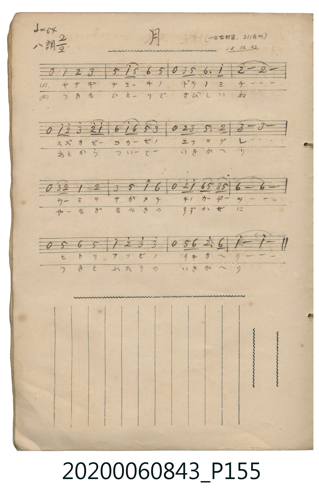

# 月

<audio controls src="tsuki.mp3"></audio>

- 日治時期公學校《唱歌帳》（典藏號 2020.006.0843・P155）
- 原載《小公唱材集》第 311 頁（大正 13 年 12 月 23 日抄）

## 說明

【曲目說明】
・出處：《唱歌帳》（國立臺灣歷史博物館典藏號 2020.006.0843）第 P155.jpg 頁。
・標註：（小公唱材集 311 頁ヨリ）13.12.23.（大正 13 年 12 月 23 日抄錄）。
・調性與拍號：ハ調（C 大調），2/2 拍，原譜速度 𝅗𝅥=64（換算四分音符 != 128）。
・背景與曲風：每一樂句均以四分休止符後接優雅上行旋律展開，描寫黃昏柳樹並木堤岸上涼風習習，
孩童獨自散步回家時，天邊明月宛如也怕孤單似地一路相隨，變成了與月亮兩人的同行。
・版本說明：本檔案為原頁單聲部簡譜之忠實數位化版本。
【原頁歌詞全文與中文語譯】（對應 P155.jpg）

・編曲說明（鋼琴伴奏版）：
1. 前奏 (Intro, 4 小節)：取末樂句旋律，描繪柳堤微風與明月相伴的悠然步調。
2. 主歌伴奏 (Song, 16 小節 × 2 段)：左手在第 1 拍歌唱休止處以低音先導，帶動流暢的 2/2 拍律動。

## 跨冊／重複收錄參照

> 同名異曲（各冊收錄之不同詞曲版本）

- **[同名異曲]** 《新定兒童唱歌》尋常科第一學年用（2020.006.0847.0001）：[**〈ツキ〉**](../../../shintei_jido_shoka/grade_1_2020.006.0847.0001/2_08_tsuki/index.md)（`F` / `2/4` — [原始 TMD](../../../shintei_jido_shoka/grade_1_2020.006.0847.0001/2_08_tsuki/tsuki.tmd)）
- 總表：[跨冊重複與同名歌曲總索引](../../../duplicate_songs.md)

## 歌詞

```text
（一）ヤナギナミキノ　ドテノミチーーー
スズカゼコカゼノ　ユフマグレーーー
ウミヲナガメテ　キノカゲーヲーーー
ヒトリアソビノ　イキカヘリーーー
一邊眺望大海、一邊走在樹蔭下，獨自遊玩後往返歸途。）

（二）つきもひとりで　さびしいね
あとからついて　いきかへり
やなぎなみきの　すずかぜに
つきとふたりの　いきかへり
在柳樹成排的涼風中，變成了與月亮兩人的往返同行。）
```

## ABC

```abc
X:1
T:月
M:2/2
L:1/16
Q:1/2=64
K:C
V:V1 name="Piano" snm="Pia"
[V:V1]
z4 C4 D4 E4 | G4 c2 G2 A4 G4 | z4 E2 G2 A6 c2 | d16 |
z4 c2 d2 e4 d2 c2 | A4 c2 A2 G4 E4 | z4 D2 E2 G6 D2 | E16 |
z4 E2 D2 C4 D4 | E4 G4 c4 A4 | z4 d2 c2 A2 G2 E2 G2 | A16 |
z4 G4 A4 G4 | c4 d4 e4 e4 | z4 G2 A2 d6 A2 | c16 |
```

## TMD 檔案連結

- [主旋律 TMD 檔案](tsuki.tmd) [[在 TMD Studio 編輯](https://tmdlang.github.io/Tmd-TS/#tmd=s7IKdvYPcrWy4qpTUCpJTLdSSM7PyUlNLsnMz7MqzsjPTkzOyFeCS5bl55TmploBqXgDQ4RwcX5pUXJqfEFieqpVgKGpKboM3KT4vPyS1KT8_GyEioKi_LLUvMQ8oKrcxLzS4uSizIKS-OT8gkqEmtSyzJRUkIrUlMyS_KLMxBwkJ6UWFYMdC3FDSVFiHsQMoCBCVUlGKtDdeYklpUWpSlxaWgrP5nQoaGlxKdoqGBpZcNnbKjhz2RjpG9mBdDybvvTZpt3PZjY9mzP_aeuap2t3PFuw8HFD19MpG5-t7Xm6Y_Pjhu73ezqetu54Mb3_xcz5CkYGRgZ6BgZmegYWJsaPm3eDwuD9nk6w9U_75r_Y0wnSvaEfZBjQjLkTXs5uA5rxfM0aBWNDQ4WXCxpBxi1Z_mztYgVDY4WnO7cAXQV2opGxAsg1XS1g47j0tRRsqQW4FBQUHjdMeDZ70_PZ616sWvVsRt_jholg0ebdT9t3vZg59f2eWVi8Paf7-eruF-27njcufrZ2-9P-TU97Zz3vXPlyyQocIQJ0O8iroFDRyypIB_n3cUMT1KZnK2a-WLEbaBPIaNQgggXO4-YVj5tXAU0xNNYzNNIzMtYjGFwve0AhhrDlxar9zxqWv-hof9bdC3QfyGPN_UBBoEHOCkCjwMzO93t6gGlAAagGyAJF3No5LxvmP921TOHD3NbpQLzU1swEqOVZ_-zn66Y_nT37aUfby_mbn69ZpgBJSKh2Nvc8m7keZOfsTS8XrQDa-Wx9_5MdDc9WND3tX_p0bvuT3UshZjzZM_HZ2kVAY57u63nWt_Rpy6qXs1uf7Oh6sbDn2fTup_u6n26c-nIaMPB7nvX3P12_-uXu5mcz-p_N3_xsxc4nO5Y9m7Pi6YIlTzftAGp5tm0P0K7n-ycBEVA9yCkKCk_Xrny-eunz3hUv2lc9mwqMNaC9856u2wZM4iCPLln5sqkLGP3AEHy6bvbTZU1Pds5_1jD16dolT6ete7Jnz9M5G4DOfrF9_fPZO17OAnqk58W6rmcdE57sagP5bk7Hk13rnraufLJr1_NZLU8n9ACdjQiF550dz-asgaQvUBDMWfNs1ZRnCzueN-0ChjAwdoF2vGjc9LJ5xfMNC4EB_mRn99P9C56uX_Zs6o4ne3uf9kyDmAAyEZpkIfqAafLFynlPW1c8m9YOdMaTHWtBjFXzXqxdD0zH4NTU-6y9E57sgHEDNgAoA_QNKKaalzxu7nrctA5ENs9_3LT2cTMwCzQ8bgZKtYHYQMFmYOrbA0EQ2xugqGnn46Zdj5tWP27a87hpM5QB1b_scfPUx83zHjdteNy8Bpd-oCKg8ZvATgAqWgiyEyQOdgXIOKAUUBuExNTfPOlxcwcwWzxuWvS4ae_j5slQy5uWgIwA6m-eAZJF1gz0OSR8gPHwdM4KSPoBxuOzvkmgiAMnIWAWBEY0MCGBEhs4LQHD9um-dUDG0wk7n3U3AVVCk9_MJmDSfb9nNiSNAcMUmIqez9n1bM5sUN7cuv1xQyNE8MXWDSDrVux8MWXtkx2gZAxJii8bu573rQSm-af7Gl7sn_Js7Y6XDVOA8YwcU7t6QDHVuORxY-_jpqbHjZseN6543NT1uHE5yLONUx83bn7cOP1xY8vjxrWoAdQIVL3icWP34yaIfqCKZWBxIKMXJN64A2gQWqQA5VY9buwDk_vB6taB9cx83DgLrGfO48bVaPaA3QayauvjRmAqAroNogfDHuTwh-QaUEabsR6a0XY0AHPQ030dT9c3PV0_7-mE5aCMtn0-KOg6JgKD_cWu1cCwAuXErduf7GsDZmF44GPGJiTugJmCQG4Fhzw8z4JCHmgc5ZULFCho6XNxBefnpVsFZCbm5TvUGNQoVIOdbGOhZQdmAKs0DaCfNBUMgKXFEiDuUgBmSYUaCAuURfYABdYCmX1AQZCiTiBuA_OB0mCFjUAMVAXFQDvhBu_qARvcCDS4sRdoThNIfeMmIAZWKSCDgXY0LocY3DgViDcD8XQgbgErBFmLYTBIsa6CIRAbAbExENcomIJE4oCUGZAB4kAUGUNFwJI1CkZxYDYC1oDTOUoYNO0E4l1AvBqIQTkX5JAmoLNAWRrkYpBbYEGxDIiBrm6eBxTfAA6KNQSDognkeSDuBurpBPsSFDgtYC2NIANBNoIUtkDCDKSwcQfYFaAIwRUccSDfGYM8CKTBvgV5HMgwA4cHJJhAKo3AoQLyvRFQBCROKESAJSXIxvlAvAmWMJpAHl0ITglg10JTCDyUQMUmWC0wrvEHCDDPg72-CohB4Qph7Yd6HpQSQYExE4hnQQNjDlgVMH5wBYYx0Guw9AHxIjR96IIDBRoO4GAChQ4oPCDBRSAkmicBcQcQrwJHxyIg3gvkTUakiCZgXIKCApR6IJEGVEtk5gCmCpC_tgIxMKjBOQPme5KSAsiviGwA9jU44YMTB5iAqTOD5QgzmELUAKjl4tK1UwCVHwpAWpkLAA)]
- [鋼琴伴奏 TMD 檔案](tsuki_piano.tmd) [[在 TMD Studio 編輯](https://tmdlang.github.io/Tmd-TS/#tmd=s7IKdvYPcrWy4tLSUng2p-P9no6X3XueT9jyZM-Wp0v7n3cCRToVtLS4FG0VDI0suOxtFZy5bIz0jey46hSUnk1f-mzT7mczm57Nmf-0dc3TtTueLVj4uKHr6ZSNz9b2PN2x-XFDN9DEp607XkzvfzFzvoKRgZGBnoGBmZ6BhYnx4-bdAYampkALlECGPe2b_2JPJ0j3hn6QYUAz5k54ObsNaMbzNWsUjA0NFV4uaFTi4tLXUrClFuBSUFB43DDh2exNz2eve7Fq1bMZfY8bJoJFm3c_bd_1YubU93tmYfHSnO7nq7tftO963rj42drtT_s3Pe2d9bxz5cslK3D4FuhNkDdAPtbLKkgH-eVxQxPUpher9j9rWP6io_1Zdy9QJ8jK5n6gINAmZ4WnS5aDmZ3v9_QAQ14BqAbIetkw_-muZQqQeAGq-zC3dToQL7U1MwEqRRj9fPsKoO8gXsMau0DLQEoVFAz1FJ529gLFFTQ880qK8nUUTBSAcfF8fYMmUM3T_mnP5qx-tqLpaf_SZ9O7n-4DBkPPs_7-5ztXPZu_-emCJU_3rXu5aAXIDzP6gCnp-ewdQFuez2p51rTgecu2Z2uXAj0BdZaCgpGewpMdu4EhCnGJgkZwfl66joKhGdRGhcPTFYA-XbcVbPX2Zc86u5_OWQEKQEOQ_0FRMWXjkz0Tn61dBIyiJ7uXPtnb9xLojNaOpxuA3gRG1Lan3VOfbW18NmsR0A0K0HADuhooDHUF5akHChS09Lm4wEFmFZCZmJcf5OFQY1CjUA32qo2Flh2YUaNgoKCrYArEZlC6RsEwDkgZgQhjOAFTZwaRACmHKoRBkHwNVy2KnT4odprA7TSMV4g2jFUwhVCYfBDDFMIHUnB5IGUAsQMUMYS9ZQjyB8gHYA-APAd0McgPMJ-CFBlDRcCSNTDvIWANsoFxIHlwgABpsHqQViDDDGwixCKQSiOwuSD9RkARkDguM42BKmAOhaiEOhQSJVDjwLaBLAEZC7EVl4HUiEyImSgBTWJcmgApEyS-GZAyy0WKXCNo5OIwBqofKowzScDUE-kYqHZjIGUMdgzMWSARsPOolUJ17RTAGUEByAAFIjKtzAUA)]

## 分析

```text
================================================================================
📊 TMD Song Profile: [ 月 ]
================================================================================
⏱  Duration:       0:30 (30.0s), 16 measures total
🎼 Key & Tempo:    首調基準 C, != 128.0 BPM, <2/2>
   - 分析範圍：      由實際發聲的音符與和弦推測調性；播放脈絡另行呈現
🎤 人聲音域:    C4 (MIDI 60) – E5 (MIDI 76) [跨度: 16 個半音 / 1.3 個八度, 難度: moderate]
   - 最低音:  C4 in [Song #1 @ m.1, 0:00]
   - 最高音: E5 in [Song #1 @ m.5, 0:08]
   - 適合: soprano, mezzo-soprano, contralto, tenor, baritone, bass
🏛  結構:      Song (30.0s)
⚡ 編曲密度:        Peak 1 軌道同時演奏
🗝  調性診斷：       C 調性不明確（純淨自然大調，未偵測到可信轉調）
   - 風格氣質:    純淨自然大調（陽光明朗、易唱易記，無明顯調外色彩）
   - 轉調歷程:    全曲維持單一推測調性（未偵測到可信轉調）
   - 核心骨幹音:  E, D, A, C, G
   - 調性數值:    C 調性不明確 [相關度: 0.73, 穩定度: Ambiguous, 自然音純度: 100.0%]
   - 候選調性 (K-S): C 大調 (0.73), A 小調 (0.72), G 大調 (0.68)
   - 五度圈歷程:   +0
   - 各段落調性細節:
     • [Song #1]: C 調性不明確 (r: 0.73, 自然音純度: 100.0%)

  [ 五度圈游移軌跡 ]
              [C ]*
         F            G  
      Bb               D  
      Eb               A  
         Ab           E  
            Db       B  
               F# 
     (* = active key center)

  [ 十二半音累積音高分佈 ]
     C  : ██████████████████████    19.6%
     C# :                            0.0%
     D  : ███████████████████████   20.5%
     D# :                            0.0%
     E  : ████████████████████████  21.4%
     F  :                            0.0%
     F# :                            0.0%
     G  : ████████████████████      17.9%
     G# :                            0.0%
     A  : ███████████████████████   20.5%
     A# :                            0.0%
     B  :                            0.0%
--------------------------------------------------------------------------------
Assignment 軌道音域：
  - Piano         : C4 – E5 (16 個半音 / 1.3 個八度, 55 個音符)
================================================================================
```


## 原書掃描頁




