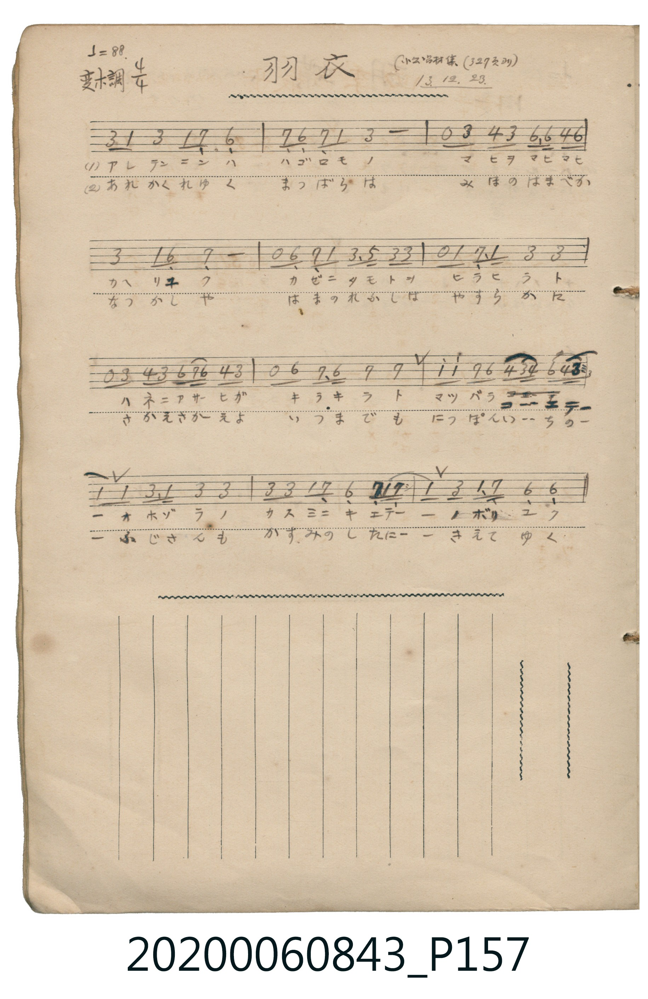

# 羽衣

<audio controls src="hagoromo.mp3"></audio>

- 日治時期公學校《唱歌帳》（典藏號 2020.006.0843・P157）
- 原載《小公唱材集》第 327 頁（大正 13 年 12 月 23 日抄）

## 說明

【曲目說明】
・出處：《唱歌帳》（國立臺灣歷史博物館典藏號 2020.006.0843）第 P157.jpg 頁。
・標註：（小公唱材集 327 頁ヨリ）13.12.23.（大正 13 年 12 月 23 日抄錄）。
・調性與拍號：變ホ調・ハ短調（Eb 大調關係小調 C 小調 / 日本都節音階），4/4 拍，速度 ♩=88。
・背景與曲風：取材自日本駿河國三保松原著名的「羽衣傳說」。旋律運用傳統日本陰音階（都節音階：6_ 7_ 1 3 4 6），
古雅幽玄地描繪天女身披羽衣、迎著朝陽與松風在三保海濱翩翩起舞，最終飛越松原、隱入富士山霞光雲霄的仙境景象。
・版本說明：本檔案為原頁單聲部簡譜之忠實數位化版本。
【原頁歌詞全文與中文語譯】（對應 P157.jpg）

・編曲說明（鋼琴伴奏版）：
1. 前奏 (Intro, 4 小節)：取首樂句古雅的都節音階旋律，以空靈五度與分解和聲鋪陳三保松原的雲霞仙境。
2. 主歌伴奏 (Song, 12 小節 × 2 段)：左手以莊重清朗的日本傳統調式和聲支撐天女羽衣之舞。

## 跨冊／重複收錄參照

> 同曲（〈羽衣〉；收錄於《新定兒童唱歌》四年級與《唱歌帖》P157《小公學校唱歌教材集》抄譜）

- **[同曲]** 《新定兒童唱歌》尋常科第四學年用（2020.006.0847.0004）：[**〈羽衣〉**](../../../shintei_jido_shoka/grade_4_2020.006.0847.0004/4_04_hagoromo/index.md)（`E,` / `4/4` — [原始 TMD](../../../shintei_jido_shoka/grade_4_2020.006.0847.0004/4_04_hagoromo/hagoromo.tmd)）
- 總表：[跨冊重複與同名歌曲總索引](../../../duplicate_songs.md)

## 歌詞

```text
（一）アレテンニンハ　ハゴロモノ　マヒヲマヒマヒ　カヘリユク
カゼニタモトヲ　ヒラヒラト　ハネニアサヒガ　キラキラト
マツバラコーエテー　オホゾラノ　カスミニキエテー　ノボリユク
微風吹拂衣袂飄飄，羽翼映著朝陽閃閃發光，
飛越松原，在浩瀚天空的雲霞中消逝、冉冉升天而去。）

（二）あれかくれゆく　まつばらは　みほのはまべか　なつかしや
はまのわかしは　やすらかに　さかえさかえよ　いつまでも
にっぽんいーちのー　ふじさんも　かすみのしたにー　きえてゆく
海濱的嫩松枝呀，願你安詳地永遠繁榮茂盛；
連日本第一的富士山，也在雲霞之下漸漸隱沒遠去。）
```

## ABC

```abc
X:1
T:羽衣
M:4/4
L:1/16
Q:1/4=88
K:Cm
V:V1 name="Piano" snm="Pia"
[V:V1]
G2 E2 G4 E2 D2 C4 | D2 C2 D2 E2 G8 | z2 G2 A2 G2 c2 c2 A2 c2 | G4 E2 C2 D8 |
z2 C2 D2 E2 G2 B2 G2 G2 | z2 E2 D2 E2 G4 G4 | z2 G2 A2 G2 c d c2 A2 G2 | z2 c2 d2 c2 d4 d4 |
e2 e2 d2 c2 A2 G A c2 A G | E2 E2 G2 E2 G4 G4 | G2 G2 E2 D2 C2 D2 E4- | E2 G2 E2 D2 C4 C4 |
```

## TMD 檔案連結

- [主旋律 TMD 檔案](hagoromo.tmd) [[在 TMD Studio 編輯](https://tmdlang.github.io/Tmd-TS/#tmd=s7IKdvYPcrWy4tLSUni-b--LhYsVtLS4FG0VLCy47G0VXHW4slMrbRWcc7lsTPRN7LjqFJSeTV_6bNPuZzObns2Z_7R1zdO1O54tWPi4oevplI3P1vY83bH5cUP3-z0dT1t3vJje_2LmfAUjAyMDPQMDMz0DCxPjx827AwxNzd_v6VQCGfa0b_6LPZ0g3Rv6QYYBzZg74eXsNqAZz9esUTA2Mld4uaARZNyS5c_WLlYwNFZ4unOLgqGRwrM5HQpGxgog13S1gI3j0tdSsKUW4FJQUHjcMOHZ7E3PZ697sWrVsxl9jxsmgkWbdz9t3_Vi5tT3e2Zh8fac7ueru1-073reuPjZ2u1P-zc97Z31vHPlyyUrcIQI0O0gr4JCRS-rIB3k38cNTVCbnq2Y-WLFbqBNIKNRgwgWOI-bVzxuXgU0xdBYz9BIz8hYj2BwvewBhRjClher9j9rWP6io_1Zdy_QfUDrXqzretw8GygOlH3c3P98_logG2iua5IC0Ggg--X0OU_2NwGdBGQrOCtAGfpgC-asedm89_n6hpfzN7-c1Qe06f2eHmDqUQCaDmS9bJj_dNcyhUczV9paWCC5obnn2cz1IDfM3vRy0QqgG572TwP69EX7KqiZy_c_27QZGL5PdnQ-2T_32dx9oMQzcfrTCb3PZ7U8buiBpN-nTZuB0fW4oRdo9LPp3U_3db9s7H4-ZQVQ_PnWjVCjZm6Aua0D1amzzOIVzOMVDBWMFUwUzCBOBzlQQeFp_5KXs1uf7tz7vK_l6ZwNz_r7n-9c9XTJyqdLN7_YtfpZ12qI9Y8bGl_s7wM669mcuS9n7gX5Z-4-oH-ezlkBdffW7c_2b3y-fyUQvdi6_UXHPKAVz-Y0PN_a9HLx7BfbuiAeA5rzctbGp61Ln67vebp49dONG1_Omfe0tfMlMHTmtAA9_GT3zKeLmkFBthGY-2Ch-LyzA-g_SHoF-gbIfrZqyrOFHc-bdgENBaaWp9PWvWjc9LJ5xfMNC1-snfNkZ_fT_Querl_2bOqOJ3t7n_ZMg5gAMhGaBSD6gGn8xUqgA1Y8m9YO9NSTHWtBjFXzXqxdD8wX4NTZ-6y9E56MgUEHNgAo82RHAyi1NS163LzmcXPb4-bNj5u7wWT_44YGENm05XHz2sfNQAXATAYUmfe4edLj5k0wBpgEijetftw8A5jWHzcve9y0HuK8BigCyjXtAZnbBEyyQIM6QPpBZgH1r4SRHVD7mnvBKhc9btoKkmoCehdoAtAFK6Fkcweq6SAntDxungBWAXT4nsdNwEwH9MoesE6gi2Y_btoH1gn2Acg1Ox83zwdbsxZFMVBB8xwUTwCDCBKQwAh7Pqf7ZdNiUNwu3QzOxiuf7NoFDL0X2zcD0xQkiQHjDJJqkBPRs7U7nvYBC4rZ0NS6bx0o0U3Y-ay7CajlxSJg4moBIpCufXuf79_zbMYCeCJ9Oa0ZiJ7P3ANMX_D0jpwYgYLA9Pts68rnDbOATnq-chcwAYJT4jxQQtjW8bJhLjDBPm3rBKHedqCaFw09QPcAkxFyQtjVA0oIjU2Pm3oeN3Y_bgTGfM_jpjYQAxgyjfseNy553LjhcRNQDTBVAUX2P27c_bhxHYgLkt0J0gUSXwVWCTRh-uOmFtSogipd97ipH6oCYlZTy-PGmWCjgYKrwSqngtkdCEYTOIE0AlUCTQcasvxxEyRjIUxf_bhx8ePGvY-bJoPUAaO0cSHIMkjcNm593DgDZBxQtqkJLAI0dybYH0BPAJ0yH2QCVHEv2G5gKgAFAPaE8GzPDiACFQR9u4FBjoiNDRufzVj_ZPcSYOp41r796f6toBIBqXx5Oh2Y_edDYhJa4sxqebp6JdCEZ_PmPp0IzJE9LxfOeLJ3wdN1nS9WAovVDc827HjZuOD5zsZny9a96Gl6Pns2PDW9bFgMKTiBFRUwN4OMgpVKQHOe7JwPTB3Q5LATWDx3w539bNMkoJmIhAA0i_KqGQoUtPS5uILz89KtAjIT8_IdagxqFKrB7rUxNNOyA7OALQINoIM1FYCZHVg8rgHiNiDeDMTdULpfoQZMAgshIL0WiEEq-4B4D1DGAEjPA-JJQLwJiQ2hgTqbVgNZM4B4FRAvA_LXg3UC3Qa3f1cP0P7GJqBcD5AG2tsIsg3IbgK6BcgGmtK4D4iXAPEGoGgnkIaYAra_cT8Q7wbidRBxsNqdYJNAOoH2gnWCzJ0O1N2CbH8NsB7TBdZmumAaBEFsYAWnqwCs6CAiNUh8MAtZOQyCXAIRNYHSZlAM4oNoiFUwKxCmoZgCLgkQsQL0HSj8mvZA4qMJ6FNw6HeAQxsS-qDQXolEd0DFgWHY3AvVB9TTtBWipmkNRL4JFJNA9TAaqA89TkBhCwtPYNg2AU2EhSJQHGIKMDQbZ0LjBCS3GhonU6F8oEuR2U1Q1zWC9IFiBWT2cqB4EyJGQAGJGdimUBqEIWrgMYUcHzAaW3yYw-MDYQhIxByJBkEYjR4bkFQNSj8ToGEHqumA1ApQtoGkR4gAKK3PBtJA34HDtg-WE5qA6bJ5PjRWgCGPoRWcseagZBfMrAI0qHExEO8Fyk8GBSZYa-NCUDwhmdUIjPJGYNYDRQBIHTCQQRkCFBXAKANnG1CWAUUn0EngcheuFZhywHEHcgIkF8LjxzAOFOYgAhZwkCAFtgfBbGOQGqRowR49sLhEzW_w-IQogmnBzJSI3MlVy8Wla6cAKugUgLQyFwA)]
- [鋼琴伴奏 TMD 檔案](hagoromo_piano.tmd) [[在 TMD Studio 編輯](https://tmdlang.github.io/Tmd-TS/#tmd=s7IKdvYPcrWy4tLSUni-b--LhYvf7-l42b3n-YQtT_Zsebq0_3lnx_s9nQpaWlyKtgoWFlz2tgquOlzZqZW2Cs65XDYm-iZ2XHUKSs-mL322afezmU3P5sx_2rrm6dodzxYsfNzQ9XTKxmdre57u2Py4oRto8tPWHS-m97-YOV_ByMDIQM_AwEzPwMLE-HHz7gBDU3OgRUogw572zX-xpxOke0M_yDCgGXMnvJzdBjTj-Zo1CsZG5govFzQqcXHpaynYUgtwKSgoPG6Y8Gz2puez171YterZjL7HDRPBos27n7bvejFz6vs9s7B4aU7389XdL9p3PW9c_Gzt9qf9m572znreufLlkhU4fAv0JsgbIB_rZRWkg_zyuKEJatOLVfufNSx_0dH-rLsXqBNo5Yt1XY-bZwPFgbKPm_ufz18LZAMtdk1SeLpkOZD9cvqcJ_ubgGEFZCs4K0AZ-govm_c-X9_wcv7ml7P6gHa-39MDjC0FoLlA1suG-U93LVMAxynC8ufbVwD9D_E81nQAdA5IqYKCoZ7C085eoLiChmdeSVG-joIJyGKgfZpANU_7p71cNu3Ziqan_Uuf9i95Obv1-awWZOc8m979dB8w9Hqe7F76fOWul3M7nuyaAnQQ0N9PO9peLF_8dFLPi8ZNL7tXvZy5-cmOzif75z6buw-YLkDmzN70cs68J7tnPl3UDHW6goKRnsKTHbuB8QJxrYJGcH5euo6CoRHUVQqHpysYKTxbtxXsvO3LnnV2A61-0df1sr332Y7WZ3OmA00GJeI5a542bX6-dSMwCJ_u6Yc449mU9c8mTXi6ZOXTpZshmeTJzu4XHfOgtlOe9qBAQUufiwscnFYBmYl5-UEeDjUGNQrVYC_aGJpp2YFZNQrGCroKhkAMokEQxDaPBxJmIAIEa5D4YBaychisUTCAippAaTMkNkhHDcJEdAjSCjaEqxbF0T4ojjaBu9ksPl4h2iw-NxaJBfQJiG0MYiNYNQomILZJPKogqgEGEItB0TyQgQULMBANsQpmBcI0FFOgjgKZhWmfKZQGYYgauGORnQSjsTnJHCUOoRaBDEGiQRBGwxxkGAeyBETAVELMMIGyjUFqkNyB3T0wx6OGMdwDEEUwLZgRgYgR1LilappCVmoIZBrC1QFFMAyGqkAWImgqevLFZi5cDdwRcJsQ5mP3FVLy17VTAGc9BSADFFzItDIXAA)]

## 分析

```text
================================================================================
📊 TMD Song Profile: [ 羽衣 ]
================================================================================
⏱  Duration:       0:32 (32.7s), 12 measures total
🎼 Key & Tempo:    首調基準 E,, != 88.0 BPM, <4/4>
   - 分析範圍：      由實際發聲的音符與和弦推測調性；播放脈絡另行呈現
🎤 人聲音域:    C4 (MIDI 60) – D#5 (MIDI 75) [跨度: 15 個半音 / 1.2 個八度, 難度: moderate]
   - 最低音:  C4 in [Song #1 @ m.1, 0:02]
   - 最高音: D#5 in [Song #1 @ m.9, 0:21]
   - 適合: soprano, mezzo-soprano, contralto, tenor, baritone, bass
🏛  結構:      Song (32.7s)
⚡ 編曲密度:        Peak 1 軌道同時演奏
🗝  調性診斷：       C 小調（純淨自然小調，未偵測到可信轉調）
   - 風格氣質:    純淨自然小調（陰鬱抒情、旋律集中，無明顯調外色彩）
   - 轉調歷程:    全曲維持單一推測調性（未偵測到可信轉調）
   - 核心骨幹音:  G, C, D, D#, G#
   - 調性數值:    C 小調 [相關度: 0.76, 穩定度: Moderate, 自然音純度: 100.0%]
   - 候選調性 (K-S): C 小調 (0.76), G 小調 (0.68), G 大調 (0.66)
   - 五度圈歷程:   +0
   - 各段落調性細節:
     • [Song #1]: C 小調 (r: 0.76, 自然音純度: 100.0%)

  [ 五度圈游移軌跡 ]
              [C ]*
         F            G  
      Bb               D  
      Eb               A  
         Ab           E  
            Db       B  
               F# 
     (* = active key center)

  [ 十二半音累積音高分佈 ]
     C  : ███████████████           20.3%
     C# :                            0.0%
     D  : ███████████████           20.3%
     D# : ██████████████            18.7%
     E  :                            0.0%
     F  :                            0.0%
     F# :                            0.0%
     G  : ████████████████████████  33.0%
     G# : █████                      6.6%
     A  :                            0.0%
     A# : █                          1.1%
     B  :                            0.0%
--------------------------------------------------------------------------------
Assignment 軌道音域：
  - Piano         : C4 – D#5 (15 個半音 / 1.2 個八度, 75 個音符)
================================================================================
```


## 原書掃描頁




