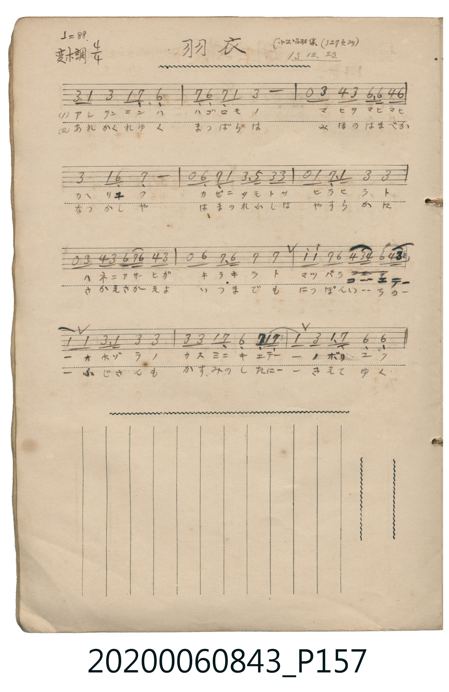

# 羽衣

> Re:Shōka 使用 AI 協助辨識與重建樂譜，可能會有錯誤。歡迎回報。

- **鋼琴伴奏版**：<br><audio controls src="hagoromo.mp3"></audio>

- 日治時期公學校《唱歌帳》（典藏號 2020.006.0843・P157）
- 原載《小公唱材集》第 327 頁（大正 13 年 12 月 23 日抄）

## 說明


- 出處：《唱歌帳》（國立臺灣歷史博物館典藏號 2020.006.0843）第 P157.jpg 頁。
- 標註：（小公唱材集 327 頁ヨリ）13.12.23.（大正 13 年 12 月 23 日抄錄）。
- 調性與拍號：變ホ調- ハ短調（Eb 大調關係小調 C 小調 / 日本都節音階），4/4 拍，速度 ♩=88。
- 背景與曲風：取材自日本駿河國三保松原著名的「羽衣傳說」。旋律運用傳統日本陰音階（都節音階：6_ 7_ 1 3 4 6），
古雅幽玄地描繪天女身披羽衣、迎著朝陽與松風在三保海濱翩翩起舞，最終飛越松原、隱入富士山霞光雲霄的仙境景象。
- 版本說明：本檔案為原頁單聲部簡譜之忠實數位化版本。
【原頁歌詞全文與中文語譯】（對應 P157.jpg）

### 編曲說明（鋼琴伴奏版）：

1. 前奏 (Intro, 4 小節)：取首樂句古雅的都節音階旋律，以空靈五度與分解和聲鋪陳三保松原的雲霞仙境。
2. 主歌伴奏 (Song, 12 小節 × 2 段)：左手以莊重清朗的日本傳統調式和聲支撐天女羽衣之舞。


## 歌詞

```text
（一）アレテンニンハ　ハゴロモノ　マヒヲマヒマヒ　カヘリユク
カゼニタモトヲ　ヒラヒラト　ハネニアサヒガ　キラキラト
マツバラコーエテー　オホゾラノ　カスミニキエテー　ノボリユク
微風吹拂衣袂飄飄，羽翼映著朝陽閃閃發光，
飛越松原，在浩瀚天空的雲霞中消逝、冉冉升天而去。）

（二）あれかくれゆく　まつばらは　みほのはまべか　なつかしや
はまのわかしは　やすらかに　さかえさかえよ　いつまでも
にっぽんいーちのー　ふじさんも　かすみのしたにー　きえてゆく
海濱的嫩松枝呀，願你安詳地永遠繁榮茂盛；
連日本第一的富士山，也在雲霞之下漸漸隱沒遠去。）
```

## ABC

<div class="abc-score" data-abc-src="hagoromo.abc" aria-label="五線譜載入中"></div>

[下載 ABC 原始檔](hagoromo.abc)

## TMD 檔案連結

- [主旋律 TMD 檔案](hagoromo.tmd) [[在 TMD Studio 編輯](https://tmdlang.github.io/Tmd-TS/#tmd=s7IKdvYPcrWy4qpTUCpJTLdSSM7PyUlNLsnMz7MqzsjPTkzOyFeCS5bl55TmploBqXgDQ4RwcX5pUXJqfEFieqpVgKGpOboM3KT4vPyS1KT8_GyEioKi_LLUvMQ8oKrcxLzS4uSizIKS-OT8gkqEmtSyzJRUkIrUlMyS_KLMxBwkJ6UWFYMdC3FDSVFiHsQMoCBCFVBTemaeVUliJtAp8UBcnhifm5iZl5OYl4KsqiQjP70osSCj0iojsxhkVXJiTnx2Yl4iQlFJRiowCFJTSpMTIXZoaSk837f3xcLFClpaXIq2ChYWXPa2Cq46XNmplbYKzrlcNib6JnYg_c-mL322afezmU3P5sx_2rrm6dodzxYsfNzQ9XTKxmdre57u2Py4ofv9no6nrTteTO9_MXO-gpGBkYGegYGZnoGFifHj5t2gwH2_pxPsmKd981_s6QTp3tAPMgxoxtwJL2e3Ac14vmaNgrGRucLLBY0g45Ysf7Z2sYKhscLTnVsUDI0Uns3pUDAyVgC5pqsFbByXvpaCLbUAl4KCwuOGCc9mb3o-e92LVauezeh73DARLNq8-2n7rhczp77fMwuLt-d0P1_d_aJ91_PGxc_Wbn_av-lp76znnStfLlmBI0SAbgd5FRQqelkF6SD_Pm5ogtr0bMXMFyt2A20CGY0aRLDAedy84nHzKqAphsZ6hkZ6RsZ6BIPrZQ8oxBC2vFi1_1nD8hcd7c-6e4HuA1r3Yl3X4-bZQHGg7OPm_ufz1wLZQHNdkxSARgPZL6fPebK_CegkIFvBWQHK0AdbMGfNy-a9z9c3vJy_-eWsPqBN7_f0AFOPAtB0IOtlw_ynu5YpPJq50tbCAskNzT3PZq4HuWH2ppeLVgDd8LR_GtCnL9pXQc1cvv_Zps3A8H2yo_PJ_rnP5u4DJZ6J059O6H0-q-VxQw8k_T5t2gyMrscNvUCjn03vfrqv-2Vj9_MpK4Diz7duhBo1cwPMbR2oTp1lFq9gHq9gqGCsYKJgBnE6yIEKCk_7l7yc3fp0597nfS1P52x41t__fOeqp0tWPl26-cWu1c-6VkOsf9zQ-GJ_H9BZz-bMfTlzL8g_c_cB_fN0zgqou7duf7Z_4_P9K4HoxdbtLzrmAa14Nqfh-daml4tnv9jWBfEY0JyXszY-bV36dH3P08Wrn27c-HLOvKetnS-BoTOnBejhJ7tnPl3UDAqyjcDcBwvF550dQP9B0ivQN0D2s1VTni3seN60C2goMLU8nbbuReOml80rnm9Y-GLtnCc7u5_uX_B0_bJnU3c82dv7tGcaxASQidAsANEHTOMvVgIdsOLZtHagp57sWAtirJr3Yu16YL4Ap87eZ-2d8GQMDDqwAUCZJzsaQKmtadHj5jWPm9seN29-3NwNJvsfNzSAyKYtj5vXPm4GKgBmMqDIvMfNkx43b4IxwCRQvGn14-YZwLT-uHnZ46b1YOcBhZr2gIxrAqZUoP4OkDaQEUBtK2FkB9Sa5l6wykWPm7aCpJqAvgQaCrR4JZRs7oAEI9DClsfNE8ASQGfuedwEzGJAh-8BawDaP_tx0z6wBrB7QY7Y-bh5Ptj0tSiKgQqa56A4GRggkGADRs_zOd0vmxaDYnLpZnCmXflk1y5gWL3YvhmYgiAJChhDkDSCnGSerd3xtA9YLMyGps1960BJbMLOZ91NQC0vFgGTUgsQgXTt2_t8_55nMxbAk-TLac1A9HzmHmBqgqdu5KQHFASm1mdbVz5vmAV00vOVu4DJDZzu5oGifVvHy4a5wOT5tK0ThHrbgWpeNPQA3QNMNMjRvqsHFO2NTY-beh43dj9uBMZzz-OmNhADGDKN-x43LnncuOFxE1ANMA0BRfY_btz9uHEdiAuS3QnSBRJfBVYJNGH646YWcAxBVax73NQPlYAY0dTyuHEm2ESg4Gqw5qlgdgeC0QRODo1AlUBDgYYsf9wEyT1ADY2LHzfufdw0GSQNjMDGhSA7IDHZuPVx4wyQKUDZpiawCNC4mWBXA50MdMF8kAlQxb1gK4FxDvIu9mh_tmcHEIEyed9uYAAjwn7Dxmcz1j_ZvQSYFp61b3-6fysotyOVHU-nA7P2fEi8QUuTWS1PV68EmvBs3tynE4G5reflwhlP9i54uq7zxUpgkbnh2YYdLxsXPN_Z-GzZuhc9Tc9nz4annZcNiyGFIrASAuZUkFGwEgdozpOd84FpARr5O4FFbzfc2c82TQKaiYh2oFmUV7tQoKClz8UVnJ-XbhWQmZiX71BjUFMNdq6NoZmWHZgFrOw1gO7VBJYBi4BZdg0QtwHxZiDuhtL9CjVgEli-AOm1QAxS2QfEe4AyBqCMDsSTgHgTEhtCA3U2rQayZgDxKiBeBuSvB-sEOg1u_64eoP2NTUC5HiANtLcRZBuQ3QR0C5ANNKVxHxAvAeINQNFOUNJF2N-4H4h3A_E6iDhY7U6wSSCdQHvBOkHmTgfqbkG2vwZYRekCKypdMA2CIDaw7tJVANZhEJEaJD6YhawcBkEugYiaQGkzKAbxQTTEKpgVCNNQTAFne0SsAH0HCr-mPZD4aAL6FBz6HeDQhoQ-KLRXItEdUHFgGDb3QvUB9TRthahpWgORbwLFJFA9jAbqQ48TUNjCwhMYtk1AE2GhCBSHmAIMzcaZ0DgBya2GxslUKB_oUmR2E9R1jSB9oFgBmb0cKN6EiBFQQGIGtimUBmGIGnhMIccHjMYWH-bw-EAYAhIxR6JBEEajxwYkVYPSzwRo2IGqNSC1ApRtIOkRIgBK67OBNNB34LDtg-WEJmC6bJ4PjRVgyGNoBWesOSjZBTOrAA1qXAzEe4Hyk0GBCdbauBAUT0hmNQKjvBGY9UARAFIHDGRQhgBFBTDKwNkGlGVA0Ql0ErjYhWsFphxw3IGcAMmF8PgxjAOFOYiABRwkSIFNPTDbGKQGKVqwRw8sLlHzGzw-IYpgWjAzJSJ3ctVycenaKYDKOQUgrcwFAA)]
- [鋼琴伴奏 TMD 檔案](hagoromo_piano.tmd) [[在 TMD Studio 編輯](https://tmdlang.github.io/Tmd-TS/#tmd=s7IKdvYPcrWy4qpTUCpJTLdSyC8qychPL0osyKi0ysgsLskvykxOzInPTsxLVIIrKs4vLUpOjS9ITE-1CjA0NUfIlGSk5qZapaaUJieWZObnKXFpaSk837f3xcLF7_d0vOze83zClid7tjxd2v-8s-P9nk4FLS0uRVsFCwsue1sFVx2u7NRKWwXnXC4bE30TO5Chz6YvfbZp97OZTc_mzH_auubp2h3PFix83ND1dMrGZ2t7nu7Y_LihG2jy09YdL6b3v5g5X8HIwMhAz8DATM_AwsT4cfNukPOAFoFd-LRv_os9nSDdG_pBhgHNmDvh5ew2oBnP16xRMDYyV3i5oFGJi0tfS8GWWoBLQUHhccOEZ7M3PZ-97sWqVc9m9D1umAgWbd79tH3Xi5lT3--ZhcVLc7qfr-5-0b7reePiZ2u3P-3f9LR31vPOlS-XrMDhW6A3Qd4A-VgvqyAd5JfHDU1Qm16s2v-sYfmLjvZn3b1AnUArX6zretw8GygOlH3c3P98_logG2ixa5LC0yXLgeyX0-c82d8EDCsgW8FZAcrQV3jZvPf5-oaX8ze_nNUHtPP9nh5gbCkAzQWyXjbMf7prmQI4ThGWP9--Auh_iOexpgOgc0BKFRQM9RSedvYCxRU0PPNKivJ1FExAFgPt0wSqedo_7eWyac9WND3tX_q0f8nL2a3PZ7UgO-fZ9O6n-4Ch1_Nk99LnK3e9nNvxZNcUoIOA_n7a0fZi-eKnk3peNG562b3q5czNT3Z0Ptk_99ncfcB0ATJn9qaXc-Y92T3z6aJmqNMVFIz0FJ7s2A2MF4hrFTSC8_PSdRQMjaCuUjg8XcFI4dm6rWDnbV_2rLMbaPWLvq6X7b3PdrQ-mzMdaDIoEc9Z87Rp8_OtG4FB-HRPP8QZz6asfzZpwtMlK58u3QzJJE92dr_omAe1nfK0BwUKWvpcXODgtArITMzLD_JwqDGoqQb70MZCyw7MqFEwVjAEYl0gaR6vYBYPZNVAWUASIgWCNQoGQLYJEJuBSUOgCFg1DBqAFHHVoljpg2ylCdxKs_h4hWiz-NxYJBbQISC2MYiNYNUomIDYJvGogqgGGEDsBcURFp8amiF5FeRNXbifQGygJ3URHgF7HcoHs5CVwyAoKCCiJlDaDIpBfBANsQpmBcI0FFOgjgKZhWmfKZQGYYgauGORnYQcO-hOMoc7CWEISMQciQZBGA1zkGEcyBIQAVMJMcMEyjYGqUFyB3b3wByPGsZwD0AUwbRgRgQiRlCjlpopClmpIZBpCFcHFMEwGKoCWYigqeiJF5u5cDVwR8BtQpiP3VdIiV_XTgGc7xSADFBoIdPKXAA)]

## 分析

```text
================================================================================
📊 TMD Song Profile: [ 羽衣 ]
================================================================================
⏱  Duration:       0:32 (32.7s), 12 measures total
🎼 Key & Tempo:    首調基準 E,, != 88.0 BPM, <4/4>
   - 分析範圍：      由實際發聲的音符與和弦推測調性；播放脈絡另行呈現
🎤 人聲音域:    C4 (MIDI 60) – D#5 (MIDI 75) [跨度: 15 個半音 / 1.2 個八度, 難度: moderate]
   - 最低音:  C4 in [Song #1 @ m.1, 0:02]
   - 最高音: D#5 in [Song #1 @ m.9, 0:21]
   - 適合: soprano, mezzo-soprano, contralto, tenor, baritone, bass
🏛  結構:      Song (32.7s)
⚡ 編曲密度:        Peak 1 軌道同時演奏
🗝  調性診斷：       C 小調（純淨自然小調，未偵測到可信轉調）
   - 風格氣質:    純淨自然小調（陰鬱抒情、旋律集中，無明顯調外色彩）
   - 轉調歷程:    全曲維持單一推測調性（未偵測到可信轉調）
   - 核心骨幹音:  G, C, D, D#, G#
   - 調性數值:    C 小調 [相關度: 0.76, 穩定度: Moderate, 自然音純度: 100.0%]
   - 候選調性 (K-S): C 小調 (0.76), G 小調 (0.68), G 大調 (0.66)
   - 五度圈歷程:   +0
   - 各段落調性細節:
     • [Song #1]: C 小調 (r: 0.76, 自然音純度: 100.0%)

  [ 五度圈游移軌跡 ]
              [C ]*
         F            G  
      Bb               D  
      Eb               A  
         Ab           E  
            Db       B  
               F# 
     (* = active key center)

  [ 十二半音累積音高分佈 ]
     C  : ███████████████           20.3%
     C# :                            0.0%
     D  : ███████████████           20.3%
     D# : ██████████████            18.7%
     E  :                            0.0%
     F  :                            0.0%
     F# :                            0.0%
     G  : ████████████████████████  33.0%
     G# : █████                      6.6%
     A  :                            0.0%
     A# : █                          1.1%
     B  :                            0.0%
--------------------------------------------------------------------------------
Assignment 軌道音域：
  - Piano         : C4 – D#5 (15 個半音 / 1.2 個八度, 75 個音符)
================================================================================
```


## 原書掃描頁




