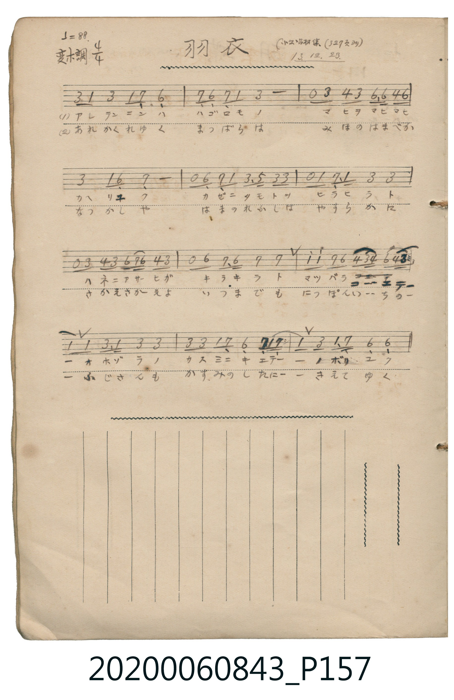

# 羽衣

> Re:Shōka 使用 AI 協助辨識與重建樂譜，可能會有錯誤。歡迎回報。

- **鋼琴伴奏版**：<br><audio controls src="hagoromo.mp3"></audio>

- 日治時期公學校《唱歌帳》（典藏號 2020.006.0843・P157）
- 原載《小公唱材集》第 327 頁（大正 13 年 12 月 23 日抄）

## 說明


- 出處：《唱歌帳》（國立臺灣歷史博物館典藏號 2020.006.0843）第 P157.jpg 頁。
- 標註：（小公唱材集 327 頁ヨリ）13.12.23.（大正 13 年 12 月 23 日抄錄）。
- 調性與拍號：變ホ調- ハ短調（Eb 大調關係小調 C 小調 / 日本都節音階），4/4 拍，速度 ♩=88。
- 背景與曲風：取材自日本駿河國三保松原著名的「羽衣傳說」。旋律運用傳統日本陰音階（都節音階：6_ 7_ 1 3 4 6），
古雅幽玄地描繪天女身披羽衣、迎著朝陽與松風在三保海濱翩翩起舞，最終飛越松原、隱入富士山霞光雲霄的仙境景象。
- 版本說明：本檔案為原頁單聲部簡譜之忠實數位化版本。
【原頁歌詞全文與中文語譯】（對應 P157.jpg）

### 編曲說明（鋼琴伴奏版）：

1. 前奏 (Intro, 4 小節)：取首樂句古雅的都節音階旋律，以空靈五度與分解和聲鋪陳三保松原的雲霞仙境。
2. 主歌伴奏 (Song, 12 小節 × 2 段)：左手以莊重清朗的日本傳統調式和聲支撐天女羽衣之舞。


## 歌詞

```text
（一）アレテンニンハ　ハゴロモノ　マヒヲマヒマヒ　カヘリユク
カゼニタモトヲ　ヒラヒラト　ハネニアサヒガ　キラキラト
マツバラコーエテー　オホゾラノ　カスミニキエテー　ノボリユク
微風吹拂衣袂飄飄，羽翼映著朝陽閃閃發光，
飛越松原，在浩瀚天空的雲霞中消逝、冉冉升天而去。）

（二）あれかくれゆく　まつばらは　みほのはまべか　なつかしや
はまのわかしは　やすらかに　さかえさかえよ　いつまでも
にっぽんいーちのー　ふじさんも　かすみのしたにー　きえてゆく
海濱的嫩松枝呀，願你安詳地永遠繁榮茂盛；
連日本第一的富士山，也在雲霞之下漸漸隱沒遠去。）
```

## ABC

```abc
X:1
T:羽衣
M:4/4
L:1/16
Q:1/4=88
K:Cm
V:V1 name="Piano" snm="Pia"
[V:V1]
G2 E2 G4 E2 D2 C4 | D2 C2 D2 E2 G8 | z2 G2 A2 G2 c2 c2 A2 c2 | G4 E2 C2 D8 |
z2 C2 D2 E2 G2 B2 G2 G2 | z2 E2 D2 E2 G4 G4 | z2 G2 A2 G2 c d c2 A2 G2 | z2 c2 d2 c2 d4 d4 |
e2 e2 d2 c2 A2 G A c2 A G | E2 E2 G2 E2 G4 G4 | G2 G2 E2 D2 C2 D2 E4- | E2 G2 E2 D2 C4 C4 |
```

## TMD 檔案連結

- [主旋律 TMD 檔案](hagoromo.tmd) [[在 TMD Studio 編輯](https://tmdlang.github.io/Tmd-TS/#tmd=s7IKdvYPcrWy4qpTUCpJTLdSSM7PyUlNLsnMz7MqzsjPTkzOyFeCS5bl55TmploBqXgDQ4RwcX5pUXJqfEFieqpVgKGpOboM3KT4vPyS1KT8_GyEioKi_LLUvMQ8oKrcxLzS4uSizIKS-OT8gkqEmtSyzJRUkIrUlMyS_KLMxBwkJ6UWFYMdC3FDSVFiHsQMoCBCFVBTemaeVUliJtAp8UBcnhifm5iZl5OYl6LEpaWl8Hzf3hcLFytoaXEp2ipYWHDZ2yq46nBlp1baKjjnctmY6JvYgQx7Nn3ps027n81sejZn_tPWNU_X7ni2YOHjhq6nUzY-W9vzdMfmxw3d7_d0PG3d8WJ6_4uZ8xWMDIwM9AwMzPQMLEyMHzfvBgXP-z2dYJc97Zv_Yk8nSPeGfpBhQDPmTng5uw1oxvM1axSMjcwVXi5oBBm3ZPmztYsVDI0Vnu7comBopPBsToeCkbECyDVdLWDjuPS1FGypBbgUFBQeN0x4NnvT89nrXqxa9WxG3-OGiWDR5t1P23e9mDn1_Z5ZWLw9p_v56u4X7bueNy5-tnb70_5NT3tnPe9c-XLJChwhAnQ7yKugUNHLKkgH-fdxQxPUpmcrZr5YsRtoE8ho1CCCBc7j5hWPm1cBTTE01jM00jMy1iMYXC97QCGGsOXFqv3PGpa_6Gh_1t0LdB_Quhfruh43zwaKA2UfN_c_n78WyAaa65qkADQayH45fc6T_U1AJwHZCs4KUIY-2II5a142732-vuHl_M0vZ_UBbXq_pweYehSApgNZLxvmP921TOHRzJW2FhZIbmjueTZzPcgNsze9XLQC6Ian_dOAPn3Rvgpq5vL9zzZtBobvkx2dT_bPfTZ3HyjxTJz-dELv81ktjxt6IOn3adNmYHQ9bugFGv1sevfTfd0vG7ufT1kBFH--dSPUqJkbYG7rQHXqLLN4BfN4BUMFYwUTBTOI00EOVFB42r_k5ezWpzv3Pu9reTpnw7P-_uc7Vz1dsvLp0s0vdq1-1rUaYv3jhsYX-_uAzno2Z-7LmXtB_pm7D-ifp3NWQN29dfuz_Ruf718JRC-2bn_RMQ9oxbM5Dc-3Nr1cPPvFti6Ix4DmvJy18Wnr0qfre54uXv1048aXc-Y9be18CQydOS1ADz_ZPfPpomZQkG0E5j5YKD7v7AD6D5Jegb4Bsp-tmvJsYcfzpl1AQ4Gp5em0dS8aN71sXvF8w8IXa-c82dn9dP-Cp-uXPZu648ne3qc90yAmgEyEZgGIPmAaf7ES6IAVz6a1Az31ZMdaEGPVvBdr1wPzBTh19j5r74QnY2DQgQ0AyjzZ0QBKbU2LHjevedzc9rh58-PmbjDZ_7ihAUQ2bXncvPZxM1ABMJMBReY9bp70uHkTjAEmgeJNqx83zwCm9cfNyx43rYc4rwGKgHJNe0DmNgGTLNCgDpB-kFlA_SthZAfUvuZesMpFj5u2gqSagN4FmgB0wUoo2dyBajrICS2PmyeAVQAdvudxEzDTAb2yB6wT6KLZj5v2gXWCfQByzc7HzfPB1qxFUQxU0DwHxRPAIIIEJDDCns_pftm0GBS3SzeDs_HKJ7t2AUPvxfbNwDQFSWLAOIOkGuRE9Gztjqd9wIJiNjS17lsHSnQTdj7rbgJqebEImLhagAika9_e5_v3PJuxAJ5IX05rBqLnM_cA0xc8vSMnRqAgMP0-27ryecMsoJOer9wFTIDglDgPlBC2dbxsmAtMsE_bOkGotx2o5kVDD9A9wGSEnBB29YASQmPT46aex43djxuBMd_zuKkNxACGTOO-x41LHjdueNwEVANMVUCR_Y8bdz9uXAfigmR3gnSBxFeBVQJNmP64qQU1qqBK1z1u6oeqgJjV1PK4cSbYaKDgarDKqWB2B4LRBE4gjUCVQNOBhix_3ATJWAjTVz9uXPy4ce_jpskgdcAobVwIsgwSt41bHzfOABkHlG1qAosAzZ0J9gfQE0CnzAeZAFXcC7YbmApAAYA9ITzbswOIQAVB325gkCNiY8PGZzPWP9m9BJg6nrVvf7p_K6hEQCpfnk4HZv_5kJiEljizWp6uXgk04dm8uU8nAnNkz8uFM57sXfB0XeeLlcBidcOzDTteNi54vrPx2bJ1L3qans-eDU9NLxsWQwpOYEUFzM0go2ClEtCcJzvnA1MHNDnsBBbP3XBnP9s0CWgmIiEAzaK8aoYCBS19Lq7g_Lx0q4DMxLx8hxqDGoVqsHttDM207MAsYItAA-hgTQVgZgcWj2uAuA2INwNxN5TuV6gBk8BCCEivBWKQyj4g3gOUMQDS84B4EhBvQmJDaKDOptVA1gwgXgXEy4D89WCdQLfB7d_VA7S_sQko1wOkgfY2gmwDspuAbgGygaY07gPiJUC8ASjaCaQhpoDtb9wPxLuBeB1EHKx2J9gkkE6gvWCdIHOnA3W3INtfA6zHdIG1mS6YBkEQG1jB6SoAKzqISA0SH8xCVg6DIJdARE2gtBkUg_ggGmIVzAqEaSimgEsCRKwAfQcKv6Y9kPhoAvoUHPod4NCGhD4otFci0R1QcWAYNvdC9QH1NG2FqGlaA5FvAsUkUD2MBupDjxNQ2MLCExi2TUATYaEIFIeYAgzNxpnQOAHJrYbGyVQoH-hSZHYT1HWNIH2gWAGZvRwo3oSIEVBAYga2KZQGYYgaeEwhxweMxhYf5vD4QBgCEjFHokEQRqPHBiRVg9LPBGjYgWo6ILUClG0g6REiAErrs4E00HfgsO2D5YQmYLpsng-NFWDIY2gFZ6w5KNkFM6sADWpcDMR7gfKTQYEJ1tq4EBRPSGY1AqO8EZj1QBEAUgcMZFCGAEUFMMrA2QaUZUDRCXQSuNyFawWmHHDcgZwAyYXw-DGMA4U5iIAFHCRIge1BMNsYpAYpWrBHDywuUfMbPD4himBaMDMlIndy1XJx6dopgAo6BSCtzAUA)]
- [鋼琴伴奏 TMD 檔案](hagoromo_piano.tmd) [[在 TMD Studio 編輯](https://tmdlang.github.io/Tmd-TS/#tmd=s7IKdvYPcrWy4tLSUni-b--LhYvf7-l42b3n-YQtT_Zsebq0_3lnx_s9nQpaWlyKtgoWFlz2tgquOlzZqZW2Cs65XDYm-iZ2XHUKSs-mL322afezmU3P5sx_2rrm6dodzxYsfNzQ9XTKxmdre57u2Py4oRto8tPWHS-m97-YOV_ByMDIQM_AwEzPwMLE-HHz7gBDU3OgRUogw572zX-xpxOke0M_yDCgGXMnvJzdBjTj-Zo1CsZG5govFzQqcXHpaynYUgtwKSgoPG6Y8Gz2puez171YterZjL7HDRPBos27n7bvejFz6vs9s7B4aU7389XdL9p3PW9c_Gzt9qf9m572znreufLlkhU4fAv0JsgbIB_rZRWkg_zyuKEJatOLVfufNSx_0dH-rLsXqBNo5Yt1XY-bZwPFgbKPm_ufz18LZAMtdk1SeLpkOZD9cvqcJ_ubgGEFZCs4K0AZ-govm_c-X9_wcv7ml7P6gHa-39MDjC0FoLlA1suG-U93LVMAxynC8ufbVwD9D_E81nQAdA5IqYKCoZ7C085eoLiChmdeSVG-joIJyGKgfZpANU_7p71cNu3Ziqan_Uuf9i95Obv1-awWZOc8m979dB8w9Hqe7F76fOWul3M7nuyaAnQQ0N9PO9peLF_8dFLPi8ZNL7tXvZy5-cmOzif75z6buw-YLkDmzN70cs68J7tnPl3UDHW6goKRnsKTHbuB8QJxrYJGcH5euo6CoRHUVQqHpysYKTxbtxXsvO3LnnV2A61-0df1sr332Y7WZ3OmA00GJeI5a542bX6-dSMwCJ_u6Yc449mU9c8mTXi6ZOXTpZshmeTJzu4XHfOgtlOe9qBAQUufiwscnFYBmYl5-UEeDjUGNQrVYC_aGJpp2YFZNQrGCroKhkAMokEQxDaPBxJmIAIEa5D4YBaychisUTCAippAaTMkNkhHDcJEdAjSCjaEqxbF0T4ojjaBu9ksPl4h2iw-NxaJBfQJiG0MYiNYNQomILZJPKogqgEGEItB0TyQgQULMBANsQpmBcI0FFOgjgKZhWmfKZQGYYgauGORnQSjsTnJHCUOoRaBDEGiQRBGwxxkGAeyBETAVELMMIGyjUFqkNyB3T0wx6OGMdwDEEUwLZgRgYgR1LilappCVmoIZBrC1QFFMAyGqkAWImgqevLFZi5cDdwRcJsQ5mP3FVLy17VTAGc9BSADFFzItDIXAA)]

## 分析

```text
================================================================================
📊 TMD Song Profile: [ 羽衣 ]
================================================================================
⏱  Duration:       0:32 (32.7s), 12 measures total
🎼 Key & Tempo:    首調基準 E,, != 88.0 BPM, <4/4>
   - 分析範圍：      由實際發聲的音符與和弦推測調性；播放脈絡另行呈現
🎤 人聲音域:    C4 (MIDI 60) – D#5 (MIDI 75) [跨度: 15 個半音 / 1.2 個八度, 難度: moderate]
   - 最低音:  C4 in [Song #1 @ m.1, 0:02]
   - 最高音: D#5 in [Song #1 @ m.9, 0:21]
   - 適合: soprano, mezzo-soprano, contralto, tenor, baritone, bass
🏛  結構:      Song (32.7s)
⚡ 編曲密度:        Peak 1 軌道同時演奏
🗝  調性診斷：       C 小調（純淨自然小調，未偵測到可信轉調）
   - 風格氣質:    純淨自然小調（陰鬱抒情、旋律集中，無明顯調外色彩）
   - 轉調歷程:    全曲維持單一推測調性（未偵測到可信轉調）
   - 核心骨幹音:  G, C, D, D#, G#
   - 調性數值:    C 小調 [相關度: 0.76, 穩定度: Moderate, 自然音純度: 100.0%]
   - 候選調性 (K-S): C 小調 (0.76), G 小調 (0.68), G 大調 (0.66)
   - 五度圈歷程:   +0
   - 各段落調性細節:
     • [Song #1]: C 小調 (r: 0.76, 自然音純度: 100.0%)

  [ 五度圈游移軌跡 ]
              [C ]*
         F            G  
      Bb               D  
      Eb               A  
         Ab           E  
            Db       B  
               F# 
     (* = active key center)

  [ 十二半音累積音高分佈 ]
     C  : ███████████████           20.3%
     C# :                            0.0%
     D  : ███████████████           20.3%
     D# : ██████████████            18.7%
     E  :                            0.0%
     F  :                            0.0%
     F# :                            0.0%
     G  : ████████████████████████  33.0%
     G# : █████                      6.6%
     A  :                            0.0%
     A# : █                          1.1%
     B  :                            0.0%
--------------------------------------------------------------------------------
Assignment 軌道音域：
  - Piano         : C4 – D#5 (15 個半音 / 1.2 個八度, 75 個音符)
================================================================================
```


## 原書掃描頁




