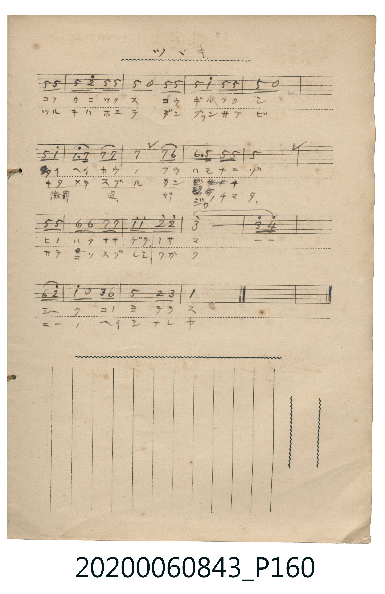

# 我國兵士

> Re:Shōka 使用 AI 協助辨識與重建樂譜，可能會有錯誤。歡迎[回報](https://github.com/TMDLang/reshoka/issues)。

- **鋼琴伴奏版**：<br><audio controls src="wagakuni_heishi.mp3"></audio>

- 日治時期公學校《唱歌帳》（典藏號 2020.006.0843・P159–P160）
- 原載《小公唱材集》第 407 頁（大正 14 年 1 月 5 日抄）

## 說明


- 出處：《唱歌帳》（國立臺灣歷史博物館典藏號 2020.006.0843）第 P159.jpg–P160.jpg 頁。
- 標註：（小公唱材集 407 頁ヨリ）14.1.5（大正 14 年 1 月 5 日抄錄）。
- 調性與拍號：變ロ調（B♭ 大調），2/4 拍，速度 != 132，弱起拍。

### 編曲說明（鋼琴伴奏版）：

1. 前奏 (Intro, 4 小節)：取曲末昂揚進行曲樂句，以精神抖擻的步伐揭開序幕。
2. 主歌伴奏 (Song, 37 小節 × 2 段)：左手採用軍歌進行曲標準的低音與和絃交替律動。


## 歌詞

```text
（TMD 檔案未包含歌詞註解）
```

## ABC

<div class="abc-score" data-abc-src="wagakuni_heishi.abc" aria-label="五線譜載入中"></div>

[下載 ABC 原始檔](wagakuni_heishi.abc)

## TMD 檔案連結

- [主旋律 TMD 檔案](wagakuni_heishi.tmd) [[在 TMD Studio 編輯](https://tmdlang.github.io/Tmd-TS/#tmd=s7IKdvYPcrWy4qpTUCpJTLdSSM7PyUlNLsnMz7MqzsjPTkzOyFeCS5bl55TmploBqXgDQ4RwcX5pUXJqfEFieqpVgKGpJboM3KT4vPyS1KT8_GyEioKi_LLUvMQ8oKrcxLzS4uSizIKS-OT8gkqEmtSyzJRUkIrUlMyS_KLMxBwkJ6UWFYMdC3FDSVFiHsQMoCBCVUlGKtDduZk5mSWJRUgmAw1Lz8yzKs0DWVCSmZaZmoIsWZKRn16UWJBRaZWRWQyyOTkxJz47MS9RiUtLS-FZx8Snc7qftm59uni1gpYWl6KtgqGxEZe9rYKTDpeNkb6JHcioZ9OXPtu0-9nMpmdz5j9tXfN07Y5nCxY-buh6OmXjs7U9T3dsftzQ_X5Px9PWHS-m97-YOV_ByMDIQM_AwEzPwMLE-HHzblCIPmqYHGBoZvB-TyfYeU_75r_Y0wkyZEM_yEygUXMnvJzdBjTq-Zo1CiYG5govFzSCTF2y_NnaxQqGJgpPd25RMFR4NqdDwVQB5KSuFrBhXPpaCrbUAlwKCgqPGyY8m73p-ex1L1atejaj73HDRLBo8-6n7btezJz6fs8sLH6f0_18dfeL9l3PGxc_W7v9af-mp72znneufLlkBY5gAbod5FFQ0OhlFaRDgwfEBHn8cUMT1NJnK2a-WLEbaCnIFtSwgoXS4-YVj5tXAQ00NNEz1DMlEGgve0DhhrDgxar9zxqWv-hof9bdC3Ql0KYX67oeN68FigNNcno0c60C0Dgwr_P9nh5golAAqgSyXjbMf7prmQIkzQD5T_dsfLF1O1AOajblsQEFClr6XFzB-XnpVgGZiXn5DjW6hjXVIBsUbAzNtOzALGAigNivoK0ACldDhaf9S0FR1bz-cdMahRqFx03rgb7tBrGaZwB5S8Bi24G8PWCxPgWNx83LHjct0wRZBzKyRsFAQRcMDeOBhDGIqFEwBVEgCGfUKJjBmOYIMUMoCwahOkFGghlgPTVgi3wMaxRgGoHuBZFAJ4O0gBwNE--GGwTyAFQU6A24KNAz6FaCvKULNhvoN7B6EAm11QhhKzCCgeSLlVOgJk2Cmd_YgjCrcT5cdAGSaC8WW_fAbAXrf9wIMr2GCxZRoPgxgsVP01qg-k1APB-IV4B1LwGbAIsYCAtVROPphNlI8QSNCpN4EALTIGeAKRAEBzVYDVwpMDLB8QmNVDAFihowA6IUHjUgJ0KiAOJMEGsF1KOw4Id4Gdn7OIMEbBrEHEREwAL3cVM3kA0yHRKwIBlEEiDajsYesFmTMYLdGBrsT3bshueGfnCyAPlzFzyIVwODeP8CpCCGJWcYXQOMQQgLRgNDEcNJIDlQsIJjAMRBClV4gga5AO4HcAKFhMQuJJ-txufb5kYwiZq0HzcuhJnU2IbQ1Qg3H55wQaKrMM1vnA4zH5qIwfGBEprA4hWaiNeBfQFy_35wSm1aDQ1JpBIGmGwfN0963DwPb7CCWOBiBBxmYBa2wgQkAi9LQBzk9IoIw3VI4QUKZaD7wCQoPCEFBsG01AwqDICuRtgBDt3d8HDchBRmIPseN4Ji9nEjqOh53NRFjB1NoBiC6EMNYVN4Mb4SUjA0bQXSm6FF2-OmjVBO016gwCIg7oIl66Z9wOBu2gwsQTGCGxio4HCFBi680EYEO7xIBwYvOISRSw94sKOXE0A3QtIzxJ0g1maoT0FhAYmRjcjiQGdDdECcDivmIc6HhQ1ILaQiQAr_pgakkAaXSeA0DIoDWG6CliNNTVBxaAkDzAGPG0GmP24ElV4gs0CmIKd0UCyixoMZPKWvBrvxcXML2E0g3TvBboSVIZCc8Lh5KjiVQXIAMCL2A6sq9BIbVCAQCl1EAsetEj35gxM3OCBBzoQHHtipqIEKLjKg2QSaQYAOh2UQWJ0K0QHJOOAgQytkIEU0pNaEFBsgGXgENoJqa2jihkYTJFs8bgQV0BASZBeogIHYBXYJuBBHjQZzeHaANGHA0QEJeFB2AAc6hAeKAsz8ACp--uiXHyDNFJhDkQIckR-gwQ0Th6RdvPkBWh6BTECOCFDgPW4ER1Ij2C5Y6gYHPCTl7wCTIJNA4pC6G1LjgkozuEwTKOCR8wPIjagRYQFsr1vCIwNUg-6HlE1ADDIB1FJog_ocLAIsP9EaNE3bYVUEsGEKykBAL4GkV0C0AgsTSIqFRxY4ChC1AlLVAMKgzASuYbFUwyARE5hm9GoYuVoAF1pgEuIJUECDi2ZwuofLgCsDbIU5JL9A8hskjyFHESRywO1QaJEFImFRBKlIYJEHy0WwqgzDJqSogUYcUpqGN-WgqRfeVjcCMaCNPnCrHgRhzXzkUEG0m8GFKDgUEEU8yHegsgTZRSAIMxHZ14hmBCRXQ3M7uJCFmNSBMAne8kaYVMvFpWunAOr-RPsYxirA2UZgtjIXAA)]
- [鋼琴伴奏 TMD 檔案](wagakuni_heishi_piano.tmd) [[在 TMD Studio 編輯](https://tmdlang.github.io/Tmd-TS/#tmd=s7IKdvYPcrWy4qpTUCpJTLdSyC8qychPL0osyKi0ysgsLskvykxOzInPTsxLVIIrKs4vLUpOjS9ITE-1CjA0tdQNMDQzQEiXZKTmplqlppQmJ5Zk5ucpcWlpKTzrmPh0TvfT1q1PF69-v6fjZfee5xO2PNmz5enS_uedHe_3dCpoaXEp2ioYGhtx2dsqOOlw2Rjpm9iBzHw2femzTbufzWx6Nmf-09Y1T9fueLZg4eOGrqdTNj5b2_N0x-bHDd1AI5-27ngxvf_FzPkKRgZGBnoGBmZ6BhYmxo-bd4Oc-KhhMsiRQIvA7nzaN__Fnk6QIRv6QWYCjZo74eXsNqBRz9esUTAxMFd4uaBRiYtLX0vBllqAS0FB4XHDhGezNz2fve7FqlXPZvQ9bpgIFm3e_bR914uZU9_vmYXFZ3O6n6_uftG-63nj4mdrtz_t3_S0d9bzzpUvl6zA4WmgN0HeAHlcL6sgXQHoeyDHzADMAXrscUMT1NoXq_Y_a1j-oqP9WXcv0Big_S_WdT1uXgsUB9rslKTwdMlyMLvz_Z4eYIwoANUBWS8b5j_dtUwBEmEI055vXwH0HcRrWGMZaD5IqYKCoZ7C085eoLiChmdeSVG-joKJAjAunq9v0ASqedo_DWjOszmrn81oetY_62XDphcLe0AiK5qe9i8F2v9k99Lnm_Y9XzrvWde0Z5N3P5_V8mzt0id7JjzrX_tyWvfTXf1Pd06FOktBwUhP4cmO3cAQhbhEQSM4Py9dR8HYHGqjwuHpCkYKz9ZtBVu9fdmzzu5nfQufT1nxYncvUBeS7TOf7ZoGtOvJ3r6X8zcDA-3ppJ7nW5uf7FrybPb-p_u6n3bDLKU8sUCBgpY-Fxc4hKwCMhPz8oM8HGoMaqrBHrOx0LIDM2oUTONByAyMahTM40HIEOipGgVjIA2UMgKJG8Yr6CoYAHENVy2KqT7YTQWqjzaMVTABUiaxEFuiTWNhwnB503iQeDySCJAygFgCCmqEy3UNYZYYmsFtATkIBMGuMwYRYJsggnBGDchrECbQbzAxQygLBqE6QUaCGWA9NYhAAqkBegeIwDRIA5gCQbBasBq4UqBrwA6CugpMgcwGMyBKYUEF8wTcIUZQFowGRQW6Y0FyIPPAVoM4uI0DscAeB6sFs7B5HyQC9z2Ig2oiJGXA9cNDEmEyPJwhSQo1ROAmo_gdzAG5npB6hKtwq6STm8EaEEGJFJ4gDPIMODqwxBlIxASmGT3O4IkD6i548gXmP3gyAid0EISlfLScAsqNiJyCyI4g5eDci5TNIBkRmkOh-RMuD7QPIg-VAFKgbAmPNagYRA86H90O1KyNUkDA1eAwA90dsAKFNFNAfJwuoYZvBosZOGKTUHhgD1X0whtfYa1rpwCuFBSADFByRKaVuQA)]

## 分析

```text
================================================================================
📊 TMD Song Profile: [ 我國兵士 ]
================================================================================
⏱  Duration:       1:03 (63.6s), 70 measures total
🎼 Key & Tempo:    首調基準 B,, != 132.0 BPM, <2/4>
   - 分析範圍：      由實際發聲的音符與和弦推測調性；播放脈絡另行呈現
🎤 人聲音域:    A#3 (MIDI 58) – D#5 (MIDI 75) [跨度: 17 個半音 / 1.4 個八度, 難度: challenging]
   - 最低音:  A#3 in [Song[L1] #1 @ m.1, 0:00]
   - 最高音: D#5 in [Song[L1] #1 @ m.33, 0:29]
   - 適合: soprano, mezzo-soprano, contralto, tenor, baritone, bass
🏛  結構:      Song[L1] (31.8s) -> Song[L2] (31.8s)
⚡ 編曲密度:        Peak 1 軌道同時演奏
🗝  調性診斷：       A# 大調（純淨自然大調，未偵測到可信轉調）
   - 風格氣質:    純淨自然大調（陽光明朗、易唱易記，無明顯調外色彩）
   - 轉調歷程:    全曲維持單一推測調性（未偵測到可信轉調）
   - 核心骨幹音:  F, A#, A, D, G
   - 調性數值:    A# 大調 [相關度: 0.88, 穩定度: Moderate, 自然音純度: 100.0%]
   - 候選調性 (K-S): A# 大調 (0.88), F 大調 (0.84), D 小調 (0.71)
   - 五度圈歷程:   -2 -> -2
   - 各段落調性細節:
     • [Song[L1] #1]: A# 調性不明確 (r: 0.86, 自然音純度: 100.0%)
     • [Song[L2] #1]: A# 大調 (r: 0.88, 自然音純度: 100.0%)

  [ 五度圈游移軌跡 ]
               C  
         F            G  
     [Bb]*              D  
      Eb               A  
         Ab           E  
            Db       B  
               F# 
     (* = active key center)

  [ 十二半音累積音高分佈 ]
     C  : ███████                    8.4%
     C# :                            0.0%
     D  : ███████████               12.6%
     D# : ████                       4.2%
     E  :                            0.0%
     F  : ████████████████████████  27.5%
     F# :                            0.0%
     G  : ██████████                11.5%
     G# :                            0.0%
     A  : ███████████               13.0%
     A# : ████████████████████      22.9%
     B  :                            0.0%
--------------------------------------------------------------------------------
Assignment 軌道音域：
  - Piano         : A#3 – D#5 (17 個半音 / 1.4 個八度, 208 個音符)
================================================================================
```


## 原書掃描頁





