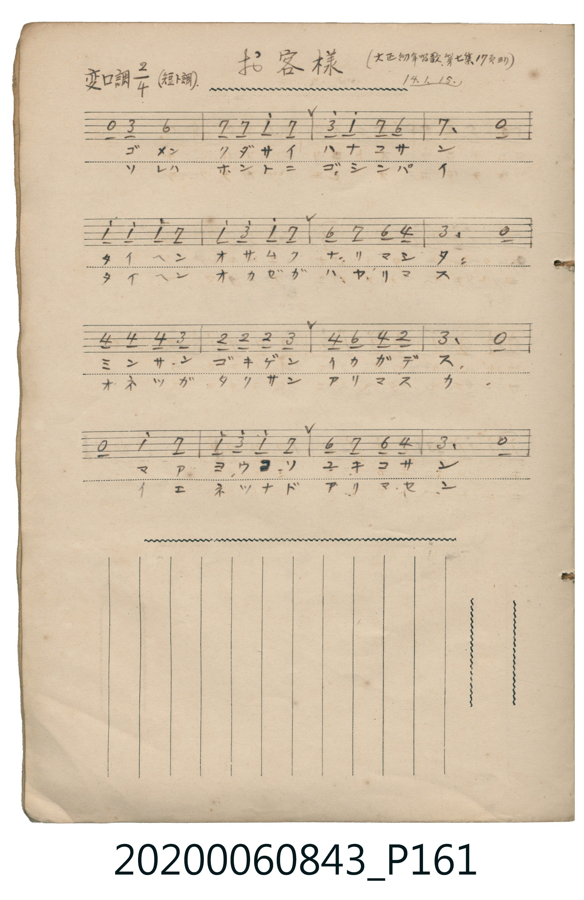
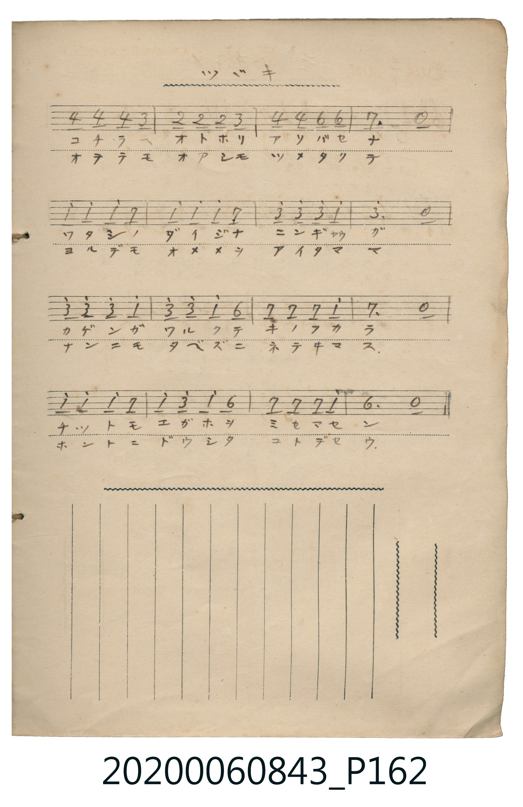

# お客様

<audio controls src="okyakusama.mp3"></audio>

- 日治時期公學校《唱歌帳》（典藏號 2020.006.0843・P161–P162）
- 原載《大正幼年唱歌》第七集第 17 頁（大正 14 年 1 月 15 日抄）

## 說明

【曲目說明】
・出處：《唱歌帳》（國立臺灣歷史博物館典藏號 2020.006.0843）第 P161.jpg – P162.jpg 頁。
・標註：（大正幼年唱歌第七集 17 頁ヨリ）14.1.15.（大正 14 年 1 月 15 日抄錄），P162 標註「ツヾキ」。
・調性與拍號：變ロ調（短ト調，即 Bb 大調之關係小調 G 小調），2/4 拍。
・背景與曲風：兒童扮家家酒的對話唱歌（問答歌）。第一節由來訪的小客人向主人「花子（ハナコ）」問候，
並由花子迎客「歡迎光臨，雪子（ユキコ），請這邊進」；之後雪子擔心地訴說自己心愛的洋娃娃從昨天起生病不笑，
第二節則由花子關心詢問洋娃娃是否感冒發燒、手腳冰冷、睜著眼睛睡不著。全曲採自然小調／日本陰音階風格，生動可愛。
・版本說明：本檔案完整合併 P161.jpg 與 P162.jpg 共 32 小節簡譜。原譜以 `6` 為 G4，為符合標準音域，整體記於 `6_`–`3` 音區。
【原頁歌詞全文與中文語譯】（對應 P161.jpg – P162.jpg）

・編曲說明（鋼琴伴奏版）：
1. 前奏 (Intro, 4 小節)：取曲末樂句，以溫柔純真的小調和聲帶出孩童家家酒的對話情境。
2. 主歌伴奏 (Song, 32 小節 × 2 段)：左手以輕巧的八分音符伴奏襯托問答語氣。

## 跨冊／重複收錄參照

> 同曲（《大正幼年唱歌》第七集〈お客様〉；收錄於《新定兒童唱歌》二年級與《唱歌帖》P161）

- **[同曲]** 《新定兒童唱歌》尋常科第二學年用（2020.006.0847.0002）：[**〈おきやくさま〉**](../../../shintei_jido_shoka/grade_2_2020.006.0847.0002/4_16_okyaku_sama/index.md)（`B,` / `2/4` — [原始 TMD](../../../shintei_jido_shoka/grade_2_2020.006.0847.0002/4_16_okyaku_sama/okyaku_sama.tmd)）
- 總表：[跨冊重複與同名歌曲總索引](../../../duplicate_songs.md)

## 歌詞

```text
（一）ゴメンクダサイ　ハナコサン　タイヘンオサムク　ナリマシタ
ミナサンゴキゲン　イカガデス　マアヨウコソ　ユキコサン
コチラヘオトホリ　アソバセナ　ワタシノダイジナ　ニンギャウガ
カゲンガワルクテ　キノフカラ　チットモエガホヲ　ミセマセン
「哎呀歡迎光臨，雪子小姐，請往這邊進來吧！」
「我最心愛的洋娃娃，從昨天起身體不舒服，一點笑容也不露出來。」）

（二）ソレハホントニ　ゴシンパイ　タイヘンオカゼガ　ハヤリマス
オネツガタクサン　アリマスカ　イエネツナド　アリマセン
オテテモオアシモ　ツメタクテ　ヨルデモオメメヲ　アイタママ
ナンニモタベズニ　ネテヰマス　ホントニドウシタ　コトデセウ
「不，並沒有發燒，只是小手小腳都冰冰涼涼的，連晚上也一直睜著眼睛，
什麼也不吃地躺著，到底是怎么一回事呢？」）
```

## ABC

```abc
X:1
T:お客様
M:2/4
L:1/16
Q:1/4=100
K:Gm
V:V1 name="Piano" snm="Pia"
[V:V1]
z2 D2 G4 | A2 A2 B2 A2 | d2 B2 A2 G2 | A6 z2 |
B2 B2 B2 A2 | B2 d2 B2 A2 | G2 A2 G2 E2 | D6 z2 |
E2 E2 E2 D2 | C2 C2 C2 D2 | E2 G2 E2 C2 | D6 z2 |
z2 B2 A4 | B2 d2 B2 A2 | G2 A2 G2 E2 | D6 z2 |
E2 E2 E2 D2 | C2 C2 C2 D2 | E2 E2 G2 G2 | A6 z2 |
B2 B2 B2 A2 | B2 B2 B2 A2 | d2 d2 d2 B2 | d6 z2 |
d2 c2 d2 B2 | d2 d2 B2 G2 | A2 A2 A2 B2 | A6 z2 |
B2 B2 B2 A2 | B2 d2 B2 G2 | A2 A2 A2 B2 | G6 z2 |
```

## TMD 檔案連結

- [主旋律 TMD 檔案](okyakusama.tmd) [[在 TMD Studio 編輯](https://tmdlang.github.io/Tmd-TS/#tmd=s7IKdvYPcrWy4tLSUnjc2PV03aJny2coaGlxKdoqGBoYcNnbKjjpcGWnVtoquOdy2Rjpm9hx1SkoPZu-9Nmm3c9mNj2bM_9p65qna3c8W7DwcUPX0ykbn63tebpj8-OG7vd7Op627ngxvf_FzPkKRgZGBnoGBmZ6BhYmxo-bdwcYmhk-apgMpIze7-lUApn5tG_-iz2dIEOWLH-2dvHTnXue7twCMRBo2vM1a57saH45uw3IUDA0V3i5oBFkAVipgqGJAlCtgqHCszkdCoamCiDndbWADebS11KwpRbgUlBQeNww4dnsTc9nr3uxatWzGX2PGyaCRZt3P23f9WLm1Pd7ZmEJhzndz1d3v2jf9bxx8bO125_2b3raO-t558qXS1bgCCKg20EeBQWTXlZBugIwrEAcIzAH6PfHDU1Qa5-tmPlixW6gtfDgQA45eLBBw-xx84rHzauAphua6BnqGZrqEQrElz2gcHy_pwdkuwLEsscNPY-bWx4373vctPZxQy_CLS9W7X_WsPxFR_uz7l6gl4COerGu63HzWqA40J7n89c-bu4As3ue9m5WcEpSAFoN5D_Z2f1y-pwn-5uebugHchXcFSAMiMXANKcANA_JluaeZzPXg2yZvenlohVAW562Tnq-eumzznVP120DopdA7qyWpxt6X6zcCAkGkC-n9j9fOwXMBiayJnDANDxf3_B8ysYn-9perFgF1tIPzAFPdu16OmHikx27gQygV190bXy6dgLQhMfN_Y-bux43bQab0As08GnDTKADQc5SUHiyYxnQKIjiF_v7gOYA9T5buxDEbu180Q50Z8_L2atgRi0DhR3YKKD4i9XdLxtmvmzqetmwCWjy-z2zgUHydB9U_bPJU57ub346Z8OLFVuAie5F-6qn2zcCRZ61zAa6-dmW7qcrmkFo37xnM1Y8XbLyxdbtz6fMfz699cmO3udrJsJdCPLyrh6gl592tsOdCgx4oFEvVi4Cegdu1LMZ659OWPasZf7TtknPZ-553j7pcUPjs87uF62bn7ZteNq2Hch9PnfOi4nTn8_Z83zu7OdzFwLtAnKBAfu0dQUwXp71LQS683nLNlhM9oOS05w1L2dueDl_88tZfcCIe7ZgD9BtQKc-7Z76tH890DuIOH7e2QFUDcliwAgGsp-tmvJsYcfTdT3Ppm55OqHjyd6tiNwBTAuI3PG0daOCsREoCYFid8PCF2vngJwFLF3Wznmye6lCglmCwvOmXQruJiDbm3Y9X7MMaB4wZT_bNQ3otqfzgekWZMnL1VNerJjxbNoeoI74BGAGTDBOUAAp6G0AuRNaFgDNBWYrYLJ6sXIeyOvT2oGOebJjLYixat6LteuBBQQo9W3ofdbeiT0_A9MA2DSgMmCSBCWupi2Pmxc-bt78uGn94-aGx01bHzctedzQAE-AIBGgLFCkaT9IqnkGWPEqsPgCkC6QYmDOW_W4ed7jpu1AZRDnAl0ORs3zwQaBTQFaBkqKm2AmLnnctPpx05rHze2Pm3aCFQONWAQqOJqAiRaofi9YEJqAIYagmg4UbQaWNCtB7gI6qhmY3GeD3AKSWgTS3zzhcdNukAtABq0He2L74-Y-sF-B1u-ASXWD3bfucfNisN1r0KwBOhPsapBjgQEF5ALJNrAUsKQBGjcVpAboDpBZQAc1g50CdAHQK0AtQDcBcxs4MECuAfoSSIK9AowJSOSBS_OeZ52Tn03e92RXGyirgnMNqKBYDszIPcDs9mzDYmAp93Tf9KdL9wKzxtOJwCgEii8HFkQvdq0GpqKXzXtBUtOBCXk-MHdDMiPQ2KeT-4CKsRYRcPOBJcPTfQ3wwgFYUj2dsPz9HmD5jzDnWcfEZ3MaMAsEkDOQygSIY0D5tGPSsznAQqYHmNpe7p4HLCKertv5ZOd8oNTLOZuA1RjQFmAKBxdEiJS5C1xwgiIPGHTAdAgMPWA0A8OzGxzgwEQEjEKgyERoWkVPmcDY2QMKdmgyBkpBEudOtEgFivaCahegUpARwNQBT-vARAjVAzIOmlaB9RlYPSi5A4tlZGWw6EQ1vQ2MgKkA6CggCXQ1sKQGOgpoxEKolZBEBKoqgcmnHaoYlCOBCJxkQBqBdu8HWdM8Dy1vAR0CDAdg2gUqAqqY-bhpFzSUQC4F2r0B6gmQCFIwAp0PSuWg3ArLRUBxYC7cDRTHkixfNi1-Pmc-sKx-snsJsKqCVhPg5AdMDy_2T4QU4C_nznu6Y8ezrY0vFgKjsOfp0p2QIh2UYvd1PO3b9HTdZszECUwM4BSy7NkmYGrphGgBae8HFsnrgekTWB2AyvbWzaDkDaoUNjzbtgeIgCkQlIwbFj-bOevJji5wump4PnsLcn2BqDR3N7zctQeS9p5OANdxu3YBlYEs6tjwdNdUoF3PGvqe7ASVjE9nz3uyq_vpxEUQp4ISJ9AIylt1UKCgpc_FFZyfl24VkJmYl-9QY1CjUA12po2Flh2YAWxLgkpwUE0KbCeBw3OWBtBlmgoGCsAsAKy4QKW2Qg2Qsx7IaQDSW4F4CUikuR-Iu4C8zWBRkMhmoDagpVCTUYAGML9BTN0LVAjKcWAds8G6gOkCiLvB9gAtbdoOFZ0IFlmCMLUGyDSOVzCLV9AFss3jQcgQRNQoGEMYQCmwhC4QGijUgHM7ijeNULwJTJpgG4D5GmwnyL5VEF82LwD7GuRKoC-bgaLN88BuA6nZT8inuAxeDcR7gHgNPAhBaiCGg9TsRPasIRiCvWcI82ANyIsQj5qA_Y3Hr8aofm2eD40xkO8gTgKF9log3gQXAToH7Mg1QJF2dCfh8ivI_b1A3ALzGdj3wCSDZNUipEDcCRZZjexXoGcgCOihGgWjeCgC84CiEO8CBfD72AQ9EYOtWwQO7BVA1jJoet0LFgHxQL4nMQWDgmgFWDnUz-AE0onhy93oRoKSLzgSQamXxBg1wpJJwS5vbgTileCEBk1k4NwEylmrYE4CZ7oJcCd1ERejbVAMDj5w6gUZBcqckAAF-XwhPK5BIm0kxCgkUvHkV4iP0fJrMyhRgSwEOaMPbCmoVAJFyQ6wz0Ai3ZDyA9bQAjt_DUE_gxJIMzDpA5M9kp9BPgTjTfDABFkGdAIkxwJJXDkWzjQGQ0MwC6dH0TIrOBNCsiWstAAVwSBREN0Gdg0w8QIDAdguBKsHqVlJ2JugxApKN6BQgngT5JmZQHoXWBSWsEFRvwHmTdSCyRgYLTAPgWhYLMJKZPxRippJIQm4GZpsIQ4CZVVQAQRKxOBwBxVdwMSLI1_h8ilG7QLMpJAyAJh6gL4GWQWTB0Y6xGCgPL4iGNOr4NoI4tVaLi5dOwVQnasApJW5AA)]
- [鋼琴伴奏 TMD 檔案](okyakusama_piano.tmd) [[在 TMD Studio 編輯](https://tmdlang.github.io/Tmd-TS/#tmd=s7IKdvYPcrWy4tLSUnjc2PV03aJny2e839PxsnvP8wlbnuzZ8nRp__POjvd7OhW0tLgUbRUMDQy47G0VnHS4slMrbRXcc7lsjPRN7LjqFJSeTV_6bNPuZzObns2Z_7R1zdO1O54tWPi4oevplI3P1vY83bH5cUM30OinrTteTO9_MXO-gpGBkYGegYGZnoGFifHj5t0BhmaGjxomAykjoIVKIDOf9s1_sacTZMiS5c_WLn66c8_TnVsgBgJNe75mzZMdzS9ntwEZCobmCi8XNCpxcelrKdhSC3ApKCg8bpjwbPam57PXvVi16tmMvscNE8Gizbuftu96MXPq-z2zsHhyTvfz1d0v2nc9b1z8bO32p_2bnvbOet658uWSFTj8D_QxyBegMNDLKkhXAAYEiGME5gA99rihCWrti1X7nzUsf9HR_qy7F2gM0P4X67oeN68FigNln89f-7i5A8gGusJd4emGfjCz8_2eHmA8KQC1AFkvG-Y_3bVMARKdCIOfb18B9CjEl1jTANAqkFIFBUM9haedvUBxBQ3PvJKifB0FE5BVz9c3aALVPO2fBjTn2ZzVz1Y0Pe1fCrTwye6lz3atfjZ_yvMtU57Pmf98VgvEYU8n9bxo3PR0xzZgUD5du_L56qVP120Dopetk8Bqel-s3PisufXpomaoKxUUjPQUnuzYDQxriMMUNILz89J1FIyNoA5QODxdwUjh2bqtYJdsX_assxto-4s9U59uXw4ys3X10462l_M3P1-zDGLCi6Xrn3XOeDq1__naKS9WzXu2YTHULspTDxQoaOlzcYHDySogMzEvP8jDocagRqEa7CEbCy07MKNGwRAMzePBTGMgNgMxgXwIMgRygCK6QGigUMNVi2KmDw4zzeLjFaLN4nNjFYxBLGMQC1kUwapBUoFbLdRmUKDj94wB0BCIc2FegHoN5DEgA-Y3mHdwBAGYCVQL0WECNgBdE1AUgoAyNQpG8VAE5gFFIfqAAli0GkCsADmSavZBrCTCf3CmMRiC4tcYTb0xMC3DZLCnCMJBSCgVIeKScCIiNblgV4twLKHkiV3UBMQyiUcyGN1cuAokpUYgphFIP4KFpBJZEIepg8i1tAtc0kxGVk1KMiHXzWSWV7p2CuDCUgHIAKV3ZFqZCwA)]

## 分析

```text
================================================================================
📊 TMD Song Profile: [ お客様 ]
================================================================================
⏱  Duration:       0:38 (38.4s), 32 measures total
🎼 Key & Tempo:    首調基準 B,, != 100.0 BPM, <2/4>
   - 分析範圍：      由實際發聲的音符與和弦推測調性；播放脈絡另行呈現
🎤 人聲音域:    C4 (MIDI 60) – D5 (MIDI 74) [跨度: 14 個半音 / 1.2 個八度, 難度: moderate]
   - 最低音:  C4 in [Song #1 @ m.10, 0:10]
   - 最高音: D5 in [Song #1 @ m.3, 0:02]
   - 適合: soprano, mezzo-soprano, contralto, tenor, baritone, bass
🏛  結構:      Song (38.4s)
⚡ 編曲密度:        Peak 1 軌道同時演奏
🗝  調性診斷：       G 小調（純淨自然小調，未偵測到可信轉調）
   - 風格氣質:    純淨自然小調（陰鬱抒情、旋律集中，無明顯調外色彩）
   - 轉調歷程:    全曲維持單一推測調性（未偵測到可信轉調）
   - 核心骨幹音:  A, D, A#, G, D#
   - 調性數值:    G 小調 [相關度: 0.68, 穩定度: Moderate, 自然音純度: 100.0%]
   - 候選調性 (K-S): G 小調 (0.68), D 小調 (0.58), A# 大調 (0.53)
   - 五度圈歷程:   +1
   - 各段落調性細節:
     • [Song #1]: G 小調 (r: 0.68, 自然音純度: 100.0%)

  [ 五度圈游移軌跡 ]
               C  
         F           [G ]*
      Bb               D  
      Eb               A  
         Ab           E  
            Db       B  
               F# 
     (* = active key center)

  [ 十二半音累積音高分佈 ]
     C  : ███████                    6.8%
     C# :                            0.0%
     D  : ███████████████████████   23.7%
     D# : ██████████                10.2%
     E  :                            0.0%
     F  :                            0.0%
     F# :                            0.0%
     G  : ████████████              12.7%
     G# :                            0.0%
     A  : ████████████████████████  24.6%
     A# : ██████████████████████    22.0%
     B  :                            0.0%
--------------------------------------------------------------------------------
Assignment 軌道音域：
  - Piano         : C4 – D5 (14 個半音 / 1.2 個八度, 100 個音符)
================================================================================
```


## 原書掃描頁






