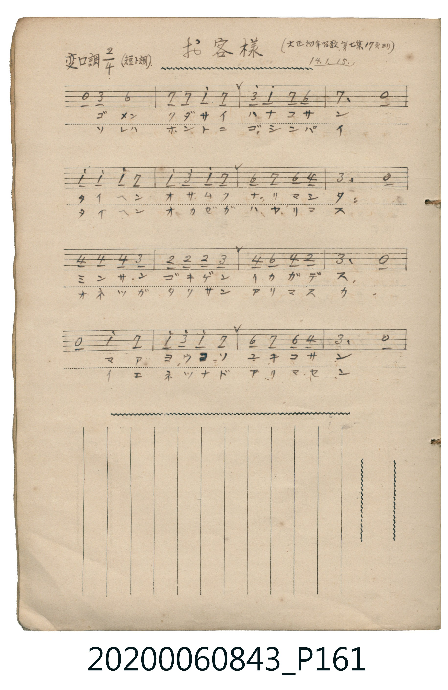
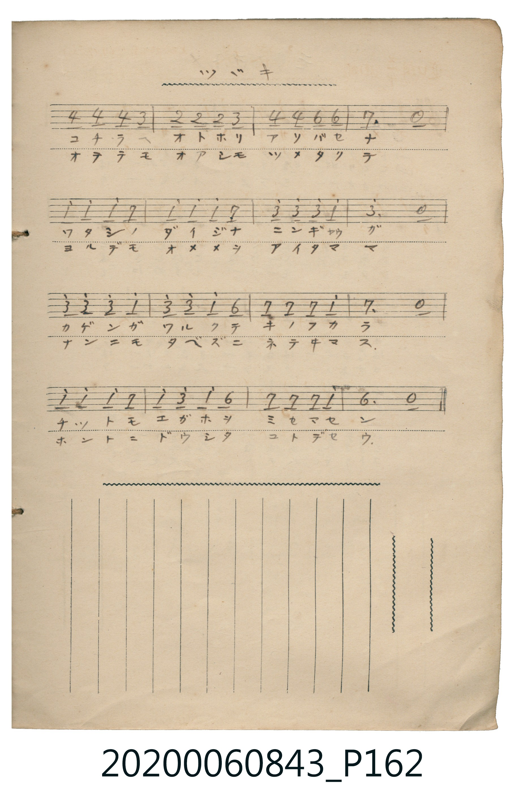

# お客様

> Re:Shōka 使用 AI 協助辨識與重建樂譜，可能會有錯誤。歡迎回報。

- **鋼琴伴奏版**：<br><audio controls src="okyakusama.mp3"></audio>

- 日治時期公學校《唱歌帳》（典藏號 2020.006.0843・P161–P162）
- 原載《小公唱材集》第 393 頁（大正 14 年 1 月 5 日抄）

## 說明


- 出處：《唱歌帳》（國立臺灣歷史博物館典藏號 2020.006.0843）第 P161.jpg–P162.jpg 頁。
- 標註：（小公唱材集 393 頁ヨリ）14.1.5（大正 14 年 1 月 5 日抄錄）。
- 調性與拍號：變ロ調（B♭ 大調），2/4 拍，速度 != 100。

### 編曲說明（鋼琴伴奏版）：

- Reference Audio: [大正幼年唱歌チャンネル (YouTube)](https://www.youtube.com/@%E5%A4%A7%E6%AD%A3%E5%B9%BC%E5%B9%B4%E5%94%B1%E6%AD%8C%E3%83%81%E3%83%A3%E3%83%B3%E3%83%8D%E3%83%AB/videos)
1. 前奏 (Intro, 4 小節)：取曲末樂句，以溫柔純真的小調和聲帶出孩童家家酒的對話情境。
2. 主歌伴奏 (Song, 32 小節 × 2 段)：左手以輕巧的八分音符伴奏襯托問答語氣。


## 歌詞

```text
（TMD 檔案未包含歌詞註解）
```

## ABC

<div class="abc-score" data-abc-src="okyakusama.abc" aria-label="五線譜載入中"></div>

[下載 ABC 原始檔](okyakusama.abc)

## TMD 檔案連結

- [主旋律 TMD 檔案](okyakusama.tmd) [[在 TMD Studio 編輯](https://tmdlang.github.io/Tmd-TS/#tmd=s7IKdvYPcrWy4qpTUCpJTLdSSM7PyUlNLsnMz7MqzsjPTkzOyFeCS5bl55TmploBqXgDQ4RwcX5pUXJqfEFieqpVgKEZbhkjdBm4HfF5-SWpSfn52QgVBUX5Zal5iXlAVbmJeaXFyUWZBSXxyfkFlQg1qWWZKakgFakpmSX5RZmJOUiOTS0qBnsD4oaSosQ8iBlAQYSqkoxUoI8KchKRTAUalJ6ZZ1WaBzK8JDMtMzUFWbIkIz-9KLEgo9IqI7MYZGtyYk58dmJeohKXlpbC48aup-sWPVs-Q0FLi0vRVsHQwIDL3lbBSYfLxkjfxA5kzrPpS59t2v1sZtOzOfOftq55unbHswULHzd0PZ2y8dnanqc7Nj9u6H6_p-Np644X0_tfzJyvYGRgZKBnYGCmZ2BhYvy4eTcokB81TAaF6Ps9nWC3Pe2b_2JPJ8iQDf0gM4FGzZ3wcnYb0Kjna9YoGFsaK7xc0AgydcnyZ2sXKxiaKDzduUXBUOHZnA4FUwWQk7pawIZx6Wsp2FILcCkoKDxumPBs9qbns9e9WLXq2Yy-xw0TwaLNu5-273oxc-r7PbOw-H1O9_PV3S_adz1vXPxs7fan_Zue9s563rny5ZIVOIIF6HaQR0FBo5dVkA4NHhAT5PHHDU1QS5-tmPlixW6gpSBbUMMKFkqPm1c8bl4FNNDQRM9Qz5RAoL3sAYUbwoIXq_Y_a1j-oqP9WXcv0JVAm16s63rcvBYoDjTJ6dHMtQpA48C8zvd7eoCJQgGoEsh62TD_6a5lCpA0AzWP8hiAAgUtfS6u4Py8dKuAzMS8fIcag5pqkAUKNhZadmAGMNpBgacACkVDhRcLe4Au13iyo0FTwUDhcdMWoNcWPm7erFAD5KwHchqA9FYgXgISae4H4i4gbzNYFCSyGagNaCfUZBSg8WRXD8TUvUCFa0C6QTpmg3U9bu4A4m6wPUBLm7ZDRSeCRZYgTK0BMo3jFcziFXSBbPN4EDIEETUKxhAGUAosoQuEBgo1YF0-hjUK8TD_gI0m3kMgc4BGQswxgpgD9gFYPfFegJmDEexGKMH-uGk_WPnj5hlwh66COLJ5AdjRICuBjmwGijbPA1sEUrOfUMjjMng1EO8B4jXwEACpgRgOUrMTOfANwRAc3IawAK8BBTkk4E3A8YAZ9uR7Cj30yfcFzvA3Rg3_5vnQRAByHMQCUHSuBeJNcBGg4WArQYmgHT2YcIU_yDW9QNwCcyfYL8BUiGTVIqQw2AkWWY0c_sAAhiBgINcoGMVDEZgHFIVEAVAAeyyQ7TXMWCDXLzhjwQS98AFrWwSOzhVA1jIgBmXLvWAREA_kbBJLHpDfVoCVQ90OTnOdGK7djW4kqNgBJ3ZQqUNKygeWFlCPgHQS6xVsZQ7E7RBTiHM9lrA2wlLQg61ubgTileBsBYteUHEGKtpWwSwAF3sT4BZ0EZfi26AYHJXgvAoyClQ6QiIX5A9gmQxNPyCRNhJSPCTR4yrzyfca9hRPjl9wxgJaud8MyjwgjSDj-sCaQZUTKNp3gJ0EEukGR-zjpnWPmxeDEhLIGWsIxgMo1TUD8zQwPyO5HVwTgvAmeCiALAM6AVJmAklcJT-caQyGhmAWZnFDqo_AeQPiJYzwJ9sPOMMfrdwHF3qQYhBWjYAaCCBREN0GtgCYUYE-edw8FawepGYl4dAH5VJQOgR5FeJykPtmAuldYFFYjgalrA0wl6PWu8bA1AILZxANS_CwBhCO1E-ulzBDn1w_4Ax91PIekkmbgRiUNSEWgIpKUCUEyqjg6AVVX8AMiqOIxhX6GK0zYIkJKYOByRLoC1gpAZIHpi2IwUB5fK0ezOAHN0jR0z-5fsIMfnI9ATOplotL104B1BOI9jGMVYCzjcBsZS4A)]
- [鋼琴伴奏 TMD 檔案](okyakusama_piano.tmd) [[在 TMD Studio 編輯](https://tmdlang.github.io/Tmd-TS/#tmd=s7IKdvYPcrWy4qpTUCpJTLdSyC8qychPL0osyKi0ysgsLskvykxOzInPTsxLVIIrKs4vLUpOjS9ITE-1CjA0M9QFEkYI6ZKM1NxUq9SU0uTEksz8PCUuLS2Fx41dT9cterZ8xvs9HS-79zyfsOXJni1Pl_Y_7-x4v6dTQUuLS9FWwdDAgMveVsFJhys7tdJWwT2Xy8ZI38QOZPCz6Uufbdr9bGbTsznzn7auebp2x7MFCx83dD2dsvHZ2p6nOzY_bugGGv20dceL6f0vZs5XMDIwMtAzMDDTM7AwMX7cvBvkzkcNk0EuBVoIduzTvvkv9nSCDFmy_NnaxU937nm6cwvEQKBpz9esebKj-eXsNiBDwdBc4eWCRiUuLn0tBVtqAS4FBYXHDROezd70fPa6F6tWPZvR97hhIli0effT9l0vZk59v2cWFk_O6X6-uvtF-67njYufrd3-tH_T095ZzztXvlyyAof_gT4G-QIUBnpZBekKwIAAcYzAHKDHHjc0Qa19sWr_s4blLzran3X3Ao0B2v9iXdfj5rVAcaDs8_lrHzd3ANlAV7grPN3QD2Z2vt_TA4wnBaAWIOtlw_ynu5YpQKITYfDz7SuAHoX4EmsaAFoFVRqUmpZalJqXnKrgWJqSmW-lEI0lgpobHzcvfty8-XFz7-Pm1QoakfmlIaVJqZqxGhklJQXFVvr65eXlepX5pSVAUb3k_Fx9B1VXU1VHE1VHc1VXM1VHF1VHY5CIk6WqkzOMYQJiWJqoOhlC1VgApYxVLYAIKAJmgHSBGU4whoULTMpJvywzJTW_WJML5BUFBUM9haedvUAvKmh45pUU5esomIBC7fn6Bk2gd5_2TwMGybM5q5-taHravxQYdk92L322a_Wz-VOeb5nyfM7857NaIGH8dFLPi8ZNT3dsA6aKp2tXPl-99Om6bUD0snUSWE3vi5UbnzW3Pl3UDA1wBQUjPYUnO3YDQwoSxgoawfl56ToKxkZQBygcnq5gpPBs3VawS7Yve9bZDbT9xZ6pT7cvB5nZuvppR9vL-Zufr1kGMeHF0vXPOmc8ndr_fO2UF6vmPduwGGQXyDLKcwIUKGjpc3GBA8oqIDMxLz_Iw6HGoKYa7CEbCy07MKNGwRAMzePBTGMgNgMxgXwIMgRygCK6QGigUMNVi2KkD3YjzeLjFaLN4nNjFYxBLGMQC1kUwapBUoFbLdRiUJjj9YoB0AyIY2EegHoM5C0gA-YzmGdwBACYCVQL0WECNgBdE1AUgoAyNQpG8VAE5gFFIfqAAli0GkCsADmSavZBrCTCf3CmMRiCYtcYTb0xMCXDZLCnB8JBSCgNIaKSYBIiNbFgV4twK6HEiV3UBMQyiUcyGN1cuAokpUYgphFIP4KFpBJZEIepg8i1tAtc0kxGVk1KMiHXzWSWVrp2CuCSUgHIACV3ZFqZCwA)]

## 分析

```text
================================================================================
📊 TMD Song Profile: [ お客様 ]
================================================================================
⏱  Duration:       1:16 (76.8s), 64 measures total
🎼 Key & Tempo:    首調基準 B,, != 100.0 BPM, <2/4>
   - 分析範圍：      由實際發聲的音符與和弦推測調性；播放脈絡另行呈現
🎤 人聲音域:    C4 (MIDI 60) – D5 (MIDI 74) [跨度: 14 個半音 / 1.2 個八度, 難度: moderate]
   - 最低音:  C4 in [Song[L1] #1 @ m.10, 0:10]
   - 最高音: D5 in [Song[L1] #1 @ m.3, 0:02]
   - 適合: soprano, mezzo-soprano, contralto, tenor, baritone, bass
🏛  結構:      Song[L1] (38.4s) -> Song[L2] (38.4s)
⚡ 編曲密度:        Peak 1 軌道同時演奏
🗝  調性診斷：       G 小調（純淨自然小調，未偵測到可信轉調）
   - 風格氣質:    純淨自然小調（陰鬱抒情、旋律集中，無明顯調外色彩）
   - 轉調歷程:    全曲維持單一推測調性（未偵測到可信轉調）
   - 核心骨幹音:  A, D, A#, G, D#
   - 調性數值:    G 小調 [相關度: 0.68, 穩定度: Moderate, 自然音純度: 100.0%]
   - 候選調性 (K-S): G 小調 (0.68), D 小調 (0.58), A# 大調 (0.53)
   - 五度圈歷程:   +1 -> +1
   - 各段落調性細節:
     • [Song[L1] #1]: G 小調 (r: 0.68, 自然音純度: 100.0%)
     • [Song[L2] #1]: G 小調 (r: 0.68, 自然音純度: 100.0%)

  [ 五度圈游移軌跡 ]
               C  
         F           [G ]*
      Bb               D  
      Eb               A  
         Ab           E  
            Db       B  
               F# 
     (* = active key center)

  [ 十二半音累積音高分佈 ]
     C  : ███████                    6.8%
     C# :                            0.0%
     D  : ███████████████████████   23.7%
     D# : ██████████                10.2%
     E  :                            0.0%
     F  :                            0.0%
     F# :                            0.0%
     G  : ████████████              12.7%
     G# :                            0.0%
     A  : ████████████████████████  24.6%
     A# : ██████████████████████    22.0%
     B  :                            0.0%
--------------------------------------------------------------------------------
Assignment 軌道音域：
  - Piano         : C4 – D5 (14 個半音 / 1.2 個八度, 200 個音符)
================================================================================
```


## 原書掃描頁






