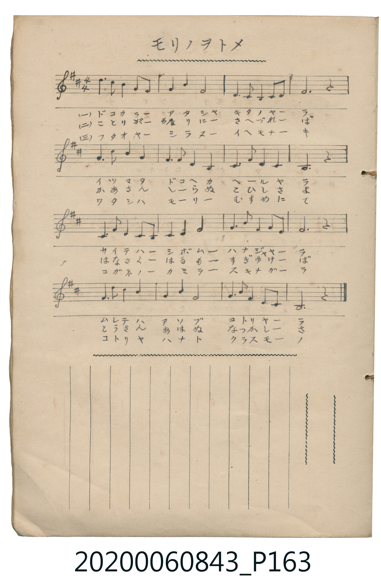

# モリノヲトメ

> Re:Shoka 使用 AI 辨識樂譜，可能會有錯誤。歡迎回報。

<audio controls src="mori_no_otome.mp3"></audio>

- 日治時期公學校《唱歌帳》（典藏號 2020.006.0843・P163）

## 說明

【曲目說明】
・出處：《唱歌帳》（國立臺灣歷史博物館典藏號 2020.006.0843）第 P163.jpg 頁。
・調性與拍號：ニ長調（D 大調，2♯），4/4 拍，原譜為手抄五線譜及三節歌詞。
・背景與曲風：敘事抒情童謠《森の乙女》（森林的少女）。以溫柔優美的附點節奏與大調五聲性旋律，
描寫不知父母與身世的森林金髮少女，懷念著母親，在林間與花朵、小鳥相伴生活的純真與哀愁。
・版本說明：本檔案由原頁手抄五線譜轉譯為 TMD 簡譜。
【原頁歌詞全文與中文語譯】（對應 P163.jpg）

・編曲說明（鋼琴伴奏版）：
1. 前奏 (Intro, 4 小節)：取末樂句溫暖抒情的旋律，描繪森林晨光與鳥鳴。
2. 主歌伴奏 (Song, 16 小節 × 3 段)：左手以柔和的分解和絃襯托森林少女的歌聲。

## 歌詞

```text
（一）ドコカラー　アタシヤ　キタノヤーラ
イツマタ　ドコヘカ　ヘールヤラ
サイテハー　シボムー　ハナジャヤーラ
ムレテハ　アソブ　コトリヤーラ
就像是開了又謝的花朵嗎？還是成群嬉戲的小鳥呢？）

（二）ことりがー　もりにー　さへづれーば
かあさん　しらぬ　こひしさよ
はなさくー　はるもー　すぎゆけーば
とうさん　あはぬ　なつかしーさ
當百花盛開的春天悄然逝去時，便泛起對未曾相見的父親的懷念。）

（三）フタオヤー　シラヌー　イヘモナーキ
ワタシハ　モーリー　むすめにて
コガネノー　カミヲー　スキナガーラ
コトリヤ　ハナト　クラスモーノ
一邊梳理著金色的長髮，一邊與小鳥和花朵一同生活。）
```

## ABC

```abc
X:1
T:モリノヲトメ
M:4/4
L:1/16
Q:1/4=96
K:D
V:V1 name="Piano" snm="Pia"
[V:V1]
d3 B B4 G4 F4 | G4 A4 F8 | E3 D D4 E4 F4 | F12 z4 |
A3 B B4 A8 | F3 G E4 D8 | E3 F G4 E8 | D12 z4 |
D3 F F4 E4 D4 | E4 F4 A8 | G3 B F4 G4 E4 | F12 z4 |
A3 B B4 c8 | A4 B4 F8 | G3 A F4 E4 D4 | D12 z4 |
```

## TMD 檔案連結

- [主旋律 TMD 檔案](mori_no_otome.tmd) [[在 TMD Studio 編輯](https://tmdlang.github.io/Tmd-TS/#tmd=s7IKdvYPcrWy4qpTUCpJTLdSSM7PyUlNLsnMz7MqzsjPTkzOyFeCS5bl55TmploBqXgDQ4RwcX5pUXJqfEFieqpVgKGZMboM3KT4vPyS1KT8_GyEioKi_LLUvMQ8oKrcxLzS4uSizIKS-OT8gkqEmtSyzJRUkIrUlMyS_KLMxBwkJ6UWFYMdC3FDSVFiHsQMoCBCVUlGKtDdeYklpUWp6KJpibmZOUDbtLQUHjcvety86nFz3-PmTY-bOx43L1TQ0uJStFWwNOOyt1Vw4bIx0TexA-l_Nn3ps027n81sejZn_tPWNU_X7ni2YOHjhq6nUzY-W9vzdMfmxw3d7_d0PG3d8WJ6_4uZ8xWMDIwM9AwMzPQMLEyMHzfvBoXT-z2dSlxc-loKttQCXAoKCo8bJjybven57HUvVq16NqPvccNEsGjz7qftu17MnPp-zyws7pzT_Xx194v2Xc8bFz9bu_1p_6anvbOed658uWQFDi8A3f58zRoFkDf0sgrSFV4uaHzc0AS16cWq_c8alr_oaH_W3QvUCbKyufvl1O1AcaBlLgpPlywHM3uMHs1cDzQJyAIGrAJQNZD1tG_-i7VznjftetbZ_ayr5cmuKc-3zwKKPO3verKj8_n6BqDDX6ych2Rbc8-zmetBts3e9HLRCqBtz6bOeLILqHnSs-bW56uXvlizAOjlZ4vXPW5c92TnzKdLob4GijybN_35rJanGyYCBYEOARr6ZPfSZ7tWP5s_5WnLquf7-oCyL2e2vNw9D2jx06X9QFsgjgc660XjJqAvn03vfroPaFoPyDUKCs_6-5-uX_1kR-_z-Uufd2x7tr4XqOXFLqDINKBREBtftk98uXodzNKeZ-3bn-7f-mLidJDiZatAQTBnBUjZtMkgvV0bn83Z-rih8emG_peblz6fvePJni3Pp8x_tmU30MDnW6Y8nzMf5KrJDc9akKLgeWfHszlrIEkAFCJz1jxbNeXZwo7nUzYCAxgYW2ih-2Jv54u164GhrhDi66LwfMNCoBjINGiKguoBh_zT1hXPprUD7XyyYy2IsWoeUCcwmYHS0YbeZ-2d8FQBDFGwAUCZJzsaQOHb3Pm4afPjptWPm1c-bt7zuKHhcdOix037Hzdtf9y8BMxdC-KCcuASkILmlRAHNEBRE1C05XHzPJAiIBdiXPMMkIkg7gywHqDpQGXoOreCNbc9bu6H2Qy0c87j5gVQLki863HTjsfNi3FYDlK6BmoE1OV7HzdPA7OBrgCWF8CyA0kn0NuQwAFFQMfE5yu3PV89_9mM9U_3zXs6edWLxQuf7GsDpb6Ji97vmf9kd8PLXXuAJcrThplP-zteLGt8Onve044NEJVP-3ZDlEFS2dMNG5829wONejmt-8muNpD6NXOBRkESy9PpwCif_7KpBajgWceE5_uWPF3T-axjEzilgxIRxCjk2NnVA4qdxsmPG1c8bup63NgDC6MmMBcYomBu49THjTseNy593ARW0LgBNYAaux83NoEUNU0Gc6c_bgIaugbMBhq9CSQCku1A07b-ceMqsNmwqAGKNHWDLIdyZz5u7Hvc1Pa4cSJWa1c8bgTKwa0FOgFoIsRaoLlLwO6aDtY5FT1enk_dBg0TYJ4D505QaE9tfDp139Ope15u3gKMEWCOfLJv_7Ody19s3Q5M4c-3LHg2Z9WLNQ0v5y4C5WlwrgUxGuYC8_H7PbMhcQQ0-fnMfcAYeT57NjCaQApmLH26ZOWzppbnLdteAhX3gSoQqOGbZ0MMB5r8bPY-YC5_sQykBViEQA0HFxLAHImSp4AlJzBPAT0OzEGwtAdN2cD8BY9EoDgwZwDrti6QSNNatGQNDGxIDgQna5A6YAoGGgfRDA7-pkZQImhchpangFkZmCF6wfkVohqYUuaDa08IdycoQ4OyFVAZltyMlGvgORAoApJaD_ICUD_UOX3oEQcpYl82Tn45eyYwiIBJ_cWqDcBi8snO-c82TXo2p_Ppum2gcOsAlks9oEzX0I0o75dufto6CR5TwLLpZVPXs0Wbn09oAxbDwOL5RScoswBrLGA5DYogsAJQKQtJKpN6IBkNKP50Qg-kMIZGDdA4yqtxKFDQ0ufiCs7PS7cKyEzMy3eoMahRqAY72cbQTMsOzAK2HjSAztAElvmdCsAABeLVQDaodFWoAXIWAfF-IN4OFFwCFlkLEWnuA4lAlTWvVDAA2QY3cVcP0MTGyUC8Aqi8C0iDEhNYfxNUAGQNWKRxKhDvAOKlQBmYssYNaCbu6AS5EagU7JxVSJaD3bYSiHtgJjYtAbJmgJpjQAxKs1CHw02sUTCMU9AFQjMgBNG6CiZQ2hhK18BFTNFkYLBGwQhMGwIhRATCRzYDXQ8MGsBUgPMiUiyAnd4CxPPAPgWFLTReQB4Cxg1IBFRNASlQCILjBEfwdwMxMLRB4ds0GRyooEIMyAGa2LgGLACKoU0gCbAyUCh1YA339UjJoB9sJShbASlQRECCtwFoxEwg3QiOW5Dhy5ADHBKKiPCGhSoiNCFhZQIPRVioooe3MTxmYCoRKtD1EA7vrdAwbwP5DDlFzQHiBTDfAT0NTElAGVD1TjjhA4OrERgy4JQNMxQk2ASMElAGgIoAg6sRmI2agHaDaybcCR-cMdcANfaCch7MmaAEMB-IgTEIFdkJyaBgp4KKTHQ3wkLIGJ4y0UMbFsqIVIwZU5DwN4OrQI8PMtI9OKhBHgTHA7zo2QvkTQPzQDmgA5rgCIQ-sMhpBAUpIt2DcgEoTiCJHhQzwCgH5w9wjoAUQjiCHWErckIAioJcBTQUVPSAwh2SI0BK-vCle3OM0ISFL0wFZjkDCV9TPHFGON3XcnHp2imAagMFIK3MBQA)]
- [鋼琴伴奏 TMD 檔案](mori_no_otome_piano.tmd) [[在 TMD Studio 編輯](https://tmdlang.github.io/Tmd-TS/#tmd=s7IKdvYPcrWy4tLSUnjcvOhx86rHzX2Pmzc9bu543Lzw_Z6Ol917nk_Y8mTPlqdL-593drzf06mgpcWlaKtgacZlb6vgwmVjom9ix1WnoPRs-tJnm3Y_m9n0bM78p61rnq7d8WzBwscNXU-nbHy2tufpjs2PG7qBBj5t3fFiev-LmfMVjAyMDPQMDMz0DCxMjB837w4wNDMGmq_ExaWvpWBLLcCloKDwuGHCs9mbns9e92LVqmcz-h43TASLNu9-2r7rxcyp7_fMwuLOOd3PV3e_aN_1vHHxs7Xbn_Zveto763nnypdLVuDwAtDtz9esUQB5Qy-rIF3h5YLGxw1NUJterNr_rGH5i472Z929QJ0gK5u7X07dDhQHWuai8HTJcjCz8_2eHmCIKgCVAVkvG-Y_3bVMARzcCLOeb18B9A7EL1ijCGg6SKmCgqGewtPOXqC4goZnXklRvo6CicLTDf3P1zdoAtU87Z_2bM7qZyuanvYvfbZr9bNZ0551TXrW3Pp8Vsuz6d1P9wGDoedZf__znaueLV73bN70ZzOBXu8E-uHl5qUvN2-BOkhBwUhP4cmO3cDAg7hBQSM4Py9dR8HQDGqXwuHpCsYKz9ZtBVu6fdmzzu4nu5c-mz_l6aQeoF1PO9peLF8MYm9tfrF0_bPOGRDrnm6Y-HTpZpBj1va8aNwEtY7yFAEFClr6XFzgULEKyEzMyw_ycKgxqFGoBvvJxtBMyw7MqlEwVdAFQjMgBNG6CuZQGgZhKkBqILQxhgoTMG0KlzGC0oZwFTAWOjSAqeCqRXGuD4pzTeCuNYxXiDaMVTCNB9Km8bEIETOQiFl8LkjIBMQ2AcpiKgNSBhDLQLFIIGgM49DCBuJPRAjAfA7yO66wgYSFITwEYGGDMANdD2bYYI8pmJ0IuyAmmWCEP7prjOHuhqlEqCAcU9DAgZqEO87RfYrpXogrzOAq0F1FftgMYCpGJCwCiRieTJFSLFQK6FxY0oWLIFK4MYhlDE7rqCbC1eIxD2eewG4Spjuw5S4i3EaFLKtrpwAuIhSADFAoY6OVuQA)]

## 分析

```text
================================================================================
📊 TMD Song Profile: [ モリノヲトメ ]
================================================================================
⏱  Duration:       0:40 (40.0s), 16 measures total
🎼 Key & Tempo:    首調基準 D, != 96.0 BPM, <4/4>
   - 分析範圍：      由實際發聲的音符與和弦推測調性；播放脈絡另行呈現
🎤 人聲音域:    D4 (MIDI 62) – D5 (MIDI 74) [跨度: 12 個半音 / 1.0 個八度, 難度: easy]
   - 最低音:  D4 in [Song #1 @ m.3, 0:05]
   - 最高音: D5 in [Song #1 @ m.1, 0:00]
   - 適合: soprano, mezzo-soprano, contralto, tenor, baritone, bass
🏛  結構:      Song (40.0s)
⚡ 編曲密度:        Peak 1 軌道同時演奏
🗝  調性診斷：       D 大調（純淨自然大調，未偵測到可信轉調）
   - 風格氣質:    純淨自然大調（陽光明朗、易唱易記，無明顯調外色彩）
   - 轉調歷程:    全曲維持單一推測調性（未偵測到可信轉調）
   - 核心骨幹音:  F#, D, E, A, G
   - 調性數值:    D 大調 [相關度: 0.81, 穩定度: Moderate, 自然音純度: 100.0%]
   - 候選調性 (K-S): D 大調 (0.81), F# 小調 (0.69), B 小調 (0.63)
   - 五度圈歷程:   +2
   - 各段落調性細節:
     • [Song #1]: D 大調 (r: 0.81, 自然音純度: 100.0%)

  [ 五度圈游移軌跡 ]
               C  
         F            G  
      Bb              [D ]*
      Eb               A  
         Ab           E  
            Db       B  
               F# 
     (* = active key center)

  [ 十二半音累積音高分佈 ]
     C  :                            0.0%
     C# : ███                        3.3%
     D  : ██████████████████        21.2%
     D# :                            0.0%
     E  : █████████████             15.8%
     F  :                            0.0%
     F# : ████████████████████████  28.7%
     G  : ████████                   9.6%
     G# :                            0.0%
     A  : ███████████               12.9%
     A# :                            0.0%
     B  : ███████                    8.3%
--------------------------------------------------------------------------------
Assignment 軌道音域：
  - Piano         : D4 – D5 (12 個半音 / 1.0 個八度, 54 個音符)
================================================================================
```


## 原書掃描頁




